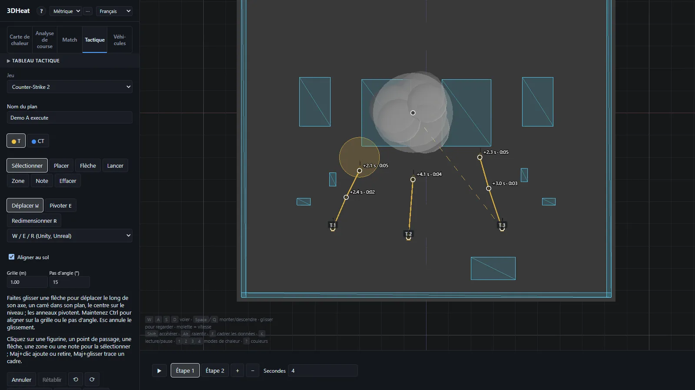

# Tableau tactique

L'onglet **Tactique** est une planche à dessin pour un plan d'équipe : vous placez de petites figurines sur une carte, dessinez des flèches pour indiquer où elles vont, et appuyez sur lecture pour voir la scène se jouer. Servez-vous-en pour préparer une manche ou une attaque avant de jouer. Il partage le canevas, la caméra et le [niveau](levels.md) avec les autres onglets, et rien d'autre ; un plan n'est pas une donnée et ne dessine aucune chaleur.

## Votre premier plan {#your-first-plan}

1. Ouvrez l'onglet **Tactique**. Choisissez le **Jeu** (par exemple Counter-Strike 2) et, pour Valorant, appuyez sur **Charger les cartes Valorant** puis choisissez une **Carte**. Ou chargez d'abord un [niveau](levels.md).
2. Choisissez un **Camp** (il règle la couleur) et appuyez sur **Vue de dessus**.
3. Choisissez **Lieu**, sélectionnez une figurine dans **Figurines** (utilisez **Rechercher des figurines** pour en trouver une) et cliquez sur la carte. Placez-en deux ou trois.
4. Choisissez **Flèche**, cliquez sur une figurine, cliquez le long du chemin qu'elle doit suivre, puis appuyez sur **Entrée** pour terminer la flèche.
5. Appuyez sur **+** sous la vue pour ajouter l'étape 2. Chaque figurine commence là où sa flèche s'est terminée. Dessinez d'autres flèches à partir de là.
6. Appuyez sur **▶** (ou `K`) pour jouer le plan depuis l'étape affichée jusqu'à la fin.
7. Nommez le plan dans **Nom du plan** et appuyez sur **Enregistrer**.

## Commencer un plan {#starting-a-plan}

| Commande | Ce qu'elle fait |
|---|---|
| **Jeu** | Choisit les camps et les figurines proposées par la palette : Counter-Strike 2 (T, CT ; joueurs et utilitaires), Valorant (Attaque, Défense ; joueurs et capacités génériques), Battlefield, Squad, Arma (infanterie, véhicules terrestres, aéronefs, bateaux), DCS / War Thunder / IL-2 (avions à réaction, avions à hélice, hélicoptères, défense aérienne, terrestre, navires, armes), et Autre. Un plan qui a déjà des figurines garde ses camps lorsque le jeu change. |
| **Nom du plan** | Le nom sous lequel le plan est enregistré. |
| **Carte**, **Charger les cartes Valorant** | Avec Valorant choisi : **Charger les cartes Valorant** récupère la liste des cartes sur [valorant-api.com](https://valorant-api.com) ; **Carte** place ensuite la mini-carte de la carte choisie comme niveau, cadrée depuis le dessus. L'image est récupérée au moment du choix et n'est jamais livrée avec le logiciel. L'avis de Riot est affiché tant qu'elle est à l'écran (voir plus bas). |
| **Camp** | Le camp auquel appartient la prochaine figurine, flèche ou zone ; elle prend la couleur du camp. |

Sans niveau, le tableau est le plan de sol plat. Chargez un niveau sous **Arrière-plan / niveau** pour planifier sur une vraie carte : une carte CS2 exportée avec l'outil CS2, un niveau de la bibliothèque, ou une image de carte.

## Outils {#tools}

| Outil | Clic | Remarques |
|---|---|---|
| **Sélectionner** | Une figurine, un point de passage, une flèche, une zone ou une note la sélectionne. | Maj+clic ajoute ou retire ; Maj+glisser trace un cadre autour de ce qu'il faut ajouter. La sélection reçoit un manipulateur de transformation (voir plus bas) ; `Suppr` ou `Retour arrière` la supprime. `M` déplace la figurine sélectionnée au clic suivant. |
| **Lieu** | Pose la figurine choisie. | Une figurine est choisie dans la palette **Figurines** (avec **Rechercher des figurines**). Sans rien de sélectionné, `R` fait tourner de 15° la prochaine figurine avant de la poser (`Maj+R` dans l'autre sens). |
| **Flèche** | Chaque clic ajoute un point ; Entrée, un double-clic ou un clic droit termine, Échap l'abandonne. | **Déplacer**, **Attaque** (tête plus large) ou **Surveiller** (une ligne fine à hauteur des yeux). Une flèche commencée sur une figurine est le trajet de cette figurine à cette étape : lue, la figurine le parcourt, et l'étape suivante commence là où il s'est terminé. |
| **Lancer** | Le lanceur, puis l'endroit où cela atterrit. | Un arc en pointillés relie l'un à l'autre, et l'utilitaire choisi (fumigène, éblouissante, cocktail molotov, ...) apparaît à l'endroit où il tombe et y reste à partir de cette étape. |
| **Zone** | Le centre, puis le bord. | Un disque de la couleur du camp. |
| **Note** | L'endroit où la note va ; demande son texte. | Affichée comme une épingle, et son texte au-dessus. |
| **Effacer** | Une figurine, une flèche, une zone ou une note. | La retire à partir de cette étape ; à sa première étape, la retire entièrement. |

**Annuler** et **Rétablir** (`Ctrl+Z` ; `Ctrl+Y` ou `Ctrl+Maj+Z`) parcourent chaque modification. Une ligne sous le plan indique combien de figurines, de flèches et d'étapes il contient. **Vue de dessus** regarde droit vers le bas (orthographique), **Vue 3D** revient à la perspective, **Image** cadre le plan, ou le niveau lorsque le plan est vide.

**Taille des figurines** met à l'échelle chaque figurine du tableau ; 1× correspond à la taille réelle, ce qui, vu de très haut, fait quelques pixels pour une personne.

## Déplacer, tourner et redimensionner {#moving-turning-and-scaling}

Tout ce qui se trouve sur le tableau se déplace comme dans un éditeur 3D : figurines, utilitaires, marqueurs, points de passage isolés et flèches entières, zones et notes. Ce qui est sélectionné reçoit un manipulateur en son milieu :

| Mode | Touches | Poignées |
|---|---|---|
| **Déplacer** | W (ou G) | Une flèche par axe (X rouge, Y vert et vers le haut, Z bleu) se déplace le long de lui ; un carré se déplace dans son plan ; le centre se déplace sur le niveau sous le pointeur. |
| **Pivoter** | E (ou R) | Un anneau par axe tourne autour de lui. Les anneaux d'une figurine seule sont son propre lacet, tangage et roulis ; un groupe tourne autour des axes du monde, autour de son milieu. |
| **Redimensionner** | R (ou S) | Écarte ou rapproche la sélection depuis son milieu le long d'un axe ou dans toutes les directions ; le rayon d'une zone grandit avec elle. |

**Clés** bascule entre W / E / R (Unity, Unreal) et G / R / S (Blender) ; les touches ne choisissent le mode que lorsque quelque chose est sélectionné, et font voler la caméra sinon. Ainsi `R` signifie **Redimensionner** avec les touches W / E / R et **Pivoter** avec les touches G / R / S lorsque quelque chose est sélectionné, et fait tourner la prochaine figurine à poser lorsque rien ne l'est. Toutes les touches du tableau sont listées dans la [référence clavier](keyboard-reference.md#tactics-board). Maintenez **Ctrl** pendant un glissement pour accrocher un déplacement à la **Grille** (mètres) ou une rotation au **Pas d'angle**. **Aligner au sol** (activé par défaut) pose les personnes, véhicules, marqueurs, points de passage et zones déplacés sur la surface du niveau ; les avions et hélicoptères conservent leur hauteur, et un glissement le long de la flèche Y n'accroche jamais. Glisser une poignée ne déplace jamais la caméra. **Échap** annule un glissement, et chaque modification est une étape d'Annuler.

Les points de passage apparaissent sous forme de points sur les flèches de l'étape affichée : cliquez-en un pour le sélectionner, glissez-le pour le déplacer, Suppr pour le retirer. La section **Sélectionnées** affiche la position de la sélection en mètres, le lacet, le tangage et le roulis d'une figurine en degrés, et le rayon d'une zone, chacun modifiable en saisie directe.

## Chronométrage {#timing}

Le trajet d'une figurine est chronométré : chaque segment prend sa longueur sur le niveau - échantillonnée sur la surface tous les deux mètres environ, de sorte qu'une colline ou un escalier entre deux points compte - à la vitesse du **mode** de déplacement de cette figurine dans ce jeu, plus une éventuelle **attente** à un point de passage. L'infanterie rampe, s'accroupit, marche (silencieuse), court ou sprinte ; les véhicules et bateaux avancent lentement, prudemment, normalement ou foncent ; les avions et hélicoptères volent lentement, en croisière, en vitesse de combat ou au maximum. Un mode que le jeu n'a pas (CS2 n'a pas de sprint) prend le mode le plus proche qu'il possède. La façon dont une pente ralentit dépend du jeu : dans CS2 et Valorant, seule la distance horizontale compte, comme dans les jeux ; les simulations militaires ralentissent l'infanterie en montée (fonction de marche de Tobler) et les véhicules selon la pente.

Les vitesses proviennent de tables par jeu, avec leurs sources (voir [Vitesses de déplacement](tactics-speeds.md)) : CS2 selon l'arme tenue, d'après les définitions d'armes du jeu ; Valorant selon l'arme ; Battlefield, Squad, Arma et les jeux aériens selon le type et la classe du véhicule. **Se déplace comme** choisit le profil d'une figurine (une arme, un type de véhicule) ; **Perso (m/s)** remplace n'importe quel mode pour cette figurine. Les modes portent les noms affichés par le tableau : *Ramper*, *S'accroupir*, *Marcher (silencieux)*, *Courir*, *Sprinter* ; *Prudent*, *Normal*, *Foncer* ; *Lent*, *Croisière*, *Combat*, *Maximum*.

Chaque point de passage affiche le temps depuis le précédent et le temps depuis le début du plan (« +3,9 s · 0:12 »). Le trajet de la figurine sélectionnée liste chaque segment avec son mode, sa longueur et son temps, l'attente et l'arrivée. **Arrivées** sous **Chronométrage** place chaque figurine dotée d'un trajet sur une seule ligne de temps, la première arrivée en haut. Avec **Jouer en temps réel** (activé par défaut), une étape dure jusqu'à l'arrivée du trajet le plus lent et chaque figurine avance à sa propre vitesse ; **Secondes** est alors la longueur minimale de l'étape. **Unités du niveau par mètre** indique en quoi le niveau est exprimé : 39,37 pour les cartes CS2 (unités du jeu), 1 pour les cartes en mètres.

## Comparer avec les données de match {#compare-with-match-data}

**Charger des matchs…** lit les tables de matchs CS2 de la carte (les fichiers Parquet de l'outil CS2, autant qu'on veut ; seules les colonnes nécessaires, en arrière-plan) ; **Utiliser les données chargées** prend les données chargées dans la visionneuse. Ensuite :

- **Arrivée la plus précoce sur la carte** colore la carte selon le temps depuis le début de la manche auquel un joueur a atteint chaque endroit pour la première fois - le bouton **Le plus rapide** montre le plus rapide sur toutes les manches, **Typique (médiane)** la manche médiane - du vert tôt au rouge tard, pour un camp ou pour les deux. Cela montre ce qui est possible et quand.
- Le trajet sélectionné est comparé à ce que les joueurs ont réalisé depuis son début (ou depuis le début de la manche) jusqu'à sa fin, chaque extrémité étant un disque du rayon défini : « Le plus rapide observé 14,2 s, p10 15,0 s, médiane 18,3 s sur 41 essais ; votre plan 15,1 s ».
- Les vitesses réellement atteintes par les joueurs - en course, en marche, accroupis, d'après les colonnes de marche et d'accroupissement des tables - en m/s.

## Étapes {#steps}

La barre sous la vue contient les étapes. Un plan commence avec une étape ; **+** en ajoute une, et chaque figurine y commence là où son trajet de la dernière étape s'est terminé ; **−** supprime celle qui est affichée. **Secondes** indique combien de temps dure l'étape affichée lorsqu'elle est jouée. **▶** (K) joue depuis l'étape affichée jusqu'à la fin : les figurines ayant un trajet le parcourent, celles déplacées vers un nouvel endroit à l'étape suivante s'y rendent en glissant, les autres restent immobiles. Pendant qu'une étape est affichée, la place de chaque figurine à l'étape suivante est dessinée en fantôme discret, et les flèches de la dernière étape apparaissent faiblement sous celles de celle-ci.

## Enregistrer {#saving}

La section **Fichier** contient **Enregistrer**, **Ouvrir** et **Effacer**. **Enregistrer** écrit le plan sous `<nom>.h3dplan.json` (JSON simple : camps, étapes, figurines avec une place par étape, flèches, zones, notes) ; **Ouvrir** le relit. Un fichier d'une autre version, ou qui n'est pas un plan, est refusé avec la raison. **Effacer** vide le plan ; Annuler le restaure.

## Figurines {#figures}

Chaque figurine est construite par la visionneuse elle-même : des formes simples aux dimensions publiées d'un type, avec les détails qui la distinguent de ses voisines - les roues de roulement et la tourelle d'un char, les canons, missiles et radars d'un véhicule de défense aérienne, le plan d'aile, la dérive et les moteurs d'un avion, les rotors et ailes courtes d'un hélicoptère. Rien n'est repris d'un jeu. Un modèle inventé par un jeu est représenté par la figurine générique de sa classe. Voir [Figurines](figures.md#which-figure-a-unit-gets) pour savoir comment les données trouvent leur figurine.

## Avis de Riot {#riots-notice}

Les cartes de Valorant sont affichées selon la politique « Legal Jibber Jabber » de Riot Games, qui autorise les projets communautaires gratuits à les utiliser et demande cet avis partout où elles apparaissent : *3DHeat a été créé selon la politique « Legal Jibber Jabber » de Riot Games, en utilisant des éléments appartenant à Riot Games. Riot Games n'approuve ni ne parraine ce projet.* Les capacités du tableau sont des formes génériques, et non les illustrations de Riot.
