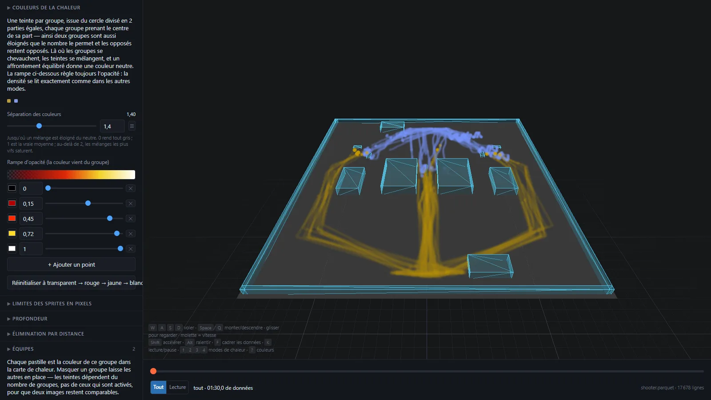

# Chaleur par équipe

La chaleur par équipe montre où se trouvait chaque équipe, chaque équipe dans sa propre couleur. Là où les équipes se chevauchent, les couleurs se mêlent.

**Chaleur par équipe** (touche 3) est le champ de densité de [Chaleur](heat.md), chaque [groupe](glossary.md) recevant sa propre teinte. Là où les groupes se chevauchent, leurs teintes se mêlent ; un affrontement équilibré donne une couleur neutre. L'opacité transporte toujours la densité exactement comme dans les autres modes : l'image répond donc à *combien* et à *à qui* en même temps. Il faut une colonne de groupe.

Ce n'est pas la [superposition des figurines](box-replay.md) : celle-ci dessine une figurine par personne, alors que ceci est un champ de chaleur coloré par la même colonne.

## Comment l'utiliser {#how-to-use-it}

1. Appuyez sur `3` (ou choisissez **Chaleur par équipe** dans la barre des modes).
2. Ouvrez **Couleurs de la chaleur**. Les pastilles montrent la couleur de chaque groupe ; survolez une pastille pour voir le nom de l'équipe.
3. Si tout paraît gris, augmentez **Séparation des couleurs**.
4. Décochez un groupe dans la [Liste des équipes](teams-list.md) pour le retirer ; les autres couleurs restent où elles étaient.

## Commandes {#controls}

Dans la section **Couleurs de la chaleur** :

| Commande | Défaut | Sens |
|---|---|---|
| Pastilles | | La couleur de chaque groupe, pour les 12 premiers groupes, puis *+N de plus*. Survolez pour voir le nom du groupe et sa couleur. |
| **Séparation des couleurs** | 1,4 | À quelle distance un mélange est écarté du neutre, de 0 à 4. À 0, tout est gris ; à 1, c'est la vraie moyenne ; au-delà d'environ 2, les mélanges les plus clairs sortent de la plage affichable et sont ramenés canal par canal, ce qui décale leur teinte. |
| **Rampe d’opacité (la couleur vient du groupe)** | la rampe de chaleur par défaut | Seul l'**alpha** de la rampe est utilisé ici : transparent là où il n'y a rien, opaque au sommet. Ses couleurs sont ignorées. |

Un groupe dont l'étiquette signifie « pas de groupe » (`0`, vide, `none`, `unknown`, `null` ou `-1`) est dessiné en gris.

Toutes les autres commandes de chaleur (forme, saturation, réponse, chaleur minimale, profondeur, élimination) fonctionnent comme dans [Chaleur](heat.md).

La [Liste des équipes](teams-list.md) montre la couleur de chaleur par équipe de chaque groupe comme sa pastille dans ce mode. Masquer un groupe laisse la couleur de tous les autres groupes là où elle était : les teintes viennent du nombre total de groupes, et non de ce qui est activé. Deux images restent donc comparables.

## Pour les développeurs {#for-developers}

### La palette {#the-palette}

D'après [`colors.ts`](https://github.com/Holdi601/3DHeat/blob/main/src/render/colors.ts) :

- Les couleurs vivent dans le plan de couleur **Oklab**, à une luminosité (0,7) et une chroma (0,115) fixes. Ainsi chaque groupe est aussi clair, et un groupe rouge ne paraît pas plus chaud qu'un groupe bleu.
- Avec *n* groupes, le cercle des teintes est divisé en *n* parts égales, et le groupe *i* prend le **centre** de sa part, `(i + 0,5) / n` d'un tour. Deux groupes quelconques sont aussi éloignés que leur nombre le permet, et les opposés restent opposés quel que soit le nombre.
- Au plus **16** teintes distinctes sont utilisées. Au-delà, les identifiants sont placés par divisions successives (identifiants à bits inversés : 0, ½, ¼, ¾, ⅛, …) pour que des identifiants voisins ne partagent pas une teinte. Les groupes au-delà de 16 partagent forcément une teinte.
- Un groupe dont l'étiquette signifie « pas de groupe » (`0`, vide, `none`, `unknown`, `null` ou `-1`, sans tenir compte de la casse) est dessiné en **gris neutre** au lieu de prendre une part du cercle. Seule la première de ces étiquettes dans la liste des groupes est traitée ainsi.

La séparation par défaut est 1,4 et non 1, car à 1, un mélange de cinq teintes également réparties *est* gris : c'est exact, mais illisible. Un peu au-dessus de 1 garde les égalités honnêtes tout en rendant visible une répartition de 60/40.

### Comment cela fonctionne {#how-it-works}

La cible de chaleur a quatre canaux dans ce mode. Chaque sprite ajoute sa densité *v* au premier canal, et *v* × les coordonnées Oklab *a* et *b* du groupe aux deuxième et troisième canaux. Au moment du composite, le mélange du pixel est la moyenne pondérée par la densité : *a* = G / R, *b* = B / R, mis à l'échelle par la séparation des couleurs et converti en sRGB à la luminosité de la palette. Diviser par la densité accumulée garde la teinte indépendante de la quantité de données. C'est pourquoi toutes les commandes de densité n'agissent plus que sur l'opacité.

La cible à quatre canaux coûte quatre fois plus de mémoire GPU que la cible de chaleur à un seul canal, à la même résolution.
