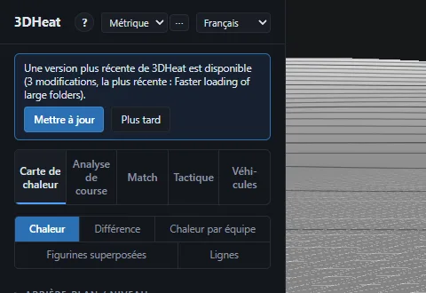

# Mises à jour

La visionneuse vous indique quand une version plus récente existe, et ne se met à jour que si vous dites oui. Rien n'est modifié sur votre ordinateur sans votre réponse.

## Mettre à jour la visionneuse {#update-the-viewer}

1. **Dans la page.** Lorsqu'une version plus récente existe, un encadré apparaît sous le nom, en haut de la barre latérale : « Une version plus récente de 3DHeat est disponible ». Cliquez sur **Mettre à jour**. La page se recharge d'elle-même une fois terminé. **Plus tard** masque l'encadré jusqu'au prochain rechargement de la page.
2. **Si elle demande de lancer restart.bat**, fermez la fenêtre du serveur (la fenêtre noire ouverte par `start.bat`) puis double-cliquez sur `restart.bat`.
3. **Au lancement de la visionneuse.** `start.bat` vérifie aussi. Si une version plus récente existe, il demande **Mettre à jour maintenant ? [O/N]**. Appuyez sur `O` pour mettre à jour. Appuyez sur `N`, ou attendez 60 secondes sans répondre, pour lancer la version que vous avez.



Une copie comportant vos propres modifications n'est jamais mise à jour à votre place ; l'encadré indique seulement qu'une mise à jour attend, et invite à valider ou mettre de côté vos modifications, puis à lancer `git pull`. Une copie qui n'a pas été installée avec git (un fichier zip, par exemple) n'affiche rien.

Fonctionnement de la vérification, étape par étape :

```
page ---(après 4 s, puis toutes les 6 h)---> serveur de développement ---> git fetch
   en retard ?  non  -> rien n'est affiché
                oui  -> vos modifications ou vos validations ?  oui -> vous le signaler seulement
                                                              non -> [Mettre à jour] -> git pull
                                                                     -> rechargement, ou « lancez restart.bat »
```

## Les règles de sécurité {#the-safety-rules}

- **Avance rapide uniquement** (`git pull --ff-only`) : une mise à jour ne fusionne, ne rebase ni ne réécrit jamais rien.
- **Pas de modifications locales** : une copie avec des modifications non validées dans des fichiers suivis (`git status --porcelain --untracked-files=no` non vide) n'est jamais mise à jour automatiquement - le travail de quelqu'un n'est pas à écraser par une mise à jour. Elle est seulement informée qu'une mise à jour attend. Les fichiers non suivis (données, exports) ne comptent pas comme modifications.
- **Pas de validations locales** : une copie avec des validations que l'amont n'a pas (« divergente ») n'est pas mise à jour - une avance rapide ne peut pas la faire progresser, et la fusion relève d'un `git pull` manuel. La page et `start.bat` le disent dans les mêmes termes, et `start.bat` lance la version présente.
- **Seulement depuis la page elle-même** : la requête de mise à jour du serveur de développement doit porter un en-tête personnalisé et, lorsque le navigateur envoie un `Origin`, venir de l'hôte du serveur (ci-dessous).
- Seul un dépôt git avec une branche amont est jamais mis à jour ; tout le reste (une copie sans `.git`, pas de git installé, un build statique) est laissé tel quel et ne dit rien.

## Ce que fait start.bat {#what-startbat-does}

`start.bat` (double-cliquez dessus ; la fenêtre est le serveur) fait, dans l'ordre :

1. Trouve Node.js - dans le `PATH`, sinon dans `%ProgramFiles%\nodejs`, `%ProgramFiles(x86)%\nodejs` ou `%LOCALAPPDATA%\Programs\nodejs` - et propose de l'installer avec `winget install -e --id OpenJS.NodeJS.LTS` s'il manque (demandé, O/N ; ensuite la fenêtre doit être rouverte pour que Windows prenne en compte le nouveau `PATH`).
2. **Mises à jour**, lorsque git est installé et que le dossier contient `.git` :
   - `git fetch --quiet` (sans réseau ou sans amont : ignoré silencieusement) ;
   - compte `git rev-list --count HEAD..@{u}` ; rien en retard : rien n'est dit ;
   - modifications locales : « Une version plus récente de 3DHeat est disponible (N modifications), mais cette copie a des modifications locales, elle n'est donc pas mise à jour. Validez-les ou mettez-les de côté, puis lancez git pull. » - et la version présente est lancée ;
   - validations propres (`git rev-list --count @{u}..HEAD` différent de 0) : « Une version plus récente de 3DHeat est disponible (N modifications), mais cette copie a des validations propres que la version la plus récente n'a pas, elle n'est donc pas mise à jour. Mettez-la à jour avec git pull. » - et la version présente est lancée ;
   - sinon « Une version plus récente de 3DHeat est disponible (N modifications). » et la question **Mettre à jour maintenant ? [O/N]**. `N`, ou aucune réponse pendant 60 secondes, affiche « Pas mise à jour ; lancement de la version que vous avez. » et lance la version présente. Sur `O` : « Mise à jour... », signale si `package.json` ou `package-lock.json` changent, lance `git pull --ff-only` (si cela échoue encore - le réseau, par exemple : « La mise à jour n'a pas abouti ; lancement de la version que vous avez. »), puis `git submodule update --init` (les outils épinglés, voir [Maintenir la documentation](maintaining.md#the-tools-under-exporters)), puis `npm install` lorsque les fichiers du paquet ont changé et que `node_modules` existe, et « Mis à jour. ».
3. Refuse de démarrer un second serveur : si quelque chose écoute déjà sur le port **5273**, il le signale et renvoie vers `restart.bat` / `stop.bat`.
4. Au premier lancement (pas de `node_modules`), demande avant de télécharger les dépendances (environ 300 Mo dans `node_modules\`, rien à l'échelle du système).
5. Lance le serveur de développement sur `127.0.0.1:5273` (`--strictPort`) et ouvre le navigateur lorsqu'il est prêt.

`restart.bat` arrête le serveur (par port) puis relance `start.bat`, qui pose donc la même question. `stop.bat` se contente d'arrêter le serveur.

## Pour les développeurs {#for-developers}

### Pendant l'exécution : la route de mise à jour {#while-it-runs-the-update-route}

Le serveur de développement (le plugin Vite `heat3d-self-update` dans `vite.config.ts`) répond sur
`/__heat3d/update`. Cette route n'existe que sur le serveur de développement : ni dans un build
statique, ni dans `vite preview`.

**`GET /__heat3d/update`** indique si la copie est en retard :

```json
{ "checkout": true, "upstream": "origin/main", "behind": 3, "ahead": 0, "dirty": false, "latest": "the newest commit's subject" }
```

- `checkout: false` lorsque le dossier n'est pas une copie git ;
- elle lance `git fetch --quiet` **au plus toutes les 30 minutes** (les demandes intermédiaires
  répondent à partir de la dernière récupération) ;
- `behind` / `ahead` viennent de `git rev-list --count HEAD..@{u}` / `@{u}..HEAD`, `dirty` de
  `git status --porcelain --untracked-files=no`, et `latest` est le sujet de la validation la
  plus récente de l'amont ;
- sans branche amont, `upstream: null` et `behind: 0`.

**`POST /__heat3d/update/apply`** met la copie à jour :

1. Refusée avec `403 { ok: false, reason: "forbidden" }`, sauf si la requête porte l'en-tête
   `X-Heat3d-Update: 1` et, lorsqu'elle transporte un `Origin`, que l'hôte de cette origine est
   le `Host` de la requête. Un formulaire d'un autre site ne peut pas envoyer d'en-tête
   personnalisé sans une requête de pré-vérification CORS, que ce serveur n'accorde jamais.
2. Rien à faire (pas une copie git, pas d'amont, pas en retard) : `{ ok: true, updated: false }`.
3. Modifications locales : `{ ok: false, reason: "dirty" }` ; validations locales :
   `{ ok: false, reason: "diverged" }`.
4. Sinon : relève les fichiers qui changent (`git diff --name-only HEAD @{u}`), lance
   `git pull --ff-only` (délai de 2 min), `git submodule update --init` (échec ignoré),
   `npm install` lorsque `package.json` ou `package-lock.json` a changé (délai de 15 min), puis
   répond `{ ok: true, updated: true, restart }`. `restart` indique pourquoi le serveur en cours
   d'exécution ne peut pas prendre la mise à jour en compte : `"dependencies"` lorsqu'elles ont
   été réinstallées, `"config"` lorsque seul un fichier `vite.config` a changé, `false` lorsqu'un
   redémarrage n'est pas nécessaire.
5. Une commande git ou npm en échec répond `{ ok: false, reason: "<l'erreur, jusqu'à 300 caractères>" }`.

Les réponses sont au format JSON avec `Cache-Control: no-store`. Le serveur n'écoute que sur
`127.0.0.1`, donc la route n'est pas accessible depuis le réseau.

### L'avis dans la page {#the-notice-in-the-page}

`UpdateBanner`, sous le nom en haut de la barre latérale :

- Il interroge la route **4 secondes** après le chargement de la page (pas dans les toutes
  premières secondes : la page doit charger un jeu de données et démarrer le GPU), puis de nouveau
  **toutes les 6 heures** tant que la page reste ouverte.
- Il n'affiche **rien** lorsque la route n'existe pas (build statique), que le dossier n'est pas
  une copie git, ou que rien n'est plus récent : un avis à chaque démarrage finirait par être ignoré.
- En retard, sans modifications locales : « Une version plus récente de 3DHeat est disponible
  (N modifications, la plus récente : <sujet>). », avec **Mettre à jour** et **Plus tard**
  (*Plus tard* masque l'avis jusqu'au rechargement de la page).
- En retard, avec modifications locales : la même phrase, suivie de « Cette copie contient des
  modifications locales, elle n'est donc pas mise à jour automatiquement ; faites un commit ou un
  stash, puis lancez git pull. » - sans bouton.
- **Mettre à jour** envoie une requête à `/apply` (« Mise à jour… »). Ensuite :
  - « Mis à jour. La page se recharge. » - et elle se recharge 1,5 s plus tard (le serveur sert
    déjà les nouveaux fichiers) ;
  - lorsque les dépendances ont été réinstallées : « Mis à jour. Ses dépendances ont changé :
    fermez la fenêtre du serveur et lancez **restart.bat** pour terminer. » ;
  - lorsque seuls les réglages du serveur ont changé : « Mis à jour. Les réglages du serveur ont
    changé : fermez la fenêtre du serveur et lancez **restart.bat** pour terminer. » ;
  - rien à récupérer finalement (`updated: false` : la copie a été mise à jour entre-temps, par
    `start.bat` par exemple) : « Rien à mettre à jour : cette copie est déjà la version la plus
    récente. » - et pas de rechargement ;
  - refusée : la phrase sur les modifications locales, ou « Cette copie a ses propres commits,
    absents de la version la plus récente ; mettez-la à jour avec git pull. », ou « La mise à jour
    n'a pas abouti : <raison> ».
