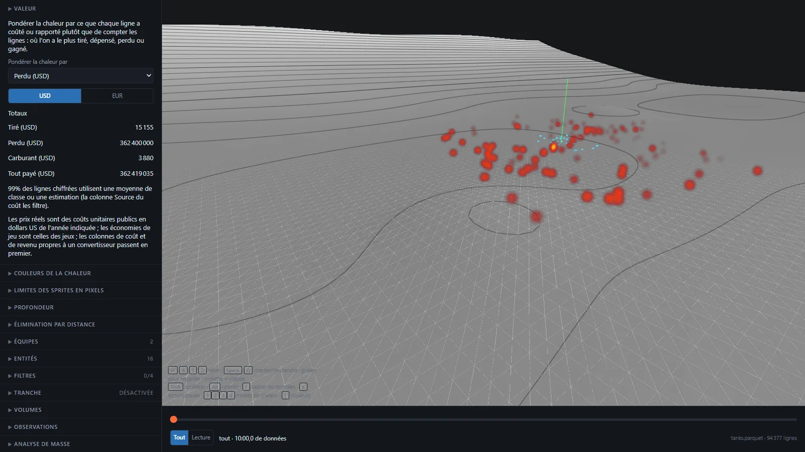

# Pondération par valeur

Chaque tir, chaque munition, chaque véhicule perdu et chaque litre de carburant a un prix. La visionneuse calcule ce que chaque ligne a coûté ou rapporté, et peut pondérer la chaleur par ce montant. La carte montre ainsi **où l'argent est parti**, et non où se trouvent les lignes.

## Comment l'utiliser {#how-to-use-it}

1. Chargez des données avec des événements (tirs, éliminations, morts) et les noms des véhicules ou des armes.
2. Ouvrez **Valeur** dans la barre latérale de la Chaleur.
3. Choisissez **Pondérer la chaleur par**, par exemple *Perdu (USD)*. La chaleur additionne maintenant le prix de chaque ligne au lieu de 1.
4. Lisez **Totaux** : la somme de chaque colonne de valeur pour ce qui est affiché (les filtres et la fenêtre de temps s'appliquent).
5. Quand les prix sont de l'argent réel, un interrupteur **USD / EUR** apparaît.

Choisissez la première entrée vide du menu pour compter de nouveau les lignes.

## Ce qui peut être pondéré {#what-can-be-weighed}

Les colonnes de valeur sont ajoutées au chargement, une par type et par monnaie :

| Type | Lignes concernées | Comment il est évalué |
|---|---|---|
| **Tiré** | tirs et lancements | l'arme, sinon une moyenne pour le type de munition |
| **Dépensé** | achats, apparitions | les colonnes d'argent du jeu (par exemple le menu d'achat d'un jeu de tir) |
| **Perdu** | morts, destructions | le véhicule du joueur, sinon la moyenne de sa classe |
| **Détruit** | éliminations | le véhicule visé |
| **Dégâts infligés** | touches | une part de la valeur de la cible |
| **Carburant** | positions | le carburant consommé, à partir d'une colonne de carburant ou estimé d'après la classe et le temps |
| **Tout payé** | | tiré + dépensé + perdu + carburant |
| **Gagné** | récompenses | les colonnes de récompense du jeu lui-même (`earn_…`) |
| **Net** | | gagné moins payé ; dessiné en chaleur signée (rampe positive là où l'on a plus gagné, négative là où l'on a plus payé) |

Les noms des colonnes sont `cost_<type>_<monnaie>`, `earn_<monnaie>` et `net_<monnaie>`. Un convertisseur qui connaît la monnaie propre du jeu (par exemple un convertisseur de replay qui écrit en crédits du jeu) l'emporte sur les tables de prix intégrées.

## Les tables de prix {#the-price-tables}

| Table | Monnaie |
|---|---|
| Militaire réel : missiles, bombes, munitions, contre-mesures, avions, hélicoptères, véhicules terrestres, navires, carburant | USD (EUR = USD × 0,92, la valeur fixe `EUR_PER_USD` de [`cost.ts`](https://github.com/Holdi601/3DHeat/blob/main/src/data/cost.ts) ; ce n'est pas un taux en direct) |
| Menus d'achat des jeux de tir et récompenses d'élimination | les crédits du jeu |
| Jeux de chars et jeux navals | les crédits du jeu |
| Jeux de stratégie (plusieurs ressources) | une colonne par ressource, plus une colonne combinée |
| Jeux de guerre | points |

Le jeu est reconnu d'après les noms présents dans les données. Les prix réels viennent de sources publiques (documents budgétaires, encyclopédies) ou sont marqués comme estimations ; ils ne sont pas corrigés de l'inflation. La liste générée des tables est sur [Tables de valeurs](ref-value-tables.md).

## Estimations {#estimates}

La colonne de catégorie supplémentaire **Source du coût** indique comment chaque ligne a été évaluée : `table`, `class average`, `estimate` ou `none`. La section Valeur montre quelle part des lignes évaluées sont des moyennes ou des estimations. Pour ne garder que les lignes évaluées exactement, décochez *estimate* et *class average* sous **Source du coût** dans [Filtres](filters.md).

## Où ailleurs la valeur apparaît {#where-else-value-shows}

- [Observations](insights.md) : les constats *Terrain coûteux* et *Terrain rentable*.
- [Détail](breakdown.md) : argent gagné, perdu et net par équipe, joueur ou arme.
- [Volumes et comparaison](volumes.md) : colonnes de valeur dans les statistiques et la comparaison.
