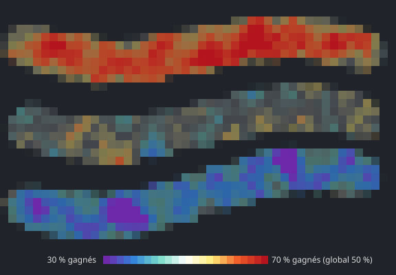

# Taux de victoire : à quelle fréquence un endroit, un trajet ou une action gagne

Où un joueur se tient, quel chemin il prend, où il lance ses grenades – et à quelle fréquence son camp gagne ensuite la manche. La **carte des taux de victoire** colore chaque endroit selon la part des lignes qui s'y trouvent et qui appartiennent à des manches gagnées par le camp de la ligne. Elle la compare à la part sur tout ce qui est affiché : chaud là où elle est plus élevée, froid là où elle est plus basse, rien là où elle est égale.

*L'image montre des données inventées : trois trajets sur un niveau vide, avec 68 %, 50 % et 33 % de leurs lignes dans des manches gagnées.*

Il faut des données qui disent qui a gagné : les [colonnes de résultat](data-formats.md#outcome-columns) (`won`, `matchWon`, `roundEndReason`). Les convertisseurs de CS2 et de War Thunder les écrivent ; n'importe quel fichier peut les avoir.

## Essayer {#try-it}

1. Chargez des matchs avec une colonne de résultat et appuyez sur `2` (**Différence**).
2. Dans **Répartition différentielle**, appuyez sur **Taux de victoire par manche** (ou **Taux de victoire par match**). Cela place les manches gagnées sur **+** et les perdues sur **−**, et passe le panneau sur **Part du +**.
3. Lisez les couleurs. Le panneau indique la part globale : *Au total, 52,0 % des 1 200 000 lignes sont en +.*
4. Affinez avec les [filtres](filters.md) : un camp (T ou CT), un type d'événement (*Position* pour savoir où les gens se tenaient, *Tir* ou *Lancement* pour savoir d'où ils ont tiré ou lancé), un achat, une carte.

Un endroit chaud avec des lignes *Position* est un endroit dont les occupants ont souvent gagné la manche. Avec des lignes *Élimination*, c'est un endroit où les éliminations réalisées ont mené à des manches gagnées.

## Les réglages {#the-settings}

| Réglage | Ce qu'il fait | Par défaut |
|---|---|---|
| **Différence** / **Part du +** | la différence elle-même, ou la part du camp + parmi les lignes des deux camps | Différence |
| **Couleur pleine à** | à quelle distance au-dessus ou en dessous de la part globale un endroit apparaît en couleur pleine, en points | ± 20 points |
| **Lignes minimales pour colorer un endroit** | un endroit avec moins de lignes n'est pas coloré ; il apparaît progressivement à partir de la moitié | 12 |
| **Attraction vers la part globale (lignes)** | chaque endroit part de ce nombre de lignes à la part globale, pour qu'un endroit avec 3 lignes, toutes gagnées, n'apparaisse pas à 100 % | 12 |

Les trois agissent sur l'image finie : les faire glisser ne relance jamais l'accumulation.

La part vaut pour n'importe quelle répartition, pas seulement les victoires : *Part du +* avec une répartition par camp montre où les T formaient la plus grande partie de la présence, et avec une répartition par les fichiers de deux cartes, où les lignes d'un fichier l'emportent sur celles de l'autre.

## Des lignes, pas des manches {#rows-not-rounds}

La carte compte des lignes. Un joueur qui reste vingt secondes au même endroit ajoute une ligne à chaque échantillon, toutes d'une seule manche. La preuve à un endroit, ce sont donc les lignes proches, pas les manches. C'est pourquoi le minimum et l'attraction sont en lignes, et pourquoi ils valent plus qu'une manche.

Pour les manches elles-mêmes :

- **[Détail](breakdown.md)** sur un point, la vue ou un volume : *Victoires %* compte la manche de chaque joueur une fois, attirée de la même façon vers le taux global de l'endroit (4 manches).
- Statistiques des **[Volumes](volumes.md)** : *Taux de victoire* – les manches avec un joueur dans le volume, chacune une fois, attirées vers le taux sur tout ce qui est affiché, avec les nombres.

## Filtres de résultat {#outcome-filters}

Le panneau [Filtres](filters.md) liste les colonnes de résultat juste après celles de la visionneuse : **Résultat de la manche** et **Résultat du match** (*Tous*, *Gagné*, *Perdu*) et **Fin de la manche** (Élimination, Bombe explosée, Bombe désamorcée, Temps écoulé, Abandon, Égalité, Objectif, Zones tenues, Tickets perdus, Tous les véhicules perdus), dans la langue de la visionneuse.

## Pour les développeurs {#for-developers}

La passe de chaleur écrit trois sommes dans la cible à quatre canaux qu'utilise la chaleur par équipe : la chaleur `R = Σ|v|`, la chaleur du camp + `P`, et `S = Σ v²/w`, où `w` est le poids de la passe (poids d'échantillonnage fois gain de trame). La composition lit la part `P/R` (une moyenne pondérée par le noyau) et les lignes sur lesquelles elle repose, `n = R²/S` (la taille d'échantillon effective de Kish). Elle attire la part vers la part globale, `p = (n·P/R + m·r0)/(n + m)`, et colore `p - r0` sur l'étendue, avec les dégradés de la différence.

`n` élimine tout facteur commun aux lignes d'un pixel – le gain de trame, le poids d'échantillonnage, le poids de surface d'un sprite limité. L'image est donc la même à tout zoom et à toute densité d'échantillonnage, et les trames d'une ligne sur k se fondent dans l'ensemble sans que les couleurs sautent. La part globale vient des comptes par camp du CPU, au dixième de pour cent près ; rien n'est relu depuis le GPU. Le calcul et ses vérifications : [`render/rateMap.ts`](https://github.com/Holdi601/3DHeat/blob/main/src/render/rateMap.ts) et son test.

Cela coûte autant que la chaleur par équipe : la cible à quatre canaux quadruple la bande passante de mélange de la passe de chaleur, seulement tant que *Part du +* est actif.
