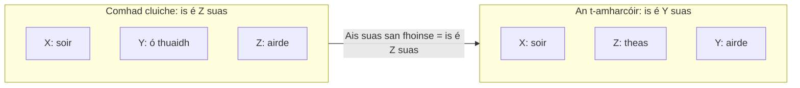

# Aiseanna, aonaid agus am

Ní aontaíonn cluichí agus léarscáileanna ar cén treo atá suas, cé chomh fada is atá aonad, nó conas a scríobhtar am. Taispeánann an leathanach seo na trí shocrú a dhéanann do shonraí a sheasamh, a scálú agus a sheinm sa treo ceart.

Má sheasann do léarscáil mar bhalla in ionad a bheith ina cadhnaí, athraigh **Ais suas san fhoinse**.

Leis an **Ais suas san fhoinse** mícheart seasann an léarscáil mar bhalla; leis an gceart luíonn sí mar urlár.

## An domhan a tharraingíonn an t-amharcóir ann {#the-world-the-viewer-draws-in}

Is **Y-suas** domhan an amharcóra: is iad X agus Z an plána talún, is é Y an airde. Is **Z-suas** an chuid is mó d'innill chluichí: dóibhsean is iad X agus Y an talamh agus is é Z an airde. Tá roinnt innill frithchaite freisin (lámh-chlé). Insíonn an mapáil conas aiseanna an chomhaid a iompú ina n-aiseanna don amharcóir. (Go teicniúil tá an t-amharcóir lámh-dheas, coinbhinsiún three.js.)

### Ais suas {#up-axis}

**Ais suas san fhoinse** sa [Mapáil colún](column-mapping.md):

| Socrú | Comhad (x, y, z) bíonn domhan (X, Y, Z) |
|---|---|
| *Is é Z suas (most game engines)* - an réamhshocrú | (x, **z**, **y**): bíonn Z an chomhaid ina airde agus bíonn Y an chomhaid ina Z an domhain |
| *Is é Y suas (coinbhinsiún grafaicí)* | (x, y, z) gan athrú |

I sonraí Z-suas athlipéadaítear na trí eagar in ionad iad a chóipeáil ([`remapAxesInPlace`](https://github.com/Holdi601/3DHeat/blob/main/src/data/ingest.ts)), rud a shábhálann na céadta megabheart ar luchtuithe móra. Déantar an tuairim ón tsampla: is é an colún Y nó Z a bhfuil an scaipeadh is lú aige an colún suas.

### Casadh {#flips}

**Cas X**, **Cas Y**, **Cas Z** neagraíonn ais *an chomhaid* leis an ainm sin, roimh an athlipéadú - mar sin nuair a bhíonn Z-suas, neagraíonn *Cas Y* an rud a thagann mar Z an domhain. Athraíonn casadh na sonraí luchtaithe: is iad na comhordanáidí casta a thaispeántar ag an [rialóir](measure.md), ag an stiall agus ag suíomh an cheamara.

Chun domhan frithchaite a tharraingt ceart **gan** na sonraí a athrú, úsáid **Ceamara & radharc → Inbhéartaigh ais an domhain** ina ionad ([Ceamara](camera.md#invert-world-axis)). Is é sin an rogha is fearr do chluichí a bhfuil a ndomhan lámh-chlé, mar fanann gach comhordanáid a thaispeánann na huirlisí mar chomhordanáid an chluiche féin.

### Scála aonaid {#unit-scale}

Iolraíonn **Scála aonaid** gach suíomh. Socraíonn *1 (m)* an 1, socraíonn *0.01 (cm→m)* an 0.01 (is ceintiméadair iad aonaid Unreal Engine, mar sin úsáid 0.01; is orlaí iad aonaid Source-engine, mar sin úsáid 0.0254; ní méadair iad ceachtar acu), glacann an bosca le haon luach. Athraítear 0 scríofa nó luach nach uimhir é go 1.

Lipéadaíonn an t-amharcóir fad i méadair (ga an spriorad, fad scagtha, an rialóir, luas eitilte), agus ní fíor sin ach nuair is méadar é an t-aonad domhain scálaithe. Ní bhriseann aon rud nuair nach ea; ní léifidh na lipéid ach "m" ar aon aonad atá ann.

## Am {#time}

### Aonaid ama {#time-units}

Riail ordúil: is Stampa Unix iad luachanna cosúil le 17000000000 (deich ndigit nó níos mó); is soicindí ó thús iad luachanna cosúil le 0, 0.25, 0.5.

| Aonad ama (lipéad roghchláir) | Léitear mar | Clog an bhalla taispeánta |
|---|---|---|
| *Soicindí (coibhneasta)* | luach × 1 s | níl |
| *Milleasoicindí (coibhneasta)* | luach × 0.001 s | níl |
| *Micreashoicindí (coibhneasta)* | luach × 10^-6 s | níl |
| *Nanashoicindí (coibhneasta)* | luach × 10^-9 s | níl |
| *Stampa Unix (s)* | soicindí ó 1970-01-01 UTC | tá |
| *Stampa Unix (ms)* | milleasoicindí ó 1970-01-01 UTC | tá |
| *Teaghrán dáta ISO-8601* | téacs cosúil le `2026-03-14T18:02:11.250Z`, parsáilte leis an `Date.parse` den bhrabhsálaí | tá |

Le haonad iomlán (na trí cinn dheireanacha) coinníonn an tacar sonraí nóiméad clog an bhalla de na chéad sraith, agus taispeánann an amlíne am UTC reatha an lae (`HH:MM:SSZ`) in aice leis an gceannródaí.

**Colúin Parquet `TIMESTAMP` agus `DATE`** dí-ionchódaítear iad go nóiméid fhíora, mar sin neamhaird á déanamh den socrú aonaid, agus deir an painéal sin. Is lá iomlán é colún `DATE`: roinneann gach sraith de lá nóiméad amháin, agus léimeann an seinm lá ag an am, rud a ndeir an painéal faoi.

**Oibríonn teaghráin ISO-8601 i CSV agus i Parquet araon.** Parsáiltear colún ama téacs leis an aonad ISO uair amháin in aghaidh gach teaghrán ar leith; mura bparsáiltear aon cheann, teipeann an luchtú le *No parseable ISO-8601 timestamps in the mapped time column.* - agus cheana féin diúltaíonn an mhapáil tosú nuair nach bparsáiltear aon cheann de na luachanna samplaithe. Léitear colún `TIMESTAMP` Parquet mar stampa ama cibé aonad a bheidh socraithe, agus léitear colún uimhriúil Parquet leis an aonad ISO mar mhílliseacht Unix. Diúltaítear colún ama téacs le haonad uimhriúil sula luchtaítear é: léifí gach luach mar NaN.

### Conas a stórálann an t-am {#how-time-is-stored}

Le linn comhaid a chumasc, is soicindí 64-giotach iad na hamanna, ionas go gcoinníonn epoch iomlán a mhion-mhion fo-shoicind. Nuair a bhíonn na comhaid go léir istigh, éiríonn an t-am is luaithe den roghnú iomlán 0 agus stórálann gach sraith soicindí 32-giotacha uaidh. Tá 24 giota mantasa ag snámhphointe 32-giotach: rúin suas go díreach lá agus leath réitítear níos fearr ná 1/100 s, agus rúin leath bliana go dtí thart ar shoicind. Cuirtear sraith ar 0, an tús, nuair a bhíonn an t-am ar iarraidh nó nach uimhir é.

Ansin cuirtear na sraitheanna in ord de réir ama, agus sin a dhéanann an amlíne saor: aimsítear fuinneog ama le dhá chuardach dheighilteach (féach [Samplú agus buiséid](sampling-and-budgets.md)).

### Am caite versus clog an bhalla {#elapsed-time-versus-wall-clock}

Comhaireann colún ama mar `match_time` nó `round_time` ó thús gach cluiche féin. Nuair a roghnaítear é, cuirtear gach cluiche ar ais aiste chomhroinnte amháin - maith chun na rudaí a tharlaíonn sa 3ú nóiméad de gach cluiche a chur i gcomparáid - agus díríonn an painéal ar sin. Taispeánann colún clog an bhalla na cluichí in ord a tharla siad i ndáiríre, ag forleathadh mar a forleathadh siad.

## Treo breathnaithe {#look-direction}

Úsáidtear treo breathnaithe ag [athsheinm boscaí](box-replay.md) amháin (na fíocháin ó gach bosca). Stóráiltear é mar dhá uillinn, giaw agus pitse, i radiain.

- **Colúin giaw / pitse** léitear iad mar atá, tiontaithe ó chéimeanna nuair a roghnaítear *Céimeanna*. Ní choigeartaítear iad don ais suas nó do na casadh.
- **Colúin veicteora treo** téann siad tríd an athlipéadú agus na casadh céanna is a dhéanann na suíomhanna, agus ansin bíonn giaw = atan2(x, -z) agus pitse = atan2(y, √(x² + z²)) i naiseanna an domhain, ionas go dtagann an fhíocháin mar a bhfuil an bosca ag féachaint i ndomhan frithchaite-fhoinse freisin.

Má thagann colúin giaw/pitse amach ag an treo mhícheart tar éis casadh, veicteora treo, nó uillinní coigeartaithe, is é sin an leigheas.
