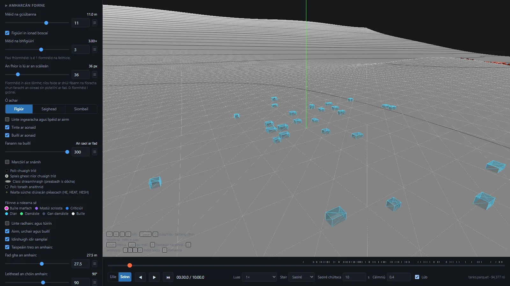

# Forleagan figiúirí (athsheinm boscaí)

Scannán beag: figiúr amháin do gach duine, ag bogadh de réir mar a ritheann an t-am, le lorg ina dhiaidh.

Tugtar **Forleagan figiúirí** ar an mód sa bharra modhanna. Ba "athsheinm boscaí" a tugadh ar an leathanach seo roimhe, mar ní raibh figiúirí ann sular tháinig duine i gcéill mar bhosca; tá "athsheinm figiúirí" agus "athsheinm boscaí" mar an gcéanna. Níl eochair uimhreach ag **Forleagan figiúirí**: roghnaigh é sa bharra modhanna. Tarraingíonn sé figiúr amháin (nó bosca) in aghaidh [duine](glossary.md), ag bogadh feadh an [amlíne](timeline.md), le línte radhairc agus lorg roghnacha. Is seinm é seachas dlús: *cé a bhí cá háit, nuair*. Teastaíonn colún duine uaidh; gan colún ama tarraingítear gach samplach ag an am céanna.

## Conas é a úsáid {#how-to-use-it}

1. Luchtaigh sonraí le colún duine agus colún ama.
2. Roghnaigh **Forleagan figiúirí** sa bharra modhanna.
3. Athraigh an amlíne go **Seinn** agus brúigh seinn (`K`).
4. Oscail **Amharcán foirne** chun **Fad an loirg**, méid na bhfigiúirí nó na línte radhairc a athrú.

Ní tarraingítear teas sa mhód seo, agus tá an buiséad oiriúnaitheach spriorad neamhghníomhach.

De réir réamhshocraithe tarraingítear gach duine mar an figiúr den rud a bhfuil siad - féach [Figiúirí](figures.md) le haghaidh an figiúr a fhaigheann aonad, agus [Athsheinm cluiche](match-replay.md) le haghaidh lipéad, an ceamara leanúnach, tomhas idir dhá aonad agus liosta na n-imeachtaí.

## Painéal Amharcán na foirne {#the-team-viewer-panel}

Taispeántar é in ionad na bpainéal teasa sa mhód seo.

| Rialú | Réamhshocrú | Raon (jog) | Brí |
|---|---|---|---|
| **Figiúirí in ionad boscaí** | air | | Gach duine mar an figiúr den rud a bhfuil siad: saighdiúir ar cos, an tanc nó an t-aerárthach a ainmníonn na sonraí. Fanann rud nach ndeir na sonraí faoi mar bhosca. |
| **Méid na bhfigiúirí** | 1× | | Is é 1× an méid fíor. |
| **An fhíor is lú ar an scáileán** | 36 px | 0 = méid fíor i gcónaí | Méid fíor in aice láimhe; sa chian fásann figiúirí chun go mbeidh siad an oiread picteilíní seo ar fad. |
| **Airm, urchair agus buillí** | air | | Airm i mbealach le deatach, tracers, tuairteanna, buillí agus maruithe. Tá tracers a dhíorthaítear ó bhuille breac-líneach. |
| **Méid na gciúbanna** | méid an aonáin, nó fairsinge / 500, ar luchtú | 0.05-200 m, logartamach (5000) | Fad imeall gach boscaí. Féach [méid an aonáin](sessions-persons-groups.md#entity-size). |
| **Idirshuigh idir samplaí** | air | | Idir dhá shampla den duine céanna sa seisiún céanna, cuirtear an bosca de réir cionn idir iad. Ní thrasnaíonn sé teorainn seisiúin riamh. |
| **Taispeáin treo an amhairc** | air | | Gha ó gach bosca i dtreo amhairc an duine (teastaíonn [colúin amhairc](axes-units-and-time.md#look-direction)). |
| **Fad gha an amhairc** | méid an aonáin × 4, nó fairsinge / 200, ar luchtú | 0.5-500 m, logartamach (20,000) | Taispeántar agus treo an amhairc air. |
| **Fad an loirg** | 8 s | 0-300 s (86,400); 0 = as | Soicindí stair tarraingthe taobh thiar de gach duine. |
| **Tarraing gach sampla amh** | as | | Bosca in aghaidh sampla stóráilte sa fhuinneog in ionad bosca idirshuite amháin in aghaidh an duine. Fo-shamplaithe chun idirghníomhach a choinneáil. |

Míníonn leideanna sa phainéal go nascann idirshuí agus lorg samplaí laistigh de sheisiún amháin, agus, nuair a bhíonn [ainmneacha roinnte](sessions-persons-groups.md#names-worn-by-several-things-at-once) sa luchtú, cé mhéad ainm a tharraingítear mar shamplaí aonair.

## An seisiún atá á sheinm {#the-session-being-played}

Nuair a bhíonn colún seisiúin ann, cinneann an roghnóir **Seisiún** ag barr na cléibhe ([Seisiúin](sessions-persons-groups.md#the-session-picker)) cén cluiche a sheinntear siar. Roghnaítear an ceann is gnóthaí ar luchtú. Ní bhíonn ach sraitheanna an tseisiúin sin ina mbosca agus lorg, agus ritheann an amlíne thar raon an tseisiúin sin in ionad thar thacar sonraí iomlán. Seinneann *Gach seisiún* gach seisiún ag an am céanna, agus fós ní nascann sé samplaí trasna seisiún riamh.

## Cad a tharraingítear cathain {#what-is-drawn-when}

Ó [`TrackCursor`](https://github.com/Holdi601/3DHeat/blob/main/src/data/tracks.ts):

**Boscaí beo** (mód Seinn, samplaí amha as). Do gach duine infheicthe, a sampla is déanaí ag nó roimh an gceannródaí:

- Má tá an chéad sampla eile ag an duine, tá sé sa seisiún céanna, agus níl an t-ainm roinnte, cuirtear an bosca idir an dá shampla de réir ama, leis an giaw idirshuite ar an mbealach gearr agus an pitse go líneach (nuair a bhíonn *Idirshuigh* air).
- Murab ea, fanann an bosca ag an tsampla deireanach ar feadh **Saolré chúltaca** na haimlíne (10 s de réir réamhshocraithe) agus ansin baintear é, ionas nach mairfidh imreoirí díchur.

**Mód Gach rud** neamhaird á déanamh den cheannródaí, tarraingíonn sé gach sampla san raon mar bhosca.

**Samplaí amha** tarraingíonn bosca in aghaidh sampla stóráilte sa fhuinneog: an *Raon* leis an stair *Fuinneog*, agus gach rud go dtí an ceannródaí murab ea. Ar a mhéad 65,536 bosca; le níos mó samplaí, tarraingítear gach *k*ú ceann.

**Lorg** (nuair a bhíonn fad an loirg os cionn 0 agus nach dtarraingítear samplaí amha): líne idir gach péire de shamplaí as a chéile de dhuine laistigh de *fhad an loirg* soicind suas go dtí an ceannródaí, ag dul i léig ó 80% opacity go trédhearcach de réir aois. Stopann lorg ag athrú seisiúin agus ní tharraingítear é d'ainmneacha roinnte. Ar a mhéad 131,072 vertex; le níos mó, scipeáiltear sraitheanna go cothrom.

**Cé atá infheicthe:** folaítear duine nuair a bhíonn a ghrúpa díthicéilte sa [liosta Foirne](teams-list.md) (is é grúpa a chéad sraithe an grúpa sin), nuair a eisíonn scagaire grúpa é, nó nuair a bhíonn roghnú sa phainéal [Aonáin](entities.md) nach n-áirítear iad ann. Ní bhaineann [scagairí](filters.md) colúin le boscaí.

## Dathanna {#colours}

Clann dathanna amháin do gach grúpa agus scáth amháin do gach ball, ionas go n-insíonn súil amháin duit cén taobh ar a bhfuil duine ([`teamMemberColor`](https://github.com/Holdi601/3DHeat/blob/main/src/render/colors.ts)). Casann dathanna grúpa thart ar liosta seasta de deich - gorm, dearg, glas, ómrach, corcairghorm, cian, magenta, líomóid, oráiste, indigo - agus scaiptear baill grúpa thar éadrom 42-76% agus sáithiú 90-65%.

## Nótaí {#notes}

- Tógann forleagan na bhfigiúirí a figiúirí arís ach amháin nuair a athraíonn rud éigin; athtarraingíonn fráma neamhghníomhach an ceann deireanach.
- Comhaireamh líne *Ciúbanna* den [forleagan staitisticí](performance-and-stats.md) na boscaí ar an scáileán.
- Tarraingíonn forleagan na bhfigiúirí sa radharc céanna leis an leibhéal, mar sin [doimhneacht réimse](camera.md#depth-of-field) doilíonn na boscaí ach ní dhoirteann sé an teas riamh.
