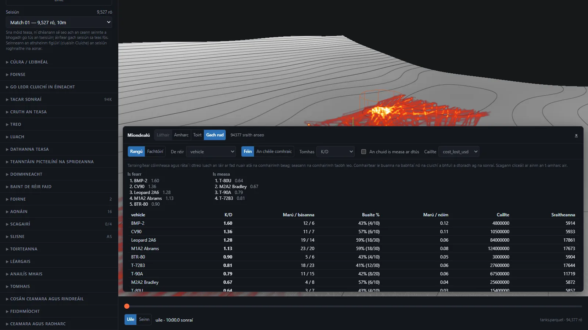
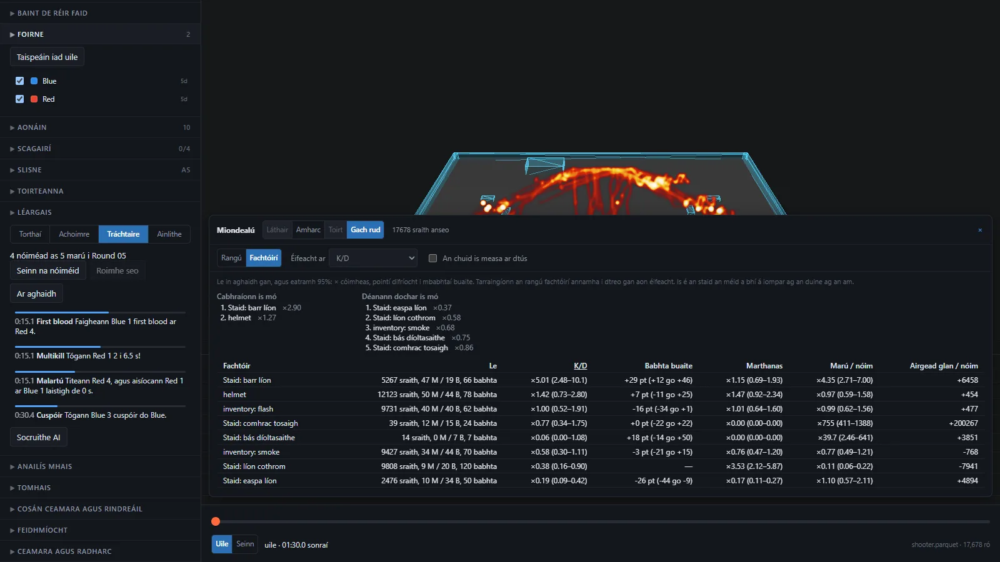

# Miondealú: cé agus cad is fearr san áit seo

Freagraíonn an **Miondealú** ceist amháin: san áit seo, cé acu feithicil, imreoir nó airm a dhéanann is fearr? Úsáid é chun an tanc a bhuann ag an droichead a aimsiú, nó chun a fheiceáil an gcabhraíonn cathóg i ndáiríre.

Rangaíonn sé an rud a tharlaíonn in áit amháin (spota roghnaithe, an radharc, toirt, nó gach rud atá taispeánta) de réir aon chatagóir, agus tomhaiseann sé gach fachtóir staide le *gan* agus *le*.

## Bain triail as {#try-it}

1. Luchtaigh cluiche le maruithe agus básanna, agus oscail **Toirteanna**.
2. Tarraing toirt thart ar an áit a bhfuil cúram ort faoi agus roghnaigh é.
3. Brúigh **Miondealú…** faoi Staitisticí.
4. Faoi **De réir**, roghnaigh *Feithicil*, agus roghnaigh an tomhas *K/D* (maruithe in aghaidh báis).
5. Léigh an liosta, an ceann is fearr ar dtús. Brúigh **An chuid is measa ar dtús** chun é a iompú. Cliceáil ainm chun an radharc a scagadh chuige; cliceáil arís chun é a scaoileadh.

## Oscail é {#open-it}

| Ó | Réigiún a thosaíonn leis |
| --- | --- |
| **Miondealú…** i [Toirteanna](volumes.md) (Staitisticí) | an toirt roghnaithe |
| **Miondealú anseo** ar an gcárta roghnúcháin, tar éis cliceáil ar phointe | cruinne timpeall an phointe sin (**Ga**, réamhshocrú 3% de mhéid na sonraí) |
| an painéal scoilte **Difríocht** | an radharc |

Athraíonn an ceanntásc an réigiún: **Láthair**, **Amharc** (cad a chonaic an ceamara ag an gcomhaireamh deireanach; **Comhair arís** tar éis bogadh), **Toirt** (roghnaigh ceann) nó **Gach rud**. Comhaireann sé sa chúlra; deir an líne staide cé mhéad sraith atá sa réigiún.

## Rangú {#ranking}

Roghnaigh cad atá le rangú agus tomhas:

| Tomhas | Cad is ann dó |
| --- | --- |
| A, B | sraitheanna ar gach taobh den léarscáil dhifríochta, scoilte mar a scoilteann an teas iad |
| A / B, A - B, A / (A + B) | an dá shraith i gcoinne a chéile |
| K/D | maruithe in aghaidh básanna |
| Buaiteoir % | babhtaí (nó cluichí) buaite, nuair a deir na sonraí cé a bhuaigh |
| Maruithe / nóiméad | maruithe in aghaidh an nóiméid i láthair (bearnaí samplaí gluaiseachta) |
| Ioncam, Caillte, Airgead glan | suimeanna de cholúin `earn_*` agus `cost_*`; roghnóir a roghnaíonn an airgeadra |

Áirítear maruithe, básanna, láithreacht, buanna agus airgead gach sraith a thaispeánann an radharc san áit, ar thaobh amháin den scoilt nó ar gach taobh.

Tarraingítear cóimheasanna agus rátaí i dtreo luach iomlán na háite nuair a bhíonn na comhaireamh beag, ionas nach mbíonn 2 mharú i 1 saol ag barr an liosta. Taispeántar na comhaireamh in aice leo.

Is féidir leat a rangú de réir na ngrúpaí, imreoirí agus cluichí, aon cholún catagóire (feithicil, airm, taobh, cineál ceannaigh, gníomhaire nó ciorcal), aon cholún uimhreach i raonta (armúr, luach ualaigh), **aicme** colúin airm (raidhfil, lámhaire, SMG, pistil...) agus cé mhéad píosa **fóntais** a bhíonn i gcolún liosta mar `inventory`.

**Féin** rangaíonn sé de réir luach an tsraithe féin. **Luach an chéile** rangaíonn sé de réir luach an taobh eile: arm an chreach ar mharú, arm an mharaithe ar bhás (teastaíonn colún `other` / `victim` a ainmníonn iad).

## Staid ag an am {#state-at-the-time}

Is é luach sraithe a luach féin mura ndéanann an tsraith aon chuntas air (sraith imeachta gan trealamh) nó más bás é (ar féidir lena cholún airm an t-arm a bhí ag an marfóir a ainmniú); ansin is é an luach a bhí ag an duine céanna i ndiaidh na tuairisce roimhe sin sa chluiche.

## Fachtóirí: le in aghaidh gan {#factors-with-against-without}

Athraigh ó **Rangú** go **Fachtóirí**, roghnaigh **Éifeacht ar**, agus léigh *Cabhraíonn is mó* agus *Gortaíonn is mó*:

Éifeacht gach fachtóra ar K/D, babhtaí buaite, marthanacht (nóiméid in aghaidh báis), maruithe in aghaidh an nóiméid agus airgead glan in aghaidh an nóiméid, le hintervál 95%: cóimheasanna mar x, babhtaí buaite mar difríocht pointí. Tarraingíonn an rangú gach meastachán i dtreo gan éifeacht de réir a neamhchinnteachta féin, mar sin teastaíonn éifeacht shoiléir ó fhachtóir annamh chun rangú ard; is é an t-intervál atá léirithe an ceann gan tarraingt.

Cuireann sonraí le babhtaí **cásanna** an ghearrchomhraic leis ([Gearrchomhrac agus babhtaí](close-quarters.md)), a ríomhtar uair amháin in aghaidh tacair sonraí: *dallta* (colún `state_flashed` na sraithe, nó flash namhaid laistigh de 15 m sna 3 s deireanacha), *bás tráchtáilte*, *dúel tosaigh*, agus *fear suas*, *uimhreacha cothroma* nó *fear síos* (imreoirí beo ar thaobh na sraithe i gcoinne an namhaid). Comhaireamh bás sa chás a bhí a íospartach ann díreach roimhe.

Ar a mhéad 256 fachtóir a thomhaistear i bpas amháin.

## Do fhorbróirí {#for-developers}

### Samplaí beaga a tharraingt {#pulling-small-samples}

Is é luach an rangaithe `(n + m*r0) / (d + m)`: is iad `n` agus `d` na comhaireamh, `r0` cóimheas iomlán na háite agus `m` meáchan an réamh-luacha sin.

### Do údair tiontaithe: colúin fachtóra a ainmniú {#for-converter-authors-naming-factor-columns}

Cuireann tiontaire fachtóir leis tríd a cholún a ainmniú:

| Colún | Fachtóir |
| --- | --- |
| `state_<ainm>` uimhir | ar siúl mar a bhíonn sé neamh-nialach (`state_scoped`, `state_suppressor`) |
| `state_<ainm>` catagóir | fachtóir amháin in aghaidh luacha (`state_ammo` = AP, HE...) |
| `active_<ainm>` | mar an gcéanna, do rud a bhfuil sé casta air nó a úsáideadh le déanaí: scil, ult, giuirléid, buff (`active_ult`, `active_stim`) |
| colún liosta (`inventory`, `loadout`, `perks`, `abilities`, `attachments`, `modules`, `buffs`, `debuffs`, `upgrades`, nó ainm `state_`/`active_` a chríochnaíonn le `s`) | fachtóir amháin in aghaidh mír de luach `a\|b\|c` |
| bratacha trealaimh atá coitianta cheana (`helmet`, `defuser`, `armor`, `scoped`, `airborne`, `duck`, `flashed`...) | ar siúl mar a bhíonn sé neamh-nialach |
| `ammoType`, `shellType`, `ammoName` | an babhta a lasadh go deireanach |

Torthaí: colún `won` 0/1 (bhuaigh taobh na sraithe an babhta nó an cluiche) agus colún `round`. Airgead: `earn_<airgeadra>` agus `cost_<cineál>_<airgeadra>`; cuireann ioncam de réir cineáil amháin (`earn_round_cs2`, luach cruinn babhta ó thiontaire) in ionad ioncam an tsamhail costais den chineál sin amháin (clúdaíonn `round` plandálacha agus dí-phléascadh freisin), agus priseálann an tsamhail an chuid eile.

Luchtaíonn an mapáil na colúin seo leis féin, i dtaobh liosta chomhaid an chomhaid féin: gach colún `state_*`, `active_*`, `won`, `round` agus liosta, ach amháin iad siúd a léiríonn staitisticí comhaid Parquet nach bhfuil ach luach amháin acu ar fad (is 4 bheart gach colún luchtaithe in aghaidh sraithe).
