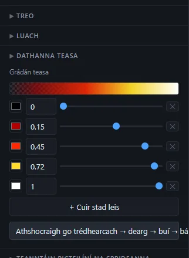

# Dath agus nochtadh

Eascraíonn na rialuithe seo an méid teasa a fhaigheann dath áirithe. Is é **Pointe sáithithe** an méid teasa a chuntar mar bhán-te.

## Deisiúcháin tapa {#quick-fixes}

- Tá gach rud bán: ardaigh **Pointe sáithithe**, nó brúigh **Nochtadh uathoibríoch ón réimse**.
- Níl aon rud le feiceáil: ísligh **Pointe sáithithe**, nó brúigh **Nochtadh uathoibríoch ón réimse**.
- Ní thaispeánann ach roinnt ponc aonair: cas suas **Teas íosta**.

Gníomhaíonn gach rialú ar an leathanach seo nuair a iompraítear an teas ina dath, mar sin athtarraingíonn tú láithreach má tharraingíonn tú aon cheann acu, agus **ní thosaíonn sé an carnadh arís go deo**.

## Pointe sáithithe {#saturation-point}

**Pointe sáithithe** (alt Cruth na teasa): an teas carnaithe a léarscáileáiltear go barr an ramhar dath (leis an fhreagairt *Líneach*; féach thíos le haghaidh na n-eile). Sliodar logartamach 0.1-4000, handle tarraingthe suas go 10,000,000, mar fásann an teas carnaithe de réir líon na sraithe. Réamhshocrú 24; ar gach luchtú, meastachán **anailíseach** ar dtús, ansin **tomhaiste** ón bpictiúr.

Is é an difríocht idir léarscáil teasa agus scáileán bán (nó bán-gheal) an rud a dhéantar mícheart, agus ní féidir é a fháil go hiontaofa: tá na sonraí tiubh ag grúpáil - spawn, doras, bealach caol - ionas go n-athraíonn an cóimheas idir an buaicphointe agus an dlúis mheán de réir an ordú méide idir tacair sonraí agus idir uillinneacha ceamara.

## Nochtadh uathoibríoch {#auto-exposure}

Tomhaiseann **Nochtadh uathoibríoch ón réimse** an réimse a tháirgeann an shader i ndáiríre. Déanann sé neamhaird de phicteilíní folmha, glacann sé an 98ú céatadán de na cinn soilsithe agus cuireann sé ag 85% den bhealach go dtí an pointe sáithithe é, ionas go gcoimeádtar barr an ramhair do na buaicphointí fíora.

Léann an painéal *tomhaiste X% den fhráma; 98ú céatadán R curtha in aice le barr an ramhair*. Leis an fhreagairt *Sáithitheach*, tagann luach ag 85% den phointe sáithithe ar thart ar 57% den ramhar seachas 85%.

Ritheann sé **go huathoibríoch** freisin:

- 8 bhfráma renderáilte tar éis tacar sonraí a luchtú;
- 8 bhfráma tar éis don [scagairí](filters.md) athrú (scagadh gach suíomh síos go céad imeacht athraíonn an dlús ó ord méide go hord méide);
- 8 bhfráma tar éis athrú idir teas pointe agus [teas líne](line-heat.md), nó nuair a athraítear na bealaigh a tharraingíonn teas líne, mar leagann líne i bhfad níos lú teasa síos in aghaidh samplach ná sprite.

Nuair nach bhfuil aon rud soilsithe, fágann an rith uathoibríoch an sáithiú mar atá; titeann an cnaipe ar ais go dtí an meastachán anailíseach agus deir sé *níl aon rud soilsithe le tomhas - úsáideadh an meastachán anailíseach*.

### Lean an t-amharc {#follow-the-view}

Tá **Lean an t-amharc** (alt Cruth na teasa, ar siúl de réir réamhshocraithe) ag tomhas arís gach uair a stopann an ceamara, ionas go n-úsáideann réigiún a dtéann tú isteach ann an raon dath iomlán in ionad an scála a tomhaiseadh don léarscáil iomlán. Déantar neamhaird de athruithe beaga, agus sleamhnaíonn an scála in ionad léim. Ritheann sé sna ceithre mhód teasa, ní sa chléib fhigiúr.

Díchum é chun an scála a ghlasáil agus áiteanna a chur i gcomparáid ar scála amháin. Glasálann sé freisin má tharraingíonn tú **Pointe sáithithe** de láimh.

## Freagairt an dlúis {#density-response}

**Freagairt an dlúis** - conas a léarscáileáiltear *k* (teas / sáithiú) ar an ramhar:

| Freagairt | Foirmle | Úsáid |
|---|---|---|
| **Sáithitheach** (réamhshocrú) | t = 1 - e^(-k) | Druideann sé i dtreo bharr an ramhair go hasamtótach, mar a dhéanann sprite trédhearcacha carntha. Ní ghearrann rud ar bhán réidh riamh, rud a fhágann gurb é an réamhshocrú sábháilte ar shonraí nach bhfuil aithne agat orthu. |
| **Líneach** | t = k | An t-aon mhapáil ina gciallaíonn an dath céanna an líon céanna. Úsáid é chun dhá thacar sonraí nó dhá fhuinneog ama a chur i gcomparáid. |
| **Log** | t = log₂(1 + 7k) / 3 | Comhbhrúnn sé eireaball fada, ionas nach ísleoidh hotspot amháin an chuid eile go bun an ramhair. Ardaíonn sé áiteanna tanaí. |

## Teas íosta {#minimum-heat}

**Teas íosta** (réamhshocrú as, 0-100%): ardaítear gach picteilín a iompraíonn aon teas ar chor ar bith go dtí ar a laghad an pointe seo den ramhar. Cas suas é, agus laghdaigh ga an sprite, chun **an áit ar tharla rud ar bith riamh** a fheiceáil - bíonn sonraí aonair le feiceáil go soiléir in ionad a bheith díreach os cionn trédhearcach. Fág as é nuair a bhíonn tú ag measúnú dlúis, mar leagann sé bun an ramhair síos d'aon ghnó. Coinníonn an tairseach (k > 0.0001) picteilíní atá folamh go fíor folamh.

## Eagarthóir an ramhair {#the-ramp-editor}

Sa chuid **Dathanna teasa**. Deir a lipéad cad chuige a bhfuil an ramhar: *Ramhar teasa* i Teas agus Línte, *Dearfach (foirne suimithe)* i Difríocht, *Ramhar teimhneachta (dath ón ngrúpa)* i [Teas foirne](team-heat.md), áit nach úsáidtear ach an alfa.



Réamhamharcann an barra ag an mbarr an ramhar. Thíos air, sraith amháin do gach stad:

| Cuid | Brí |
|---|---|
| Swatch datha | Dath an stad (roghnóir dathanna an bhrabhsálaí). |
| Uimhir | Suíomh an stad ar an ramhar, 0 go 1 (0 = gan teas). |
| Sliodar | Opacity an stad, 0-100%. |
| ✕ | Baintear an stad; díchumasaithe nuair nach bhfuil ann ach dhá cheann. |

**+ Cuir stad leis** cuireann stad leis leathbhealach idir an dá stad dheireanacha, leis an dath agus an opacity ón stad deireanach. **Athshocraigh go trédhearcach → dearg → buí → bán** cuireann an réamhshocrú ar ais.

Is féidir stadanna a thabhairt in ord ar bith; cuirtear in ord iad nuair a thógtar an ramhar. Is é an **alfa** an rud a mheascann an teas leis an radharc, agus sin an fáth go bhfuil an críoch nialasach de rámh réamhshocraithe go hiomlán trédhearcach.

### Na ramhair réamhshocraithe {#the-default-ramps}

| Suíomh | Dearfach (Teas, Línte, Difríocht +) | Diúltach (Difríocht −) |
|---|---|---|
| 0.00 | dubh, alfa 0 | dubh, alfa 0 |
| 0.15 | rgb(180, 0, 0), alfa 0.55 | rgb(0, 170, 60), alfa 0.55 |
| 0.45 | rgb(255, 40, 0), alfa 0.85 | rgb(0, 190, 200), alfa 0.85 |
| 0.72 | rgb(255, 220, 40), alfa 0.95 | rgb(40, 80, 255), alfa 0.95 |
| 1.00 | bán, alfa 1 | rgb(170, 60, 255), alfa 1 |

## Le linn an ceamara a bheith ag bogadh {#while-the-camera-moves}

Nuair a bhogann an ceamara, tosaíonn an carnadh arís gach fráma. Le **Tarraing gach ró i ngach fráma** ar siúl (an réamhshocrú), tá gach fráma bogtha fós cruinn; le as, taispeánann fráma bogtha meastachán samplach amháin - bláthanna níos gile, measúnaithe de réir meáchain - a thagann le fíorphictiúr níos réidhe nuair a stopann tú. Tá sé sin ag súil leis; féach [Carnadh](accumulation.md).

## Do fhorbróirí {#for-developers}

### An pas comhcheangail {#the-composite-pass}

Tar éis don teas a bheith carnaithe, iompraítear luach gach picteilín ina dath i bpas comhcheangail amháin ([`COMPOSITE_FS`](https://github.com/Holdi601/3DHeat/blob/main/src/render/webgl2/shaders.ts)). Is iad seo na céimeanna:

```
k = |teas| / pointe sáithithe
t = freagairt(k)                         teorannaithe 0..1
má tá teas íosta > 0 agus k > 0.0001:  t = íosta + (1 - íosta) × t
dath, alfa = ramhar(t)                   (an ramhar diúltach nuair a bhíonn teas < 0, Difríocht amháin)
picteilín = mix(radharc, dath, alfa)
```

### An meastachán anailíseach {#the-analytic-estimate}

Glacann **an meastachán anailíseach** ([`estimateSaturation`](https://github.com/Holdi601/3DHeat/blob/main/src/data/calibrate.ts)) go scaiptear na sraitheanna thar fhootprint X-Z na sonraí: teas meán = sraitheanna × (π r² / achar an fhootprint) × 1/3 × dian an lárphointe (is é 1/3 meán an disc de ramhar líneach), iolraithe faoin gcóimheas buaicphointe-go-meán measta de 25, teorannaithe 0.1-1,000,000. Ní gá ach go mbeadh sé laistigh de ordú méide den cheart.

### Tomhas {#metering}

[`exposure.ts`](https://github.com/Holdi601/3DHeat/blob/main/src/render/exposure.ts):

1. léitear an sprioc teasa ar ais ón GPU, fo-shamplaithe go 40,000 luach ar a mhéad;
2. cuirtear picteilíní folmha (teas ≤ 0.0001) ar lár - tá an chuid is mó de réimse teasa folamh, agus dá meánfaí iad bheadh gach rud faoi-nochta, mar a bheadh meantóir ceamara dírithe ar chúlra dubh;
3. is é an 98ú céatadán de na picteilíní soilsithe an tagairt;
4. bíonn an pointe sáithithe ina thagairt / 0.85, ionas go suíonn an tagairt ag 85% den bhealach go dtí an pointe sáithithe agus go gcoimeádtar barr an ramhair do na buaicphointí fíora.

### An tábla dathanna {#the-colour-table}

Déantar an ramhar a bhácáil isteach i dtábla RGBA 256 × 2 (an ramhar dearfach sa chéad sraith, an diúltach sa dara sraith) ([`buildColorLut`](https://github.com/Holdi601/3DHeat/blob/main/src/render/colors.ts)). Idirshuitear na dathanna i solas líneach agus stóráiltear iad mar sRGB; idirshuitear an opacity go líneach.
