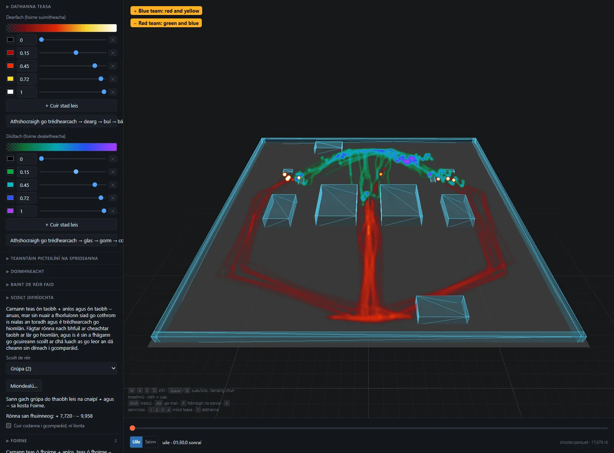

# Difríocht

Dearg nuair a bhí foireann A níos mó, glas-gorm nuair a bhí foireann B, gan dada nuair a bhí siad cothrom.

**Difríocht** (eochair 2) is teas comhartha é. Cuireann sraitheanna de dhaonra amháin teas leis; dealaíonn sraitheanna daonra eile é. Nuair a fhorluíonn an dá cheann go cothrom bíonn an toradh nialach agus trédhearcach go hiomlán; nuair a bhíonn ceann amháin i réim taispeántar é i dathanna an taoibh sin - de réir réamhshocraithe te (trédhearcach → dearg → buí → bán) do thaobh **+**, agus fuar (trédhearcach → glas → gorm → corcra) do thaobh **−**.

## Conas é a úsáid {#how-to-use-it}

1. Brúigh `2` (nó roghnaigh **Difríocht** sa bharra módanna).
2. Oscail **Scoilt difríochta** sa bharra cliathánach.
3. Roghnaigh cad atá le **Scoilt de réir**: de ghnáth *Grúpaí*.
4. Cuir grúpa amháin (nó luach amháin) ar **+** agus grúpa eile ar **−**.
5. Léigh na dathanna: is é te an taobh +, is é fuar an taobh −. Tugann an painéal rabhadh más rud é nach bhfuil sraitheanna ag taobh amháin (féach [Teachtaireachtaí a fheicfidh tú](#messages-you-may-see)).

*Cé dhá dhaonra* is í an cheist iomlán, mar sin is féidir leis an scoilt aon cholún coinnithe a bheith, ní grúpaí amháin. Fágtar as an toradh sraitheanna a thiteann ar **aon** taobh, ní chuntar iad mar nialach: is é sin a dhéanann go gcuireann scoilt thar dhá luach de go leor luachanna an dá luach sin i gcomparáid go beacht, agus cumhdaíonn sé leis na [scagairí](filters.md) - scag síos go léarscáil amháin, ansin scoil é de réir tógála.

Teastaíonn dhá thaobh ón mód: colún grúpa le dhá ghrúpa ar a laghad, nó scoilt thar cholún coinnithe le haghaidh scagtha. Ar shonraí le níos lú ná dhá ghrúpa tosaíonn lódáil le scoilt colúin - colún *Source file* de lódáil iomadúla ar dtús, seachas sin an chéad cholún catagóire le dhá luach, seachas sin an chéad cholún uimhriúil le raon - ionas go n-oibríonn *cuir dhá lódáil i gcomparáid* ar shonraí gan aon ghrúpa. Ní fhágann ach sonraí gan ceachtar mód dodhéanta; mar an gcéanna a fhágann scoilt colúin nach bhfuil aon rud ar thaobh amháin dodhéanta.

## Painéal na scoilte Difríochta {#the-difference-split-panel}

Taispeántar i mód na Difríochta, faoi na panéil teasa.

**Scoilt de réir** tairgeann:

| Rogha | Taispeánta mar | Riail na scoilte |
|---|---|---|
| Grúpaí | *Grúpa (N)* (nuair a bhíonn colún grúpa ann) | Gach grúpa ar +, − nó ar aon cheann, socraithe sa [liosta foirne](teams-list.md) |
| Colún catagóire | *colún (N luach)* | Luachanna ar +, − nó ar aon cheann |
| Colún uimhriúil | *colún (uimhriúil)* | Raon luachanna do gach taobh |
| An comhad tionscnaimh | *Source file - compare two loads* (nuair a lódáladh comhaid iomadúla) | Comhaid ar +, − nó ar aon cheann |

Ní thairgtear ach colúin a coinníodh faoi *Coinnigh le haghaidh scagtha* ag an lódáil.

### Cuir codanna i gcomparáid, ní líonta {#compare-shares-not-counts}

**Cuir codanna i gcomparáid, ní líonta** (réamhshocrú as) meáchanaíonn gach taobh le haon thar a líon sraitheanna féin, ionas nach mbuann taobh a bhfuil cúig huaire níos mó sraitheanna aige ar líon amháin. Taispeánann an dath ansin cén áit a bhfuil gach taobh níos coitianta go comhréireach ná an ceann eile. Úsáid é nuair a bhíonn an-difriúil ag an dá thaobh, mar shampla dhá sheisiún de fhad difriúil.

### Teachtaireachtaí a fheicfidh tú {#messages-you-may-see}

Tugann an painéal rabhadh nuair nach difríocht fíor an pictiúr:

| Teachtaireacht | Brí |
|---|---|
| *N + / M −* (nó *N + / M − / K unused*) | Cé mhéad luach ar gach taobh (agus ar aon cheann). |
| Níl sraith sa fhuinneog ar an taobh **+** | Ní tharraingítear ach an taobh **−**. Bog fuinneog na hamlíne nó athraigh an scoilt. |
| Níl sraith sa fhuinneog ar an taobh **−** | Ní tharraingítear ach an taobh **+**. |
| Níl aon luach ar aon taobh | Ní tharraingíonn an difríocht rud ar bith. Cuir luach amháin ar a laghad ar **+** nó **−**. |
| *column* ní féidir é a scoilt sa chaoi seo | Ní oireann an colún roghnaithe don scoilt. Roghnaigh an colún arís. |
| Níor oir colún na scoilte isteach i gcuimhne GPU do N as M píosaí | Ní tharraingítear na sraitheanna sin. Ardaigh buiséad GPU faoi Feidhmíocht → Buiséid acmhainní, nó lódáil níos lú sraitheanna. |

### De réir grúpa {#by-group}

Ní dhéanann an painéal ach tagairt don [liosta foirne](teams-list.md), ina bhfuil cnaipe **+** agus **−** ag gach grúpa. Ar gach lódáil cuirtear leath an chéad leath de na grúpaí (suas) ar +, agus an chuid eile ar −; déanann **Roinn go cothrom** sa liosta foirne an rud céanna arís. Ní chuireann grúpa ar aon taobh, nó folaithe lena sheic-bhosca, leis ar bith.

### De réir luachanna catagóire {#by-category-values}

| Cuid | Brí |
|---|---|
| `a + / b − / c unused` | Cé mhéad luach ar gach taobh agus ar aon cheann. |
| **Glan** | Cuireann gach luach ar aon taobh. |
| Liosta luachanna | Gach luach le cnaipe **+** agus **−** (cliceáil an ceann gníomhach arís chun é a bhaint den taobh sin). Liostaítear luach folamh mar *(missing)*. |
| Nóta teorann | Ní liostaítear ach an chéad 200 luach: *Showing the first 200 of N values. A column this wide is better narrowed with a filter first, or split by range if its values are ordered.* |

Nuair a roghnaítear an colún cuirtear a chéad luach ar + agus a dara luach ar −. Nuair nach bhfuil aon luach ar an dá thaobh, titeann an scoilt ar ais go grúpaí in ionad fráma folamh a thaispeáint. Oibríonn *Source file* ar an gcaoi chéanna, luach amháin in aghaidh an chomhaid - is mar sin a chuirtear dhá onnmhairiú, dhá rith tástála nó dhá thógáil i gcomparáid.

### De réir raoin {#by-range}

| Cuid | Brí |
|---|---|
| Leid | Íosmhéid agus uasmhéid an cholúin. |
| **Raon dearfach (+)**, **ó** / **go** | Cuireann sraitheanna a bhfuil luach sa raon seo acu leis, san áireamh sa dá cheann. |
| **Raon diúltach (−)**, **ó** / **go** | Dealaíonn sraitheanna sa raon seo. |
| **Scoilt ag an lárphointe** | Socraíonn + go [íosmhéid, lár] agus − go [lár, uasmhéid] - is é sin freisin a dhéanann an colún a roghnú. |

Má tá luach sa dá raon, is + a chomhaireofar é. Ní gá go gclúdaíonn na raonta an colún; fágtar as an toradh luachanna nach bhfuil in aon cheann. *The first two minutes against the last two* is scoilt raoin ar cholún amhail ama.

## Dathanna {#colours}

Taispeánann an chuid **Dathanna teasa** dhá eagarthóir ramp sa mhód seo: **Dearfach (foirne suimitheacha)** agus **Diúltach (foirne dealaitheacha)**, gach ceann lena chnaipe athshocraithe féin (*Reset to transparent → red → yellow → white*, *Reset to transparent → green → blue → purple*). Glacann an comhshuíomh luach absalóideach an teas glan trí [phointe sáithithe agus fhreagra](colour-and-exposure.md), agus roghnaíonn sé an ramp diúltach nuair a bhíonn an glan faoi nialas. Féach [Dath agus taispeántas](colour-and-exposure.md#the-ramp-editor).

Bain úsáid as an bhfreagra dlús *Líneach* nuair a bhíonn méid na difríochta tábhachtach: is é an t-aon fhreagra ina gciallaíonn dath comhionann líon comhionann.

## Do fhorbróirí {#for-developers}

Faigheann gach sraith comhartha de +1, -1 nó 0 sa veirtéacs-sceathán ([`POINT_HEAT_VS`](https://github.com/Holdi601/3DHeat/blob/main/src/render/webgl2/shaders.ts)); diúltaíonn 0 don tsraith sula dtarraingítear aon phíosa.

- De réir grúpa, tagann an comhartha ó thábla grúpa 4,096-iontráil atá innéacsaithe ag aitheantas grúpa na sraithe (iompraíonn an t-aitheantas grúpa sa cheathrú cainéal de theacsal suíomh na sraithe).
- De réir catagóire, tagann an comhartha ó dara tábla 4,096-iontráil, líonta de réir luachanna catagóire, agus léitear luach na sraithe ó theacsal scagaire an cholúin; diúltaítear do luach atá thar deireadh an tábla ar an dá chúltaca.
- De réir raoin, déantar luach na sraithe a chur i gcomparáid leis an dá raon.

Tosaíonn athrú na scoilte an carnadh arís.

**Fanann grúpaí folaithe folaithe le gach scoilt.** Faoi scoilt de réir colúin ní iompraíonn an tábla grúpa comharthaí a thuilleadh; coinníonn sé 1 do ghrúpa a thaispeántar agus 0 do ghrúpa folaithe ([`frameSignTables`](https://github.com/Holdi601/3DHeat/blob/main/src/render/filterTables.ts)), agus sroicheann an dá thábla an sceathán le chéile - dhá réimse de theacsal comhartha amháin ar WebGL2, dhá leath de bhufair stórála amháin ar WebGPU. Tarraingítear sraith amháin nuair a thaispeántar a grúpa *agus* nuair a bhíonn a luach colúin ar thaobh. Mar sin ní chuireann grúpa a bhfuil an tic bainte de sa [liosta foirne](teams-list.md), nó a fhágtar as le fócas taobh an chluaisín Cluiche, le haon rud ar bhealach ar bith a scoiltear an difríocht.
