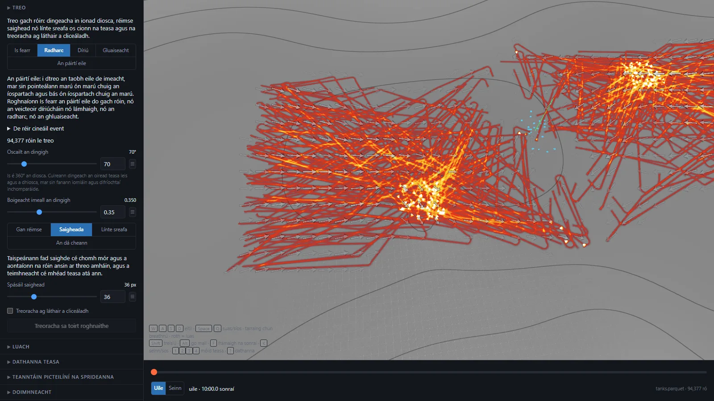

# Teas treoch

Deir teas simplí **cá** a tharlaíonn rudaí. Deir teas treoch freisin **cén treo**: cén treo a raibh daoine ag féachaint, ag díriú, ag bogadh, nó cén áit a raibh an taobh eile de throid.

Is diosca iomlán é spriorad gnáth (360 céim). Le **Oscailt an dingigh** de 70 céim éiríonn an spriorad céanna ina dhingeadh caol a dhéanann pointeáil ar an treo a raibh an tsraith ag féachaint, agus cuireann sé an teas iomlán céanna leis.

## Conas é a úsáid {#how-to-use-it}

1. Luchtaigh sonraí ina bhfuil treo (féach [Cad a thugann treo do shraith](#what-gives-a-row-a-direction)).
2. Roghnaigh **Teas**, **Difríocht** nó **Teas foirne** sa bharra modhanna.
3. Oscail an chuid **Treo** sa bharra cléibhe.
4. Roghnaigh **foinse** (cén treo le húsáid), agus ansin cas ar an tarraingt:
   - ísligh **Oscailt an dingigh** faoi 360° chun gach sraith a tharraingt mar dhingeadh ag pointeáil ar a treo in ionad diosca;
   - roghnaigh **Réimse** chun saigheada nó sruthlínte a tharraingt thar an teas;
   - cuir tic le **Treoracha ag láthair a cliceáladh** agus cliceáil ar an teas chun cairt pholar den láthair sin a fháil.

Deir an líne staide cé mhéad sraith a bhfuil treo acu ón bhfoinse roghnaithe.

## Socruithe {#settings}

| Socrú | Réamhshocrú | Cad a dhéanann sé |
|---|---|---|
| Foinse: **Is fearr**, **Amharc**, **Díriú**, **Gluaiseacht**, **An páirtí eile** | Is fearr | Cén treo a fhaigheann gach sraith. Glacann *Is fearr*, do gach sraith, an páirtí eile, murab ea an díriú, murab ea an radharc, murab ea an ghluaiseacht. |
| **De réir cineál imeachta** | mar thuas | Foinse difriúil do gach cineál imeachta, mar shampla *An páirtí eile* do mharuithe agus *Amharc* do shuíomhanna. Taispeántar é nuair a bhíonn colún imeachta sna sonraí le 40 luach ar a mhéad. |
| **Oscailt an dingigh** | 360° | Is é 360° an diosca gnáth (as). Is dingeadh níos caolaí é níos lú. Cuireann dingeadh an oiread teasa leis agus a dhiosca, ionas go bhfanann suimeanna agus difríochtaí inchomparáide. |
| **Boigeacht imeall an dingigh** | 0.35 | 0 dingeadh le himeall géar, 1 lucht bog. |
| **Réimse**: Gan réimse, Saigheada, Sruthlínte, Araon | Gan réimse | Saigheada: is é fad saighead an méid a aontaíonn na sraitheanna ansin ar threo amháin, is é a dlús an méid teasa atá ann. Taispeánann saigheada an áit a bhfuil teas amháin. |
| **Spásáil saighead** | 28 px | Fad idir saigheada ar an scáileán. |
| **Beoigh na línte sreafa** | air | Sreafaíonn na sruthlínte agus iad air. |
| **Treoracha ag láthair a cliceáladh** | as | Cliceáil ar an teas chun na treoracha ansin a fheiceáil (thíos). |
| **Treoracha sa toirt roghnaithe** | | An cairt chéanna do gach rud atá istigh sa [toirt](volumes.md) roghnaithe. |

## An chairt pholar ag láthair {#the-polar-chart-at-a-spot}

Le **Treoracha ag láthair a cliceáladh** ar, cliceáil ar an teas. Bailítear na sraitheanna gar don phointe sin (laistigh de 1.5 gha spriorad) i rós de 24 slis de 15°:

- **oráiste** petals: treoracha imeachtacha (cá bhfuil na sraitheanna ag pointeáil);
- **gorm** petals: treoracha teachtacha (cén áit as a tháinig siad);
- ardaíonn **achar** petal lena líon; taispeánann saighead an phríomhtreo;
- léiríonn na línte faoin gcairt an phríomhiomaire, cé chomh láidir is a aontaíonn na sraitheanna (R, 0 go 1), an scaipeadh i gcéimeanna, agus líon na sraitheanna.

Tá 0° thuas sa chairt, is é sin Z−domhanda (an tuaisceart do thaifeadtaí Tacview). Marcáiltear an láthair sa radharc 3D freisin le saighead agus fáinne.

## Cad a thugann treo do shraith {#what-gives-a-row-a-direction}

| Foinse | Teastaíonn sa sonraí |
|---|---|
| Amharc | colún giaw (mapáilte mar threo an amhairc): `yaw`, `heading`, `azimuth`, `view_yaw`, `rot_z` |
| Díriú | paireanna uimhreacha mar `aim_x`/`aim_y`, `shot_x`/`shot_y`, `fire_x`/`fire_y`, `hit_dir_x`/`hit_dir_y` (`…_z` roghnach) |
| Gluaiseacht | rud breise ar bith ní theastaíonn: an céim ón sampla roimhe sin den duine céanna (10 s ar a mhéad roimhe, seisiún céanna) |
| An páirtí eile | colún a ainmníonn taobh eile imeachta (`other`, `victim`, `target`, `killer`, `attacker`, `shooter`, `other_player` ...) a bhfuil ainmneacha daoine ina luachanna; pointeálann marú ó mharfóir go dtí íospartach, pointeálann bás ó íospartach go dtí marfóir |

## Leideanna {#tips}

- Teastaíonn méid éigin ar an scáileán ó dhingeadh; faoi cúpla picteilín tarraingítear arís iad mar dhiosca.
- Úsáid *An páirtí eile* ar shraitheanna maraithe chun a fheiceáil **ó cá háit** a buadh troid, agus *Amharc* ar shraitheanna suímh chun a fheiceáil **cá bhfuil daoine ag féachaint**.
- Le **Difríocht**, pointeálann dingeadh an dá thaobh ar a dtreonna féin, mar sin seasann líne tine conspóideach amach.
