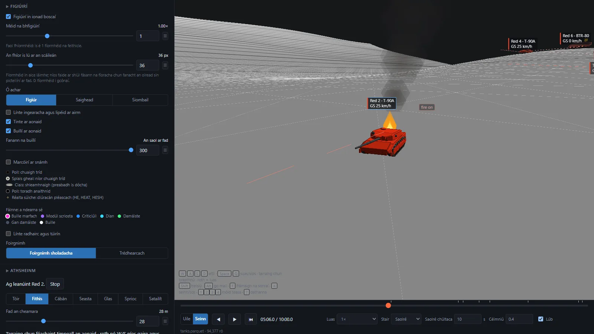

# Figiúirí

Is **figiúr** samhail 3D bheag de cad is aonad i ndáiríre é: tanc, jet, long, saighdiúir. Tarraingíonn an [athsheinm](match-replay.md) gach aonad mar a fhigiúr ag an méid fíor, in ionad bosca simplí.

Tá thart ar 2,000 feithicil, aerárthach, long, arm agus saighdiúir ainmnithe ann, agus tógann an t-amharcóir féin iad go léir.

## Cad atá sa chatalóg {#what-is-in-the-catalogue}

| Fearann | Samplaí |
|---|---|
| Daoine | saighdiúir ina sheasamh, ar a dhóid, ar a bholg; lámhaire, frith-tanc, lia, criú |
| Talamh | tancanna, feithiclí troideanna coisí, cosaint aeir, airtléireacht, trucailí agus carranna, traenacha agus tramanna |
| Aer | trodaithe, aerárthaí ionsaithe, buamadóirí, iompair, heileacaptair, ó bhíoplánaí go jeteanna nua-aimseartha |
| Muir | long chogaidh de réir aicme, iompróirí, fo-longa, bádaí, trádlonga |
| Airm | diúracáin, roicéid, buamaí, tórpedónna, flairí agus cleabhóg |
| Marcóirí | grenádaí deataigh, tine agus flashe, buamaí plandáilte, bratacha, spawns, pointí conairí |

## Conas a dhéantar na figiúirí {#how-the-figures-are-made}

- **Tógtha as toisí foilsithe.** Déantar an chuid is mó de na figiúirí ag tógálaí figiúr an amharcóra féin as uimhreacha poiblí: fad, leithead, airde, rothaí bóthair, túirín agus gunna, sciatháin agus eireaball. Déantar a gcruth a choigeartú ansin ar ghrianghrafanna poiblí, ar dhréachtaí agus ar thoisí foilsithe. Ní úsáidtear samhlacha aon chluiche.
- **Samhlacha saor in aisce.** Úsáideann cúpla figiúr samhlacha 3D saor in aisce (CC0 nó CC BY) nuair is fíre iad, uaireanta ceangailte leis an gcorp tógtha. Tugtar creidiúint d'údair saothar CC BY ar [Creidiúintí figiúr](figure-credits.md); ní theastaíonn creidiúint ó shaothair CC0 agus ní liostaítear iad ansin.
- Tá leagan iomlán, leagan garbh agus leagan i bhfad i gcéin ag gach figiúr (leibhéil mhionsonraí, LOD), ionas gur féidir na mílte a tharraingt ag an am céanna.

## Cén figiúr a fhaigheann aonad {#which-figure-a-unit-gets}

Breathnaíonn an t-amharcóir ar cholúin na sonraí féin:

1. **Ainmneacha** - colúin darb ainm *Name*, *Vehicle*, *Unit*, *Unit type*, *Model*, *Aircraft*, *Plane*, *Tank*, *Ship*, *Craft*, *Loadout*, *Kit* nó *Figure* - meaitseáiltear iad i gcoinne na catalóige: go díreach, trí thart ar 4,000 ailias (aitheantais aonaid cluichí éagsúla), trí thosach is faide aitheanta (`F-16C_50` is an F-16C), nó trí ainm figiúr is giorra a thosaíonn leis.
2. Ní úsáidtear ainm nach oireann a **chineál** don aonad (ní hé an trodaí an trucail darb ainm *Typhoon*).
3. **Cineálacha** - colúin darb ainm *Type*, *Class*, *Kind*, *Category*, *Icon*, *Role* nó *Domain* - tugann siad figiúr aicme: clibeanna Tacview (`Air+FixedWing`, `Ground+Heavy+Armor+Vehicle+Tank`, `Sea+Watercraft+Warship`, `Weapon+Missile`), deilbhíní léarscáile, nó focail shimplí (tank, helicopter, infantry).
4. Sonraí aon cheann acu is sonraí daoine iad: is saighdiúir é gach duine.

Mar sin is é an bealach is éasca na figiúirí cearta a fháil colún `vehicle` le hainmneacha fíora, nó colún `type` le clibeanna Tacview.

**Taispeánann an t-aonad agam mar bhosca nó mar shaighdiúir.** Cuir colún `vehicle` leis le hainm fíor, nó colún `type` le clibeanna Tacview. Leag an luch ar an aonad chun a fheiceáil cén t-ainm a meaitseáladh. Fágann sonraí a bhfuil colúin den sórt sin acu ach nach ndeir aon rud faoi aonad é mar bhosca; tarraingítear sonraí gan ceachtar acu mar shaighdiúirí.

## Socruithe {#settings}

Socraíonn an chuid **Figiúirí** de bharra taoibh an athsheinm méid, an méid is lú ar an scáileán, cad a bhíonn ar aonaid i gcéin (figiúr, saighead, siombail), agus na héifeachtaí a tharraingítear orthu. Féach [Athsheinm cluiche](match-replay.md#figures). Deatach, tine agus éifeachtaí eile ama: [Figiúirí sa forleagan figiúr](figure-replay.md).

## Pacáiste figiúr áitiúil roghnach {#an-optional-local-figure-pack}

Is féidir pacáiste roghnach de do chuid figiúirí féin a choinneáil ar do ríomhaire féin. Tagann a figiúirí in ionad figiúirí catalóige den ainm céanna. Ní chuid den stóras ná de thógáil fhoilsithe riamh é; gan é, ní athraíonn rud ar bith.
