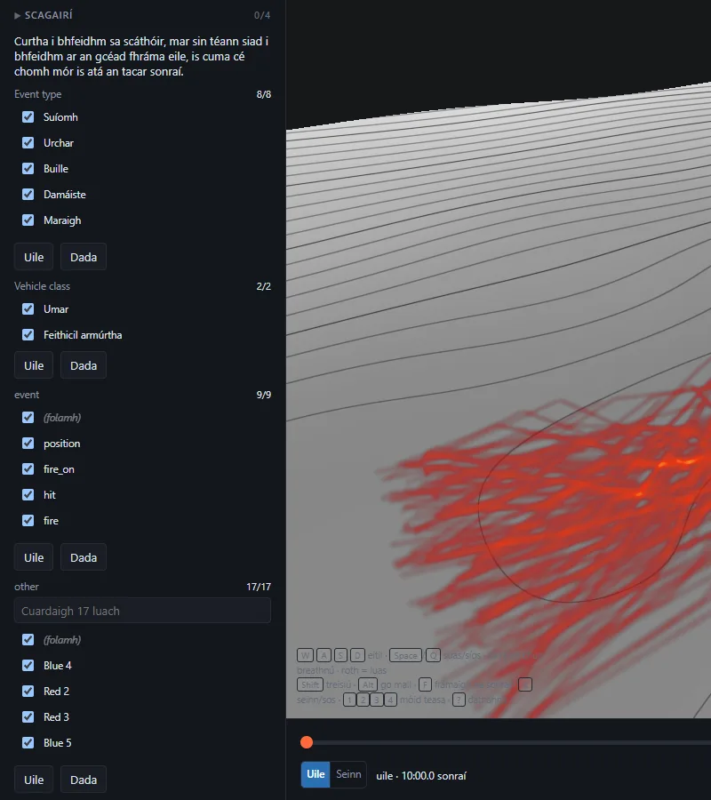
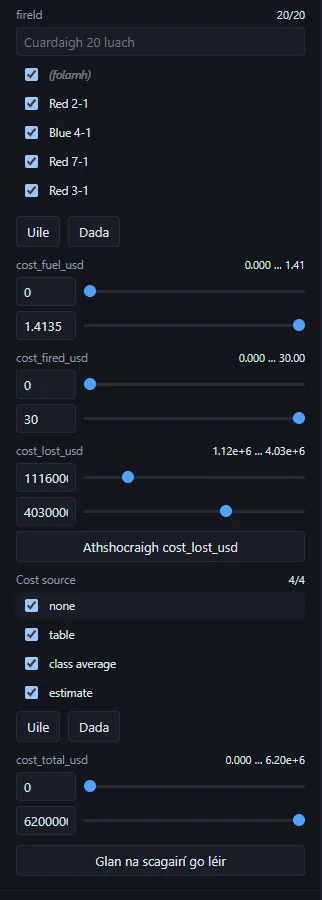

# Scagairí

Cuireann **Scagairí** na sraitheanna nach bhfuil spéis agat iontu i bhfolach, mar shampla aicme feithicle amháin nó cineál imeachta amháin, agus nuashonraítear an pictiúr láithreach. Liostaíonn an painéal na colúin a coinníodh ag an lódáil faoi *Coinnigh le haghaidh scagtha* ([Mapáil colún](column-mapping.md)), agus *Comhad foinse* nuair a lódáladh roinnt comhad.

## Bain triail as {#try-it}

1. Lódáil tacar sonraí agus oscail **Scagairí** sa bharra taoibh.
2. Faoi **Aicme feithicle**, bain tic de *Tanc*. Athraíonn an pictiúr láithreach.
3. Brúigh **Glan na scagairí go léir** chun an gníomh a chealú.

Is iad na chéad sraitheanna colúin an amharcóra féin (thíos). Tagann na sraitheanna ina ndiaidh ó do chomhad.

## Colúin a chuireann an t-amharcóir leis {#columns-the-viewer-adds}

Ag an lódáil oibríonn an t-amharcóir amach ceithre cholún de chuid féin agus liostaíonn sé **ar dtús** iad, leis na hainmneacha agus na luachanna i do theanga, ionas go n-oibríonn an scagaire céanna do gach cluiche agus foinse sonraí:

| Colún | Luachanna | Ó cad a oibríthear amach é |
|---|---|---|
| **Cineál imeachta** | 23 cineál: Suíomh, Urchar lámhachta, Seoladh (diúracán, roicéad, buama), Buail, Cuir amú (arm críochnaithe in aice le sprioc ar bith), Pléasc, Damáiste, Marú, Bás, Scriosta, Turgnamh, Éalú / teitheadh, Spawn, Despawn, Éirí de thalamh, Tuirlingt, Teagmháil talún, Stop ar an talamh, Athléigh / athbheathaigh, Gabh / cuspóir, Decoy, Teachtaireacht, Eile | colún darb ainm `event`, `events`, `event_type` nó `event_name`; mapáiltear focail gach cluiche (`shot`, `burst`, `fired`, `struck`, `flare`, `plant` ...) ar na cineálacha seo. An tábla iomlán: [Cineálacha agus aicmí imeachtaí](ref-event-types.md). |
| **Imreoir nó AI** | Imreoir, AI | colún `ai`, `is_ai`, `bot` nó `actor`; nó `is_player` / `human`; nó aitheantas cuntais (`user_id`, `steam_id`; folamh nó 0 is AI é); le haghaidh taifeadtaí Tacview, an bhfuil píolóta ag an réad |
| **Aicme feithicle** | 17 aicme: Trodaire, Aerárthach ionsaithe, Buamadóir, Aerárthach eile, Heileacaptar, Tanc, Feithicil armúrtha, Cosaint aeir, Airtléire, Trucail / carr, Long, Fo-long, Coisí, Arm, Decoy, Struchtúr, Eile | ainm na feithicle nó an aonaid (meaitseáilte i gcoinne an [chatalóg figiúr](figures.md)) agus colúin chineáil |
| **Aicme sprice** | na haicmí céanna | feithicil an taobh eile (`other_vehicle`, `target_vehicle`, `victim_type` ...) |

Díreach ina ndiaidh tagann na [colúin toraidh](data-formats.md#outcome-columns), nuair atá siad sna sonraí: **Toradh an bhabhta** agus **Toradh an chluiche** (*Ar bith*, *Buaite*, *Caillte*) agus **Conas a chríochnaigh an babhta**, a luachanna i do theanga. Scag orthu, nó scoilt an teas dá réir mar [léarscáil ráta buaite](win-rate.md).

Ní liostaítear ach na cineálacha a tharlaíonn. Is féidir colúin luacha (`cost_*`, `earn_*`, `net_*` agus *Foinse costais*, féach [Meáchan luacha](value-weighting.md)) a scagadh cosúil le colún uimhriúil ar bith: mar shampla, bain tic de *estimate* faoi *Foinse costais* chun sraitheanna le praghas amháin a choinneáil.

Faigheann liosta catagóire le níos mó ná 12 luach bosca cuardaigh (*Cuardaigh n luach*) agus cnaipe **Seo amháin** a cheadaíonn go díreach na luachanna a mheaitseálann.

Cinntear cé na colúin is féidir a scagadh ag am an lódála, toisc go gcaithfear iad a léamh ansin. Gan colún coinnithe ar bith insíonn an painéal sin agus treoraíonn sé chuig *Coinnigh le haghaidh scagtha*.

## Mearscagairí Rainbow Six Siege {#rainbow-six-siege-quick-filters}

Nuair atá cluiche Rainbow Six Siege lódáilte, tosaíonn an painéal le cnaipí a shocraíonn na scagairí le cliceáil amháin: **Poill piléar agus marcanna** (na marcanna a fágadh ar an leibhéal), **Marcanna le lámhachóir** agus **Marcanna le haicme airm** (na marcanna ar oibríodh amach lámhachóir dóibh, nó arm ó mharú an lámhachóra ag an nóiméad céanna; roinn nó scag iad tuilleadh de réir `byOperator` nó `byItemClass`), **Iarrachtaí cur agus díghníomhachtaithe**, **Iarrachtaí briste** (tosaithe, gan chríochnú, san áit ar stop an t-imreoir) agus **Treisithe** (san áit ar treisíodh balla nó haiste, ag an gcosantóir a thuigeann an tiontaire). Cuireann gach ceann acu scagaire nua in áit an scagaire ar an gcolún imeachta agus coinníonn sé an chuid eile; cealaíonn **Glan na scagairí go léir** é. Tá cur síos ar na colúin i gcáipéisíocht an tiontaire.

## Colúin uimhriúla (raon) {#numeric-columns-range}

| Cuid | Brí |
|---|---|
| Ainm, agus `íos ... uas` | An colún, agus an raon reatha (raon iomlán an cholúin fad nach bhfuil scagaire socraithe). |
| An chéad líne: bosca uimhreach agus sleamhnán | An teorainn íochtarach. Má tharraingítear an sleamhnán os cionn na teorann uachtaraí, bogann an teorainn uachtarach léi. |
| An dara líne: bosca uimhreach agus sleamhnán | An teorainn uachtarach. Má tharraingítear faoin teorainn íochtarach, bogann sí freisin. |
| **Athshocraigh *colún*** | Baintear an scagaire seo. |

Clúdaíonn na sleamhnáin íosmhéid go huasmhéid an cholúin i 1,000 céim; glacann na boscaí uimhreach le haon luach. Tagann sraith trí scagaire má tá a luach laistigh den raon, an dá cheann san áireamh. Taispeántar luachanna móra i bhfoirm easpónantach (`1.23e6`).

## Colúin catagóire {#category-columns}

| Cuid | Brí |
|---|---|
| Ainm, agus `ceadaithe/iomlán` | An colún, agus cé mhéad dá luachanna atá ceadaithe. |
| Liosta luachanna | Bosca seiceála in aghaidh an luacha; taispeántar luach folamh mar *(folamh)*. |
| **Gach rud** / **Dada** | Ceadaigh gach luach / níl luach ar bith ceadaithe. |

Ceadaíonn gach luach a bhaint den scagaire.

## Rialacha {#rules}

- **Ceithre scagaire ag an am céanna.** Taispeánann an ceanntásc `active/4`. Ní chuirtear cúigiú scagaire i bhfeidhm, agus deir an painéal sin. Úsáideann roghnú i [Eintitis](entities.md) (nó fócas imreora chluaisín Cluiche) ceann amháin de na ceithre cinn. Ní úsáideann scagaire a chlúdaíonn an colún ar fad ceann ar bith.
- **Tá 4,096 luach ar a mhéad ag colún catagóire**; ní choinnítear ceann níos leithne ag an lódáil.
- **Comhcheanglaítear scagairí le AND**, agus le infheictheacht foirne, scoilt na difríochta, fuinneog an ama, an baint faoi fhad agus an [sliseadh](slice.md).
- **Athrú scagaire athshocraíonn sé an carnadh agus tomhaiseann sé an nochtadh arís cúpla fráma ina dhiaidh sin**, toisc gur féidir le scagadh an dlús a athrú go mór ([Dath agus nochtadh](colour-and-exposure.md#auto-exposure)).
- **Glan na scagairí go léir** baineann gach scagaire colúin. Fanann infheictheacht foirne agus roghnuithe imreora a socraíodh in áit eile.
- Athraíonn scagairí colúin na modhanna teasa. Ní athraíonn siad figiúirí an [athsheinm figiúr](box-replay.md), a leanann infheictheacht foirne agus roghnú na Eintiteas. Athraíonn roghnú na Eintiteas an dá cheann.
- I [teas líne](line-heat.md) déantar scagaire a thástáil ar an sraith a *chríochnaíonn* gach deighilt ag.
- Ag gach tacar sonraí nua glantar gach scagaire.

## Do fhorbróirí {#for-developers}

**Sliotáin.** Glacann gach scagaire gníomhach ceann de cheithre sliotán GPU ([`MAX_FILTER_SLOTS`](https://github.com/Holdi601/3DHeat/blob/main/src/render/types.ts)), uigeacht de 4 bheart in aghaidh na sraithe. Téann sliotáin chuig na scagairí in ord an athraithe is déanaí ([`filterSlots`](https://github.com/Holdi601/3DHeat/blob/main/src/render/filterTables.ts), roinnte ag an shader agus ag an dá phainéal). Thar ceithre cinn, taispeánann earráid *Ní chuirtear i bhfeidhm ach na chéad 4 scagaire. Glan ceann - ní dhéantar neamhaird ar an gcuid eile, ní chomhcheanglaítear go ciúin iad*, agus léitear ainmneacha na scagairí breise *colún (gan cur i bhfeidhm)*. Ritheann scagairí in aghaidh an róe sa vertex shader, mar sin ní theastaíonn athléamh ná athuaslódáil nuair a athraítear tairseach.

**Scagairí nach dtaispeánann an painéal.** Tá dhá chineál eile sa stát iarratais ([`FilterSpec`](https://github.com/Holdi601/3DHeat/blob/main/src/state/types.ts)):

- scagaire **grúpaí**, a shocraíonn cluaisín Cluiche nuair a dhíríonn sé ar thaobh amháin. Folaíonn sé na grúpaí eile i ngach mód, scoilt [difríochta](difference.md) de réir colúin san áireamh.
- scagaire **daoine**, a shocraíonn an painéal [Eintitis](entities.md) agus cluaisín Cluiche nuair a dhíríonn sé ar imreoir amháin. Srianann sé an athsheinm figiúr agus na modhanna teasa. Sa teas is scagaire catagóire é thar aitheantais na ndaoine agus glacann sé ceann de na ceithre sliotán. Tá 65,536 aitheantas ina mhascaí ([`FILTER_MASK_CAPACITY`](https://github.com/Holdi601/3DHeat/blob/main/src/render/types.ts)); ní tharraingítear duine thar sin sa teas fad is atá sé gníomhach, fiú nuair a roghnaítear é. Taispeánann an athsheinm figiúr iad fós.
