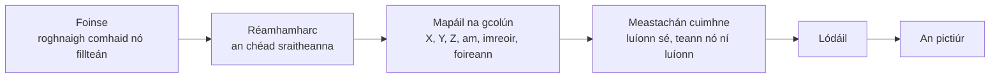

# Sonraí a iontráil

Sula dtarraingeoidh 3DHeat rud ar bith ní mór dó tábla: deir gach ró cá raibh rud éigin agus, mura bhfuil sé ar eolas agat, cathain agus cé a bhí ann. Taispeánann an chuid seo conas a éiríonn comhad ina phictiúr. Gan sonraí fós? Bain triail as an [sonraí taispeána](demo-data.md).

**Déan seo anois:**

1. Sa bharra taoibh Léarscáil teasa oscail **Foinse** agus brúigh **Comhaid…** (nó scaoil comhad nó fillteán ar an limistéar scaoilte).
2. Féach ar **Mapáil na gcolún**: tá na boscaí líonta cheana féin de ghnáth.
3. Seiceáil go deir **Meastachán cuimhne** *luíonn sé*.
4. Brúigh **Lódáil**.

Tagann gach rud a thaispeánann cluaisín na Léarscáile teasa ó **tacar sonraí** amháin: tábla de shraitheanna, gach ceann acu le suíomh agus, roghnach, am, imreoir, grúpa, seisiún, treo féachana agus líon ar bith colún breise a choinnítear le haghaidh scagadh. Míníonn an chuid seo conas a dhéantar tacar sonraí.

## An conair ó chomhaid go pictiúr {#the-path-from-files-to-picture}

1. **Roghnaigh comhaid** sa phainéal **Foinse** - comhad amháin, roinnt, crann fillteán, nó trí iad a scaoileadh. Glactar le Parquet, CSV, Tacview, rianta GPS agus níos mó; tá an liosta iomlán sa [Formáidí sonraí](data-formats.md#files). Féach [Comhaid a lódáil](loading-files.md).
2. **Réamhamharc.** Osclaítear an chéad chomhad den roghnú: ainmneacha a cholún, a chéad 50 sraith, na colúin a dhealraíonn uimhriúil, agus (Parquet) cineál loighciúil gach colúin agus treoracha léitheoireachta an chomhaid féin, iontráil fóintre `heat3d`.
3. **Uathmhapáil.** Sanntar colúin ar róil - X, Y, Z, am, imreoir, seisiún, grúpa, treo féachana - agus coinnítear cúpla ceann le haghaidh scagadh. Taispeántar gach tuairim sa phainéal **Mapáil na gcolún** agus is féidir é a athrú. Féach [Mapáil colún](column-mapping.md) agus [Aiseanna, aonaid agus am](axes-units-and-time.md).
4. **Comhaireamh.** Léitear líon sraitheanna gach comhaid (go beacht ó fhóintí Parquet, measta do CSV), ionas gur féidir leis an bpainéal a rá sula lódáiltear rud ar bith cé mhéad cuimhne a theastaíonn agus an oireann sé. Mura n-oireann, molann sé gach *N*ú sraith a lódáil. Féach [Cuimhne agus buiséid](memory-and-budgets.md).
5. **Lódáil.** Parsálann oibrí cúlra colúin mhapáilte amháin de gach comhad - roinnt comhad ag an am, suas go buiséad [snáitheanna parsála](memory-and-budgets.md#parser-threads) - agus cumascann sé iad, in ord an roghnaithe, ina dtacar sonraí amháin: foclóir comhroinnte amháin de imreoirí, grúpaí agus seisiún thar na comhaid go léir, tús ama coitianta amháin, gach sraith sórtáilte de réir ama. Féach [Seisiúin, daoine agus grúpaí](sessions-persons-groups.md).
6. **Uaslódáil.** Fógraíonn an príomhsnáithe "Ag uaslódáil N ró chuig an GPU" ar feadh fráma amháin, agus pacálann sé na sraitheanna i gcuimhne an GPU laistigh den bhuiséad GPU. Féach [Cónaí cuimhne GPU](gpu-memory.md).
7. **An chéad phictiúr.** Frámaíonn an ceamara na sonraí, socraítear ga an sprid agus sáithiú ó raon agus líon sraitheanna na sonraí, agus tar éis 8 bhfráma rindreáilte tomhaistear an sáithiú ón bpictiúr féin ([Dath agus nochtadh](colour-and-exposure.md)).

## Riachtanais, seiceáilte roimh lódáil {#requirements-checked-before-a-load}

| Riachtanas | Cad a tharlaíonn gan é |
|---|---|
| **Ar a laghad dhá cheann de X / Y / Z** | Diúltaítear don lódáil. Le dhá cheann go díreach, bíonn an tríú ais 0 agus tarraingítear na sonraí mar phlána cothrománach sa radharc 3D - is é sin atá ag teastáil ó theas-léarscáil ó thuas. |
| Colún ama | Roghnach. Gan é díchumasaítear an amlíne, fanann an radharc sa mhód **Gach rud**, agus deir an bharra taoibh sin. |
| Colún imreora | Roghnach. Teastaíonn sé don [fhorleagan figiúr](box-replay.md) (figiúr do gach imreoir), [teas líne](line-heat.md) (an conair a shiúil gach imreoir), idirshuíomh, rianta agus stair **Saolré**. |
| Colún grúpa | Roghnach. Teastaíonn sé do [teas foirne](team-heat.md) agus do mhód na [difríochta](difference.md) (grúpa amháin ar a laghad). |

Déantar mód nach dtacaíonn na sonraí lódáilte leis a dhorchú sa bharra modhanna; má leagtar an luch air insíonn sé cén fáth.

## Gan do shonraí féin {#without-your-own-data}

Tá [gineadóir sintéiseach](synthetic-generator.md) sa phainéal **Tacar sonraí** (faoi **Foinse**) a tháirgeann tacar sonraí de mhéid ar bith ar chruth battle-royale, úsáideach chun an t-amharcóir a thriail agus chun a fhios a dhéanamh cad is féidir le meaisín a láimhseáil.

## Leathanaigh sa chuid seo {#pages-in-this-section}

- [Comhaid a lódáil](loading-files.md) - roghnóirí, fillteáin, tarraingt agus scaoileadh, cumasc il-chomhad, riail an chomhaid gluaiseachta, dul chun cinn agus cealú
- [Mapáil colún](column-mapping.md) - gach réimse sa phainéal mapála, conas a mheastar uathmhapáil, leideanna `heat3d`
- [Aiseanna, aonaid agus am](axes-units-and-time.md) - ais suas, iompuithe, scála aonaid, aonaid ama, treo féachana
- [Seisiúin, daoine agus grúpaí](sessions-persons-groups.md) - cad a dhéanann gach ceann, na teorainneacha, ainmneacha comhroinnte, méid aonáin, an painéal Tacar sonraí
- [Gineadóir sintéiseach](synthetic-generator.md)
- [Cuimhne agus buiséid](memory-and-budgets.md) - samhail an spáis, seiceáil an oireann, díghrádú, uasteorainn sórtála, buiséid acmhainní
