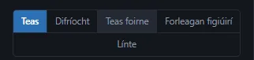

# Modhanna teasa

Cuireann gach ponc lonradh beag leis, carnann na lonraí suas, agus péintéiltear an carnadh le dathanna. Is cúig bhealach iad na modhanna chun é a phéinteáil, agus freagraíonn gach ceann ceist amháin.

Roghnaíonn barra na modhanna ag barr bharra taoibh chluaisín na Léarscáile teasa conas a tharraingítear an [tacar sonraí](glossary.md). Roghnaíonn eochracha 1-4 Teas, Difríocht, Teas foirne agus Línte. Níl eochair ag an Forleagan figiúirí.

| Mód | An cheist a fhreagraíonn sé |
|---|---|
| **Teas** | Cá tharla sé, agus cé mhéad? |
| **Difríocht** | Cén taobh a rinne níos mó de? |
| **Teas foirne** | Cé le duine a bhí sé? |
| **Línte** | Cén treo ar chuaigh daoine? |
| **Forleagan figiúirí** | Cé a bhí cá háit, agus nuair? |

| Modh (lipéad an bharra) | Eochair | Cad a tharraingíonn sé | Riachtanas |
|---|---|---|---|
| **Teas** | 1 | Dlús breiseach: cuireann gach sraith infheicthe sprid radiach atá ag féachaint ar an gceamara leis. [Teas](heat.md) | tacar sonraí |
| **Difríocht** | 2 | Dlús comharthaithe: cuireann daonra amháin leis, baineann daonra eile. [Difríocht](difference.md) | dhá thaobh: dhá ghrúpa ar a laghad, nó scoilt thar cholún coinnithe |
| **Teas foirne** | 3 | Dlús dathaithe de réir grúpa: dath do gach grúpa, measctha nuair a fhorlapann grúpaí. [Teas foirne](team-heat.md) | colún grúpa |
| **Forleagan figiúirí** | - | Figiúr (nó bosca) do gach imreoir, ag bogadh feadh na hamlíne: an athsheinm. [Forleagan figiúirí](box-replay.md), [Athsheinm cluiche](match-replay.md) | colún imreora |
| **Línte** | 4 | Teas líne: líne ó gach sampla d'imreoir go dtí an chéad cheann eile, an teas ag titim go cliathach. [Teas líne](line-heat.md) | colún imreora agus colún ama |

Déantar mód nach dtacaíonn na sonraí leis a dhorchú, agus insíonn a leid cén fáth, mar shampla *Níl sé ar fáil — Teastaíonn dhá ghrúpa nó colún a choinnítear le haghaidh scagtha ón mód difríochta le scoilt air; níl ach grúpa amháin sna sonraí seo.* Nuair nach dtacaíonn tacar nua sonraí leis an mód reatha, titeann an radharc ar ais go **Teas**.

Déantar eochracha 1-4 a sheiceáil ar an mbealach céanna i gcoinne na sonraí: ní dhéanann eochair do mhód dorchaithe rud ar bith.

## Na painéil a thaispeánann gach mód {#which-panels-each-mode-shows}

| Painéal | Teas | Difríocht | Teas foirne | Forleagan figiúirí | Línte |
|---|---|---|---|---|---|
| Bealaí ([teas líne](line-heat.md)) | | | | | tá |
| Cruth an teasa (le **Lean an t-amharc** agus **An dlús céanna ag gach zúmáil**), Dathanna teasa, Teorainneacha picteilíní sprid, Doimhneacht, Baint faoi fhad | tá | tá | tá | | tá |
| Treo ([teas treoch](directional-heat.md)), Luach ([meáchan luacha](value-weighting.md)) | tá | tá | tá | | tá |
| Amharcán foirne ([forleagan figiúr](box-replay.md)) | | | | tá | |
| Scoilt difríochta ([difríocht](difference.md)) | | tá | | | |
| [Foirne](teams-list.md), [Eintitis](entities.md), [Scagairí](filters.md), Cúlra / leibhéal, [Sliseadh](slice.md), [Tomhas](measure.md), Cosán ceamara agus rindreáil, Feidhmíocht, Ceamara agus radharc | tá | tá | tá | tá | tá |

## Cad a roinneann gach mód teasa {#what-every-heat-mode-shares}

Is é an rud céanna na ceithre mhód teasa (gach rud ach an forleagan figiúr) le hionchuir dhifriúla ([`engine.ts`](https://github.com/Holdi601/3DHeat/blob/main/src/render/engine.ts)):

1. **Cé na sraitheanna.** Roghnaíonn fuinneog an [amlíne](timeline.md) raon comhleanúnach de shraitheanna sórtáilte de réir ama; socraíonn [scagairí](filters.md), infheictheacht an ghrúpa, scoilt na difríochta, [baint faoi fhad](depth-and-culling.md#distance-culling) agus an [sliseadh](slice.md) do gach sraith, sa vertex shader, an rannchuidíonn sí agus cé chomh láidir.
2. **Splatáil.** Tarraingítear gach sraith rannchuidithe mar sprid (nó, i mód Línte, mar chuid líne) i **spriocphointe teasa** snámhphointe, ag cur a luach gráduáin leis. Tarraingítear samplaí stratach de na sraitheanna nuair a bhíonn níos mó ann ná mar is féidir le fráma amháin, agus meáchan á thabhairt dóibh chun cúiteamh. Féach [Samplú agus buiséid](sampling-and-budgets.md).
3. **Carnadh.** Fad nach athraíonn aon rud, cumasctar frámaí go dtí go mbíonn gach sraith rannchuidithe go díreach uair amháin. Féach [Carnadh](accumulation.md).
4. **Comhdhéanamh.** Roinntear an luach carnaithe ag gach picteilín ar an **pointe sáithithe**, cruthaítear é leis an **freagairt an dlúis**, ardaítear é leis an **teas íosta**, agus cuardaítear é sa **grádán dathanna**, a alfa ag cumasc é leis an radharc. Féach [Dath agus nochtadh](colour-and-exposure.md).

Cuirtear gach rud i gcéim 4 i bhfeidhm ag am an chomhdhéanta, mar sin ní thosaíonn na rialuithe sin an carnadh arís riamh; cuireann rud ar bith i gcéimeanna 1-2 tús leis.

## Leathanaigh sa chuid seo {#pages-in-this-section}

- [Teas](heat.md) - an mód teasa simplí, agus forbhreathnú a phainéal
  - [Cruth sprite](sprite-shape.md) - ga, déine, titim, eagarthóir na lúbtha, teorainneacha picteilíní, leachú
  - [Dath agus nochtadh](colour-and-exposure.md) - eagarthóir an ghrádáin, pointe sáithithe, nochtadh uathoibríoch, teas íosta, freagairt an dlúis
  - [Doimhne agus baint](depth-and-culling.md) - folaithe ag an leibhéal, folaithe taobh thiar den tír-raon, baint faoi fhad
- [Difríocht](difference.md) - an scoilt difríochta
- [Teas foirne](team-heat.md)
- [Teas líne](line-heat.md) - bealaí
- [Forleagan figiúirí](box-replay.md) - an mód athsheinm (tá an comhad fós ar a dtugtar box replay)
- [Teas treoch](directional-heat.md)
- [Meáchan luacha](value-weighting.md)
