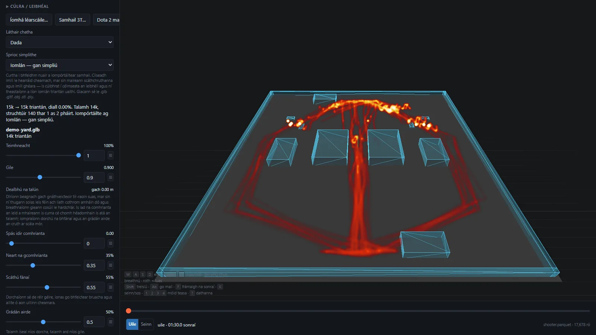

# Teas

Péinteálann teas na háiteanna ar tharla go leor rudaí iontu: dearg san áit a tharla rud beagán, bán-te san áit a tharla go leor. Freagraíonn sé "cá bhfuil an rud seo ag tarlú, agus cé mhéad".

**Teas** (eochair 1) is é an mód réamhshocraithe. Cuireann gach [sraith](glossary.md) infheicthe **spriorad** cruinn ina ndéanann aghaidh ar an gceamara; cuirtear na spritéanna forluiteacha le chéile i maolán snámhphointe; déantar an suim a mhapáil trí ramhar dath - de réir réamhshocraithe trédhearcach → dearg → buí → bán - agus tarraingítear thar an radharc é.

Léiríonn an pictiúr teas babhta lámhaigh ar leibhéal le foirgnimh: suíonn na buaicphointí sna seomraí agus ar na staighrí, ní ar an talamh amháin.

## Conas é a úsáid {#how-to-use-it}

1. Luchtaigh sonraí agus brúigh `1` (nó roghnaigh **Teas** sa bharra modhanna).
2. Mura bhfuil gach rud bán nó folamh, brúigh **Nochtadh uathoibríoch ón réimse** sa chuid **Cruth an teasa**.
3. Athraigh **Ga na sprideanna** go dtí go gcumascann poncanna comharsanacha isteach i mbanda: taispeánann níos lú spotaí aonair, taispeánann níos mó limistéir.
4. Oscail **Dathanna teasa** chun na dathanna a athrú, nó **Doimhneacht** chun ligean do chnoic agus do bhallaí an teas a cheilt taobh thiar díobh.

Déanann na painéil chéanna cruth ar [Difríocht](difference.md), [Teas foirne](team-heat.md) agus [Teas líne](line-heat.md); is difriúil iad sa rud a chuirtear leis (comhartha, dath, nó feadh línte), ní sa chaoi a ndéantar é.

## Na painéil agus a réamhshocruithe {#the-panels-and-their-defaults}

Míníonn leathanach ar leith gach rialú; nascann an colún Sonraí leis. Tá bosca scríofa in aice le sliodair agus handle tarraingthe (an greim beag ar dheis: tarraing suas nó síos; is tapa é dá fhad a tharraingíonn tú; Shift le haghaidh mín-rialaithe); nuair a chríochnaíonn rian sliodair roimh theorainn fhíor, is féidir leis an handle dul thar é go dtí an *uasteorainn jog* a luaitear anseo. Athríomh luachanna a mharcáiltear *ar luchtú* gach tacar sonraí nua.

### Cruth an teasa (oscailte) {#heat-shape-open}

| Rialú | Réamhshocrú | Raon (uasteorainn jog) | Sonraí |
|---|---|---|---|
| **Ga na sprideanna** | 6 m; ar luchtú fairsinge / 120 | 0.05-2000 m, logartamach (50,000) | [Cruth an spriorad](sprite-shape.md#sprite-radius) |
| **Déine sa lár** | 1 | 0-10 (1000) | [Cruth an spriorad](sprite-shape.md#centre-and-edge-intensity) |
| **Déine ar an imeall** | 0 | -2-10 (1000) | [Cruth an spriorad](sprite-shape.md#centre-and-edge-intensity) |
| **Cruth an ghrádáin** | *Titim* | *Titim* / *Cuar* | [Cruth an spriorad](sprite-shape.md#ramp-shape-falloff-or-curve) |
| **Titim** (Titim amháin) | 1.6 | 0.1-8 (64) | [Cruth an spriorad](sprite-shape.md#falloff) |
| **Grádán mín** (Titim amháin) | air | | [Cruth an spriorad](sprite-shape.md#falloff) |
| Eagarthóir an chuair (Cuar amháin) | réamhshocrú *Mín* | | [Cruth an spriorad](sprite-shape.md#the-curve-editor) |
| **Pointe sáithithe** | 24; ar luchtú meastachán, ansin tomhaiste | 0.1-4000, logartamach (10,000,000) | [Dath agus nochtadh](colour-and-exposure.md#saturation-point) |
| **Teas íosta** | as (0) | 0-100% | [Dath agus nochtadh](colour-and-exposure.md#minimum-heat) |
| **Freagairt an dlúis** | *Sáithitheach* | *Sáithitheach* / *Líneach* / *Log* | [Dath agus nochtadh](colour-and-exposure.md#density-response) |
| **Nochtadh uathoibríoch ón réimse** | | cnaipe | [Dath agus nochtadh](colour-and-exposure.md#auto-exposure) |
| **Lean an t-amharc** | air | | Tomhaiseann sé an nochtadh arís gach uair a stopann an ceamara, ionas go n-úsáideann réigiún a dtéann tú isteach ann an raon dath iomlán. Déantar neamhaird d'athruithe beaga agus sleamhnaíonn an scála. Díchum é, nó tarraing **Pointe sáithithe**, chun an scála a ghlasáil agus áiteanna a chur i gcomparáid ar scála amháin. [Dath agus nochtadh](colour-and-exposure.md#follow-the-view) |
| **An dlús céanna ag gach zúmáil** | air | | Ciallaíonn dath an líon céanna sraitheanna in aghaidh achar talún ge bith cé chomh gar is atá tú. Coinníonn spriorad a mhéadaíonn nó a laghdaíonn na teanntáin picteilíní an teas a chuirfeadh a mhéid fíor leis, ionas nach dtéann pictiúr a nochtadh ó i bhfad i gcéin i léig agus tú ag eitilt isteach ann. As, cuireann spriorad teanntaithe a lán meáchain leis ag a mhéid teanntaithe. [Cruth an spriorad](sprite-shape.md#pixel-clamps) |
| **Leacaigh ar phlána na talún** | as | | [Cruth an spriorad](sprite-shape.md#flatten-onto-ground-plane) |

### Dathanna teasa (dúnta) {#heat-colours-closed}

| Rialú | Réamhshocrú | Sonraí |
|---|---|---|
| Swatches grúpa agus **Scaradh dathanna** (Teas foirne amháin) | 1.4 | [Teas foirne](team-heat.md) |
| Eagarthóir **Grádán teasa** (*Dearfach (foirne suimithe)* i Difríocht, *Grádán opacity* i Teas foirne) | trédhearcach → dearg → buí → bán | [Dath agus nochtadh](colour-and-exposure.md#the-ramp-editor) |
| **Athshocraigh go trédhearcach → dearg → buí → bán** | | |
| Grádán **Diúltach (foirne dealaitheacha)** (Difríocht amháin) | trédhearcach → glas → gorm → corcairghorm | [Difríocht](difference.md#colours) |

### Teanntáin picteilíní na sprideanna (dúnta) {#sprite-pixel-clamps-closed}

| Rialú | Réamhshocrú | Raon (uasteorainn jog) | Sonraí |
|---|---|---|---|
| **Íosgha picteilín** | 1 px | 0-16 (512) | [Cruth an spriorad](sprite-shape.md#pixel-clamps) |
| **Uasgha picteilín** | 96 px | 2-1024, logartamach (8192) | [Cruth an spriorad](sprite-shape.md#pixel-clamps) |

### Doimhneacht (oscailte) {#depth-open}

| Rialú | Réamhshocrú | Sonraí |
|---|---|---|
| **Folaigh taobh thiar den tír-raon** | air | [Doimhneacht agus scagadh](depth-and-culling.md#hide-behind-terrain) |
| **Folaithe taobh thiar de chéimseata** | 0.8 (*80% níos dorcha*) | [Doimhneacht agus scagadh](depth-and-culling.md#hidden-behind-geometry) |

### Baint de réir faid (dúnta) {#distance-culling-closed}

| Rialú | Réamhshocrú | Raon (uasteorainn jog) | Sonraí |
|---|---|---|---|
| **Gar** | as (0) | 0.5-5000 m, logartamach, bun an rian = as (200,000) | [Doimhneacht agus scagadh](depth-and-culling.md#distance-culling) |
| **I gcéin** | as (0) | 1-200,000 m, logartamach, bun = as (10,000,000) | [Doimhneacht agus scagadh](depth-and-culling.md#distance-culling) |
| **Gearr ag plána** | air | | [Doimhneacht agus scagadh](depth-and-culling.md#distance-culling) |
| **Gearr an leibhéal freisin** | air | | [Doimhneacht agus scagadh](depth-and-culling.md#distance-culling) |

Eochracha: cuireann `[` agus `]` an teorainn i gcéin isteach agus amach, scoránn `\` í ([Doimhneacht agus scagadh](depth-and-culling.md#keyboard)).

### Treo agus Luach {#direction-and-value}

Tá dhá roinn eile faoi Chruth an teasa. Tarraingíonn **Treo** gach sraith mar leathán agus cuireann saigheada leis: féach [Teas treoch](directional-heat.md). Meáchanann **Luach** an teas de réir mar a chosain nó a thuill gach sraith: féach [Meáchan luacha](value-weighting.md).

## Cad a shábhálann {#what-is-saved}

Ní stóráiltear na socruithe teasa thuas idir seisiúin: athchóiríonn an leathanach a athlódáil na réamhshocruithe. Coinnítear dhá rud sa bhrabhsálaí: luas seinnte deiridh (`heat3d.speed`, féach [Amlíne](timeline.md)) agus socruithe figiúr iargúlta an [fhorleagain figiúirí](box-replay.md) (stíl an tsiombail, méid, marcanna buillí agus mar sin de). Coinnítear an teanga, [aiseanna domhain inbhéartaithe](camera.md#invert-world-axis), ainmneacha carranna a chuimhnítear sa chluaisín rása agus an [leabharlann leibhéal](level-library.md) freisin. Tá an liosta iomlán ar [Socruithe stóráilte](ref-settings-storage.md).
