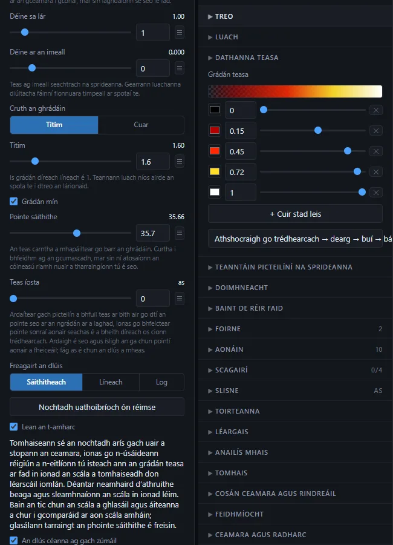

# Teas

Péinteálann teas na háiteanna ar tharla go leor rudaí iontu: dearg san áit ar tharla sé beagán, bán-te san áit ar tharla sé go minic. Freagraíonn sé "cá tharlaíonn seo, agus cé mhéad".

Is é **Teas** (eochair 1) an mód réamhshocraithe. Cuireann gach [sraith](glossary.md) infheicthe sprid radiach cruinn atá ag féachaint ar an gceamara leis; cuireann spridí forleathana suas i maolán snámhphointe; cuirtear an suim trí ghrádán dathanna - de réir réamhshocraithe trédhearcach → dearg → buí → bán - agus tarraingítear thar an radharc é.

Taispeánann an pictiúr teas babhta lámhachóra ar leibhéal le foirgnimh: suíonn spotaí te sna seomraí agus ar na staighrí, ní ar an talamh amháin.

## Conas é a úsáid {#how-to-use-it}

1. Lódáil sonraí agus brúigh `1` (nó roghnaigh **Teas** sa bharra na modhanna).
2. Má tá gach rud bán nó folamh, brúigh **Nochtadh uathoibríoch ón réimse** sa chuid **Cruth an teasa**.
3. Athraigh **Ga na sprideanna** go dtí go dtéann pointí comharsanacha isteach i gcriosanna: is lú a thaispeánann spotaí aonair, is mó a thaispeánann limistéir.
4. Oscail **Dathanna teasa** chun na dathanna a athrú, nó **Doimhneacht** chun ligean do chnoic agus ballaí an teas a fholú taobh thiar díobh.

Cruthaíonn na painéil chéanna [Difríocht](difference.md), [Teas foirne](team-heat.md) agus [Teas líne](line-heat.md); difríonn siad i rud a chuirtear leis (comhartha, dathaithe, nó feadh línte), ní i conas.

## Na painéil agus a réamhshocruithe {#the-panels-and-their-defaults}

Mapálann gach rialú thíos paraiméadar shader, mar sin ní chosnaíonn athrú air ach athtarraingt. Tá bosca cineálach in aice le sleamhnáin agus láimhseáil tarraingthe (an greim bheag ar dheis: tarraing suas nó síos, is tapúla dá fhaide, Shift le haghaidh mionchoigeartuithe); nuair a chríochnaíonn rian an tsleamhnáin roimh theorainn fhíor, is féidir leis an láimhseáil dul thar é suas go dtí an *uasteorainn an tsleamhnáin* a thugtar anseo. Athríonn luachanna a mharcáiltear *ar lódáil* do gach tacar sonraí nua.

### Cruth an teasa (oscailte) {#heat-shape-open}

| Rialú | Réamhshocrú | Raon (uasteorainn an tsleamhnáin) | Sonraí |
|---|---|---|---|
| **Ga na sprideanna** | 6 m; ar lódáil fad / 120 | 0.05-2000 m, logartamach (50,000) | [Cruth sprite](sprite-shape.md#sprite-radius) |
| **Déine sa lár** | 1 | 0-10 (1000) | [Cruth sprite](sprite-shape.md#centre-and-edge-intensity) |
| **Déine ar an imeall** | 0 | -2-10 (1000) | [Cruth sprite](sprite-shape.md#centre-and-edge-intensity) |
| **Cruth an ghrádáin** | *Titim* | *Titim* / *Lúb* | [Cruth sprite](sprite-shape.md#ramp-shape-falloff-or-curve) |
| **Titim** (Titim amháin) | 1.6 | 0.1-8 (64) | [Cruth sprite](sprite-shape.md#falloff) |
| **Grádán mín** (Titim amháin) | air | | [Cruth sprite](sprite-shape.md#falloff) |
| Eagarthóir na lúbtha (Lúb amháin) | réamhshocrú *Mín* | | [Cruth sprite](sprite-shape.md#the-curve-editor) |
| **Pointe sáithithe** | 24; ar lódáil meastachán, ansin tomhaiste | 0.1-4000, logartamach (10,000,000) | [Dath agus nochtadh](colour-and-exposure.md#saturation-point) |
| **Teas íosta** | as (0) | 0-100% | [Dath agus nochtadh](colour-and-exposure.md#minimum-heat) |
| **Freagairt an dlúis** | *Sáithithe* | *Sáithithe* / *Líneach* / *Logartamach* | [Dath agus nochtadh](colour-and-exposure.md#density-response) |
| **Nochtadh uathoibríoch ón réimse** | | cnaipe | [Dath agus nochtadh](colour-and-exposure.md#auto-exposure) |
| **Lean an t-amharc** | air | | Tomhaiseann sé an nochtadh arís gach uair a thagann an ceamara ar scíth, ionas go n-úsáideann réigiún a eitlíonn tú isteach an grádán dathanna iomlán. Déantar neamhaird ar athruithe beaga agus glideann an scála. Díchumasaigh é, nó tarraing **Pointe sáithithe**, chun an scála a ghlasáil agus áiteanna a chur i gcomparáid ar scála amháin. [Dath agus nochtadh](colour-and-exposure.md#follow-the-view) |
| **An dlús céanna ag gach zúmáil** | air | | Ciallaíonn dath an líon céanna sraitheanna in aghaidh an limistéir talún is cuma cé chomh gar is atá tú. Coinníonn sprid a mhéadaíonn teorainneacha picteilíní (i bhfad i gcéin) nó a laghdaíonn é (gar) an teas a chuirfeadh a méid fíor leis, ionas nach dtéann pictiúr a nochtadh ó i bhfad i gcéin i ndorchadas agus tú ag eitilt isteach ann. As, cuireann sprid teorainnithe a meáchan iomlán leis ar a mhéid teorainnithe. [Cruth sprite](sprite-shape.md#pixel-clamps) |
| **Leacaigh ar phlána na talún** | as | | [Cruth sprite](sprite-shape.md#flatten-onto-ground-plane) |

### Dathanna teasa (dúnta) {#heat-colours-closed}

| Rialú | Réamhshocrú | Sonraí |
|---|---|---|
| Swatches grúpa agus **Scaradh dathanna** (Teas foirne amháin) | 1.4 | [Teas foirne](team-heat.md) |
| Eagarthóir **Grádán teasa** (*Dearfach (foirne suimitheacha)* sa Difríocht, *Grádán teimhneachta* sa Teas foirne) | trédhearcach → dearg → buí → bán | [Dath agus nochtadh](colour-and-exposure.md#the-ramp-editor) |
| **Athshocraigh go trédhearcach → dearg → buí → bán** | | |
| Grádán **Diúltach (foirne dealaitheacha)** (Difríocht amháin) | trédhearcach → glas → gorm → corcra | [Difríocht](difference.md#colours) |

### Teorainneacha picteilíní sprid (dúnta) {#sprite-pixel-clamps-closed}

| Rialú | Réamhshocrú | Raon (uasteorainn an tsleamhnáin) | Sonraí |
|---|---|---|---|
| **Íosgha picteilín** | 1 px | 0-16 (512) | [Cruth sprite](sprite-shape.md#pixel-clamps) |
| **Uasgha picteilín** | 96 px | 2-1024, logartamach (8192) | [Cruth sprite](sprite-shape.md#pixel-clamps) |

### Doimhneacht (oscailte) {#depth-open}

| Rialú | Réamhshocrú | Sonraí |
|---|---|---|
| **Folaigh taobh thiar den tír-raon** | air | [Doimhne agus baint](depth-and-culling.md#hide-behind-terrain) |
| **Folaithe taobh thiar de chéimseata** | 0.8 (*80% níos dorcha*) | [Doimhne agus baint](depth-and-culling.md#hidden-behind-geometry) |

### Baint faoi fhad (dúnta) {#distance-culling-closed}

| Rialú | Réamhshocrú | Raon (uasteorainn an tsleamhnáin) | Sonraí |
|---|---|---|---|
| **Gar** | as (0) | 0.5-5000 m, logartamach, bun na rianta = as (200,000) | [Doimhne agus baint](depth-and-culling.md#distance-culling) |
| **I gcéin** | as (0) | 1-200,000 m, logartamach, bun = as (10,000,000) | [Doimhne agus baint](depth-and-culling.md#distance-culling) |
| **Gearr ag plána** | air | | [Doimhne agus baint](depth-and-culling.md#distance-culling) |
| **Gearr an leibhéal freisin** | air | | [Doimhne agus baint](depth-and-culling.md#distance-culling) |

Eochracha: brúnn `[` agus `]` an teorainn i gcéin isteach agus amach, scoraíonn `\` í ([Doimhne agus baint](depth-and-culling.md#keyboard)).

### Treo agus Luach {#direction-and-value}

Tá dhá chuid eile faoi Cruth an teasa. Tarraingíonn **Treo** gach sraith mar lúibín agus cuireann saigheada leis: féach [Teas treoch](directional-heat.md). Meáchann **Luach** an teas de réir an méid a chosain nó a shaothraigh gach sraith: féach [Meáchan luacha](value-weighting.md).

## Cad a shábháiltear {#what-is-saved}

Ní stóráiltear na socruithe teasa thuas idir seisiúin: má athlódálann tú an leathanach, athshocraítear na réamhshocruithe. Coinnítear dhá rud sa bhrabhsálaí: an luas athsheinm deiridh (`heat3d.speed`, féach [Amlíne](timeline.md)) agus socruithe an bhreasán i gcéin den [fhorleagan figiúr](box-replay.md) (stíl siombail, méid, marcanna buillí agus mar sin de). Mar an gcéanna, an teanga, [aiseanna domhanda inbhéartha](camera.md#invert-world-axis), ainmneacha na ngluaisteán a chuimhnigh cluaisín rása agus an [leabharlann leibhéal](level-library.md). Tá an liosta iomlán ar [Socruithe stóráilte](ref-settings-storage.md).
