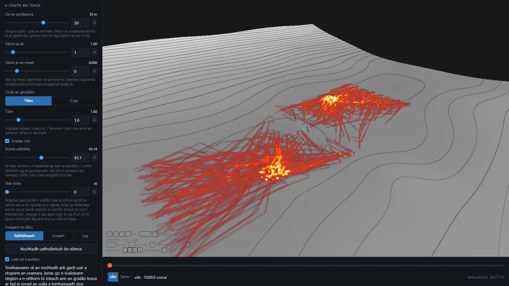
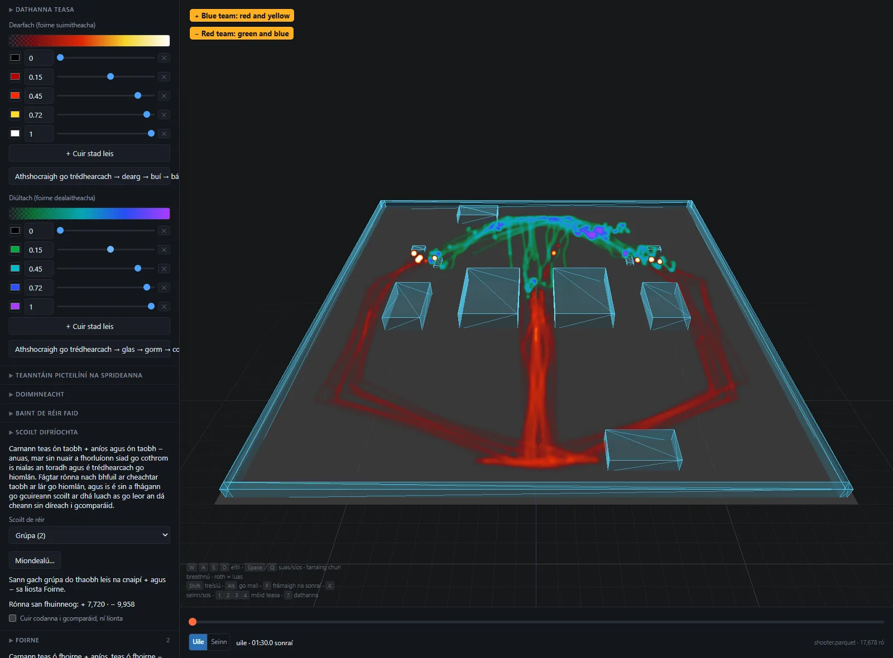
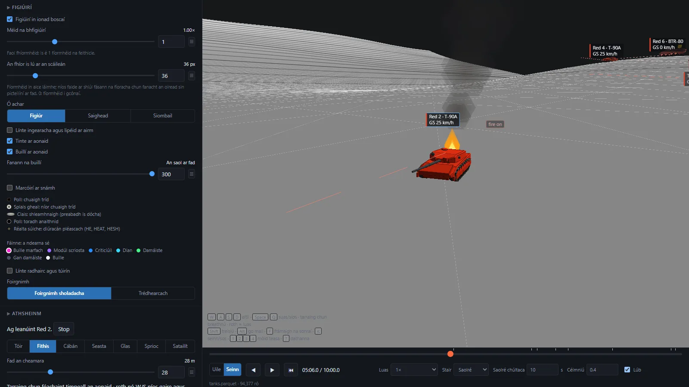
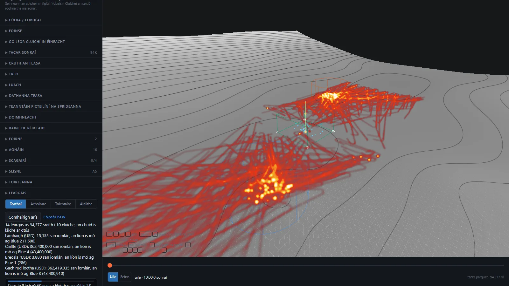
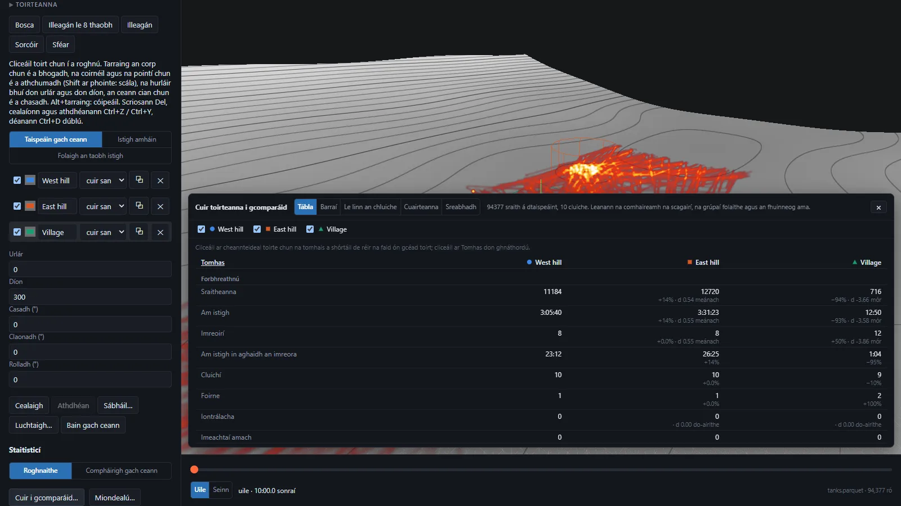
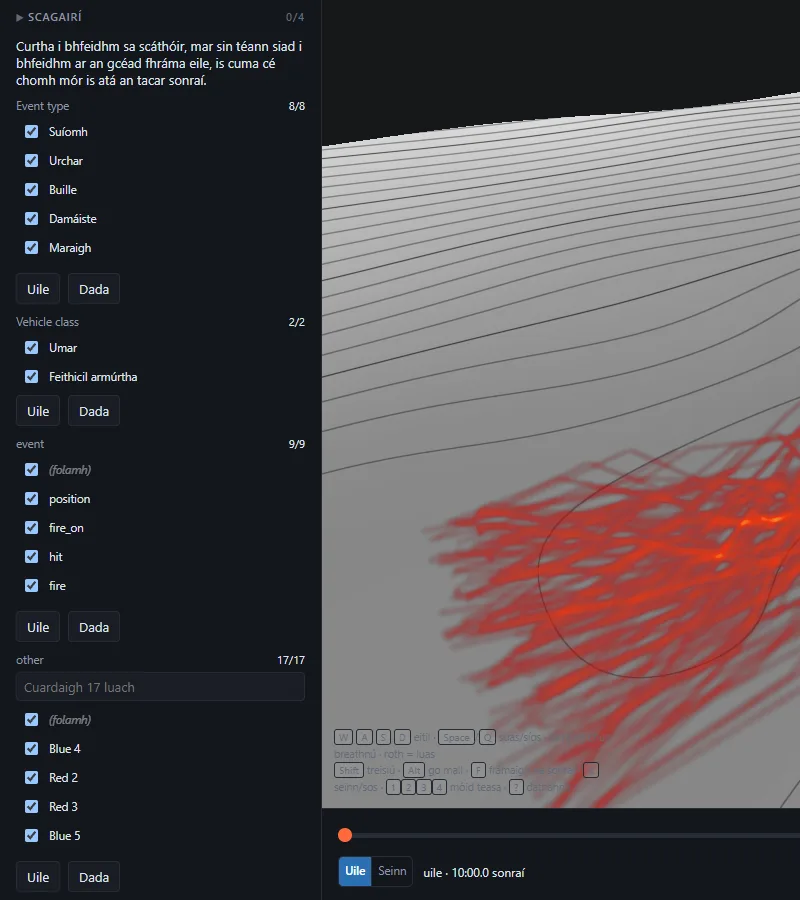
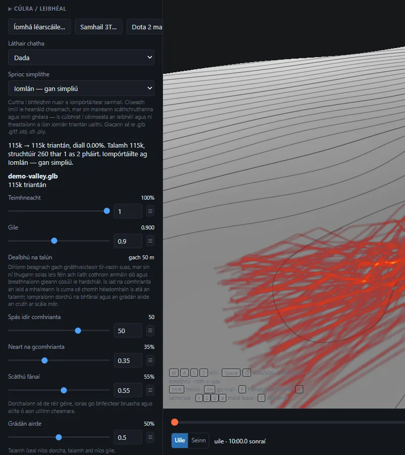

# 3DHeat

Taispeánann 3DHeat cá ndeachaigh rudaí i gcluiche - cá ndeachaigh imreoirí, cá ndearna siad troid agus cá dtit siad - mar dhathanna lonracha ar féidir leat eitilt tríothu, nó mar fhigiúirí beaga 3D a athsheinm an cluiche.

Lódáil suímh - CSV, Parquet, taifeadtaí Tacview, athsheinmeanna coinbhertaithe, comhad amháin, fillteán nó na mílte cluiche - agus féach orthu mar **léarscáil theasa ar féidir leat eitilt tríthi**, mar **fhigiúirí a athsheinmeann an cluiche**, mar línte feadh na n-bealaí a thóg daoine, nó mar dhaonra amháin i gcoinne daonra eile. Aimsíonn sé cad a sheasann amach leis féin, agus ritheann sé go hiomlán i do bhrabhsálaí: ní uaslódáiltear aon rud in áit ar bith. Tá 3DHeat agus a uirlisí go léir saor in aisce agus foinse oscailte faoi [cheadúnas MIT](https://github.com/Holdi601/3DHeat/blob/main/LICENSE).



**Nua anseo?** Déan na [sonraí taispeána](demo-data.md) agus lean a seacht gcéim. Tógadh gach pictiúr ar an suíomh seo leo.

## Cad a dhéanann sé {#what-it-does}

| | |
|---|---|
|  | **[Modhanna teasa](heat-modes.md)** - teas, [difríocht](difference.md) (dearg far a raibh an taobh amháin níos mó, gorm-glas far a raibh an taobh eile), [teas foirne](team-heat.md), [teas líne](line-heat.md); [teas treoch](directional-heat.md) le lúibíní, réimsí saighead agus cairteacha polair; teas [meáite de réir luacha](value-weighting.md): cad a chosnaíonn airm, feithiclí agus breosla. |
|  | **[Athsheinm cluiche](match-replay.md)** - gach aonad mar an [figiúr](figures.md) de cad é, samhlacha NATO nó Rúsach i bhfad i gcéin, diúracáin agus rianta solais, marcanna buillí, long briste, tinte, túiríní, cuspóirí, ceamaraí de stíl Tacview agus taispeántas taictiúil; [go leor cluichí ag an am céanna](many-matches.md). |
|  | **[Léargais](insights.md)** - suímh láidre, talamh marfach, gaistí spawn, cúngáin agus imreoirí a sheasann amach, aimsithe agus rangaithe leis an fhianaise; achoimre scríofa, roghnach le AI de do rogha; tráchtaire le haghaidh cluiche amháin; an [lionsa eolais](knowledge.md). |
|  | **[Toirteanna](volumes.md)** - boscaí, prismeanna, sorcóirí agus sféir a tharraingt, scagadh chucu, comhairle a dhéanamh ar an méid a tharlaíonn istigh, é a easpórtáil, agus áiteanna a chur i gcomparáid taobh le taobh; [miondealú](breakdown.md) ar cé agus cad a dhéanann go maith in áit. |
|  | **[Scagairí](filters.md)** - de réir cineál imeachta, imreoir nó AI, aicme feithicle, luach, aon cholún, sa chárta grafaice ag aon mhéid sonraí. |
|  | **[Leibhéil](levels.md)** - íomhánna léarscáile, leibhéil 3D a rinneadh leis na [uirlisí sonraí](#related-repositories), simplithe, an [cúlra domhanda](world-backdrop.md) le tír-raon fíor le haghaidh sonraí eitilte. |

Chomh maith leis sin: cluaisín [Anailís rása](race-analysis.md) le haghaidh cuairteanna ar chluichí rásaíochta, cluaisín [Cluiche](match-analysis.md) le haghaidh achoimrí Counter-Strike 2, an [Clár na dtaictic](tactics-board.md) le haghaidh pleananna ar leibhéal, [anailís buailte](hit-analysis.md) de réir feithicle, [anailís mhais](mass-analysis.md) de na mílte cluiche, [cosáin ceamara agus físeán](camera-path-and-video.md), [40 teanga](languages.md), [aonaid mheiticiúla nó impiriúla](settings.md).

## Na cluaisíní {#the-tabs}

Tá na cluaisíní ag barr na barra taoibh, faoin ainm, na haonaid agus roghchlár na teanga.

| Cluaisín | Cad a chuige |
|---|---|
| **Léarscáil teasa** | Aon tábla suímh: na modhanna teasa, an forleagan figiúr, scagairí, toirteanna, léargais, leibhéil, tomhas agus físeán. |
| **Anailís rása** | Dhá chuairt nó níos mó de chúrsa amháin: cá gcaillfear am, cén fáth, agus cad atá le hathrú. |
| **Cluiche** | Athsheinm figiúr cluiche, agus achoimrí cluiche Counter-Strike 2. |
| **Beartaíocht** | Pleananna ar leibhéal: figiúirí, bealaí, fóiréinn caite, limistéir agus nótaí i gcéimeanna a sheinntear. |
| **Feithiclí** | Cá raibh gach aonad buailte, ag cé agus le cad. |

## Suiteáil agus rith {#install-and-run}

Tá 3DHeat saor in aisce le húsáid, le hathrú agus le roinnt (ceadúnas MIT), agus mar sin tá gach uirlis atá liostaithe faoi [Stórais ghaolmhara](#related-repositories) saor freisin.

### Windows, an bealach éasca {#windows-the-easy-way}

Tá trí chomhad baisc sa phríomhfhillteán den stór.

| Comhad | Cad a dhéanann sé |
|---|---|
| `start.bat` | Tosaíonn sé an amharcóir. Aimsíonn sé Node.js fiú nuair nach bhfuil sé ar `PATH` (féachann sé i `%ProgramFiles%\nodejs`, `%ProgramFiles(x86)%\nodejs` agus `%LOCALAPPDATA%\Programs\nodejs`), agus nuair nach bhfuil Node.js ann tairgeann sé an leagan LTS a shuiteáil le `winget install -e --id OpenJS.NodeJS.LTS`. An chéad uair a ritheann sé, fiafraíonn sé sula íoslódálann sé na spleáchais (thart ar 300 MB i `node_modules\` laistigh den fhillteán, ach ní ar fud an chórais). Diúltaíonn sé tosú nuair atá rud éigin ag éisteacht ar phort 5273 cheana féin, agus treoraíonn sé chuig `restart.bat` ina ionad. Nuair is seiceáil git é an fillteán gan athruithe áitiúla agus go bhfuil leagan níos nuaí ann, fiafraíonn sé an nuashonraítear (T/N; mura bhfreagraítear é laistigh de 60 s coinníonn sé an leagan seo; féach [Nuashonruithe](updates.md)). Ansin ritheann sé an freastalaí forbartha ar `http://127.0.0.1:5273/` agus osclaíonn sé an brabhsálaí. **Is é an fhuinneog an freastalaí**: fág oscailte é, dún é nó brúigh Ctrl+C chun stop a chur leis. |
| `restart.bat` | Ritheann sé `stop.bat quiet`, ansin `start.bat`. Ní theastaíonn uait ach tar éis `vite.config.ts` a athrú, spleáchas a chur leis, nó nuair a bhíonn an freastalaí gafa - athlódáiltear athruithe foinse go díreach. |
| `stop.bat` | Cuireann sé stop le haon rud a éisteann ar phort 5273, trí aitheantas an phróisis a aimsítear le `netstat`, ní riamh de réir ainm íomhá, ionas nach gcuirtear isteach ar phróisis Node.js eile ar an ríomhaire. Fanann sé thart ar dhá shoicind go scaoiltear an socaed. Leis an argóint `quiet` ní stadann sé ag an deireadh. |

### De láimh (aon OS) {#by-hand-any-os}


```bash
git clone --recursive https://github.com/Holdi601/3DHeat.git
cd 3DHeat
npm install
npm run dev      # http://127.0.0.1:5273
```

Coinníonn fillteán `exporters/` na huirlisí sonraí ar leithligh mar fho-mhodúil git, gach ceann ina stóras féin; tar éis clón simplí rith `git submodule update --init`. Ní theastaíonn na huirlisí seo ón amharcóir féin chun rith. Coinníonn `exporters/ext/` na coinbhertóirí roghnacha (War Thunder, World of Tanks, World of Warships, athsheinmeanna Squad; léarscáileanna DCS agus IL-2), scartha óna chéile ionas nach gcuirfidh fadhb le ceann amháin isteach ar aon cheann eile.

Ní thagann sonraí cluiche leis an rud ar bith: déantar leibhéil, léarscáileanna agus taifeadtaí ar do ríomhaire féin leis na huirlisí, ó chluichí atá agat.

### Scripteanna npm {#npm-scripts}

| Script | Cad a ritheann sé |
|---|---|
| `npm run dev` | Freastalaí forbartha Vite ar phort 5273, ceangailte le `127.0.0.1`. |
| `npm run build` | Seiceáil chineálach (`tsc --noEmit`) agus beart léiriúcháin i `dist/`. |
| `npm run preview` | Freastalaíonn sé ar an mbeart léiriúcháin. |
| `npm run typecheck` | An tseiceáil chineálach amháin. |
| `npm test` / `npm run test:watch` | Tástálacha aonaid agus comhtháthaithe (vitest). |
| `npm run smoke` | Tiománann sé an aip iarbhír i Chromium gan ceann agus seiceálann sé go bhfuil picteilíní datha sonraí ar an gcanbhás; téann scáileanáin chuig `tools/.smoke/`. Glacann sé leis go bhfuil an freastalaí forbartha ag rith. |
| `npm run smoke:f16` | An tsraith chéanna le `?heat=f16`, ag cur iallach ar an mbealach carnadh leath-snámhphointe (féach [Carnadh leath-snámhphointe](half-float-accumulation.md)). |
| `npm run bench` | Tomhas ionchuir, scríobhann sé `tools/.smoke/ingest-bench.json`. |
| `npm run test:heavy` | Tástálacha a theastaíonn comhaid mhóra sonraí fhíora uathu; scipeann siad iad féin nuair nach bhfuil na comhaid ann. |
| `npm run inspect -- <file.parquet>` | Priontálann sé scéim comhaid Parquet agus roinnt sraitheanna (`tools/inspect-parquet.mjs`). |

### Cad a chuireann an freastalaí forbartha leis {#what-the-dev-server-adds}

Is leathanach gréasáin statach é an amharcóir, ach cuireann an freastalaí forbartha (féach `vite.config.ts`) dhá bhealach áitiúla leis nach bhfuil ag imscaradh statach de `dist/`:

- Tuairiscíonn `/__host/memory` RAM suiteáilte agus saor an ríomhaire agus, sa chás go bhfuil sé inléite, cuimhne chárta grafaice (ó `nvidia-smi`, nó ar Windows ó iontráil an adapter taispeána sa chlár). Is é seo a fhágann go n-úsáideann [buiséid chuimhne](memory-and-budgets.md) figiúirí fíora in ionad tomhas teoranta an bhrabhsálaí.
- Seiceálann `/__heat3d/update` an bhfuil an cóip taobh thiar agus is féidir leis í a chur ar aghaidh (fast-forward) ([Nuashonruithe](updates.md)).

Ní ceanglaíonn an freastalaí ach le `127.0.0.1`, mar sin ní fhaightear na bealaí seo ó líonra. Oscail é mar `http://127.0.0.1:5273`: is féidir le `localhost` feiscint ar an loopback IPv6 `::1`, áit nach éisteann rud ar bith. Ní sheolann sé ceannlínte cross-origin isolation (COOP/COEP): ní úsáideann aon rud san amharcóir `SharedArrayBuffer`, agus tugann na hoibrithe a gcuid sonraí trí aistriú, ar nach gá aon rud.

## Riachtanais brabhsálaí agus GPU {#browser-and-gpu-requirements}

- **Brabhsálaí le WebGPU nó WebGL2.** Triailtear WebGPU ar dtús (tá sé ag Chrome agus Edge); gan é úsáidtear an cúlstór WebGL2. Caithfidh WebGL2 `EXT_color_buffer_float` a thairiscint (rindreáil go dtí uigeachtaí snámhphointe), nó taispeánann an amharcóir "Ní féidir an rindreálaí a thúsú." Féach [An dá chúltaca](backends.md). Forbraítear agus tástáiltear an amharcóir i Chromium; níl na brabhsálaithe eile fíoraithe.
- **Luasghéarú crua ar siúl.** Nuair a dhéanann an brabhsálaí léaráidí ar an bpróiseálaí (SwiftShader, llvmpipe, an Microsoft Basic Render Driver agus cosúla) deir bratach dhearg ag barr na barra taoibh sin agus conas é a shocrú. Féach [Brath rindreála bogearraí](software-rendering.md).
- **Cabhraíonn GPU discréideach, ach níl sé riachtanach.** Iarrann an dá chúltaca an t-oiriúnóir ardfheidhmíochta. Is buiséad é an méid sonraí is féidir a shealbhú ar an GPU is féidir leat a fheiceáil agus a athrú ([Cuimhne agus buiséid](memory-and-budgets.md)).
- **Úsáideann gnéithe roghnacha tuilleadh APIanna brabhsálaí:** teastaíonn WebCodecs `VideoEncoder` le VP9 nó VP8 le haghaidh rindreála físeáin ([Cosán ceamara agus físeán](camera-path-and-video.md)); teastaíonn WebAssembly le haghaidh simplithe mogall leibhéal; úsáideann scaoileadh fillteán an File and Directory Entries API; úsáideann an leabharlann leibhéal IndexedDB; úsáideann pada cluiche an Gamepad API.

## Léarscáil na ndoiciméad {#documentation-map}

**Tús**: [Sonraí taispeána](demo-data.md) · [Sonraí a iontráil](getting-data-in.md) ([comhaid a lódáil](loading-files.md), [mapáil colún](column-mapping.md), [aiseanna, aonaid agus am](axes-units-and-time.md), [seisiúin, daoine agus grúpaí](sessions-persons-groups.md), [Tacview](tacview-acmi.md), [coinbhertóirí](converters.md), [.3dheat](container.md), [cuimhne agus buiséid](memory-and-budgets.md))

**Féach**: [Modhanna teasa](heat-modes.md) ([teas](heat.md), [cruth an spridbhíog](sprite-shape.md), [dath agus nochtadh](colour-and-exposure.md), [doimhne agus baint](depth-and-culling.md), [difríocht](difference.md), [teas foirne](team-heat.md), [teas líne](line-heat.md), [teas bosca](box-replay.md), [teas treoch](directional-heat.md), [meáchan luacha](value-weighting.md)) · [Amlíne](timeline.md) · [Leibhéil](levels.md) ([íomhánna léarscáile](map-images.md), [leibhéil 3D](model-levels.md), [cuma](level-appearance.md), [leabharlann](level-library.md), [cúlra domhanda](world-backdrop.md), [a fhoinsí](world-backdrop-sources.md)) · [Ceamara](camera.md) ([pada](gamepad.md), [eochracha](keyboard-reference.md)) · [Cosán ceamara agus físeán](camera-path-and-video.md)

**Anailísigh**: [Scagairí agus uirlisí](filters-and-tools.md) ([scagairí](filters.md), [foirne](teams-list.md), [eintitis](entities.md), [sliseadh](slice.md), [tomhas](measure.md), [toirteanna](volumes.md), [miondealú](breakdown.md)) · [Léargais](insights.md) ([lionsa eolais](knowledge.md)) · [Anailís mhais](mass-analysis.md)

**Athsheinm**: [Athsheinm cluiche](match-replay.md) · [Go leor cluichí ag an am céanna](many-matches.md) · [Figiúirí](figures.md) ([sa fhorleagan figiúr](figure-replay.md), [creidiúintí](figure-credits.md)) · [Comhionannas Tacview](tacview-parity.md) · [Anailís buailte](hit-analysis.md)

**Cluaisíní eile**: [Anailís rása](race-analysis.md) ([an modh](race-analytics.md), [cluichí eile](other-games.md)) · [Anailís cluiche](match-analysis.md) · [Clár na dtaictic](tactics-board.md) ([luasanna](tactics-speeds.md))

**An t-amharcóir**: [Gluais](glossary.md) · [Socruithe, aonaid agus eochracha](settings.md) · [Teangacha](languages.md) · [Nuashonruithe](updates.md) · [Inmheánacha rindreála](rendering-internals.md) ([cúltaca](backends.md), [carnadh](accumulation.md), [samplú agus buiséid](sampling-and-budgets.md), [leath-snámhphointe](half-float-accumulation.md), [cuimhne GPU](gpu-memory.md), [rindreáil bogearraí](software-rendering.md), [feidhmíocht agus staitisticí](performance-and-stats.md)) · [Formáidí sonraí](data-formats.md) · [Tagairt](reference.md) · [Na doiciméid a choinneáil](maintaining.md)

## Stórais ghaolmhara {#related-repositories}

Léann an t-amharcóir sonraí; déanann na huirlisí seo iad. Is stóras poiblí é gach ceann (MIT) le a dhoiciméadú féin. Níl sonraí cluiche ar bith sa chuid is mó díobh: déantar leibhéil, léarscáileanna agus taifeadtaí ar do ríomhaire féin, ó chluichí atá agat.

| Stór | Cad a dhéanann sé | Úsáideach le haghaidh | Doiciméadú |
|---|---|---|---|
| [3DHeat-GameFiles](https://github.com/Holdi601/3DHeat-GameFiles) | Léann cúrsaí agus leibhéil as na cartlanna a sheolann cluichí (Forza Horizon, BeamNG, Assetto Corsa Rally; léitheoirí Unreal, Unity, Frostbite agus Source 2) mar glTF | leibhéal 3D faoi do theas nó d'athsheinm | [suíomh](https://holdi601.github.io/3DHeat-GameFiles/) |
| [3DHeat-GameCapture](https://github.com/Holdi601/3DHeat-GameCapture) | Taifeadann telemetry lap ó na comhéadain a fhoilsíonn cluichí rásaíochta, agus atógann leibhéil ó físeán cluiche | laps do Anailís rása; leibhéal nuair nach féidir aon chomhad a léamh | [suíomh](https://holdi601.github.io/3DHeat-GameCapture/) |
| [3DHeat-UnrealExporter](https://github.com/Holdi601/3DHeat-UnrealExporter) | Breiseán Unreal Editor a easpórtálann leibhéal mar chomhad glTF amháin | leibhéil de do thionscadail Unreal féin | [suíomh](https://holdi601.github.io/3DHeat-UnrealExporter/) |
| [3DHeat-CS2](https://github.com/Holdi601/3DHeat-CS2) | Demos Counter-Strike 2 ina dtáblaí léarscáile teasa agus achoimrí cluiche, léarscáileanna CS2 ina ngeoiméadracht | teas CS2, athsheinmeanna agus cluaisín Cluiche | [suíomh](https://holdi601.github.io/3DHeat-CS2/) |
| [3DHeat-Watcher](https://github.com/Holdi601/3DHeat-Watcher) | Taifeadann do sheinm sa chúlra ó na rudaí a fhoilsíonn cluichí: telemetry, comhtháthuithe staide cluiche, logaí, athsheinmeanna | do staitisticí féin gan rud ar bith a dhéanamh de láimh | [suíomh](https://holdi601.github.io/3DHeat-Watcher/) |
| [3DHeat-Ext-WarThunder](https://github.com/Holdi601/3DHeat-Ext-WarThunder) | Athsheinmeanna War Thunder (`.wrpl`) ina dtáblaí: rianta aeir agus talún, urchair, buillí, marbhanna, túiríní, cuspóirí | athsheinmeanna War Thunder, marcanna buillí agus léargais | [suíomh](https://holdi601.github.io/3DHeat-Ext-WarThunder/) |
| [3DHeat-Ext-WoT](https://github.com/Holdi601/3DHeat-Ext-WoT) | Athsheinmeanna World of Tanks ina dtáblaí: suíomh gach feithicle, básanna agus marbhanna | teas agus athsheinmeanna World of Tanks | [suíomh](https://holdi601.github.io/3DHeat-Ext-WoT/) |
| [3DHeat-Ext-WoWs](https://github.com/Holdi601/3DHeat-Ext-WoWs) | Athsheinmeanna World of Warships ina dtáblaí: suíomh gach loinge agus a báthadh | teas agus athsheinmeanna World of Warships | [suíomh](https://holdi601.github.io/3DHeat-Ext-WoWs/) |
| [3DHeat-Ext-Squad](https://github.com/Holdi601/3DHeat-Ext-Squad) | Demos freastalaí Squad ina dtáblaí: suíomh, foireann agus scuad gach imreora | teas agus athsheinmeanna Squad | [suíomh](https://holdi601.github.io/3DHeat-Ext-Squad/) |
| [3DHeat-Ext-DCS](https://github.com/Holdi601/3DHeat-Ext-DCS) | Tír-raonta DCS World ó do shuiteáil féin ina leibhéil: talamh, bóithre, bailte, aerpháirceanna, páirceanna, uisce | DCS agus taifeadtaí Tacview ar a dtír-raon fíor | [suíomh](https://holdi601.github.io/3DHeat-Ext-DCS/) |
| [3DHeat-Ext-IL2](https://github.com/Holdi601/3DHeat-Ext-IL2) | Léarscáileanna IL-2 Great Battles ina leibhéil | taifeadtaí IL-2 ar a léarscáil | [suíomh](https://holdi601.github.io/3DHeat-Ext-IL2/) |

## Leagan amach an fhoinse, go hachomair {#source-layout-briefly}

| Fillteán | Ábhar |
|---|---|
| [`src/data/`](https://github.com/Holdi601/3DHeat/tree/main/src/data) | Roghnú comhad, ionchur CSV agus Parquet, uathmhapáil, bailíochtú, samhail cuimhne, tógálaí tacair sonraí, parsáil samhlacha, rangú, simplithe, leabharlann leibhéal |
| [`src/render/`](https://github.com/Holdi601/3DHeat/tree/main/src/render) | Lúb an fhráma (`engine.ts`), samplú, an dá chúltaca, ceamara, pada, tomhas, cosán ceamara, taifeadadh físeáin |
| [`src/state/`](https://github.com/Holdi601/3DHeat/tree/main/src/state) | Stát an iarratais (`store.ts`) leis na réamhshocruithe go léir, na cineálacha fearainn (`types.ts`), cuar an spridbhíog |
| [`src/ui/`](https://github.com/Holdi601/3DHeat/tree/main/src/ui) | Painéil na barra taoibh, an amlíne, na forleaganacha |
| [`src/race/`](https://github.com/Holdi601/3DHeat/tree/main/src/race), [`src/match/`](https://github.com/Holdi601/3DHeat/tree/main/src/match) | Cluaisíní Anailís rása agus Cluiche |
| [`src/i18n/`](https://github.com/Holdi601/3DHeat/tree/main/src/i18n) | Aistriúcháin |
| [`src/insights/`](https://github.com/Holdi601/3DHeat/tree/main/src/insights) | Léargais: brathadóirí, achoimre, tráchtaire, soláthraithe AI, an lionsa eolais |
| [`src/mass/`](https://github.com/Holdi601/3DHeat/tree/main/src/mass) | Anailís mhais thar go leor cluichí |
| [`src/volumes/`](https://github.com/Holdi601/3DHeat/tree/main/src/volumes) | Toirteanna, a staitisticí, a n-easpórtáil agus a gcomparáid |
| [`src/breakdown/`](https://github.com/Holdi601/3DHeat/tree/main/src/breakdown) | Miondealú agus fachtóirí |
| [`src/overlay/`](https://github.com/Holdi601/3DHeat/tree/main/src/overlay) | An forleagan go leor cluichí |
| [`src/figures/`](https://github.com/Holdi601/3DHeat/tree/main/src/figures) | Catalóg na bhfigiúr agus a tógálaí |
| [`src/vehicle/`](https://github.com/Holdi601/3DHeat/tree/main/src/vehicle) | Anailís buailte (cluaisín Feithiclí) |
| [`src/tactics/`](https://github.com/Holdi601/3DHeat/tree/main/src/tactics) | Clár na dtaictic |
| [`src/world/`](https://github.com/Holdi601/3DHeat/tree/main/src/world) | An cúlra domhanda |
| [`src/units/`](https://github.com/Holdi601/3DHeat/tree/main/src/units) | Aonaid tomhais |
