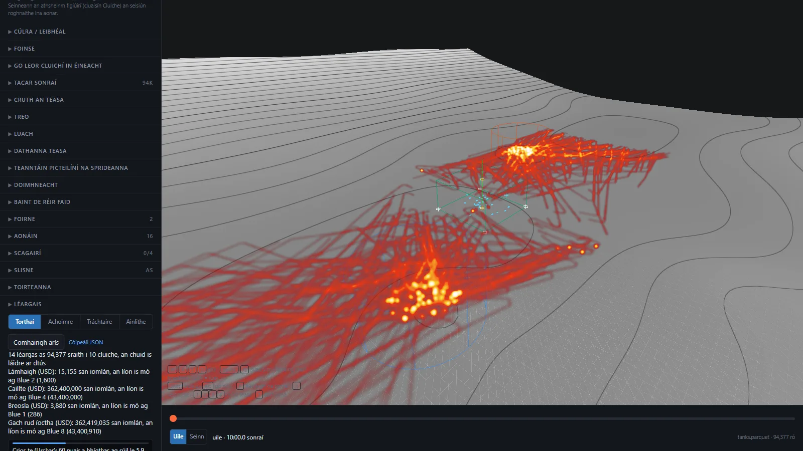
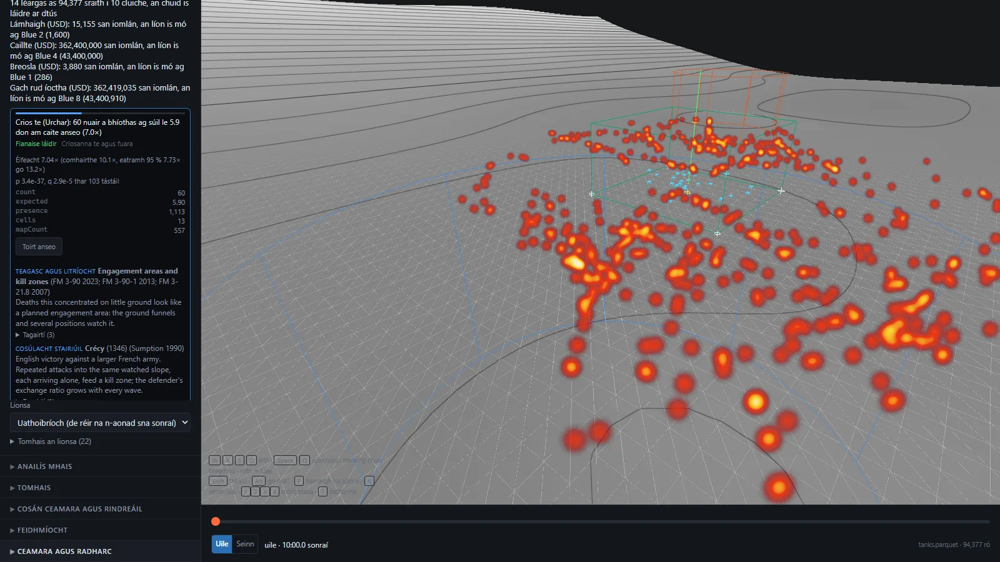
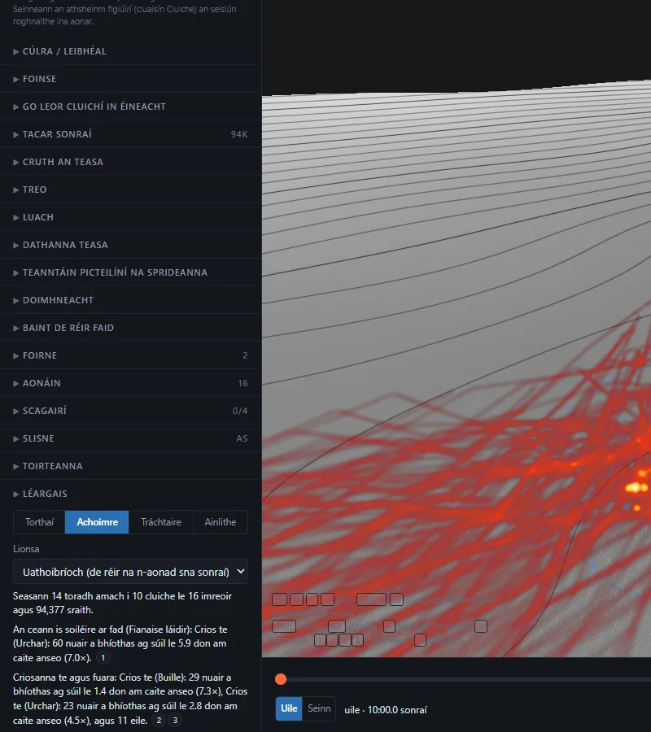
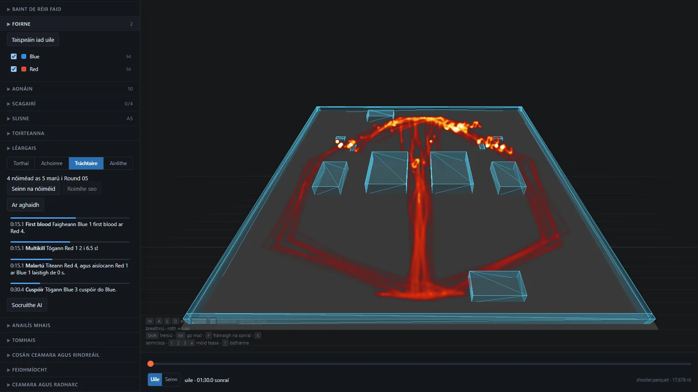

# Léargais

Breathnaíonn **Léargais** tríd na sonraí lódáilte le haghaidh rud a sheasann amach - seasaimh láidre, talamh marfach, gaistí spawn, pointí cúngaithe, imreoirí atá i bhfad os cionn a gcomhghleacaithe - agus insíonn sé duit, an ceann is láidre ar dtús, agus an fhianaise in éineacht leis. Úsáid é chun a fhoghlaim i nóiméad cá bhfuair nó cá gcaill cluiche. Ansin is féidir leis achoimre scríofa a scríobh, agus i gcluiche amháin is féidir leis gníomhú mar thráchtaire a léimeann chuig na nóiméid mhóra.

Déantar gach rud a chomhaireamh i do bhrabhsálaí. Ní fhágann rud ar bith do ríomhaire mura lasann tú AI seachtrach (féach [AI sheachtrach](#external-ai)).

Tá an chuid **Léargais** sa bharra taoibh de chluaisíní na Léarscáile teasa agus Cluiche. Tá trí chluaisín inti: **Torthaí**, **Achoimre** agus **Tráchtaire**.

## Torthaí {#findings}

1. Lódáil sonraí agus oscail **Léargais**. Brúigh **Aimsigh léargais** (taispeánann "Ag comhaireamh… n%" an dul chun cinn).
2. Léigh an liosta. Tá barra neart, abairt, cé chomh maith is atá an fhianaise (*Fianaise láidir*, *Fianaise mhaith* nó *Roinnt fianaise*), an braiteoir a fuair é, agus aicme na feithicle nuair a bhíonn sé tábhachtach.
3. **Cliceáil ar thorthaí**: cuireann an t-amharcóir a scagairí i bhfeidhm, eitlíonn an ceamara chuig an áit agus léimeann chuig an am, agus osclaíonn sé na sonraí: an éifeacht lena eatramh 95%, na luachanna p agus q, an fhianaise chomhaireamhaithe, agus **Toirt anseo**, a tharraingíonn [toirt](volumes.md) timpeall na háite.
4. **Athchóirigh scagairí** cuireann do scagairí ar ais. **Cóipeáil JSON** cóipeálann an tuarascáil iomlán.

Úsáideann comhaireamh na scagairí reatha, na grúpaí folaithe agus an cluiche roghnaithe thar an raon ama iomlán. Nuair a athraíonn tú na scagairí ina dhiaidh sin, insíonn nóta é; brúigh **Comhair arís**.

Tugann na línte ag barr an liosta (mar shampla na suimeanna airgid) achoimre ar na sonraí go léir roimh na torthaí.

### Na braiteoirí {#the-detectors}

| Braiteoir | Cad a aimsíonn sé | Teastaíonn sa tsonraí |
|---|---|---|
| **Seasaimh chumhachta** | Áiteanna a bhfuil níos fearr i bhfad na cothromaíochtaí marú-bháis ná an chuid eile den léarscáil, agus *talamh sábháilte* ina bhfaigheann beagán bás le linn an ama a caitear ann | imeachtaí marú agus báis |
| **Criosanna te agus fuara** | Áiteanna a bhfuil cineál imeachta (urchair, buillí, gabhálacha ...) ag tarlú i bhfad níos minice nó níos annamh ná mar a thuar an t-am a caitear ann | colún imeachta |
| **Talamh oscailte agus foscadh** | Básanna san oscailt in aghaidh geoiméadracht leibhéil in aice láimhe, agus mall in aghaidh gluaiseachta tapa | básanna; leibhéal 3D don chuid geoiméadrach |
| **Spawns** | Spawns láidre, gaistí spawn, spawns sábháilte, am go chéad teagmháil | am agus imreoirí |
| **Rang de réir áite** | Aicme feithicle, nó imreoirí in aghaidh AI, ag déanamh i bhfad níos fearr nó níos measa i limistéar | marúanna plus aicme feithicle nó colún imreora/AI |
| **Imreoirí** | Imreoirí a mharaíonn nó a bhfaigheann bás i bhfad níos mó nó níos lú ná daoine eile sa rang céanna | daoine agus marúanna |
| **Cúngáin agus cliatháin** | Pointí cúngaithe (i bhfad níos mó trasnuithe ná an talamh timpeall) agus bealaí cliathán (gan úsáid go minic, ach a threoraíonn chuig marúanna) | daoine |
| **Luach** | *Talamh costasach* agus *Talamh tuillteanach* | [colúin luacha](value-weighting.md) |
| **Cad a chinn na babhtaí** | Cad a scar babhtaí buaite ó bhabhtaí caillte, agus na himreoirí a chuir an méid is mó le dóchúlacht an bhua nó a chaill an méid is mó di (féach [Cé a bhuaigh](#who-won-what-decided-the-rounds)) | babhtaí, maruithe agus básanna, agus na [colúin toraidh](data-formats.md#outcome-columns) (`won`) |

Liostaítear na braiteoirí nach féidir leo rith ar na sonraí ag bun an liosta, leis an gcúis.

### Conas a rangaítear torthaí {#how-findings-are-ranked}

Déantar gach áit nó grúpa a thástáil i gcoinne na coda eile den léarscáil (tástálacha binoimiach nó ráta beachta). Coinnítear an ráta fíorfhálsachtaí ag 5% (Benjamini-Hochberg). Is féidir le seans patrún a dhéanamh as; coinníonn sé seo an t-aláram bréagach íseal: as na torthaí a thaispeántar, tá sé ar intinn thart ar aon cheann amháin as fiche a bheith ina sheans. Tarraingítear éifeachtaí ó imeachtaí beaga i dtreo "gan éifeacht" sula rangaítear iad. Liostaítear 60 torthaí ar a mhéad, agus faigheann gach braiteoir roinnt áiteanna ag barr an liosta.

### Cé a bhuaigh: cad a chinn na babhtaí {#who-won-what-decided-the-rounds}

Nuair a deir na sonraí cé a bhuaigh gach babhta (an [colún toraidh](data-formats.md#outcome-columns) `won`: CS2, Rainbow Six Siege, War Thunder ...), is é an toradh croí na Léargas. I gcás gach taoibh, roinneann sé na babhtaí de réir an méid a tharla iontu agus cuireann sé na rátaí buaite i gcomparáid:

| Fachtóir | Babhtaí an taoibh leis | ... agus gan é |
|---|---|---|
| Céadchomhrac | rinne sé an chéad mharú | fuair sé bás ar dtús |
| Ceannach | bhí a cheannach níos fearr ná ceannach an taoibh eile | níos measa |
| An chéad bhás trádáilte | trádáladh a chéad bhás laistigh de 5 s | níor trádáladh |
| Cur | chuir sé an buama | gan chur |
| Áiseanna | níos mó grenád ná a ghnáthbhabhta | níos lú |
| Teagmháil luath | tháinig an chéad chomhrac roimh mheánam an chluiche | níos déanaí |
| Áit coinnithe | sheas imreoir san áit 5 s nó níos mó | níor sheas aon duine |
| Áit bainte amach go luath | shroich imreoir í sna chéad 25 s (an bealach) | níor shroich aon duine |

Is difríocht idir dhá ráta buaite gach comparáid, lena heatramh 95% (Newcombe), p beacht Fisher, agus q thar gach fachtóir a triaileadh (Benjamini-Hochberg). Marcáiltear lámh le níos lú ná 8 mbabhta mar *beagán babhtaí*. Éiríonn na cinn faoin ráta fionnachtana bréagaí 5% ina dtorthaí; rangaítear na cinn is láidre os cionn thorthaí na mbraiteoirí eile (tá meáchan 1.35 oiread ag toradh babhta agus atá ag toradh eile leis an éifeacht agus an fhianaise chéanna).

Sampla cumtha thar 40 babhta:

> Bhuaigh **T** 79% de na 19 mbabhta inar choinnigh sé **Mid**, i gcomparáid le 24% de 21 gan é (55 pointe, 95% ó 26 go 74) - q 0.004.

Leanann sé freisin **dóchúlacht an bhua** sa bhabhta - an seans a bhí ag gach taobh ag gach nóiméad, ó na fir beo, an cur agus an clog: feistithe leis na babhtaí nuair atá 30 nó níos mó acu, nó múnla réamhshocraithe seasta mura bhfuil (agus deir an téacs cé acu). Uaidh sin tagann na **pointí casaidh** (na maruithe agus na cuir a d'athraigh an seans is mó) agus **dóchúlacht an bhua a chuir** gach imreoir **leis**: comhairtear na maruithe agus na cuir a rinne sé ar a shon, a bhásanna ina choinne, i luach babhtaí thar an gcluiche, babhta ar an meán lena eatramh, tástáilte i gcoinne nialais. Faigheann na háiteanna an t-iarmhéid céanna: cén taobh is mó a ghnóthaigh sna comhraic a troideadh ann.

Teastaíonn babhtaí, maruithe agus básanna leis an dá thaobh ó na sonraí, agus an colún `won`; áiteanna ainmnithe (`place`) do na háiteanna coinnithe, colún `buy` don cheannach.

## Achoimre {#debrief}

Scríobhann an cluaisín **Achoimre** na torthaí mar théacs gearr: ceannlíne, an toradh is soiléire, ceann do thaictic, ceann do chothromaíocht, ansin - nuair a deir na sonraí cé a bhuaigh - cad a chinn na babhtaí, na cinn eile grúpáilte de réir braiteora, agus cé mhéad atá ag brath ar fhianaise níos laige.

Tagann cad a chinn na babhtaí i gceithre mhír: an scór agus cá as a dtagann na dóchúlachtaí bua; na fachtóirí is láidre lena n-uimhreacha, a n-eatramh agus q (nuair nach n-éiríonn le ceann ar bith faoin ráta fionnachtana bréagaí deir an téacs *níl aon cheann de cinnte go fóill*, agus ainmníonn sé an ceann is láidre mar sin féin); na trí phointe casaidh is mó; agus na himreoirí a chuir an méid is mó le dóchúlacht an bhua agus a chaill an méid is mó di, leis na háiteanna is mó a ghnóthaigh. Sampla cumtha:

> Bhuaigh T 23 agus bhuaigh CT 17 de 40 babhta le toradh ar eolas (T: 58%, 95% ó 42% go 72%). Tagann na dóchúlachtaí bua ó mhúnla atá feistithe leis na babhtaí seo.
>
> Cad a scar babhtaí buaite ó bhabhtaí caillte: bhuaigh T 79% de na 19 mbabhta inar choinnigh sé Mid, i gcomparáid le 24% de 21 gan é (55 pointe, 95% ó 26 go 74) (q 0.004), ...
>
> Pointí casaidh: babhta 17 ag 48 s, d'athraigh marú ag CT ag suíomh B a sheans ó 31% go 58%, agus bhuaigh sé an babhta, ... Tá cnaipí uimhrithe ag gach mír a thaispeánann a torthaí. Cóipeálann **Cóipeáil téacs** é.

Oibríonn an t-insealbhaitheoir ionsuite as líne, i do theanga. Socraíonn an roghnóir **Lionsa** os a chionn (féach [An lionsa eolais](knowledge.md)) cén litríocht a luann na míreanna.

### AI sheachtrach {#external-ai}

Ligeann **Socruithe AI** do mhodh AI de do rogha an achoimre a scríobh ina ionad:

| Socrú | Brí |
|---|---|
| **Soláthraí** | Anthropic (Claude), OpenAI (ChatGPT), OpenRouter, Ollama (áitiúil), LM Studio (áitiúil), freastalaí llama.cpp (áitiúil), nó aon chríochphointe atá comhoiriúnach le OpenAI |
| **URL bonn**, **Samhail** | Líonann an soláthraí iad; **Liostaigh samhlacha** fiafraíonn den fhreastalaí |
| **Eochair API** | Seoltar ach chuig an URL bonn. Ní logáiltear riamh é, ní shábhálaítear riamh é i radharcanna, easpórtálacha nó i gcomhaid `.3dheat`. Ní theastaíonn eochair ó fhormhór na bhfreastalaithe áitiúil. |
| **Cuimhnigh ar an eochair sa bhrabhsálaí seo** | As de réir réamhshocraithe: déantar an eochair a dhearmad nuair a dhúntar an leathanach |
| **Úsáid AI seachtrach** | As de réir réamhshocraithe |
| **Seol ainmneacha imreoirí** | As de réir réamhshocraithe: seoltar imreoirí mar P1, P2 ... |

Ansin clóscríobh ceist roghnach agus brúigh **Scríobh le AI**. Seoltar na torthaí agus a n-uimhreacha amháin - riamh sraitheanna do shonraí. Sruthaítear an freagra isteach, agus éiríonn torthaí luaite ina gcnaipí. Nuair a deir na sonraí cé a bhuaigh, deirtear leis an múnla tosú le cad a chinn na babhtaí, le heatramh agus q gach uimhreach, agus a rá nuair a bhraitheann fachtóir ar bheagán babhtaí nó nuair a thagann na dóchúlachtaí bua ón múnla réamhshocraithe.

## Tráchtaire {#caster}

Le haghaidh **cluiche amháin** (roghnaigh ceann amháin má tá go leor lódáilte), aimsíonn an **Tráchtaire** na nóiméid is fiú féachaint orthu: an chéad fhuil, ilmharuithe, trádálacha, clutches, luaineachtaí cuspóra, aisghabhálacha, imreoirí a sheasann amach, urchair fhada, agus **pointí casaidh** - na maruithe is mó a d'athraigh seans taoibh an babhta a bhuachan (de réir na n-imreoirí atá fágtha beo ar gach taobh, i mbabhtaí gan athbheochan).

Nuair a deir na sonraí cé a bhuaigh gach babhta, deir gach nóiméad é: *"Leagann Anna Ben: téann seans T an babhta a bhuachan ó 38% go 62% - agus buann siad an babhta."* Is mó an meáchan atá ag nóiméad den taobh a bhuaigh ina dhiaidh sin nuair a roghnaíonn an tráchtaire cé na nóiméid a choinneoidh sé, agus comhairtear aisghabháil i mbabhtaí buaite.

- Cliceáil ar nóiméad: athraíonn an radharc go dtí an athsheinm, léimeann sé go díreach roimh é, eitlíonn sé ann agus leanann sé an t-imreoir.
- **Seinn na nóiméid** seinneann gach ceann go dtí a dheireadh agus bogann ar aghaidh; **Roimhe seo** / **Ar aghaidh** céimníonn tríothu.
- Le AI sheachtrach ar siúl, scríobhann **Tráchtireacht ó AI** tráchtaireacht ón liosta nóiméad (cineálacha, amanna, ainmneacha nó ainmneacha bréige, foirne, aicmí, fad).

Teastaíonn daoine agus imeachtaí marú/báis (nó gabhála) uaidh; cuireann colún `other`/`victim` trádálacha agus urchair fhada indéanta.

## An lionsa eolais {#knowledge-lens}

Is féidir torthaí a léamh trí **lionsa** d'eolas bunaithe: teagasc míleata, comhrac aeir agus mara, oibríochtaí uirbeacha, dearadh cluichí agus esports (nó *Uathoibríoch*, roghnaithe ag na haonaid sna sonraí). Taispeánann torthaí oscailte ansin an iontráil is gaire de **theagasc agus litríocht**, agus **cosúlacht stairiúil**, le tagairtí, agus ríomhann **Tomhais an lionsa** tomhais as an litríocht sin ar na sonraí (oiriúnuithe Lanchester, cóimheasa malartaithe, cóimheasa fórsa, réimsí tine, tír-raon riachtanach, trádálacha, tionscnamh). Cuirtear san áireamh iad sa achoimre agus san ordú AI. Gach rud faoi: [An lionsa eolais](knowledge.md).

Tomhaiseann tomhais an lionsa freisin conas a iompraíonn na himreoirí mar slua agus mar ghrúpa - ailíniú agus mílteacht, treoir bhealaí, lánaí agus rianta, dlúthphacáil, ceannairí agus leanúna, daoine a bhfuil moill orthu, an pointe briste faoi chaillteanas, riosca i ndiaidh beatha caillte, sraitheanna, comhaontú ceannaigh agus an freagra ar thine ag teacht isteach - gach ceann i gcoinne a mhúnla nialach féin: [Iompar comhchoiteann](collective-behaviour.md).

## Sonraí a dhéanann léargais a oibriú {#data-that-makes-insights-work}

- suíomhanna le **am**, colún **imreora** agus **foirne**;
- colún **imeachta** le marúanna agus básanna (`kill`, `death`), agus eile (`hit`, `fire`, `capture` ...);
- colún **páirtí eile** (`other`, `victim`) le haghaidh trádálacha agus treonna;
- colún **feithicle** nó **cineál** le haghaidh aicmí; colún `ai` le haghaidh imreoirí in aghaidh AI;
- colún **seisiúin** / **cluiche** / **babhta** nuair a bhíonn cluichí iomadúla ann.

Tá siad go léir ag na [sonraí taispeána](demo-data.md).
