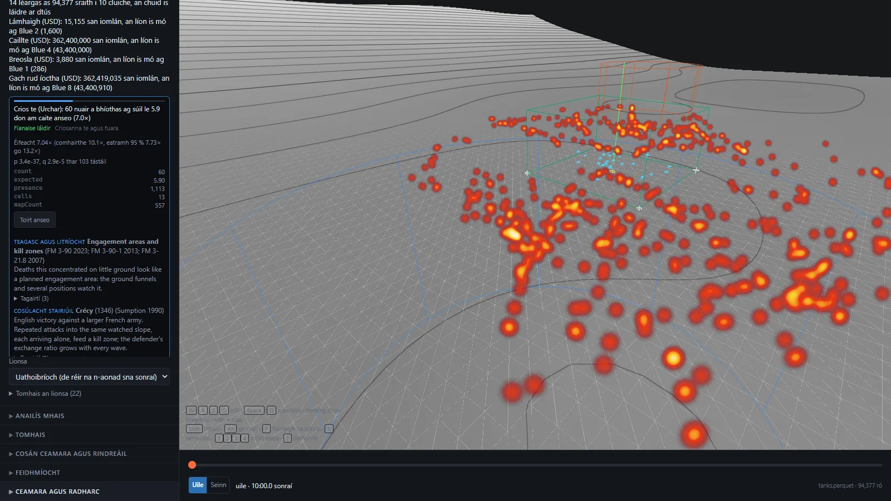

# An lionsa eolais

Nuair a aimsíonn [Léargais](insights.md) rud ar bith, míníonn an chuid seo é le smaointe ó stair mhíleata, dearadh cluichí agus anailís spóirt, agus ainmníonn sí an leabhar nó an páipéar as a dtagann siad. Úsáid é chun *cén fáth* a bhfuil patrún tábhachtach a fhoghlaim, ní hamháin go bhfuil sé ann.

## Triail as {#try-it}

1. Lódáil sonraí agus oscail **Léargais**, ansin brúigh **Aimsigh léargais**.
2. Cliceáil ar thoradh chun é a oscailt.
3. Léigh **Teagasc agus litríocht** agus **Cosúlacht stairiúil**; tá na tagairtí iomlána faoi cheal.
4. Athraigh **Lionsa** (mar shampla go *Teagasc míleata*) chun an toradh céanna a léamh trí chorp litríochta eile.

## Conas a oibríonn sé {#how-it-works}

Déanann painéal na Léargas breithiúnas ar a thorthaí ar an mbealach a dhéanfadh anailísí gairmiúil: trí theagasc míleata agus taighde oibríochtaí, comhrac stairiúil, agus litríocht dearaidh cluichí, dearaidh leibhéal agus anailíse. Déanann sé seo as líne, ó bhunachar eolais cuimsithe sa radharc, agus tugann sé an t-ábhar céanna do mhúnla seachtrach nuair a scríobhann ceann achoimre.

## Cad a thaispeánann an painéal {#what-the-panel-shows}

- **Lionsa** roghnaíonn an chorp litríochta a léitear na torthaí tríd: *Auto* (roghnaithe de réir cineálacha aonad sna sonraí: aerárthaigh, longa, feithiclí talún, coisí), *Teagasc míleata*, *Comhrac aeir*, *Cabhlach*, *Uirbeach*, *Dearadh cluiche agus cothromaíocht*, *Ríomhspórt*. Fágtar as iontrálacha lasmuigh den lionsa roghnaithe.
- Taispeánann gach toradh oscailte an iontráil **teagaisc agus litríochta** is gaire dó agus an **chosúlacht stairiúil** is gaire dó, agus na tagairtí iomlána faoi cheal.
- **Tomhais an lionsa** liostaíonn tomhais an taighde oibríochtaí a ríomhtar thar na sraitheanna céanna (thíos), gach ceann lena bhrí agus a litríocht.
- Cuireann an **Achoimre** línte leis do na príomhthorthaí agus do thomhais an lionsa: "Doctrine and literature: ..." agus "Historical parallel: ...", gach ceann le luanna údair-bhliain agus na tagairtí faoi cheal faoi.
- **Scríobh le AI** seolann na hiontrálacha is ábhartha (achoimre, ceacht, na torthaí a bhaineann leo, tagairtí iomlána) leis an tuarascáil, agus iarrann ar an tsamhail iad a lua de réir aitheantais - `{concept.lanchester-square}` - agus gan aon fhoinse eile a úsáid.

Tá na lipéid aistrithe; tá an t-eolas féin i mBéarla.

## Tomhais an lionsa {#lens-metrics}

Ríomhtar sa oibrí léargais, sa phas céanna thar na sraitheanna leis na brathadóirí (`src/insights/lensMetrics.ts`). Fágtar as gach ceann nuair nach féidir leis na sonraí é a iompar.

| Meitric | Cad a thomhaiseann sé | Teastaíonn |
|---|---|---|
| Oiriúnú Lanchester | Caillteanais gach taobh in aghaidh 20 s, filleadh ar neartanna beo an dá thaobh (Poisson, earráidí quasi-likelihood); na easpónaintí ar neart an námhaid agus an neart féin, tástáilte in aghaidh dlí na cearnóige (tine dhírithe) agus dlí na líne (tine limistéir) | am, foirne, maruithe agus básanna |
| Cóimheas malartaithe | Maruithe in aghaidh báis de réir taobh agus áite; sciar na mbásanna ar an talamh is marfaí a shealbhaíonn 5% den am a caitheadh, in aghaidh an sciar a thugann seans amháin leis an líon sin básanna; Gini na mbásanna in aghaidh an ama; I Moran de rátaí báis | maruithe agus básanna |
| Cóimheas fórsa áitiúil | Aonaid chairdiúla agus naimhdeacha beo laistigh de raon comhraic gach maraithe (raon socraithe ó na sonraí: dhá uair an fad mheánach go dtí an naimhde is gaire); sciar na maruithe ag an taobh a bhfuil an ceannas áitiúil aige, agus a barrachas os cionn an méid a thuarann uimhreacha amháin | am, foirne, daoine |
| Réimsí tine | Radharc-achair na n-áiteanna maraithe is gnóthaí ar dhromchla bacainní 2.5D (geoiméadracht leibhéil suas go airde balla, nó an talamh a siúltar) in aghaidh na háite meánach, agus comhghaol céime an radhairc agus sciar na maruithe | suímh; déanann leibhéal lódáilte níos géire é; ní don aer |
| Staid fuinnimh | Fuinneamh sonrach (airde agus an airde a d'fhéadfadh luas a cheannach) de mharbhóirí aeir agus íospartach aeir, i gcomparáid le staitistic Mann-Whitney | ranganna aerárthaigh, am, airde |
| Tír-raon eochair | Cé chomh minic is atá áit ar cheann de thrí áit mharaithe is gnóthaí cluiche | cluichí iomadúla |
| Tacaíocht fhrithpháirteach (trádálacha) | Básanna a fhreagraíonn marú comrádaí laistigh de raon comhraic agus 5 s | am, foirne |
| An chéad bhuille | Comhrainn - maruithe grúpáilte de réir cluiche, de réir 20 s ciúnais agus de réir trí raon comhraic achair - a bhuaigh an taobh a scóráil ar dtús | am, foirne |
| Múnla salvo | Cothromóid salvo Hughes oiriúnaithe ar thréimhsí 20 s de longa i dteagmháil: longa ar cuireadh as gníomh in aghaidh longa ionsaithe, agus sábháilte in aghaidh longa cosanta; oiriúnú Lanchester ar longa amháin | ranganna longa, am, foirne |
| Éifeachtacht comhraic | Maruithe in aghaidh an aonaid-uaire i ngníomh de gach taobh agus cóimheas an dá cheann is mó (luach éifeachtachta comhraic i gciall Dupuy) lena eatramh 95%, agus sciar maruithe gach taobh ag uimhreacha áitiúla cothroma | am, foirne |
| Raonta comhraic | Achar go dtí an naimhde is gaire ag maruithe, ag seolta agus ag an gcéad urchar de gach saol (brath go comhrac), de réir cineáil aonaid | am, foirne; seolta sa mhéid a bhfuil siad sna sonraí |
| Slabhra maraithe | Soicindí ó sheoladh deireanach an mharbhóra go dtí an marú, agus ó chéad urchar an troid go dtí an marú | am; seolta nó imeachtaí tine |
| Dlúthchruinniú nó scaipeadh | I ngach tréimhse 20 s, scaipeadh an dá thaobh is mó agus sciar na maruithe a ghlacann an ceann is dlúithe | am, foirne |
| Turais | De réir taobh: turais (tógálacha nó spáintí aerárthaigh), tuirlingtí, aerárthaigh caillte agus maruithe ó aerárthaigh; ráta caillte agus maruithe in aghaidh turas | ranganna aerárthaigh; tógálacha nó spáintí |

Cuireann sonraí le babhtaí na tomhaiseanna comhraic achair agus ríomhspóirt leo - dóchúlacht bua babhta, luach na ngníomhartha, dúshláin oscailte, trádálacha, peeker in aghaidh an tsealbhóra, aim, tine chrosach, úsáid, buntáiste fir, clutches, socruithe, iar-plant, feannóga marfacha agus tionchar an imreora: féach [Comhrac gar agus babhtaí](close-quarters.md).

Cuireann rianta agus foirne leo na tomhaiseanna iompraíochta comhchoitinne ó eolaíocht slua, gluaiseacht chomhchoitinne, eacnamaíocht iompraíochta agus síceolaíocht mhíleata - ailíniú agus milling, buachailleacht bhealaigh, lánta agus rianta, dlúthlonnú, ceannairí agus leanúna, claonadh ar gcúl, an pointe briseadh, riosca tar éis caillteanas, sraitheanna, comhaontú ceannaigh agus cur faoi chois, gach ceann in aghaidh a mhúnla náid féin: féach [Iompar comhchoitinne](collective-behaviour.md).

Ní chuntar armanna, meallta agus foirgnimh mar aonaid. Nuair a ainmníonn sraitheanna arm an t-aonad a sheolann é (colún `Shooter` nó `Launcher`, mar a bhíonn i sonraí a eascraíonn ó Tacview), creidtear an seoladh leis an aonad sin, ag meaitseáil a ainm nó a aitheantas réada.

## Conas a bhuaileann torthaí leis an litríocht {#how-findings-meet-the-literature}

Buaileann iontrálacha agus torthaí le chéile tríd **thacsanomaíocht phatrún** (`src/insights/knowledge/patterns.ts`): dlúthchruinniú, ceannas áitiúil, tine dhírithe agus limistéir, pointí cumhachta, criosanna marfacha, réimsí tine, fána droim ar ais, imshaobh, tacaíocht fhrithpháirteach, buntáiste fuinnimh, brú spáináin, cothromaíocht agus mar sin de. Deir gach cineál brathadóra agus gach tomhas lionsa cé na patrúin a léiríonn a uimhreacha (`src/insights/lens.ts`); deir gach iontráil eolais cé na patrúin a bhaineann léi, le meáchan. Is é comhthreo meáchanaithe an ábhartha atá iontráil ar thoradh, scálaithe de réir an chomhoiriúnaithe idir fearann na hiontrála (talamh, aer, muir, uirbeach) agus na sonraí, agus de réir neart féin an toraidh. Is é an bunús a thaispeántar uimhreacha an toraidh i abairt amháin agus ansin ceacht na hiontrála.

## Catalóg {#catalogue}

Gach patrún, coincheap, modh, cás stairiúil, prionsabal dearaidh agus staidéar, leis an leabharliosta: féach an [Catalóg eolais](knowledge-catalogue.md).

## Do fhorbróirí {#for-developers}

### Iontrálacha a chur leis {#adding-entries}

1. Roghnaigh an comhad de réir cineáil: `concepts.ts` agus `concepts-more.ts`, `methods.ts`, `cases.ts`, `cases-land.ts`, `cases-air-sea.ts`, `cases-esports.ts`, `design.ts` (prionsabail dearaidh) nó `studies.ts` in `src/insights/knowledge/`.
2. Tabhair aitheantas nua `<type>.<slug>` dó (ná húsáid ceann arís riamh), a lionsaí, a fearainn, agus na patrúin a bhaineann leis le meáchain 0..1. Cuir patrún le `patterns.ts` ach amháin nuair a fhéadann toradh é a léiriú, agus mapáil ó thoradh nó ó mheitric in `lens.ts`.
3. Scríobh an achoimre agus an ceacht **i do chuid focal féin**. Luanna ó shaothair phoiblí amháin (`pd: true` sa tagairt), agus gearr.
4. Lua: cuir aon saothar nua le `refs.ts` le húdair, bliain, teideal agus foilsitheoir (irisleabhar le imleabhar agus leathanaigh); URL nó DOI nuair a bhíonn taifead poiblí ann.
5. Rith `npx vitest run src/insights/lens.test.ts` (aitheantais uathúla, patrúin aitheanta, tagairtí a réitítear, luanna ón bpobal, cásanna le dáta agus toradh) agus `node tools/knowledge-doc.mjs` chun an [catalóg](knowledge-catalogue.md) a athnuachan.
