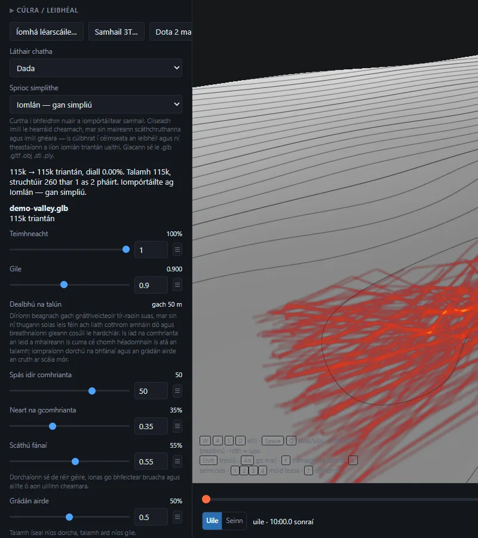

# Leibhéil agus geoiméadracht chúlra

Is é leibhéal an áit 3D ar tharla an cluiche - léarscáil, baile, rian. Cuir ceann taobh thiar de do shonraí agus is féidir leat a fheiceáil *cá bhfuil* an teas. Tugann an painéal **Cúlra / leibhéal** (féach [Gluais](glossary.md) le haghaidh "leibhéal") trí chineál comhthéacs duit:

- **íomhá léarscáile**, tagartha geografach de réir dhá ancaire - féach [Íomhánna léarscáile](map-images.md);
- **leibhéal 3D** - `.glb`, `.gltf`, `.obj`, `.stl` nó `.ply` - roinnte ina talamh, struchtúir agus uisce agus simplithe ar allmhairiú - féach [Leibhéil 3D](model-levels.md) agus [Cuma an leibhéil](level-appearance.md).
- **cúlra domhanda** - le haghaidh taifeadta a deir cá bhfuil sé ar an domhan (comhad Tacview ACMI), an fíortír-raon, bóithre, uisce, aerpháirceanna agus foirgnimh, íosluchtaithe ó shonraí oscailte - féach [Cúlra domhanda](world-backdrop.md).

Gan aon rud luchtaithe, tá an radharc dorcha le greille agus aiseanna datha (**Greille** agus **Aiseanna** i [Ceamara & radharc](camera.md)), agus deir an painéal *Níl aon rud luchtaithe - taispeánann an radharc greille agus aiseanna. Cuir íomhá léarscáile nó mogall leibhéil leis chun comhthéacs a thabhairt don teas.*

Roinneann na trí chluaisín an leibhéal céanna: is é an leibhéal céanna an cúrsa a luchtaítear sa chluaisín Anailís rása agus an léarscáil theas a thaispeánann.

## Cuir leibhéal taobh thiar de do shonraí {#put-a-level-behind-your-data}

1. Luchtaigh do chuid sonraí ar dtús ([Sonraí a fháil isteach](getting-data-in.md)), ionas go bhfeistítear an leibhéal orthu.
2. Oscail **Cúlra / leibhéal** sa bharra cléibhe.
3. Brúigh **Íomhá léarscáile…** le haghaidh pictiúir nó **Samhail 3D…** le haghaidh leibhéil 3D, agus roghnaigh an comhad. Le taifeadadh den fhíorshaol, úsáid **Cúlra domhanda** nó **Láthair chatha** ina ionad.
4. Fan go gcríochnaíonn an líne dul chun cinn. Simplítear samhail mhór ar dtús (féach **Sprioc simplithe** thíos).
5. Brúigh **F** sa radharc chun gach rud a fhrámú. Úsáid **Teimhneacht** agus **Gile** go dtí go seasann an teas amach ón leibhéal.
6. Brúigh **Sábháil sa leabharlann** má úsáidfidh tú an leibhéal arís ([Leabharlann leibhéal](level-library.md)).

## Cad a dhéanann leibhéal don teas {#what-a-level-does-for-the-heat}

- **Folaíonn sé**: déantar pointí sonraí taobh thiar de a dhorchú de réir dromchla, agus folaítear pointí sonraí taobh thiar den tír-raon ([Doimhneacht agus scagadh](depth-and-culling.md)). Gan leibhéal, níl aon fholú ann.
- Gearrann an [Stiall](slice.md) é agus, le *Gearr an leibhéal freisin*, [baint de réir faid](depth-and-culling.md#distance-culling) é, mar aon leis an teas.
- Is é an t-aon rud a dhoirtíonn [doimhneacht réimse](camera.md#depth-of-field), chomh maith leis an gréille agus na boscaí.
- Leathnaíonn leibhéal 3D **plána i gcéin an cheamara** nuair a bhíonn sé níos mó ná na sonraí: calabraítear gar agus i gcéin ón tacar sonraí, agus ansin, dhéanfadh léarscáil onnmhairithe a bhfuil cileaiméadair ar leithead inti suí go hiomlán taobh thiar de phlána i gcéin agus radharc folamh a fhágáil. Éiríonn an plána i gcéin 3 × fhad chothrománach an leibhéil nuair a bhíonn sé níos mó, bogann an plána gar leis (ar a laghad i gcéin / 100,000) chun an beachtas doimhneachta a choinneáil a bhraitheann an folú air, agus ardaítear luas eitilte go dtí ar a laghad fairsinge / 12. Ní leathnaítear é ach riamh, ní chúngaítear riamh é.

## An painéal, ón mbarr go bun {#the-panel-top-to-bottom}

| Cuid | Sonraí |
|---|---|
| **Íomhá léarscáile…**, **Samhail 3D…** | Luchtaigh ceann; cuireann sé in ionad an leibhéil reatha. |
| **Cúlra domhanda**, **Déan dearmad ar thíleanna léarscáile** | Ach amháin do thacar sonraí a bhfuil tagartha geografach aige: tóg an fíorshaol faoi mar leibhéal, nó scrios na tíleanna íoslódáilte. [Cúlra domhanda](world-backdrop.md) |
| **Sprioc simplithe** | An buiséad triantán don allmhairiú samhla nua: *Iomlán - gan simpliú* (réamhshocrú), *Ard - 8M*, *Meán - 3M*, *Íseal - 800k*, *Sceith - 100k*. [Leibhéil 3D](model-levels.md#simplification) |
| Dul chun cinn agus **Cealaigh** | Le linn dí-ionchódaithe nó allmhairithe. |
| Nóta allmhairithe | Triantáin roimh agus tar éis, roinnt talamh / struchtúir / uisce, an leibhéal mionsonraí a úsáideadh. |
| Ainm agus méid | `leithead×airde px · x × z m/px` le haghaidh íomhá, `N triantán (ó M)` le haghaidh samhla. |
| **Teimhneacht**, **Gile** | An dá chineál. |
| Rialuithe íomhá | **Díshaithiú**, **Iompaigh thuaidh/theas**, **Socrúchán** (dhá ancaire), **Oiriúnaigh do theorainneacha na sonraí**, **Airde**. [Íomhánna léarscáile](map-images.md) |
| Rialuithe samhla | Dealbhú na talún, uisce, triantáin na talún, sreangfhráma, uigeacht, dath gafa, struchtúir, aicmiú páirte. [Cuma an leibhéil](level-appearance.md) |
| **Sábháil sa leabharlann**, **Bain** | [Leabharlann leibhéal](level-library.md); baineann Bain an leibhéal den lódáil. |
| **Leabharlann** | Leibhéil stóráilte sa bhrabhsálaí seo. [Leabharlann leibhéal](level-library.md) |

## Leathanaigh sa chuid seo {#pages-in-this-section}

- [Íomhánna léarscáile](map-images.md)
- [Leibhéil 3D](model-levels.md) - formáidí, páirteanna, aicmiú, simpliú, uigeachtaí
- [Cuma an leibhéil](level-appearance.md) - gach rialú do leibhéal 3D
- [Leabharlann leibhéal](level-library.md)
- [Cúlra domhanda](world-backdrop.md) - an fíorshaol faoi thaifeadadh, ó shonraí oscailte

Is le huirlisí onnmhaitheora ar leithligh (féach [README](https://github.com/Holdi601/3DHeat/blob/main/README.md) an stóras) conas leibhéil a bhaint as cluichí agus innill; tá an conradh a scríobhann siad faoi bhun [Leibhéil 3D](model-levels.md#the-exporter-contract).
