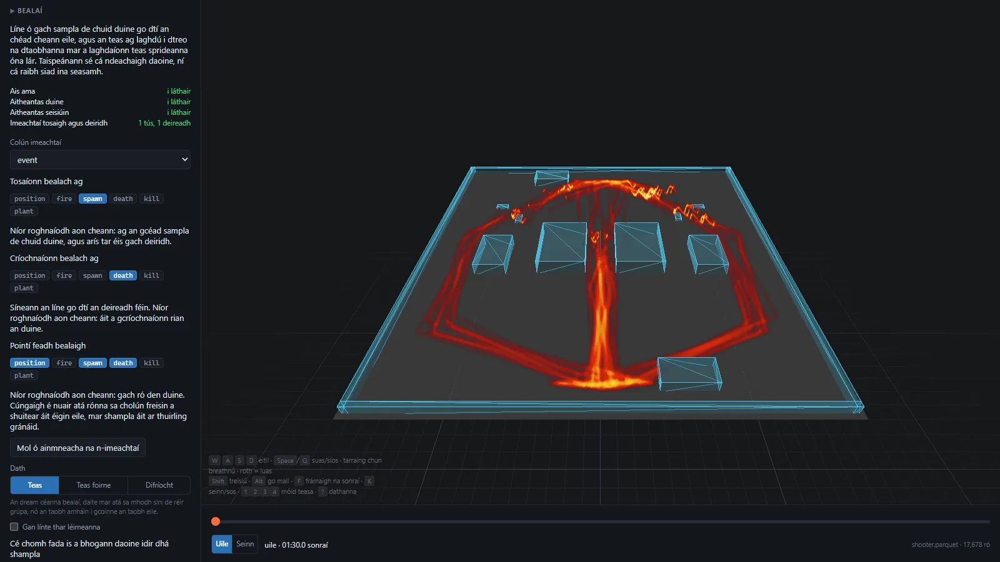

# Teas líne

Taispeánann **Teas** cá raibh daoine ina seasamh. Taispeánann **Línte** na cosáin a shiúil siad.

**Línte** (eochair 4) is teas líne é: líne ó gach sampla de [dhuine](glossary.md) go dtí an chéad cheann eile, scaipthe leis an titim chéanna a bhíonn ag [spríte](glossary.md) - trasna na líne in ionad timpeall pointe. Taispeánann sé cá *ghluais* daoine seachas cá raibh siad ina seasamh: is chomh feiceálach coridor a ritheadh uair amháin le seomra ina ndearnadh campáil, agus ceanglaíonn samplaí tanaí imreoir tapa isteach i mbealach leanúnach in ionad rian poncánach. Teastaíonn colún duine agus colún ama uaidh.

## Conas é a úsáid {#how-to-use-it}

1. Brúigh `4` (nó roghnaigh **Línte** sa bharra módanna).
2. Oscail **Bealaí** agus seiceáil an liosta seiceála glas: ní mór ais ama agus aitheantas duine a bheith ann.
3. Brúigh **Mol ó ainmneacha na n-imeachtaí** chun áit a dtosaíonn agus a chríochnaíonn bealaí a líonadh isteach.
4. Léigh líne na staitisticí: "N bealach, M acu ag sroicheadh deiridh".
5. Má théann línte trasna an léarscátha, coigeartaigh **An chéim is faide** (féach [Teorainn na léimeanna](#the-jump-limit)).

Ní chiallaíonn líne ach idir tús agus deireadh, mar sin insíonn an painéal **Bealaí** cad a chuireann teorainn le bealach. Gach rud ó [Rialacha bealaigh](#the-rules-of-a-route) ar aghaidh is mionsonra é ar féidir leat neamhaird a thabhairt air.

## Painéal na mBealaí {#the-routes-panel}

Taispeántar os cionn na bpainéal teasa i mód na línte.

### Cad atá sna sonraí {#what-the-data-has}

Liosta seiceála, glas nuair atá rud ann, ambar nuair nach bhfuil:

| Líne | Stádas |
|---|---|
| **Ais ama** | *ann* / *ar iarraidh - riachtanach* |
| **Aitheantas duine** | *ann* / *ar iarraidh - riachtanach* |
| **Aitheantas seisiúin** | *ann* / *gan ceann - is seisiún amháin iad na sraitheanna go léir* |
| **Imeachtaí tosaigh agus deiridh** | *N tosaithe, M deiridh* / *gan roghnú - rianta iomlána* (glas ach amháin le colún imeachtaí agus ar a laghad tosach amháin agus deireadh amháin) |

### Rialuithe {#controls}

| Rialú | Brí |
|---|---|
| **Colún imeachtaí** | Colún catagóire a bhfuil a luachanna ina n-imeachtaí (spawn, bás, suíomh, ...). *Gan ceann - rianta iomlána*: is bealach amháin rian gach duine i ngach seisiún, briste ag bearna sa rian. Ní thairgtear ach colúin a coinníodh le haghaidh scagtha ag an lódáil. |
| **Tosaíonn bealach ag** | Luachanna imeachtaí a thosaíonn bealach (spawn, athbheochan, leagan). Gan roghnú: tosaíonn bealach ag an gcéad sampla de dhuine, agus arís tar éis gach deiridh. |
| **Críochnaíonn bealach ag** | Luachanna imeachtaí a chríochnaíonn bealach (bás, eisiamh, teileaport). Ritheann an líne go dtí an tsraith dheiridh féin. Gan roghnú: críochnaíonn bealach san áit a gcríochnaíonn rian an duine. |
| **Pointí feadh bealaigh** | Luachanna imeachtaí a bhfuil a sraitheanna feadh an bhealaigh. Gan roghnú: gach sraith den duine. Cúngaigh é nuair a bhíonn sraitheanna eile ar an gcolún céanna, mar an áit ar thuirling gránáid. |
| **Mol ó ainmneacha na n-imeachtaí** | Líonann na trí liosta ó ainmneacha na luachanna (thíos). |
| **Dath** | *Teas*, *Teas foirne* nó *Difríocht*. Na bealaí céanna i ndathú an mhóid sin: gach grúpa ina ghné féin, nó taobh amháin i gcoinne an taobh eile, leis an liosta grúpaí, an scoilt agus na céimeanna ag feidhmiú mar a dhéanann siad sna módanna sin. Réamhshocrú *Teas*. Teastaíonn colún grúpa do theas foirne agus difríochta. |
| **Gan línte trasna léimeanna** / **An chéim is faide** | Is athbheochan, teileaport nó titim é sampla de dhuine atá níos faide ná seo, seachas áit a ndeachaigh siad; mar sin ní nascann aon líne an dá cheann. Líonann an lódáil é nuair a thaispeánann na sonraí bearna shoiléir (thíos), agus múchtar é nuair nach dtaispeánann. Oibríonn sé le colún imeachtaí nó gan é. |
| Líne na staitisticí | `N bealach, M acu ag sroicheadh deiridh, K sraith`, nuachtaithe cúpla uair sa soicind. |

Is sraith de chnaipí scoránaithe é gach liosta, ceann do gach luach, is minice ar dtús; taispeánann cuairt ar chnaipe a líon sraitheanna. Tairgtear ar a mhéad 120 luach (*N luach eile gan taispeáint*).

Má roghnaítear colún imeachtaí eile cuirtear an moladh i bhfeidhm nuair a roghnaíonn an moladh an colún céanna sin, agus tosaíonn sé le liostaí folmha seachas sin.

### An moladh {#the-suggestion}

Ar gach lódáil, agus ar **Mol ó ainmneacha na n-imeachtaí** ([`suggestLineSettings`](https://github.com/Holdi601/3DHeat/blob/main/src/data/lines.ts)):

- **Colún imeachtaí:** an chéad cholún catagóire coinnithe dar teideal `event`, `eventname` nó `eventtype`; ansin `kind`, `type` nó `action`; ansin aon cheann a bhfuil *event*, *kind*, *action* nó *type* ann.
- **Tosaíonn:** luachanna a bhfuil *spawn, deploy, join, enter, start, begin, respawn, revive, land/landed/landing, drop* iontu - mura meaitseálann siad focal deiridh freisin.
- **Críochnaíonn:** luachanna le *death, died, dead, kill/killed, eliminat…, extract, evac, teleport, leave, left, disconnect, quit, exit, end, finish, downed* iontu - ach amháin na luachanna `kill` agus `kills` (is rud é marú a dhéanann an marbhóir, ní deireadh ar a bhealach).
- **Pointí:** luachanna atá díreach *position, location, player location, move, movement, tick, sample* nó *pos*; nuair a aimsítear ceann ar bith, cuirtear na tosaigh agus na deiridh leis na pointí freisin. Nuair nach aimsítear, fanann na pointí folamh (gach sraith).

### Teorainn na léimeanna {#the-jump-limit}

Nuair a léimeann daoine, tagann faid na gcéimeanna i dhá ghrúpa gan aon rud eatarthu: an méid a chlúdaíonn duine idir dhá shampla, agus leithead an léarscátha. Ar lódáil ([`suggestMaxJump`](https://github.com/Holdi601/3DHeat/blob/main/src/data/lines.ts)) comhaireofar na céimeanna in aghaidh dúbailt a gcearnóige fad, suas go 16 milliún, agus cuirtear an teorainn sa lár den chéad raon os cionn na meán a bhfuil leithead dúbailte fad ar a laghad aige, a fhanann faoi 0.02% de na céimeanna sa bhosca, agus a bhfuil céimeanna thar a bhfuil aige. Gan raon den sórt sin ní ghearrtar aon rud, mar ní bheadh aon bhealach ann léim a dhealú ó charr tapa; cuireann teorainn a chasadh de láimh tús ag an deichiú cuid de thrasnán na sonraí.

Taispeánann an graf os cionn na teorann cé chomh fada is atá na céimeanna i ndáiríre, le líne ag an teorainn: ní tharraingítear na barraí ar dheis di. Tá an dá ais logartamach, mar féadfaidh na léimeanna a bheith céadú cuid de na céimeanna agus míle uair chomh fada. Crith ar bharra le haghaidh a raoin agus a sciar; cliceáil ar an ngraf chun an teorainn a chur ansin. Faoi, sciar na gcéimeanna os cionn na teorann.

## Rialacha bealaigh {#the-rules-of-a-route}

Siúltar tríd na sraitheanna in ord ama, de réir duine ([`buildLines`](https://github.com/Holdi601/3DHeat/blob/main/src/data/lines.ts)):

1. Scipeáiltear sraitheanna d'[ainm roinnte](sessions-persons-groups.md#names-worn-by-several-things-at-once) go hiomlán.
2. Nuair a roghnaítear pointí, scipeáiltear sraith nach tosú, nach deireadh nó nach pointe í.
3. Leanann na sraitheanna gach duine de réir seisiúin, mar sin tá bealach amháin ag duine a bhfuil a seisiúin idirleagtha in ord ama i ngach ceann acu. Dúntar bealach nuair nach raibh aon sraith ag an tsraith roimhe (tá a [shaolré](sessions-persons-groups.md#person) "gan ceann") - ní thrasnaíonn bealach riamh teorainn seisiúin nó bearna nár chinntigh an lódáil go bhfuil aon sampla eile ann. Oibrítear amach cén bealach a bhfuil sraith air uair amháin agus coinnítear é, 4 bheart in aghaidh na sraithe, ionas nach n-athdhéanfar an chuid sin nuair a athraíonn an chéim is faide.
4. Dúnann sraith **tosaigh** aon bhealach oscailte agus osclaíonn bealach nua ann.
5. Nuair a roghnaítear tosaigh, neamhaird ar shraith lasmuigh de bhealach. Gan tosaigh, osclaíonn aon sraith nach deireadh í lasmuigh de bhealach bealach.
6. Cruthaíonn sraith eile taobh istigh de bhealach **cuid** ón tsraith roimhe sa bhealach go dtí an tsraith seo.
7. Dúnann sraith **deiridh** a leathnaíonn bealach an bealach tar éis a chuid; tá an bealach sin ag *sroicheadh deiridh*.
8. Dúnann céim níos faide ná **An chéim is faide** an bealach san áit a raibh sé, agus tosaíonn bealach nua ag an deireadh eile, mura sraith deiridh í an tsraith sin. Ní tharraingítear líne trasna air, agus áirítear sa líne staitisticí é.

Stóráiltear gach cuid ar a sraith *dheiridh*, ionas go bhfanann na codanna in ord ama, agus oibríonn an [amlíne](timeline.md) (fuinneog), an samplóir, na [scagairí](filters.md), infheictheacht an ghrúpa agus comhartha na difríochta orthu mar a oibríonn siad ar phointí. Mar sin bíonn scagaire i bhfeidhm ar an tsraith a chríochnaíonn cuid.

## Athsheinm {#playback}

I mód **Uile** tarraingítear gach bealach ina iomláine. I mód **Seinn** is pointe é gach duine a bhogann idir a shamplaí, ag tarraingt a bhealaigh taobh thiar díobh:

- ní tharraingítear cuid a thosaíonn tar éis an tseinnteora;
- tarraingítear an chuid a bhfuil an duine i lár air suas go dtí a shuíomh idirmheánach, le caipín deiridh ag an gceann;
- ísleofar an teas thar an **eireaball**: leis an stair *Carnach* níl an t-eireaball teoranta agus fanann an bealach iomlán go dtí sin; le *Fuinneog* ísleofar go neamhní thar an *Raon* (30 s réamhshocraithe). Le *Saolré* is é an *Raon* an t-eireaball freisin, agus i mód na línte taispeánann an amlíne bosca an *Raoin* don stair sin freisin (in ionad *Ais saolré* agus *Ísliú*, nach n-úsáideann teas líne iad).

Agus athsheinm á dhéanamh tarraingítear gach fráma ina iomláine seachas carnadh, mar bogann na cinn ag gach fráma agus smearfadh meán reatha gach ceann ina stríoc.

## Do fhorbróirí {#for-developers}

### Cuimhne {#memory}

Tógtar na bealaí ar an bpríomhshnáithe nuair a iontrálann tú mód na línte (nó nuair a athraíonn na socruithe bealaigh) agus saorthar iad nuair a fhágtar é: 5 bheart in aghaidh na sraithe sa chuimhne agus 8 bheart in aghaidh na sraithe ar an GPU (suíomh tosaigh gach roinne, cainnithe go 16 giotán in aghaidh an ais laistigh de chuimsiú an tsonraí, agus a bratacha).

### Conas a tharraingítear líne {#how-a-line-is-drawn}

Tarraingíonn an dá chúltaca gach roinn óna sraith dheiridh mar **18 veirtéacs** ([`lineHeatVs`](https://github.com/Holdi601/3DHeat/blob/main/src/render/webgl2/shaders.ts) agus a chúpla WGSL):

- Is é an leathleithead ag gach ceann [ga spríte](sprite-shape.md#sprite-radius) ag fad an chinn sin, leis na teorainneacha picteilíní curtha i bhfeidhm. Tarraingítear líne is caol ná 2.5 px 2.5 px ar leithead agus a teas scálaithe síos chun cur leis, ionas nach n-imíonn línte tanaí ná nach ngeirrfear iad.
- Titeann an teas **trasna** na líne leis an ramp céanna a bhíonn ag spríte - an titim nó an cuar, dlús an lárphointe agus an imeall.
- Tarraingítear caipíní cruinne **amháin** san áit a dtosaíonn nó a chríochnaíonn bealach, ionas nach mbíonn na hacomhail idir roinnte as a chéile ina sreang péarlaí.
- Tógtar an geoiméadracht i spás na scáileáin agus idirmheánaítear go líneach ann, ionas go bhfanann an titim lártha ar an líne cibé bealach a rithfidh sí isteach sa doimhneacht. Gearrtar roinn a thrasnaíonn an plána gar ag an bpointe sin seachas é a thitim.

Bíonn teas pointí agus teas línte ag cur suas méideanna an-difriúla teasa in aghaidh na sraithe, mar sin déantar an sáithiú a thomhas arís nuair a athraíonn tú eatarthu ([Dath agus taispeántas](colour-and-exposure.md#auto-exposure)).
