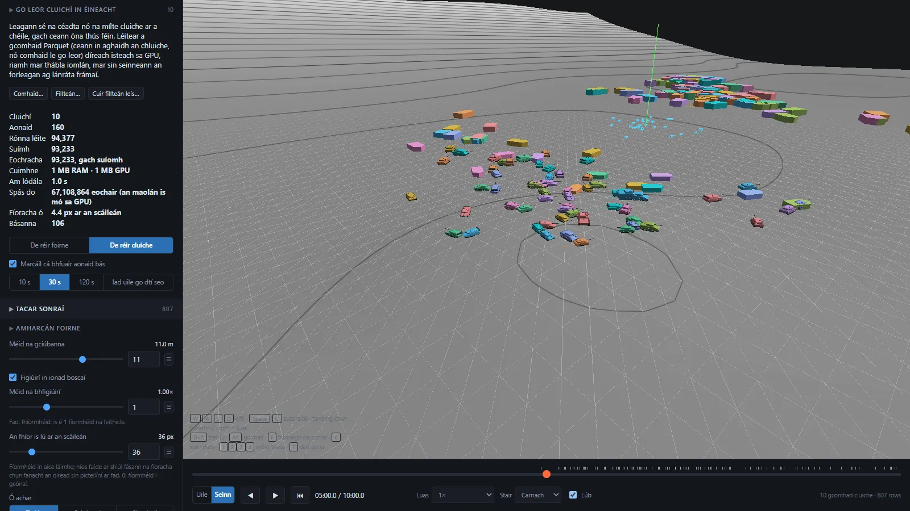

# Go leor cluichí in éineacht

Seinneann **Go leor cluichí in éineacht** go leor cluichí ar bharr a chéile, ionas go bhfeiceann tú cá dtéann imreoirí gach cluiche de ghnáth. Úsáid é chun na céadanna nó na mílte cluichí a chur i gcomparáid i bpictiúr amháin.

Tosaíonn gach cluiche ag a thús féin, agus bogann a aonaid mar fhigiúirí. Téann na comhaid díreach isteach sa chárta grafaicí agus ní thógtar tábla iomlán ar bith, ionas go seinneann sé go réidh áit a rithfeadh lódáil normálta as cuimhne.

## Conas a úsáid é {#how-to-use-it}

1. Oscail **Go leor cluichí in éineacht** sa bharra taobh Teasmhapa.
2. Brúigh **Comhaid…** (roghnaigh go leor comhad), **Fillteán…** (fillteán agus a fho-fhillteáin) nó **Cuir fillteán leis…** (cuir leis an rud atá lódáilte).
3. Athraíonn an léirsitheoir go dtí forleagan na bhfigiúr agus tosaíonn sé ag an tús. Brúigh **Seinn**.

Is cluiche amháin gach comhad (nó tá cúpla cluiche ann). Oibríonn comhaid Parquet agus coimeádáin [`.3dheat`](container.md). Teastaíonn colún suímh, am agus aonaid ó chomhad; coinnítear colúin ainm, cineáil agus taobhe. Déantar neamhaird ar chomhaid eile, agus ar chomhaid taobh tiontairí (eitilte, teachtaireachtaí, imeachtaí, comhrá, cuspóirí). Le haghaidh tábla gnáthaigh, féach [Sonraí a fháil](getting-data-in.md).

## Socruithe {#settings}

| Socrú | Cad a dhéanann sé |
|---|---|
| **De réir foirne** / **De réir cluiche** | Dathaigh de réir taobh, nó dath in aghaidh an chluiche. |
| **Marcáil cá bhfuair aonaid bás** | Marc ar an áit a bhfuair gach aonad bás, ar feadh 10 s, 30 s, 120 s, nó go léir go dtí seo. |

Taispeánann an painéal cé mhéad cluiche, aonad, sraith agus suíomh a léadh, an cuimhne a úsáideadh agus an t-am lódála. Is é *Seomra do* cé mhéad suíomh breise a d'fhéadfadh an cárta grafaicí a ghlacadh. Is é *Figiúirí ó* an méid ar an scáileán faoina dtarraingítear aonad mar shaighead bheag in ionad a fhigiúra.

Úsáideann cuma na bhfigiúr na rialuithe céanna leis an [athsheinm cluiche](match-replay.md#figures): **Méid na bhfigiúirí**, **An fhíor is lú ar an scáileán** agus **Ó achar**.

## Leideanna {#tips}

- Nuair nach bhfeadh gach rud sa chuimhne, tanaítear na suímh (ní coinnítear ach suíomh gach cúpla méadar), agus deir an painéal sin.
- Oibríonn na módanna teasa ar shonraí an fhorleagain freisin.
- Chun staitisticí thar na mílte cluichí a fháil gan iad a tharraingt, féach [Anailís mhais](mass-analysis.md).
