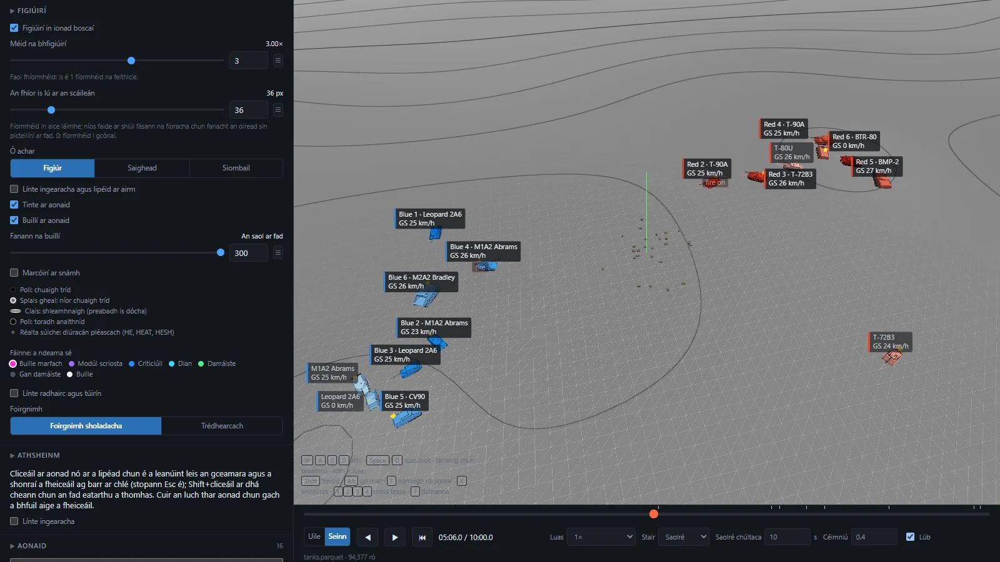
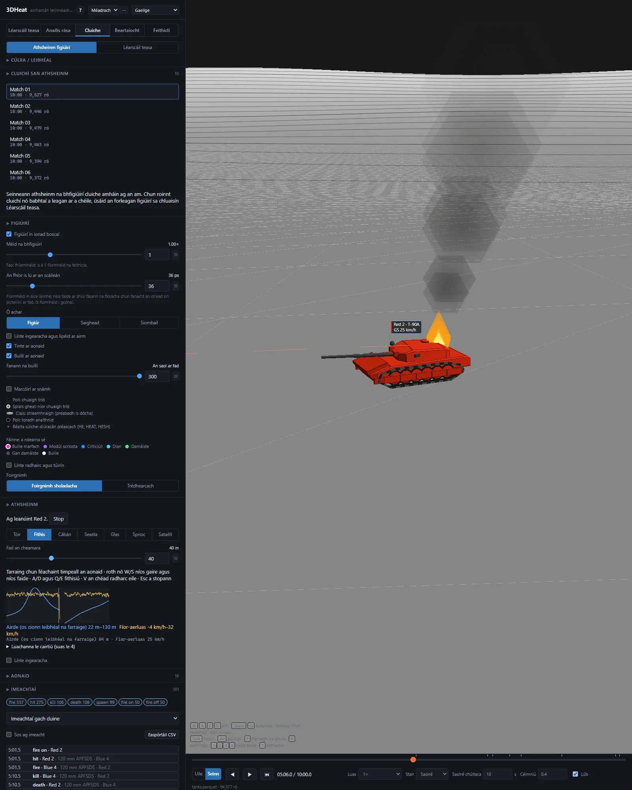
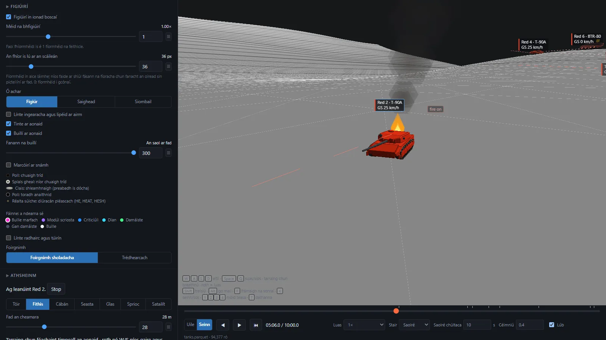
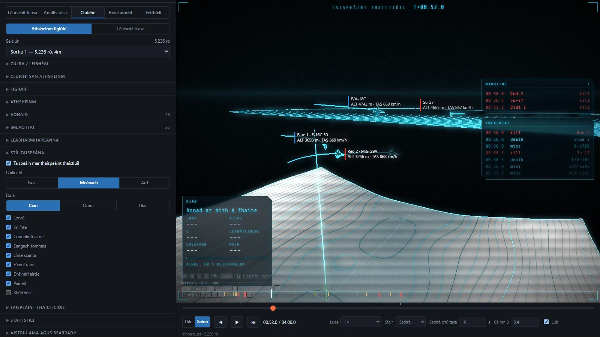
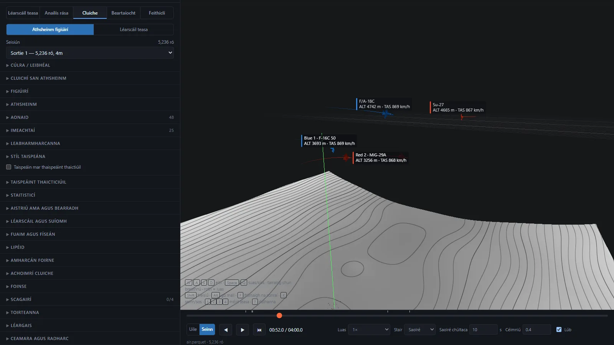

# Athsheinm cluiche

Is scannán den chluiche é an athsheinm, agus gach imreoir tarraingthe mar an rud a tiomáin siad. Úsáid é chun troid a fheiceáil arís, aonad amháin a leanúint agus a fheiceáil cé a bhuail cé.

Tarraingítear lámhaigh, buillí, tinte agus scriosta ar na haonaid agus ar na cuspóirí ar an leibhéal. Cabhraíonn ceamaraí, lipéid agus taispeáint thaictiúil leat an troid a léamh. An bhfuil aithne agat ar Tacview? Taispeánann [Parity Tacview](tacview-parity.md) cá bhfuil gach ceann dá uirlisí.

## Tosaigh athsheinm {#start-a-replay}

1. Luchtaigh taifeadadh le **Foinse → Comhaid…** nó trí é a scaoileadh ar an bpainéal Foinse (tábla ar bith le colún **duine** agus colún **ama**, comhad Tacview, athsheinm tiontaithe, cluiche [`.3dheat`](container.md)). Féach [Sonraí a fháil isteach](getting-data-in.md).
2. Oscail an cluaisín **Cluiche** agus roghnaigh **Athsheinm figiúirí**, nó roghnaigh **Forleagan figiúirí** sa bharra modhanna de chluaisín na Léarscáile teasa.
3. Faoi **Cluichí san athsheinm** roghnaigh cluiche amháin, gach ceann ag an am céanna, nó roinnt.
4. Brúigh **Seinn** ar an amlíne (nó `K`). Tarraing an amlíne chun léim.

Tá figiúirí in ionad boscaí do gach aonad a bhfuil a ainm nó a chineál ar eolas (féach [Figiúirí](figures.md)). Tarraingítear sonraí gan colún ainm nó cineál mar shaighdiúirí.

## Figiúirí {#figures}

| Socrú (cuid **Figiúirí**) | Réamhshocrú | Cad a dhéanann sé |
|---|---|---|
| **Figiúirí in ionad boscaí** | air | Múchta tarraingíonn sé boscaí simplí. |
| **Méid na bhfigiúirí** (uair an mhéid fhíor) | 1 | Is é 1 an fíor-mhéid; 0.25 go 20 uair (scála logartamach). Cabhraíonn níos mó ón gcian. |
| **An fhíor is lú ar an scáileán** | 36 px | Fásann figiúirí i gcian chun go mbeidh siad chomh fada seo, 0 go 200 px; coinníonn 0 an fíor-mhéid. |
| **Ó achar**: Figiúr, Saighead, Siombail | Figiúr | Cad a bhíonn ann d'aonad i gcian. |
| **Siombailí** | NATO (APP-6) | NATO (APP-6), comharthaí taictiúla Rúiseacha, deilbhíní **Léarscáil chluiche**, nó **Cruthanna amháin (do dhathdhaille)**. |
| **Méid na siombaile**, **Mo thaobh**, **Naimhdeach / Neodrach**, **Marcanna cúrsa** | 28 px (12 go 64), uathoibríoch, naimhdeach, air | Cén chuma a bhíonn ar shiombailí agus cé an taobh atá cairdiúil. |
| **Línte ingearacha** | air | Líne ó gach aonad síos go dtí an talamh díreach, ionas go léitear airde sa 3D. |
| **Línte ingearacha agus lipéid ar airm** | as | Línte go dtí an talamh agus lipéid ar mhiseolaí agus buamáil. |
| **Tinte ar aonaid** | air | Lasracha ón nóiméad a adhaíonn aonad go dtí go gcuirtear as é. |
| **Buillí ar aonaid** | air | Marcanna san áit a bhuail urchair (thíos). **Fanann na buillí**: 1 go 300 soicind, nó **An saol ar fad**. **Marcóirí ar snámh**: marcanna tarraingthe os cionn an dromchla. |
| **Línte radhairc agus túirín** | as | Briste: cá bhfeiceann an imreoir; slán: cá bhfuil an gunna dírithe. |
| **Foirgnimh** | soladach | Foirgnimh soladacha nó trédhearcacha, nuair a phéinteálann an leibhéal iad. |

### Siombailí ag achar {#symbols-at-a-distance}

Nuair a bheadh aonad níos lú ná **An fhíor is lú ar an scáileán**, is féidir leis a bheith ina shiombail a fhanann inléite. Insíonn an cruth an cineál (mar shampla bosca cruinn le marc rian le haghaidh armúir); insíonn an dath an taobh. Oscail roghchlár **Siombailí** chun stíl a athrú.

### Marcanna buillí, scriosta agus tinte {#hit-marks-wrecks-and-fires}

- Suíonn **marcanna buillí** ar an dromchla a bhuail an urchair, ag scála an fhiguir. Insíonn a gcuma cad a tharla: poll (shroich sé trí), splancfhuinneamh geal (níor shroich sé trí), scríob (sleamhnaigh sé), réalta súiche (babhta pléascach). Insíonn fáinne datha cad a rinne sé: urchair mharfach, modúl scriosta, criticiúil, tromchúiseach, damáiste, gan damáiste, buille. Bí ag crochadh thar mharc le haghaidh ainm an bhabhta.
- Tarraingítear aonad scriosta **dóite** mar scriosta ón mbás go dtí go n-athghiniúint sé nó go mbaintear é; tá a shiombail trasnaithe.
- **Dóigheann tinte** ar aonad ón nóiméad a adhaíonn sé go dtí go gcuirtear as é.
- **Casann túir** chuig an áit a insíonn na sonraí a bhfuil an gunna dírithe air (nó, gan sin, cá bhfeiceann an t-imreoir).

### Airm, meallta agus tracers {#weapons-decoys-and-tracers}

Le **Airm, urchair agus buillí** ar (cuid an Amharcáin Foirne): eitlíonn míseolaithe, roicéid, buamaí agus toirpéidí mar a bhfigiúirí féin le lorg deataigh; is tracers iad piléir agus sliogáin; flashálann tionchair agus pléascanna. Tarraingítear tracer **breac-líneach** a oibríodh amach ó bhuille, mar ní raibh urchair sna sonraí. Tarraingítear flairí agus chaff mar mheallta; tá siad i bhfolach ó liosta an aonaid mura bhfuil *Meallta agus sliogáin* cromtha.

## Ceamaraí {#cameras}

Cliceáil ar aonad nó ar a lipéad chun é a **leanúint**; tairgeann an chuid **Athsheinm** **Tóir**, **Fithis**, **Cábán** (le taispeáint ceann-suas, `H`), **Seasta**, **Glas**, **Sprioc** agus **Satailít**. Cuireann `V` timthriall iontu, socraíonn **Fad an cheamara** cé chomh fada. Stopann Esc.

- **Radharc dhá-aonad**: roghnaigh **Sprioc** (nó Ctrl/Alt-cliceáil ar aonad) chun breathnú air ón gceann leanta; athraíonn **Malartaigh** iad.
- **Tomhas**: Shift-cliceáil ar dhá aonad don treo, don raon agus don difríocht airde eatarthu.
- **Léarscáil 2D** (`M`): cúinne nó radharc iomlán, le lorg agus ainmneacha.
- **Leabharmharcanna** (`B`): sábháil an nóiméad agus an ceamara; liostaítear maruithe, básanna agus marcanna féin an taifeadta freisin.
- **Imeachtaí**: gach imeacht in ord ama; cliceáil léimeann sé ann. `Page Up` / `Page Down` léimeann idir imeachtaí; stopann **Sos ag imeacht** ag gach ceann.

## Taispeáint thaictiúil {#tactical-display}

Tarraingíonn an chuid **Taispeáint thaictiúil** le haghaidh aonaid ar bith, na roghnaithe, gach ceann, nó cineál amháin (aerárthaí, talamh, longa, airm): veicteoirí luais agus an conair romhainn, línte srón agus tógála, cóin radair, glasanna, naisc sonraí, limistéir agus línte comhraic, línte radhairc, áit a bhfeiceann imreoirí (cóin amhairc), radharc túirín agus an ceamara taifeadta.

### Stíl taispeána {#display-style}

Athraíonn `T` (nó an scoránach **Taispeáin mar thaispeáint thaictiúil**) an dearcadh go stíl scáileáin radair: lonradh, imlínte, línte contúir, greille tomhais, línte scanta, fáinní raoin, dréimirí airde, painéil le maruithe agus imeachtaí, agus **Stiúrthóir** a bhogann an ceamara go dtí imeachtaí leis féin.

## Cuspóirí {#objectives}

Nuair a thagann cluiche lena chuspóirí, tarraingíonn an chuid **Cuspóirí** iad ar an leibhéal: criosanna gabhála (le húinéir agus dul chun cinn na gabhála), spawns, aerpháirceanna, limistéir agus spriocanna buamála, gach sraith in-athraithe, le lipéid. Feictear iad tríd an talamh. Nuair a bhíonn roinnt modhanna cluiche luchtaithe, scagann **Mód** na cluichí de réir mhód. Tagann cuspóirí ó chomhad cluiche tiontaire in aice leis an taifeadadh nó laistigh de [choimeádán `.3dheat`](container.md).

## Lipéid agus staitisticí {#labels-and-statistics}

- **Lipéid**: rialacha de réir cineáil (**Roghnaithe**, **Aerárthaí**, **Talamh**, **Longa**, **Airm**, **AI**): taispeánta nó nach ea, cé acu luachanna, agus **Tosaíocht** do cé a fhaigheann an spás nuair a fhorluíonn lipéid. Coinníonn **Coinnigh na lipéid óna chéile** lipéad in aice lena aonad nuair a chlúdódh sé aonad eile, agus fágtar as é nuair nach bhfuil spás. Is é **Méid na lipéad** 60 go 250 %. Athshocraíonn **Ar ais go hainm, feithicil, airde agus luas** na rialacha.
  - Tosaíonn aonaid talún le hainm, feithicil agus luas.
  - Tosaíonn aerárthaí le hainm, feithicil, airde agus luas.
  - Tosaíonn longa le hainm, feithicil, luas agus cúrsa.
  - Bí ag crochadh thar aonad chun gach luach atá aige a fheiceáil.
- **Staitisticí**: de réir foirne agus aonaid: maruithe, básanna, urchair, buillí, cóimheas buillí, éirí de thalamh, tuirlingt, am san aer, luas is airde, airde agus G, fad. Easpórtáil CSV.
- **Cairteacha**: luachanna aonaid thar am, dhá aonad i gcomparáid, nó luach amháin i gcoinne luacha eile.

## Go leor cluichí ag an am céanna {#many-matches-at-once}

Chun na céadta nó na mílte cluiche a leagan thar a chéile, féach [Go leor cluichí ag an am céanna](many-matches.md). Mionsonraí figiúr (deatach, tine, éifeachtaí eile ama): [Figiúirí sa forleagan figiúirí](figure-replay.md). Liosta gnéithe Tacview: [Parity Tacview](tacview-parity.md), leathanach leanaí den cheann seo.
