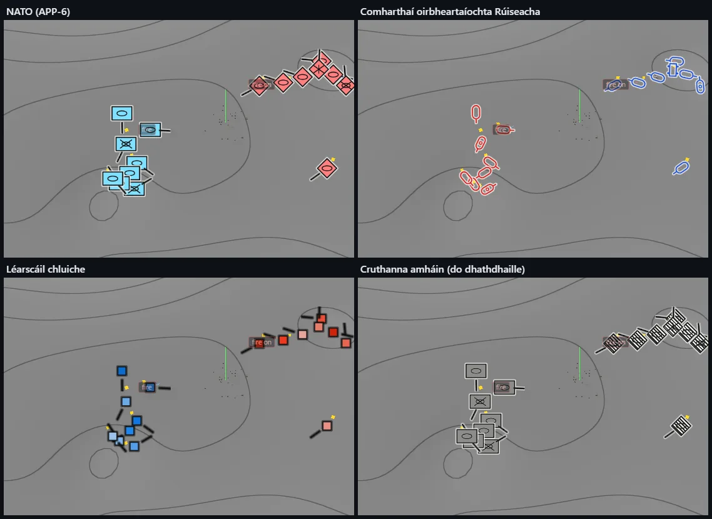

# Athsheinm cluiche

Is scannán den chluiche an athsheinm, agus gach imreoir tarraingthe mar an rud a thiomáin sé. Úsáid é chun troid a fheiceáil arís, aonad amháin a leanúint agus a fheiceáil cé a bhuail cé.

Tarraingítear urchair, buillí, tinte agus long briste ar na haonaid agus ar na cuspóirí ar an leibhéal. Cuidíonn ceamaraí, lipéid agus taispeántas taictiúil leat an troid a léamh. An eol duit Tacview? Taispeánann [Comhionannas Tacview](tacview-parity.md) cá bhfuil gach ceann dá uirlisí.

## Tosaigh athsheinm {#start-a-replay}

1. Lódáil taifeadadh le **Foinse → Comhaid…** nó trí é a scaoileadh ar phainéal na Foinse (aon tábla le colún **duine** agus **am**, comhad Tacview, athsheinm coinbhertaithe, cluiche [`.3dheat`](container.md)). Féach [Sonraí a iontráil](getting-data-in.md).
2. Oscail cluaisín **Cluiche** agus roghnaigh **Athsheinm figiúirí**, nó roghnaigh **Forleagan figiúirí** i mbarra na modhanna de chluaisín na Léarscáile teasa.
3. Faoi **Cluichí san athsheinm** roghnaigh cluiche amháin, go léir ag an am céanna, nó roinnt.
4. Brúigh **Seinn** ar an amlíne (nó `K`). Tarraing an amlíne chun léim.

Tagann figiúirí in ionad boscaí do gach aonad a bhfuil a ainm nó a chineál ar eolas (féach [Figiúirí](figures.md)). Tarraingítear sonraí gan colún ainm nó cineál mar shaighdiúirí.

## Figiúirí {#figures}

| Socrú (cuid **Figiúirí**) | Réamhshocrú | Cad a dhéanann sé |
|---|---|---|
| **Figiúirí in ionad boscaí** | air | As tarraingíonn boscaí simplí. |
| **Méid na bhfigiúirí** (uair an mhéid fhíor) | 1 | Is é 1 an mhéid fíor; 0.25 go 20 uair (scála logartamach). Cabhraíonn níos mó ó i bhfad i gcéin. |
| **An fhíor is lú ar an scáileán** | 36 px | Fásann figiúirí i gcéin go dtí go mairfidh siad an fhad seo, 0 go 200 px; coinníonn 0 an mhéid fhíor. |
| **Ó achar**: Figiúr, Saighead, Siombail | Figiúr | Cad a bhíonn ar aonad i gcéin. |
| **Siombailí** | NATO (APP-6) | NATO (APP-6), comharthaí taictiúla Rúsacha, deilbhíní **Léarscáil chluiche**, nó **Cruthanna amháin (do dhathdhaille)**. |
| **Méid na siombaile**, **Mo thaobh**, **Naimhdeach / Neodrach**, **Marcanna cúrsa** | 28 px (12 go 64), uathoibríoch, naimhdeach, air | Cén chuma atá ar shiombailí agus cé an taobh atá cairdiúil. |
| **Línte ingearacha** | air | Líne ó gach aonad síos go dtí an talamh, ionas go léitear airde sa 3D. |
| **Línte ingearacha agus lipéid ar airm** | as | Línte go dtí an talamh agus lipéid ar mhiotalaí agus buamaí. |
| **Tinte ar aonaid** | air | Lasracha ón nóiméad a dhóigh aonad go dtí go múchtar iad. |
| **Buillí ar aonaid** | air | Marcanna san áit ar bhuail urchair (thíos). **Fanann na buillí**: 1 go 300 soicind, nó **An saol ar fad**. **Marcóirí ar snámh**: marcanna tarraingthe os cionn an dromchla. |
| **Línte radhairc agus túirín** | as | Briste: an áit a bhreathnaíonn an imreoir; solad: an áit a dhíríonn an gunna. |
| **Foirgnimh** | solad | Foirgnimh soladacha nó trédhearcacha, nuair a phéinteálann an leibhéal iad. |

### Siombailí i gcéin {#symbols-at-a-distance}

Nuair a bheadh aonad níos lú ná **An fhíor is lú ar an scáileán**, is féidir leis dul i gcruth siombail a fhanann inléite. Insíonn an cruth an cineál (mar shampla bosca cruinn le marc rian d'arm); insíonn an dath an taobh. Oscail roghchlár **Siombailí** chun an stíl a athrú.

### Marcanna buillí, long briste agus tinte {#hit-marks-wrecks-and-fires}

- **Comharthaí buillí** ar an dromchla a bhuail an urchair, ag scála an fhigiúir. Insíonn a gcuma cad a tharla: poll (chuaigh tríd), spréacadh geal (níor chuaigh tríd), scríobadh (sleamhnaigh uaidh), réaltóg dhubh (fuse pléascach). Insíonn fáinne daite cad a rinne sé: urchar marfach, modúl scriosta, criticiúil, tromchúiseach, damáiste, gan damáiste, buille. Leag an luch ar mharc chun ainm an bhabhta a fheiceáil.
- Tarraingítear aonad scriosta **dóite** mar long briste ón bhás go dtí go athghiniúint sé nó go mbaintear é; tá a shiombail trasnaithe.
- **Dónn tinte** ar aonad ón nóiméad a dhóigh sé go dtí go múchtar iad.
- **Casann túiríní** chun an áit a dhíríonn an gunna mar a deir na sonraí (nó, gan sin, an áit a bhreathnaíonn an t-imreoir).

### Airm, diúracáin agus rianta solais {#weapons-decoys-and-tracers}

Le **Airm, urchair agus buillí** ar siúl (rannán Amharcán foirne): eitlíonn diúracáin, roicéid, buamaí agus tórpedónna mar a bhfigiúirí féin le rian deataigh; is rianta solais iad piléir agus sliogáin; flashíonn tionchair agus pléascanna. Tarraingítear rian solais **ar bhealach briste** a oibríodh amach ó bhuille, toisc nach raibh urchar sna sonraí. Tarraingítear flairí agus cleabhóg mar dhiúracáin; folaítear iad ó liosta na n-aonad mura ticeáiltear *Diúracáin agus sliogáin*.

## Ceamaraí {#cameras}

Cliceáil ar aonad nó ar a lipéad chun é a **leanúint**; cuireann an chuid **Athsheinm** **Tóir**, **Fithis**, **Cábán** (le taispeántas ceann-os-cionn, `H`), **Seasta**, **Glas**, **Sprioc** agus **Satailít** ar fáil. Athraíonn `V` iad, socraíonn **Fad an cheamara** cé chomh fada. Stopann Esc.

- **Radharc dhá aonad**: roghnaigh **Sprioc** (nó cliceáil aonad le Ctrl/Alt) chun breathnú air ón gceann a leantar; **Malartaigh** malartaíonn siad.
- **Tomhas**: cliceáil le Shift ar dhá aonad chun an treo, an raon agus an difríocht airde eatarthu.
- **Mapa 2D** (`M`): radharc cúinne nó iomlán, le rianta agus ainmneacha.
- **Leabharmharcanna** (`B`): sábháil an nóiméad agus an ceamara; liostaítear marúanna, básanna agus marcanna an taifeadta féin freisin.
- **Imeachtaí**: gach imeacht in ord ama; cliceáil léimeann chuige. Léimeann `Page Up` / `Page Down` idir imeachtaí; **Sos ag imeacht** stopann ag gach ceann.

## Taispeántas taictiúil {#tactical-display}

Tarraingíonn an chuid **Taispeáint thaicticiúil**, gan aonad ar bith, na roghnaithe, gach ceann, nó cineál amháin (aerárthaí, talamh, longa, airm): veicteoirí luais agus an cosán chun tosaigh, línte srónach agus ardaithe, cón radair, glasanna, naisc sonraí, limistéir agus línte comhraic, línte radhairc, cá bhfuil na himreoirí ag féachaint (cón amhairc), aim túirín, agus ceamara an taifeadta.

### Stíl taispeána {#display-style}

Athraíonn `T` (nó an scoránán **Taispeáin mar thaispeáint thaictiúil**) an cuma go stíl scáileáin radair: glow, imlínte, líne chonúir, greille tomhais, línte scanta, fáinní raoin, dréimirí airde, painéil le marúanna agus imeachtaí, agus **Stiúrthóir** a bhogann an ceamara chuig imeachtaí leis féin.

## Cuspóirí {#objectives}

Nuair a thagann cluiche lena chuspóirí, tarraingíonn cuid **Cuspóirí** ar an leibhéal iad: limistéir ghabhála (le húinéir agus dul chun cinn gabhála), spawns, aerpháirceanna, limistéir agus spriocanna bombála, gach sraith in-athraithe, le lipéid. Feictear tríd an talamh iad. Nuair a lódáiltear módanna cluiche iomadúla, scagann **Mód** na cluichí de réir mhóid. Tagann cuspóirí ó chomhad cluiche coinbhertóra in aice leis an taifeadadh nó laistigh de choimeádán [`.3dheat`](container.md).

## Lipéid agus staitisticí {#labels-and-statistics}

- **Lipéid**: rialacha de réir cineáil (**Roghnaithe**, **Aerárthaí**, **Talamh**, **Longa**, **Arm**, **AI**): taispeántar nó ní thaispeántar, cé na luachanna, agus **Tosaíocht** do cé a fhaigheann an spás nuair a fhorlapann lipéid. **Coinnigh na lipéid óna chéile** bogann lipéad in aice lena aonad nuair a chlúdódh sé aonad eile, agus fágtar as é nuair nach bhfuil spás ann. Is é **Méid na lipéad** 60 go 250 %. **Ar ais go hainm, feithicil, airde agus luas** athshocraíonn na rialacha.
  - Tosaíonn aonaid talún le hainm, feithicil agus luas.
  - Tosaíonn aerárthaí le hainm, feithicil, airde agus luas.
  - Tosaíonn longa le hainm, feithicil, luas agus treo.
  - Leag an luch ar aonad chun gach luach atá aige a fheiceáil.
- **Staitisticí**: de réir foirne agus aonaid: marúanna, básanna, urchair, buillí, cóimheas buillí, éirí de thalamh, tuirlingt, am san aer, luas uasta, airde agus G, fad. Easpórtáil CSV.
- **Cairteacha**: luachanna aonaid thar am, dhá aonad i gcomparáid, nó luach amháin i gcoinne luacha eile.

## Go leor cluichí ag an am céanna {#many-matches-at-once}

Chun na céadta nó na mílte cluiche a chur thar a chéile, féach [Go leor cluichí ag an am céanna](many-matches.md). Sonraí figiúr (deatach, tine, éifeachtaí eile ama): [Figiúirí sa forleagan figiúr](figure-replay.md). Liosta gnéithe Tacview: [Comhionannas Tacview](tacview-parity.md), leathanach leanbh den cheann seo.
