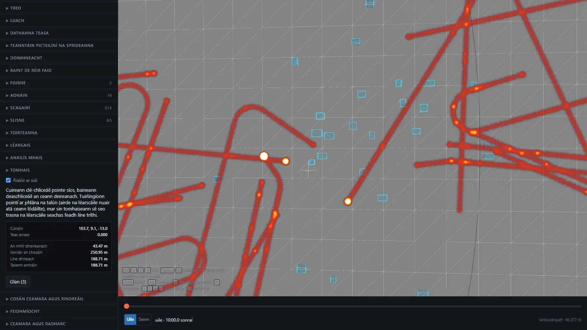

# Tomhas

Cuireann **Tomhas** an luch ina rialóir agus insíonn sé cé chomh gnóthach is atá an spota faoin cúrsóir. Úsáid é chun a fháil amach cé chomh fada is atá dhá áit óna chéile, nó cé mhéad trácht atá ag spota amháin.

## Bain triail as {#try-it}

1. Oscail **Tomhas** sa bharra taobh agus tic **Rialóir ar siúl**.
2. Cliceáil ar chlé trí áit ar an léarscáil. Leagann gach cliceáil pointe.
3. Léigh **Iomlán an chosáin** (fad an chosáin iomláin) agus **An mhír dheireanach** (an chos dheireanach).
4. Cliceáil ar dheis chun an pointe deireanach a bhaint, nó brúigh **Glan (3)** chun gach ceann a bhaint.

| Gníomh | Éifeacht |
|---|---|
| Cliceáil ar chlé | Leagann pointe nuair a bhuaileann an cúrsóir an plána talún. Is tarraingt ceamara é cliceáil a bhog níos mó ná 4 picteilín idir brú agus scaoileadh, ní pointe. |
| Cliceáil ar dheis | Baintear an pointe deireanach. |
| Bog | Nuascálann suíomh an chúrsóra agus an teas faoi go beo. |

Leanann an ceamara ag obair fad a bhíonn an rialóir ar siúl: fós féin tarraingítear chun breathnú thart, eitlíonn eochracha fós. Fad a bhíonn an rialóir ar siúl glacann sé gach cliceáil, mar sin fanann [cliceáil-chun-roghnú](camera.md#click-to-pick) go dtí go múchtar é.

**An plána talún** is é airde [íomhá na léarscáile](map-images.md) nuair a bhíonn íomhá léarscáile lódáilte, seachas sin Y is ísle an tacair sonraí (0 gan ceann). Tuirlingíonn pointí air, mar sin tomhaiseann an rialóir trasna na léarscáile, ní feadh líne trína hais. Le leibhéal 3D is é an plána fós Y is ísle an tacair sonraí, ní dromchla an leibhéil - le pointe ar an dromchla fíor, cas an rialóir as agus cliceáil air ([cliceáil-chun-roghnú](camera.md#click-to-pick)), léann sé na comhordanáidí as triantáin an leibhéil féin.

## Léamha {#readouts}

| Líne | Brí |
|---|---|
| **Cúrsóir** | X, Y, Z an domhain den phointe faoin gcúrsóir, ar an bplána. |
| **Teas anseo** | Cé mhéad teas atá ag picteilín an chúrsóra. Uimhir níos mó ciallaíonn níos mó tráchta ag an spota sin. Is í an luach a bheathaíonn an ghrádán dathanna sula roinneann an pointe sáithithe é, ionas gur féidir é a chur i gcomparáid leis an [Pointe sáithithe](colour-and-exposure.md#saturation-point). |
| **An mhír dheireanach** | Fad ón bpointe deireanach go dtí an cúrsóir (nó idir an dá phointe dheireanacha). |
| **Iomlán an chosáin** | Fad an phoilighne trí gach pointe agus an cúrsóir. |
| **Líne dhíreach** | Fad 3D ón gcéad phointe go dtí an cúrsóir (nó an pointe deireanach). |
| **Talamh amháin** | An rud céanna, ar X agus Z amháin. |
| **Glan (N)** | Baintear gach pointe. |

Taispeántar fad i sentiméadair faoi 1 aonad, i méadair faoi 1,000, i gcileiméadair os a chionn - ag glacadh leis gur méadar aonad domhain amháin ([Aiseanna, aonaid agus am](axes-units-and-time.md#unit-scale)). Is comhordanáidí domhain iad na comhordanáidí, fiú nuair a bhíonn ais [inbhéartaithe don taispeáint](camera.md#invert-world-axis).

Tarraingítear na pointí agus an líne eatarthu mar fhorleagan sa radharc, ar méid ag fad na heangaí. Ní shábháiltear pointí an rialóra i radharcanna; fanann siad nuair a lódálann tú sonraí eile.

## Do fhorbróirí {#for-developers}

Léitear **Teas anseo** ón GPU ar a mhéad gach 120 ms, mar stallann léamh ar ais picteilín amháin an phíblíne. Úsáideann sé an cosán céanna le `engine.readHeatProbe()`: roinnte faoin ngnóthachan a scríobhadh an fráma leis, mar sin ar an gconair charnta leathsnámhphointe (`?heat=f16`) tá sé sna haonaid chéanna le sprioc 32-bit ([Carnadh leathsnámhphointe](half-float-accumulation.md)).
