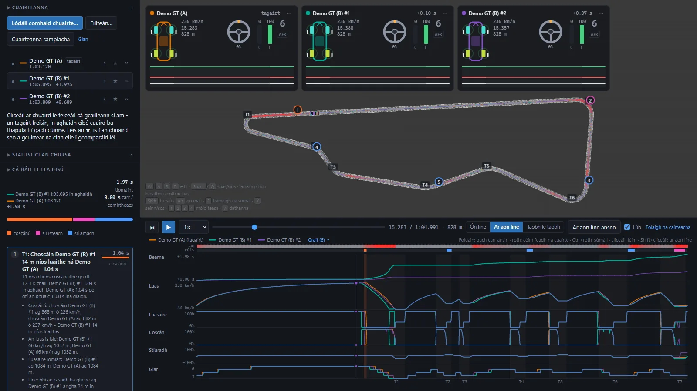

# Anailís rása

Thiomáin tú an rian céanna faoi dhó. Athsheinneann an cluaisín **Anailís rása** an dá thiomáint le chéile in 3D, taispeánann sé cá raibh cuaird amháin níos moille agus insíonn sé duit cén fáth. Gan cuairteanna fós? Brúigh **Cuairteanna samplacha**.

Comparálann an cluaisín dhá chuaird nó níos mó de chúrsa amháin. Roinneann sé an canbhás, an ceamara agus múnla an chúrsa lódáilte (**Cúlra / leibhéal**) leis an léarscáil teasa; is leis féin gach rud eile: a bharra cliathánach féin agus a bharra féin faoin radharc. Tá focail mar *lap*, *reference* agus *apex* sa [gluais](glossary.md).

Is é an leathanach seo léarscáil an chluaisín. Tá leathanach ag gach cuid:

| Leathanach | Cad a chlúdaíonn sé |
|---|---|
| [Cuairteanna a lódáil](race-loading-laps.md) | gach formáid comhaid, fillteáin agus cúrsaí, ainmneacha carranna, cuairteanna samplacha, liosta na gcuairteanna, tagarmharc agus fócas |
| [Athsheinm agus an radharc 3D](race-replay-and-scene.md) | barra an iompair, trí mhód athsheinme, carranna a ailíniú, an ceamara sealgaireachta, línte, léarscáileanna, carranna, lipéid, domhain scáthaithe |
| [Cairteacha agus an HUD](race-charts-and-hud.md) | na cairteacha fad, roghnóir na ngraf, luchfhéach agus zúmáil, cártaí na gcarranna, tábla na gcainéal |
| [Imeachtaí smachta ar an gcarr](race-control-events.md) | glasáil, sciorradh rothar, cúl ag éalú, casadh, brú amach, buailte, taismí, ABS/TC, coscán láimhe, aer - conas a bhrathaítear gach ceann, le gach tairseach |
| [Anailís cúinne ar chúinne](race-corner-analysis.md) | ailíniú de réir fad, cúinní agus stráiceanna, cuntas ama cúinne, gach cúis agus an t-ord ina dtriailtear iad, cruth na líne agus an chomhairle |
| [Próifílí carranna agus comparáid](race-car-profiles.md) | cad is féidir le gach carr a dhéanamh, tomhaiste óna chuairteanna; *Carranna i gcomparáid*; cad a chinneann an carr i ngach cúinne |
| [Staitisticí an chúrsa](race-course-statistics.md) | go leor cuairteanna de chúrsa amháin: botúin in aghaidh na cúinne agus de réir cineáil, léarscáil na mbotún, onnmhairiú na léarscála teasa, teorainneacha feidhmíochta |
| [Anailís rása: an modh](race-analytics.md) | an taighde taobh thiar de na rialacha, le foinsí |
| [Rásaíocht eile](other-games.md) | cad a dhéanann an radharc le cuairteanna ó gach cluiche: sleamhnú agus drift ríofa nuair nach seolann cluiche iad, domhain scáthaithe, na cainéil bhreise |

## An scáileán {#the-screen}

**Barra cliathánach**, ón mbarr go dtí an bun (is féidir rannóga a fhilleadh):

1. **Cuairteanna** - lódáil, liosta, taispeáint/folú, tagarmharc, fócas, leanúint. Féach [Cuairteanna a lódáil](race-loading-laps.md).
2. **Staitisticí an chúrsa** - ó thrí chuaird lódáilte amach amháin. Féach [Staitisticí an chúrsa](race-course-statistics.md).
3. **Cá háit le feabhsú** - torthaí na cuaird dhíríthe, cúinne ar chúinne. Féach [Anailís cúinne ar chúinne](race-corner-analysis.md).
4. **Cúinne ar chúinne** (nó *Cúinne ar chúinne - rang X* le roinnt ranganna) - an chuaird is tapúla trí gach cúinne agus a líne. Taispeántar é le dhá chuaird nó níos mó.
5. **Smacht ar an gcarr** - glasálacha, sleamhnáin, brúnna agus buailte na cuaird dhíríthe. Féach [Imeachtaí smachta ar an gcarr](race-control-events.md).
6. **Carranna i gcomparáid** (nó **An carr** le carr amháin) - féach [Próifílí carranna agus comparáid](race-car-profiles.md).
7. **Amharc** - cén léarscáil a phéinteáiltear ar an rian agus cad a tharraingítear. Féach [Athsheinm agus an radharc 3D](race-replay-and-scene.md).
8. Na panéil **Leibhéal** agus **Ceamara agus radharc** a roinntear (múnla an chúrsa, cur tuisil aise, ceamara) - curtha síos le léarscáil teasa agus [Ceamara](camera.md).

**An radharc** taispeánann an cúrsa, na línte tiomána, an léarscáil, na carranna, lipéid greamaithe den rian, agus suas le sé chárta carr ar barr ar chlé (féach [Cairteacha agus an HUD](race-charts-and-hud.md)). Gan cuairteanna lódáilte deir sé "No laps loaded - Drop two or more lap files here, or load the demo laps from the sidebar."

**An barra faoin radharc** coinníonn iompar an athsheinm agus, mura bhfuil sé i bhfolach, na cairteacha fad.

## Tús tapa {#quick-start}

1. Oscail cluaisín **Anailís rása** (taobh le **Léarscáil teasa** ag barr an bhóthair chliathánaigh).
2. Faigh cuairteanna isteach. Brúigh **Cuairteanna samplacha** chun a fheiceáil cad a dhéanann an cluaisín le trí chuaird bhréige. Le do chuid cuairteanna féin, taifead iad ar dtús ([formáidí comhad agus taifeadáin](race-loading-laps.md#file-formats)), ansin brúigh **Lódáil comhaid chuairte…** nó **Fillteán…**, nó scaoil comhaid nó fillteáin ar an radharc.
3. Éiríonn an chuaird iomlán is tapúla an tagarmharc; is í an chuaird eile is moille an fócas. Cliceáil cuaird ar bith sa liosta chun í a dhíriú; déanann ★ cuaird an tagarmharc.
4. Léigh **Cá háit le feabhsú**. Cliceáil torthaí: ailínítear na carranna 40 m roimhe, frámaíonn an ceamara é, seinneann an athsheinm tríd, agus osclaítear na tomhais.
5. Crith ar na cairteacha chun gach carr a bhogadh go dtí an méadar sin; Shift+cliceáil chun iad a ailíniú ansin.

## Méarchlár {#keyboard}

Le cluaisín na Rása oscailte:

| Eochair | Déanann sé |
|---|---|
| **K** | seinn / cuir ar sos an athsheinm |
| **Home** | ar ais go tús na hathsheinme |
| eochracha uimhreacha | dada (sa léarscáil teasa athraíonn siad módanna) |

Déantar neamhaird d'eochracha a chlóscríobhtar i réimse téacs nó i liosta anuas. Oibríonn eochracha an cheamara mar atá sa léarscáil teasa (**W A S D**, **Spás** suas, **Q** síos, **Shift** níos tapúla, **Alt** níos moille, luch chun breathnú; iad go léir in [Ceamara](camera.md)); **F** frámaíonn na cuairteanna lódáilte (mar a dhéanann lódáil cuairteanna).

## Go leor cuairteanna {#many-laps}

- Déantar gach cuaird lódáilte a anailísiú agus a chomhaireamh; tógann dosaen soicind nó dhó.
- Thar **8** cuaird (`SHOW_ALL_UP_TO`), tarraingítear cuairteanna nua amháin nuair is iad an tagarmharc, an chuaird dhíríthe, nó an chuaird is fearr dá rang siúd a bhfuil an chuaird dhíríthe ann. Athraíonn *Taispeáin iad uile* / *Na cinn atá faoi scrúdú amháin*.
- Thar **10** carr infheicthe (`PLAIN_PAST`), tarraingítear na cuairteanna nach bhfuil á bhfeiceáil (ní an fócas, an carr a leantar nó an tagarmharc) le línte tanaithe go pointe gach 6 m in ionad 1.5 m, agus carranna simplí.
- Tarraingíonn na cairteacha **8** cuaird ar a mhéad; taispeánann an HUD **6** cárta ar a mhéad.
- Le **3** cuaird ar a laghad taispeántar staitisticí an chúrsa.

Sonraí: [Staitisticí an chúrsa](race-course-statistics.md#performance-with-many-laps).

## Socruithe réamhshocraithe an radhairc {#default-view-settings}

| Socrú | Réamhshocrú |
|---|---|
| Léarscáil | Léarscáil ama |
| Línte tiomána, Carranna, Rothaí agus fionraí, Lipéid, Rian ón gcuairt | ar siúl |
| Gach luach ar na cártaí | as |
| Méid an chairr | 1× |
| Cairteacha | taispeántar |
| Mód athsheinme | Ón líne |
| Luas athsheinme | 1× |
| Lúb | ar siúl |

Ní shábhaítear aon cheann de seo; tosaíonn athlódáil ó na réamhshocruithe. Cuimhnítear sa bhrabhsálaí: an teanga, agus ainmneacha na gcarranna a foghlaimíodh ó chomhaid chuairte (féach [Cuairteanna a lódáil](race-loading-laps.md#car-names)).

## Do fhorbróirí {#for-developers}

### Cad a tharlaíonn nuair a lódáiltear cuairteanna {#what-happens-when-laps-are-loaded}

Gach uair a athraíonn an tacar cuairteanna, an tagarmharc nó an teanga, déantar an anailís iomlán arís (`analyse` in [`src/race/analysis.ts`](https://github.com/Holdi601/3DHeat/blob/main/src/race/analysis.ts)):

1. Cuirtear cainéil díorthaithe le gach cuaird nuair nach seolann an cluiche iad: uillinn sleamhnaithe, sleamhnú rothair ó luasanna rothair, san aer, talamh scaoilte, luas luascadh ([`derive.ts`](https://github.com/Holdi601/3DHeat/blob/main/src/race/derive.ts)).
2. Roghnaítear an tagarmharc agus tarraingítear gach cuaird ar a conair agus athshamplaítear gach 2 m ([`align.ts`](https://github.com/Holdi601/3DHeat/blob/main/src/race/align.ts)).
3. Oibrítear amach an bhfuil domhan an chluiche casta ó na cuairteanna ([`handedness.ts`](https://github.com/Holdi601/3DHeat/blob/main/src/race/handedness.ts)).
4. Aimsítear cúinní ar an tagarmharc, agus grúpáiltear ina stráiceanna ó bhloc coscáin amháin go dtí an chéad cheann eile ([`segments.ts`](https://github.com/Holdi601/3DHeat/blob/main/src/race/segments.ts)).
5. Do gach carr: a chlúdach (greim, coscán, tarraingt de réir luais), a phróifíl, agus a chuair rothar ([`envelope.ts`](https://github.com/Holdi601/3DHeat/blob/main/src/race/envelope.ts), [`profile.ts`](https://github.com/Holdi601/3DHeat/blob/main/src/race/profile.ts), [`control.ts`](https://github.com/Holdi601/3DHeat/blob/main/src/race/control.ts)).
6. Do gach cuaird agus stráice: cad a rinne sé (pointe coscáin, pointe is moille, lánluasaire, ...) agus an líne a thiomáin sé ([`line.ts`](https://github.com/Holdi601/3DHeat/blob/main/src/race/line.ts)).
7. Do gach cuaird: a imeachtaí smachta ar an gcarr, gach ceann leagtha ar an gcuaird a bhfuil comparáid aici leis ansin.
8. Do gach cuaird agus stráice: an cuntas ama i gcomparáid lena cuaird chomparáide agus an fionnachtain i bhfocail.
9. An léarscáil ama agus an léarscáil chúise do gach cuaird.

Déantar na téacsanna sa teanga reatha; ritheann athrú teanga an anailís arís (agus athainmníonn sé na cuairteanna samplacha). Taispeántar teip san anailís faoi chnaipí **Cuairteanna** mar earráid, agus fanann na cuairteanna lódáilte.

### Comhaid fhoinse {#source-files}

| Comhad | Ról |
|---|---|
| `src/race/adapters.ts`, `ibt.ts` | comhaid chuairte a léamh |
| `src/race/lap.ts`, `carNames.ts`, `synthetic.ts` | cineál na cuaird, ainmniú, cuairteanna samplacha |
| `src/race/derive.ts`, `handedness.ts` | cainéil díorthaithe, domhain casta |
| `src/race/align.ts`, `segments.ts`, `line.ts` | ais fad, cúinní, línte |
| `src/race/analysis.ts` | cúinní i gcomparáid, cúiseanna, torthaí |
| `src/race/envelope.ts`, `profile.ts` | cad is féidir le carr a dhéanamh |
| `src/race/control.ts`, `impacts.ts` | smacht ar an gcarr, buailte agus taismí |
| `src/race/stats.ts` | go leor cuairteanna |
| `src/race/replay.ts`, `scene.ts`, `glyph.ts`, `geometry.ts` | athsheinm agus tarraingt |
| `src/race/schema.ts`, `graphs.ts` | tábla na gcainéal, sraitheanna na gcairteacha |
| `src/ui/race/*` | an barra cliathánach, na cairteacha, an HUD, na lipéid |
| `src/state/raceStore.ts` | stát an chluaisín agus clog an athsheinm |
