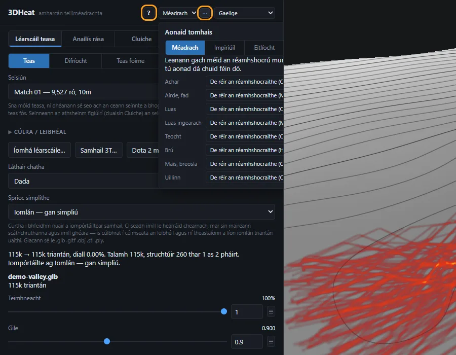
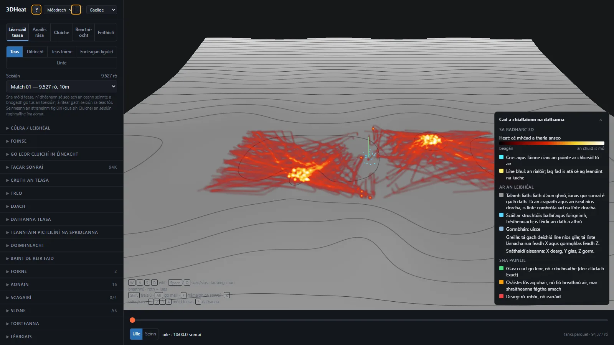
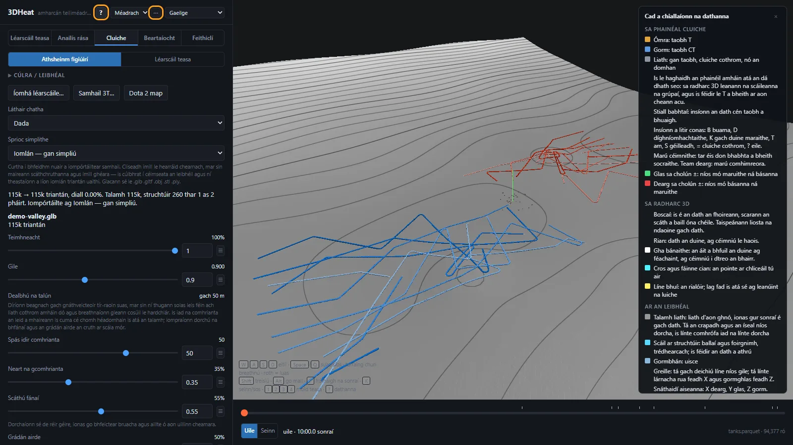

# Socruithe, aonaid agus eochracha

Athraíonn na rialuithe beaga ag barr an bharra taobh conas a labhraíonn an léirsitheoir leat: an teanga, na haonaid (méadair nó troithe, km/h nó cnóid) agus mód cabhrach a mhíníonn na dathanna. Coinnítear do roghanna i do bhrabhsálaí.

## An ceann {#the-header}

Ag barr an bharra taobh:

| Rialaithe | Cad a dhéanann sé |
|---|---|
| **?** | Mód cabhrach: cad a chiallaíonn gach dath (freisin `?` nó `F1`) |
| Roghchlár **Aonaid** | Méadrach, Impiriúil, Aviation nó Cnóid |
| Cnaipe **...** taobh le **Aonaid** | Osclaíonn "Roghnaigh aonad do gach méid": liosta anuas amháin in aghaidh an mhéid |
| Roghchlár **Teanga** | Teanga an léirsitheora: [40 teanga](languages.md), nó teanga an bhrabhsálaí |

Is féidir leis na huimhreacha a chlóscríobhann tú i mbosca pointe nó camóg a úsáid (`0.35` nó `0,35`). Léann an léirsitheoir an dá cheann agus taispeánann sé uimhreacha mar a scríobhann teanga an léirsitheora iad.

## Aonaid {#units}

1. Roghnaigh réamhshocrú sa roghchlár **Aonaid**. Athraíonn gach méid le chéile.
2. Chun méid amháin a athrú, cliceáil ar an gcnaipe **...** taobh leis agus roghnaigh aonad don mhéid sin. Taispeánann an roghchlár `*` i ndiaidh an réamhshocraithe ansin.
3. Leanann méid nach socraíodh an réamhshocrú. Roghnaigh "Mar an réamhshocrú" chun filleadh.

| Méid | Méadrach (réamhshocrú) | Impiriúil | Aviation | Cnóid |
|---|---|---|---|---|
| Fad | km | mi | NM | NM |
| Airde, fad | m | ft | ft | m |
| Luas | km/h | mph | kt | kt |
| Luas ingearach | m/s | ft/min | ft/min | m/s |
| Teocht | °C | °F | °C | °C |
| Brú | hPa | inHg | hPa | hPa |
| Mais, breosla | kg, l | lb, gal | lb, gal | t, m³ |
| Uillinn | céimeanna | céimeanna | céimeanna | céimeanna |

Aonaid eile is féidir leat a roghnú do mhéid amháin: fad km, mi, NM; luas km/h, m/s, kt, mph; luas ingearach m/s, ft/min, m/min; teocht °C, °F, K; brú hPa, inHg, mmHg, psi; mais kg, lb, t; uillinn céimeanna nó mils NATO (6400 sa chiorcal). Tá na haonaid mar an gcéanna i ngach áit sa léirsitheoir: lipéid, cártaí, cairteacha, staitisticí.

## Mód cabhrach {#help-mode}

Brúigh `?` nó `F1`, nó cliceáil ar an gcnaipe **?**. Taispeánann sé *Cad a chiallaíonn na dathanna*: míniúcháin ar an amharc 3D, na grádáin teasa, dathanna foirne, dathanna an leibhéil, dathanna stádais na bpainéal, painéal na meaitseála agus an radharc rása. Fanann sé air go dtí go múchann tú é. Sa chluaisín Cluiche míníonn sé dathanna phainéal na meaitseála freisin.

## Cad a chuimhníonn an brabhsálaí {#what-the-browser-remembers}

Coinnítear na socruithe seo i do bhrabhsálaí idir cuairteanna (ní sheoltar aon rud áit ar bith):

- an teanga, na haonaid agus an mód cabhrach;
- socruithe taispeána an athsheinm don uimhir figiúr, siombail, lipéad, ceamara agus taispeáin tactaiciúil;
- luas an athsheinm agus an scátháin;
- leabharmharcanna in aghaidh an taifeadta, toisí in aghaidh an tacair sonraí, sraitheanna cuspóra;
- socruithe AI sheachtrach (an eochair amháin mura marcálann tú *Cuimhnigh*).

Tosaíonn socruithe teasa, scagairí agus an mód as an nua le gach lódáil. An liosta iomlán, ginte: [Socruithe stóráilte](ref-settings-storage.md).

## Eochracha a choinníonn an léirsitheoir ón mbrabhsálaí {#keys-the-viewer-keeps-from-the-browser}

Tógann seisiún le sonraí móra am le lódáil, mar sin cuireann an léirsitheoir cosc ar an mbrabhsálaí é a chaitheamh amach de thimpiste:

- Ní dhéanann `Ctrl`/`Cmd` + litreacha a bheadh priontáilte, sábháilte, oscailte, athlódáilte, dúnta nó oscailte nua aon rud lasmuigh de bhoscaí téacs; ní dhéanann `F1`, `F3`, `F5`, `F6` agus `F7` aon rud.
- Nuair a dhúntar nó a athlódáiltear an cluaisín agus sonraí nó leibhéal lódáilte, iarrtar cead ar dtús.
- Sa lánscáileán glasálann an léirsitheoir na heochracha a úsáideann sé (W, T, N, S, R, P, Q, Esc), ionas nach nglacann an brabhsálaí iad.

An liosta cruinn: [Eochracha brabhsálaí](ref-browser-keys.md). Eochracha uile an léirsitheora féin: [Tagairt méarchláir agus luiche](keyboard-reference.md).
