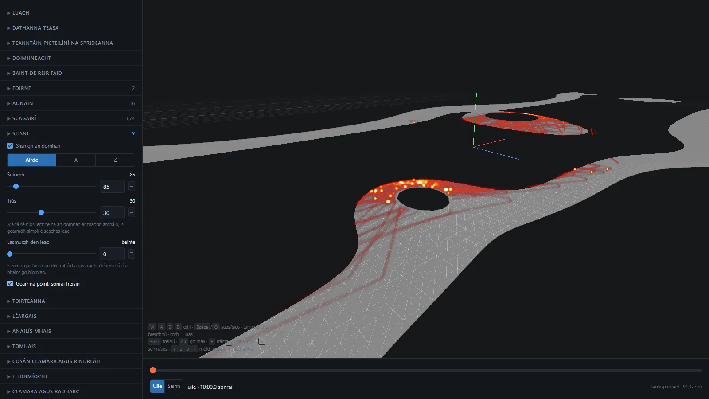

# Slisne

Gearrann **Slisne** an domhan mar bhlaosc cáca, ionas gur féidir leat breathnú isteach i bhfoirgnimh. Úsáid é nuair a choinníonn ballaí an teas spéisiúil i bhfolach, mar shampla chun leibhéal amháin d'fhoirgneamh a fheiceáil.

## Bain triail as {#try-it}

1. Lódáil leibhéal agus roinnt sonraí, agus oscail **Slisne**.
2. Tic **Slisnigh an domhan**. Is é **Airde** an ais.
3. Tarraing **Suíomh** suas agus síos: bogann an leac tríd an leibhéal.
4. Déan **Tiús** tanaí le haghaidh plean urláir, nó leathan le haghaidh "gach rud thíos anseo".
5. Coinnigh **Lasmuigh den leac** ag 0 chun an chuid eile a bhaint, nó ardaigh é chun rian lag a choinneáil.



Gearrann an leac **geoiméadracht an leibhéil agus na pointí sonraí le chéile** - ní fhágfadh gearradh an leibhéil amháin teas ag fleadh san áit a raibh a fhoirgneamh roimhe. Is é an comhghaolmhar é le [dofhálú doimhneachta](depth-and-culling.md): nuair a fholuíonn an leibhéal i gceart an rud atá taobh thiar de, tá taobh istigh foirgnimh i bhfolach freisin. Taispeántar an painéal nuair a bhíonn rud éigin le slisniú ann (tacar sonraí nó leibhéal 3D); taispeánann a ceann an ais nuair a bhíonn sé ar siúl, *as* seachas sin.

```
side view         Suíomh = cá bhfuil an leac
 ----------       Tiús = cé chomh hard is atá an leac
 | floor 3 |
 |=========|  <--- leac (coinnithe)
 | floor 2 |  <--- lasmuigh: bainte (nó lag)
 | floor 1 |
 ----------
```

## Rialaithe {#controls}

| Rialaithe | Réamhshocrú | Brí |
|---|---|---|
| **Slisnigh an domhan** | as | Cas an leac air. Fad a bhfuil an suíomh ag a luach tosaigh 0 agus an tiús ag a luach tosaigh 500, bogann casadh air iad go lár an ais agus 15% dá raon. |
| Ais | **Airde** | *Airde* (Y), *X* nó *Z*. Bogann an ais a athrú an leac go lár an ais nua. |
| **Suíomh** | an lár | Lár an leac, in aonaid domhain, trasna raon an ais (500 céim). |
| **Tiús** | 15% den raon | Ó 1/500 den raon go dhá huaire an raon, i gcéimeanna logartamacha. Léitear *thar an domhan* nuair a bhíonn sé chomh leathan leis an raon: sroicheann taobh amháin thar an domhan ansin agus is gearradh simplí é in ionad leac. |
| **Lasmuigh den leac** | 0, *bainte* | Cé mhéad de na rudaí lasmuigh a fhanann le feiceáil, 0-100%. Is minic go mbíonn rian lag den rud a gearradh amach níos éasca a léamh ná é a bhaint go hiomlán. |
| **Gearr na pointí sonraí freisin** | air | Fágann "as" an teas slán, ionas go dtaispeántar é trí na gearradh - úsáideach chun rud atá os cionn agus faoin leac a fheiceáil. |

Is é raon ais leibhéal 3D nuair a bhíonn ceann lódáilte, seachas sin raon an tacair sonraí.

Tá Slisne neamhspleách ar [bhaint faoi fhad](depth-and-culling.md#distance-culling), a ghearrann feadh threo an radhairc seachas ais domhain; tagann an dá rud le chéile. Athraíonn aon athrú ar shocrú slisnithe an carnadh teasa as an nua.

## Do fhorbróirí {#for-developers}

Déantar an leac a thástáil ar shuíomh domhain gach sraithe sa veirtéacsshader: má tá sraith lasmuigh de, iolraítear a ranníocaíocht faoin luach *Lasmuigh*, mar sin ag 0 diúltaítear di sula dtarraingítear aon phíosa. Cuireann shaders an leibhéil an tástáil chéanna i bhfeidhm ar gach píosa den talamh, de struchtúir agus d'uisce.
