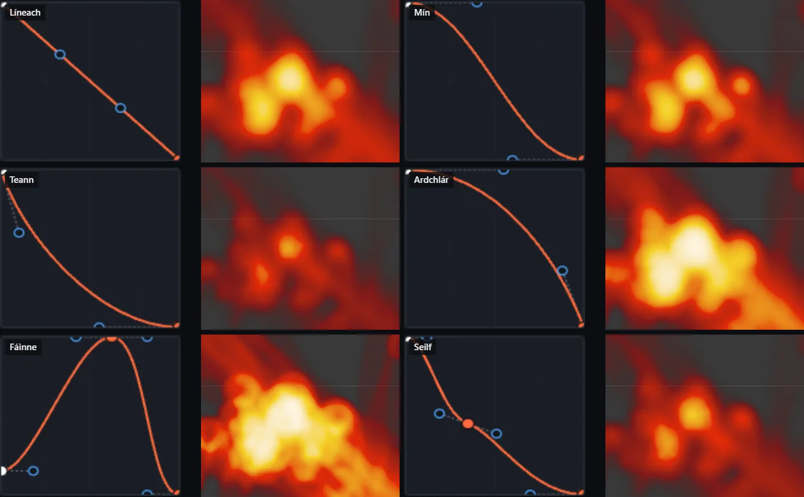

# Cruth an spriorad

Tarraingítear gach sraith mar spriorad cruinn a bhíonn ag féachaint ar an gceamara i gcónaí. Cinneann a mhéid agus an phróifíl ó a lár go dtí a imeall - an **grádán** - an bhfeictear buaicphointe mar ponc teann, scamall bog, diosca nó fáinne. Tá na rialuithe seo sa **Cruth an teasa** agus sna **Teanntáin picteilíní na sprideanna** de bharra na cléibhe, agus baineann siad le [Teas](heat.md), [Difríocht](difference.md), [Teas foirne](team-heat.md) agus, mar leath-leithead líne, le [Teas líne](line-heat.md).

Athraíonn an carnadh arís má athraítear aon cheann acu (caithfear an réimse a athtarraingt leis an gcruth nua).

Smaoinigh ar gach ponc mar bhlob bog solais. Taispeánann blob beag spotaí aonair; cumascann blob mór comharsana isteach i scamall. Cinneann an cruth cé chomh bog agus atá an imeall.



## Ga an spriorad {#sprite-radius}

Ga an spriorad i **haonaid an domhain** (lipéadaithe mar mhéadair). Réamhshocrú 6, agus ar gach luchtú an fhad chothrománach de na sonraí / 120 - sách mór chun go gcumascann samplaí comharsanacha feadh cosáin isteach i banda in ionad a bheith ina líne caol. Sliodar logartamach 0.05-2000, handle tarraingthe suas go 50,000.


Is lú a fheictear rudaí i bhfad i gcéin, agus mar sin crapann spriorad ar an scáileán de réir an achair. Faoin tionscadal comhthreomhar is mar an gcéanna é ar fud na háite, agus is é sin cuid den chúis gurb é an radharc comhthreomhar an ceann ceart chun buaicphointí a chur i gcomparáid ([Ceamara](camera.md#projection)).

## Teanntáin picteilíní {#pixel-clamps}

Teorannaíonn **Teanntáin picteilíní na sprideanna** (dúnta de réir réamhshocraithe) ga an scáileáin tar éis an tiontaithe thuas.

| Rialú | Réamhshocrú | Raon (jog) | Cén fáth |
|---|---|---|---|
| **Íosgha picteilín** | 1 px | 0-16 (512) | Coinníonn sé sonraí i bhfad i gcéin ó imeacht faoi phicteilín amháin. |
| **Uasgha picteilín** | 96 px | 2-1024, logartamach (8192) | An garda thar-tharraingthe. Costaíonn spriorad a chlúdaíonn N picteilín N oibríocht cumasctha, agus is é sin a dhéanann frámá tapa mall nuair nach bhfuil an ga teanntaithe ag an gceamara. Os cionn airde an fhuinneoige stopann sé de theanntáin a dhéanamh. |

**An dlús céanna ag gach zúmáil** (sa chuid Cruth an teasa, ar siúl de réir réamhshocraithe) oibríonn leis na teanntáin. Coinníonn spriorad a dhéanann teanntán níos mó (i bhfad i gcéin) nó níos lú (in aice láimhe) an teas a chuirfeadh a mhéid fíor leis, ionas go gciallaíonn dath an líon céanna sraitheanna in aghaidh an achair talún ag aon zúmáil. Nuair a bhíonn sé as, cuireann spriorad teanntaithe a lán meáchain leis ag a mhéid teanntaithe, agus athraíonn an pictiúr de réir mar a eitlíonn tú isteach.

## Déine sa lár agus ar an imeall {#centre-and-edge-intensity}

An teas a chuireann spriorad lena lár cruinn (**Déine sa lár**, réamhshocrú 1, 0-10, jog 1000) agus lena imeall (**Déine ar an imeall**, réamhshocrú 0, -2-10, jog 1000). Déanann luach an ghrádáin *t* (1 sa lár, 0 ar an imeall, cruthaithe ag an titim nó an cuar thíos) idirshuí eatarthu (tá an fhoirmle faoi [Do fhorbróirí](#for-developers)).

Déanann **déine imeall diúltach** an imeall a bhaint, rud a dhéanann halo fuar timpeall ar gach spota te agus a ghéarann brúchtaí in aghaidh a chéile. Cuimsíonn infheictheacht [folú](depth-and-culling.md) agus an [stiall](slice.md); is é an [Saol](timeline.md#history) an dul i ngéar; is ±1 an comhartha i [Difríocht](difference.md).

## Cruth an ghrádáin: Titim nó Cuar {#ramp-shape-falloff-or-curve}

Athraíonn **Cruth an ghrádáin** idir dhá bhealach chun *t* a chruthú ar fud an spriorad. Le *d* an fad ón lár (0) go dtí an imeall (1):

### Titim {#falloff}

Taispeántar nuair a roghnaítear *Titim* (an réamhshocrú).

- **Titim** (réamhshocrú 1.6, 0.1-8, jog 64): `t = (1 - d) ^ titim`. Is grádán líneach díreach é 1; tarraingíonn níos airde an teas isteach i dtreo an lárphointe agus teannann an buaicphointe; faoi 1 leathnaíonn sé ina dhiosca.
- **Grádán mín** (réamhshocrú air): cuireann S-chuar smoothstep i bhfeidhm ar *t*, ionas go dtagann an spriorad i ngéar ag a imeall in ionad deireadh ag imeall infheicthe.

### Eagarthóir an chuair {#the-curve-editor}

Taispeántar nuair a roghnaítear *Cuar*. Trasghearradh liteartha de spriorad: an fad ón lár trasna (*lár* ar chlé, *imeall* ar dheis), an teas suas. Is cuar cúbach Bézier píosach trí phointí rialaithe é, agus dhá láimhseáil ag gach ceann.

| Gníomh | Toradh |
|---|---|
| Dúbailtcliceáil ar an ngraf | Cuireann pointe leis ag an bhfad sin (coinnithe idir 0.02 agus 0.98), ar an gcuar agus le fána an chuair ansin, mar sin ní athraíonn sé aon rud go dtí go dtarraingíonn tú é. |
| Tarraing pointe | Bogann sé é. Coinnítear airdeanna idir 0 agus 1. |
| Tarraing ciorcal beag | Lúbann sé an teachtaire in aice leis (bogann sé an láimhseáil sin). |
| Alt-cliceáil nó cliceáil dheas ar phointe | Baineann sé é. Ní féidir an dá chríochphointe a bhaint. |
| Cnaipe réamhshocraithe | Cuireann sé an réamhshocrú in ionad an chuair. |

Tá na críochphointí socraithe ag an lár agus ag an imeall; is leatsa a n-airde fós.

**Réamhshocruithe** ([`curve.ts`](https://github.com/Holdi601/3DHeat/blob/main/src/state/curve.ts)):

| Réamhshocrú | Cruth | Úsáid |
|---|---|---|
| **Líneach** | Díreach ó 1 go 0 | Mar an gcéanna le *Titim* 1 agus *Grádán mín* as. |
| **Mín** | S-chuar | An cuar réamhshocraithe; an rud a thugann *Grádán mín* ag titim 1. |
| **Teann** | Croílár géar, sciorta fada éadrom | Sonraí tanaí. |
| **Ardchlár** | Cothrom, agus ansin titim thapa | Léitear mar dhiosca in ionad scamaill. |
| **Fáinne** | 0.15 sa lár, 1 ag 62% den ga, 0 ar an imeall | Spriorad folamh: taispeánann sé cá dtéann cosáin in ionad cá stopann siad. |
| **Seilf** | Titim dhá chéim, 0.45 ag 35% | Scarann croí dlúth óna thimpeallacht. |

## Leacaigh ar phlána na talún {#flatten-onto-ground-plane}

Déanann **Leacaigh ar phlána na talún** (as de réir réamhshocraithe) neamhaird d'airde gach sraithe agus tarraingíonn sé an teas go léir ag airde amháin - Y is ísle na sonraí - an léarscáil teasa 2D chlasaiceach. Nuair a bhíonn sé ar siúl, cuirtear folú doimhneachta agus *Folaigh taobh thiar den tír-raon* as (bheadh gach pointe díreach ar an dromchla a dtástálann sé ina aghaidh), agus deir alt na Doimhneachta sin.

## Do fhorbróirí {#for-developers}

### Foirmlí {#formulas}

Ga an scáileáin i bpicteilíní: `ga × P[1][1] / w × airde fuinneoige / 2`, áit a bhfuil `P` an maitrís tionscadail agus `w` doimhneacht radhairc an phointe.

An teas a chuireann spriorad leis:

```
teas breise = mix(imeall, lár, t) × meáchan samplach × comhartha × dul i ngéar × infheictheacht
```

### An cuar {#the-curve}

Teorannaítear láimhseálacha go cothrománach go dtí a gcuid féin, mar sin is feidhm d'fhad an cuar i gcónaí: dá ndrannfá láimhseáil i bhfad taobh thiar den chéad phointe eile, sléachtfadh sé faoi in aghaidh an phointe sin in ionad an cuar a fhilleadh ar ais, rud a dhéanfadh an toradh ag brath ar an fhréamh a fuair an réiteoir.

### Conas a tharraingítear an cuar {#how-the-curve-is-drawn}

Bácáiltear an cuar isteach i dtábla 256-iontráil aon uair a athraíonn sé, uaslódáiltear mar théacsúr snámhphointe 16-giotach é, agus samplaítear in aghaidh an phíosa é le scagadh líneach agus insliú leath-texel ionas go bhfanann an dá cheann beacht. Teastaíonn atriall chun Bézier a réiteach do x, agus níl aon áit don atriall sin sa shader is teo sa chlár, agus is lú costas ar fhaighteanas tábla ná an `pow()` a úsáideann an titim. 16-giotach in ionad 8-giotach toisc go dtaispeánn 8 giota bindeadh nuair a bhíonn na mílte spriorad curtha le chéile; is féidir scagadh a dhéanamh ar snámhphointe leath-16-giotach i WebGL2 croí, áit a dteastaíonn síneadh do 32-giotach.
