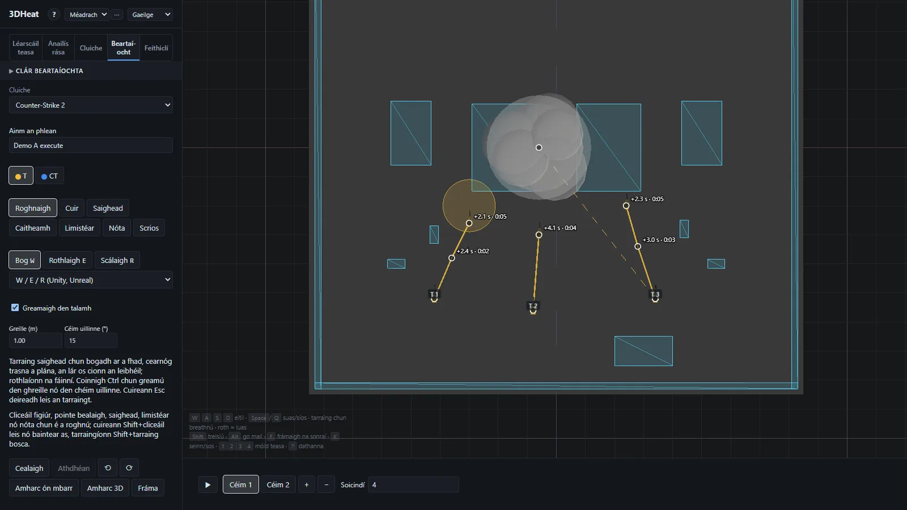

# Clár na dtaictic

Is clár tarraingthe do phlean foirne é cluaisín **Beartaíocht**: cuireann tú figiúirí beaga ar léarscáil, tarraingíonn tú saigheada do na háiteanna a rachaidh siad, agus brúigh seinn chun é a fheiceáil ag tarlú. Úsáid é chun babhta nó ionsaí a phleanáil sula n-imríonn tú. Roinneann sé an canbhás, an ceamara agus an [leibhéal](levels.md) leis na cluaisíní eile agus níl aon rud eile aige; ní sonraí é plean agus ní tharraingíonn sé teas ar bith.

## Do chéad phlean {#your-first-plan}

1. Oscail cluaisín **Beartaíocht**. Roghnaigh an **Cluiche** (mar shampla Counter-Strike 2) agus, le haghaidh Valorant, brúigh **Lódáil léarscáileanna Valorant** agus roghnaigh **Léarscáil**. Nó lódáil [leibhéal](levels.md) ar dtús.
2. Roghnaigh **Taobh** (socraíonn sé an dath) agus brúigh **Amharc ón mbarr**.
3. Roghnaigh **Áit**, roghnaigh figiúr i **Figiúirí** (úsáid **Cuardaigh figiúirí** chun ceann a aimsiú) agus cliceáil ar an léarscáil. Cuir dhá cheann nó trí cinn.
4. Roghnaigh **Saighead**, cliceáil ar fhigiúr, cliceáil ar feadh an bhealaigh ar cheart dó dul, agus brúigh **Enter** chun an tsaighead a chríochnú.
5. Brúigh **+** faoin radharc chun céim 2 a chur leis. Tosaíonn gach figiúr san áit ar chríochnaigh a shaighead. Tarraing tuilleadh saigheada ansin.
6. Brúigh **▶** (nó `K`) chun an plean a sheinm ón gcéim a thaispeántar go deireadh.
7. Ainmnigh an plean in **Ainm an phlean** agus brúigh **Sábháil**.

## Plean a thosú {#starting-a-plan}

| Rialú | Cad a dhéanann sé |
|---|---|
| **Cluiche** | Roghnaíonn sé na taobhanna agus na figiúirí a thairgeann an pailéad: Counter-Strike 2 (T, CT; imreoirí agus úsáidí), Valorant (Ionsaí, Cosaint; imreoirí agus cumais ghinearálta), Battlefield, Squad, Arma (coisí, feithiclí talún, aerárthaigh, bádaí), DCS / War Thunder / IL-2 (eitleáin, aerárthaigh airgeadh, helicoptair, cosaint aeir, talamh, longa, airm), agus Eile. Coinníonn plean a bhfuil figiúirí aige a thaobhanna nuair a athraíonn an cluiche. |
| **Ainm an phlean** | An t-ainm faoina sábháiltear an plean. |
| **Léarscáil**, **Lódáil léarscáileanna Valorant** | Nuair a roghnaítear Valorant: faigheann **Lódáil léarscáileanna Valorant** liosta na léarscáileanna ó [valorant-api.com](https://valorant-api.com); cuireann **Léarscáil** mionléarscáil na léarscála roghnaithe síos mar an leibhéal, frámaithe ón mbarr. Tarraingítear an íomhá nuair a roghnaítear í, agus ní sheoltar riamh í. Taispeántar fógra Riot agus é ar an scáileán (féach thíos). |
| **Taobh** | An taobh a bhaineann leis an gcéad fhigiúr, saighead nó limistéar eile; glacann sé dath an taobh. |

Gan leibhéal is é an clár an talamh comhthreomhar lom. Luchtaigh leibhéal faoi **Leibhéal** chun pleanáil ar léarscáil fhíor: léarscáil CS2 onnmhaithe leis an uirlis CS2, leibhéal ón leabharlann, nó pictiúr léarscála.

## Uirlisí {#tools}

| Uirlis | Cliceáil | Nótaí |
|---|---|---|
| **Roghnaigh** | Figiúr, pointe bealaigh, saighead, limistéar nó nóta a roghnaíonn sé. | Shift+cliceáil cuireann le roghnú nó baineann é; Shift+tarraing tarraingíonn bosca timpeall ar an rud le cur leis. Faigheann an roghnú giz iompaithe (féach thíos); `Delete` nó `Backspace` baineann é. `M` bogann an figiúr roghnaithe go dtí an chéad chliceáil eile. |
| **Áit** | Cuireann an figiúr roghnaithe síos. | Roghnaítear figiúr sa pailéad **Figiúirí** (le **Cuardaigh figiúirí**). Gan rud ar bith roghnaithe, casann `R` an chéad fhigiúr eile 15° sula gcuirtear síos é (`Shift+R` an bealach eile). |
| **Saighead** | Cuireann gach cliceáil pointe leis; Enter, dúbailtcliceáil nó deischliceáil críochnaíonn sé, Esc scoireann é. | **Bog**, **Ionsaí** (ceann níos leithne) nó **Faire** (líne tanaí ag airde súl). Is é bealach an fhigiúir sa chéim seo an tsaighead a thosaíonn ar fhigiúr: nuair a sheinntear ar ais, siúlann an figiúr é, agus tosaíonn an chéim eile san áit ar chríochnaigh sé. |
| **Caitheamh** | An caiteoir, ansin an áit a dtuirlingíonn sé. | Cuar briste idir an ceann amháin agus an ceann eile, agus an úsáid roghnaithe (deatach, lasadh, molotov, ...) le feiceáil san áit a dtuirlingíonn sé agus fanann sé ón gcéim seo amach. |
| **Limistéar** | An lár, ansin an imeall. | Diosca i ndath an taobh. |
| **Nóta** | An áit a dtéann an nóta; iarrann a théacs. | Taispeántar mar phionna, agus a théacs os a chionn. |
| **Scrios** | Figiúr, saighead, limistéar nó nóta. | Baintear é ón gcéim seo amach; ar a chéad chéim, baintear ar fad é. |

**Cealaigh** agus **Athdhéan** (`Ctrl+Z`; `Ctrl+Y` nó `Ctrl+Shift+Z`) céimníonn siad trí gach athrú. Léiríonn líne faoin bplean cé mhéad figiúr, saighead agus céim atá ann. **Amharc ón mbarr** breathnaíonn go díreach síos (ortagrafach), **Amharc 3D** filleann ar an bpeirspictíocht, **Fráma** cuireann an plean, nó an leibhéal nuair a bhíonn an plean folamh, ina theannta.

**Méid na bhfigiúirí** scálaíonn gach figiúr ar an gclár; is é 1× fíormhéid, a bhfuil ón mbarr ard cúpla picteilín do dhuine.

## Bogadh, casadh agus scálú {#moving-turning-and-scaling}

Is féidir gach rud ar an gclár a bhogadh mar i n-eagarthóir 3D: figiúirí, cumais, marcóirí, pointí bealaigh aonair agus saigheada iomlána, limistéir agus nótaí. Faigheann an rud roghnaithe giz ag a lár:

| Mód | Eochracha | Láimhseáin |
|---|---|---|
| **Bog** | W (nó G) | Saighead do gach ais (X dearg, Y glas agus suas, Z gorm) bogann ar feadh na haise; bogann cearnóg trasna a plána; bogann lár an léarscáil faoin gcurseoir. |
| **Rothlaigh** | E (nó R) | Fáinne do gach ais casann faoi. Is iad fáinní figiúir aonair a luascadh, tuairteáil agus rolladh féin; casann grúpa faoi ais an domhain timpeall a lár. |
| **Scálaigh** | R (nó S) | Scaipeann nó bailíonn an roghnú ó a lár ar feadh ais nó ar gach bealach; fásann ga limistéir leis. |

**Eochracha** athraíonn idir W / E / R (Unity, Unreal) agus G / R / S (Blender); roghnaíonn na heochracha an mód ach amháin nuair a bhíonn rud roghnaithe, agus eitlíonn an ceamara sa chás eile. Mar sin ciallaíonn `R` **Scálaigh** leis na heochracha W / E / R agus **Rothlaigh** leis na heochracha G / R / S nuair a bhíonn rud roghnaithe, agus casann sé an chéad fhigiúr eile le cur síos nuair nach bhfuil. Liostaítear gach eochair clár sa [treoir eochracha](keyboard-reference.md#tactics-board). Coinnigh **Ctrl** síos agus tarraing chun bogadh a ghreamú leis an **Greille** (méadair) nó casadh leis an **Céim uillinne**. **Greamaigh den talamh** (ar siúl de réir réamhshocraithe) cuireann daoine, feithiclí, marcóirí, pointí bealaigh agus limistéir a bogadh ar dhromchla an leibhéil; coinníonn aerárthaigh agus helicoptair a n-airde, agus ní ghreamaíonn tarraingt ar feadh saighead Y riamh. Ní bhogann láimhseán a tharraingt an ceamara riamh. **Esc** cealaíonn tarraingt, agus is céim amháin de Cealaigh gach athrú.

Taispeántar pointí bealaigh mar phointí ar shaigheada na céime taispeanta: cliceáil ceann chun é a roghnú, tarraing chun é a bhogadh, Delete chun é a bhaint. Taispeánann an rannóg **Roghnaithe** áit an roghnaithe i méadair, luascadh, tuairteáil agus rolladh figiúir i gcéimeanna, agus ga limistéir, gach ceann le clóscríobh.

## Am {#timing}

Tá bealach figiúir tomhaiste: tógann gach cuid a fad thar an leibhéal - samplaithe ar an dromchla gach cúpla méadar, ionas go gcuirtear cnoc nó céimeanna idir dhá phointe san áireamh - ar luas a **mhóid** ghluaiseachta don fhigiúr sin sa chluiche sin, agus aon **fhanacht** ag pointe bealaigh. Ritheann coisí, crúbann, siúlann (ciúin), rithtear nó sprintéiltear; ritheann feithiclí agus bádaí go mall, go cúramach, de ghnáth nó le deifir; eitlíonn aerárthaigh agus helicoptair go mall, ar fánaíocht, ag luas comhraic nó ag uasmhéid. Má níl mód ag an gcluiche (níl sprint ag CS2), glacann sé an ceann is gaire dá bhfuil aige. Cuireann an claon moill ar an gcaoi a mbraitheann sé ag brath ar an gcluiche: i CS2 agus Valorant ní chuntar ach an fad cothrománach, mar atá sna cluichí; moillíonn cluichí míleata coisí suas cnoic (feidhm siúlóide Tobler) agus feithiclí de réir grádáin.

Tagann na luasanna ó thábla de réir cluiche lena bhfoinsí (féach [Luasanna gluaiseachta](tactics-speeds.md)): CS2 de réir an airm a bhfuil ar iompar, ó shainmhínithe airm an chluiche; Valorant de réir airm; Battlefield, Squad, Arma agus na cluichí aeir de réir cineáil feithicle agus ranga. **Bogann mar** roghnaíonn próifíl figiúir (airm, cineál feithicle); **Do cheann féin (m/s)** sáraíonn aon mhód don fhigiúr sin. Ainmnítear módanna mar a thaispeánann an clár iad: *Crapadh*, *Crúbadh*, *Siúl (ciúin)*, *Rith*, *Sprint*; *Cúramach*, *Gnáth*, *Deifir*; *Mall*, *Fánaíocht*, *Comhraic*, *Uasmhéid*.

Taispeánann gach pointe bealaigh an t-am ón gceann deireanach agus an t-am ó thús an phlean ("+3.9 s · 0:12"). Liostaíonn bealach an fhigiúir roghnaithe gach cuid lena mhód, fad agus am, an fhanacht agus an sroicheadh. **Sroichtí** faoi **Uainiú** cuireann gach figiúr bealaigh ar líne ama amháin, an chéad sroicheadh ar barr. Le **Seinn in am fíor** (ar siúl de réir réamhshocraithe) maireann céim go dtí go sroicheann a bhealach is moille, agus bogann gach figiúr ar a luas féin; is é **Soicindí** an fad is lú den chéim ansin. **Aonaid leibhéil in aghaidh an mhéadair** insíonn cad é an leibhéal: 39.37 do léarscáileanna CS2 (aonaid chluiche), 1 do léarscáileanna méadair.

## Comparáid le sonraí cluiche {#compare-with-match-data}

**Lódáil comhaid chluiche…** léann tablaí cluiche CS2 den léarscáil (comhaid Parquet na huirlise CS2, cé mhéad is mian leat; na colúin amháin is gá, sa chúlra); **Úsáid na sonraí luchtaithe** glacann na sonraí a luchtaíodh sa radharc. Ansin:

- **An sroicheadh is luaithe ar an léarscáil** dathaíonn an léarscáil de réir an ama ó thús an bhabhta a shroich imreoir gach spota ar dtús - cnaipe **Is tapúla** taispeánann an tapúla thar gach babhta, **Tipiciúil (airmheán)** an babhta lárnach - ó ghlas go luath go dearg go déanach, do thaobh amháin nó don dá thaobh. Taispeánann sé cad is féidir a dhéanamh agus cathain.
- Déantar an bealach roghnaithe a chur i gcomparáid leis an méid a bhain imreoirí amach ó thús (nó ó thús an bhabhta) go deireadh, gach deireadh ina dhiosca den ga socraithe: "Is tapúla breathnaithe 14.2 s, p10 15.0 s, airmheán 18.3 s thar 41 rith; do phlean 15.1 s".
- Na luasanna a bhog imreoirí i ndáiríre - ag rith, ag siúl, ag crúbadh, ó cholúin siúlóide agus crúbtha na dtablaí - in m/s.

## Céimeanna {#steps}

Coinníonn an barra faoin radharc na céimeanna. Tosaíonn plean le ceann amháin; **+** cuireann ceann leis, agus tosaíonn gach figiúr é san áit ar chríochnaigh a bhealach sa chéim dheireanach; **−** baineann an ceann taispeanta. **Soicindí** an fad a thógann an chéim taispeanta nuair a sheinntear. **▶** (K) seinneann ón gcéim taispeanta go deireadh: siúlann figiúirí a bhfuil bealach acu é, sleamhnaíonn figiúirí a bogadh go háit nua sa chéim eile ann, fanann an chuid eile. Agus céim taispeanta, tarraingítear áit gach figiúir sa chéim eile mar thaibhse halainn, agus saigheada na céime deiridh go halainn faoi na saigheada sa chéim seo.

## Sábháil {#saving}

Coinníonn an rannóg **Comhad** **Sábháil**, **Tús** agus **Glan**. Scríobhann **Sábháil** an plean mar `<ainm>.h3dplan.json` (JSON simplí: taobhanna, céimeanna, figiúirí le háit i ngach céim, saigheada, limistéir, nótaí); léann **Tús** ceann ar ais. Diúltaítear do chomhad de leagan eile, nó do chomhad nach plean é, agus an chúis ann. **Glan** folmhaíonn an plean; tugann Cealaigh ar ais é.

## Figiúirí {#figures}

Tógann an radharc féin gach figiúr: cruthanna simplí de réir mhéid fhoilsithe an chineáil, leis na gnéithe a dhéanann idirdhealú idir a chomharsana - rothaí bóthair agus túr tanc, na gunnaí, na mísle agus na radair de fheithicil chosanta aeir, plean sciathán aerárthaigh, eireaball agus innill, rothar agus sciatháin ghearra helicoptair. Ní thógtar aon rud ó chluiche. Taispeántar dearadh a chum cluiche mar an figiúr ginearálta dá rang. Féach [Figiúirí](figures.md#which-figure-a-unit-gets) chun a fheiceáil conas a aimsíonn sonraí a bhfigiúr.

## Fógra Riot {#riots-notice}

Taispeántar léarscáileanna Valorant faoi pholasaí "Legal Jibber Jabber" Riot Games, a cheadaíonn do thionscadail phobail shaora iad a úsáid agus a iarrann an fógra seo san áit ar bith a bhfeictear iad: *Cruthaíodh 3DHeat faoi pholasaí "Legal Jibber Jabber" Riot Games ag úsáid sócmhainní atá ag Riot Games. Ní dheimhníonn Riot Games ná ní thacaíonn sé leis an tionscadal seo.* Is cruthanna ginearálta iad na cumais ar an gclár, ní ealaín Riot iad.
