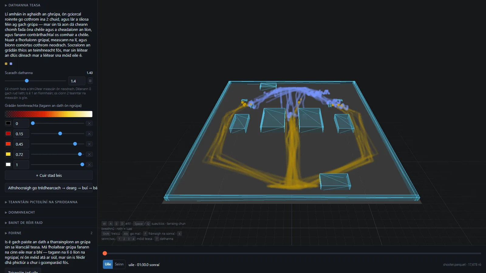

# Teas foirne

Taispeánann teas foirne cá raibh gach foireann, gach foireann ina dath féin. Nuair a fhorluíonn foirne, measctar na dathanna.

Is é **Teas foirne** (eochair 3) an réimse dlúis de [Teas](heat.md) le dath ar leith ag gach [grúpa](glossary.md). Nuair a fhorluíonn grúpaí, measctar a n-ais dathanna; tagann comórtas cothrom amach neodrach. Iompraíonn teimhneacht an dlúis díreach mar i mód eile, ionas go bhfreagraíonn an pictiúr *cé mhéad* agus *cé leis* ag an am céanna. Teastaíonn colún grúpa uaidh.

Ní hé an [forleagan figiúr](box-replay.md): tarraingíonn sin figiúr amháin in aghaidh duine; is réimse teasa é seo, dathaithe ag an gcolún céanna.

## Conas é a úsáid {#how-to-use-it}

1. Brúigh `3` (nó roghnaigh **Teas foirne** sa bharra módanna).
2. Oscail **Dathanna teasa**. Taispeánann na swatches dath gach grúpa; cuir an luch ar swatch le hainm na foirne a fheiceáil.
3. Má fheictear gach rud liath, ardaigh **Scaradh dathanna**.
4. Díthic grúpa sa [liosta Foirne](teams-list.md) chun é a bhaint; fanann na dathanna eile san áit a raibh siad.

## Rialaithe {#controls}

Sa chuid **Dathanna teasa**:

| Rialaithe | Réamhshocrú | Brí |
|---|---|---|
| Swatches | | Dath gach grúpa, do na chéad 12 grúpa, ansin *+N eile*. Cuir an luch orthu le haghaidh ainm an ghrúpa agus an dath. |
| **Scaradh dathanna** | 1.4 | Cé chomh fada agus a bhrúitear measc amach ón neodrach, 0-4. Déanann 0 gach rud liath; is é 1 an meán fíor; thar thart ar 2 fágann na measc is gile raon inléirithe agus teorannaítear in aghaidh an chainéil iad, rud a athraíonn a ndath. |
| **Grádán teimhneachta (tagann an dath ón ngrúpa)** | an grádán teasa réamhshocraithe | Ní úsáidtear ach **alfa** an ghrádáin anseo: trédhearcach nuair nach bhfuil aon rud, dorcha ag an mbarr. Déantar neamhaird ar a dhathanna. |

Tarraingítear grúpa a bhfuil a lipéad a chiallaíonn "gan grúpa" (`0`, folamh, `none`, `unknown`, `null` nó `-1`) liath.

Oibríonn na rialuithe teasa eile go léir - cruth, sáithiúlacht, freagairt, teas íosta, doimhneacht, baint - mar atá i [Teas](heat.md).

Taispeánann an [liosta Foirne](teams-list.md) dath teas foirne gach grúpa mar a swatch sa mhód seo. Má fholaítear grúpa fágann sé dath gach grúpa eile san áit a raibh sé: tagann na dathanna ó líon iomlán na ngrúpaí, ní ó cad atá ar siúl, ionas go bhfuil dhá phictiúr inchomparáide.

## Do fhorbróirí {#for-developers}

### An pailléad {#the-palette}

Ó [`colors.ts`](https://github.com/Holdi601/3DHeat/blob/main/src/render/colors.ts):

- Maireann dathanna ar an bplána datha **Oklab** ag soilsíocht shocraithe (0.7) agus croma (0.115), mar sin tá gach grúpa chomh gile céanna agus ní léitear grúpa dearg mar theasaí ná grúpa gorm.
- Le *n* grúpa, roinntear ciorcal na ndathanna ina *n* chuid chomhionanna agus glacann grúpa *i* **lár** a chuid, `(i + 0.5) / n` de chasadh. Tá aon dhá ghrúpa chomh scartha agus a cheadaíonn an líon, agus fanann cuma contrártha contrártha cibé líon atá ann.
- Úsáidtear **16** dathanna ar a mhéad. Le níos mó grúpaí cuirtear aitheantais in áit trí leathadh arís agus arís eile (aitheantais ar a ngiotán: 0, ½, ¼, ¾, ⅛, …) ionas nach roinneann aitheantais in aice láimhe dath; roinneann grúpaí os cionn 16 dath dá bhrí sin.
- Déantar grúpa a bhfuil a lipéad a chiallaíonn "gan grúpa" - `0`, folamh, `none`, `unknown`, `null` nó `-1`, gan aird ar chás - a tharraingt **liath neodrach** in ionad slis den chiorcal a ghlacadh. Ní thréaslaítear ach an chéad lipéad den chineál sin ar liosta na ngrúpaí.

Is é 1.4 an scaradh réamhshocraithe seachas 1, mar ag 1 *is* liath measc de chúig dhath atá scaipthe go cothrom: ceart agus dothuigthe. Coinníonn beagán os cionn 1 na ceangail ionraic agus léiríonn sé roinn 60/40.

### Conas a oibríonn sé {#how-it-works}

Tá ceithre chainéal ag sprioc an teasa sa mhód seo. Cuireann gach spriote a dlús *v* leis an gcéad chainéal agus *v* × comhordanáidí Oklab *a* agus *b* an ghrúpa leis an dara agus an tríú. Ag am an chomhdhéanta is é meán meáite dlús mheascán an phíocsail: *a* = G / R, *b* = B / R, scálaithe leis an scaradh dathanna agus iompaithe go sRGB ag soilsíocht an phaileat. Má roinntear faoin dlús carntha coinnítear an dath neamhspleách ar cé mhéad sonraí atá ann, agus sin é an fáth a dtéann gach rialú dlúis ar aghaidh ag gníomhú ar an teimhneacht amháin.

Costaíonn an sprioc ceithre-chainéal ceithre huaire chuimhne GPU na sprice aoncainéil teasa ag an rezolúiniú céanna.
