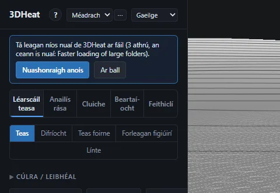

# Nuashonruithe

Insíonn an radharc duit nuair a bhíonn leagan nua ann, agus nuashonraíonn sé é féin ach amháin nuair a deir tú go bhfuil sé ceart. Ní athraítear rud ar bith ar do ríomhaire gan do fhreagra.

## Nuashonraigh an radharc {#update-the-viewer}

1. **Sa leathanach.** Nuair a bhíonn leagan nua ann, tagann bosca faoin ainm ag barr an bhóthair chliathánaigh: "A newer version of 3DHeat is available". Cliceáil **Nuashonraigh anois**. Athlódálann an leathanach é féin nuair a bheidh sé déanta. **Ar ball** cuireann an bosca i bhfolach é go dtí go n-athlódálann tú an leathanach.
2. **Má deir sé go rithfeá restart.bat**, dún fuinneog an fhreastalaí (an fhuinneog dhubh a d'oscail `start.bat`) agus déan cliceáil dhúbailte ar `restart.bat`.
3. **Nuair a thosaíonn tú an radharc.** Seiceálann `start.bat` freisin. Má tá leagan nua ann, fiafraíonn sé **Update now? [Y/N]**. Brúigh `Y` chun nuashonrú. Brúigh `N`, nó fan 60 soicind gan freagra, chun an leagan atá agat a thosú.



Ní nuashonraítear cóip a bhfuil athruithe agat féin air go huathoibríoch riamh; ní insíonn an bosca duit ach go bhfuil nuashonrú ag fanacht, agus deir sé go gcaithfidh tú do chuid athruithe a thiomantú nó a stóráil agus `git pull` a rith. Ní thaispeánann cóip nach ndearnadh a shuiteáil le git (comhad zip, mar shampla) rud ar bith.

Conas a oibríonn an seiceáil, céim ar chéim:

```
leathanach ---(tar éis 4 s, ansin gach 6 u)---> freastalaí forbartha ---> git fetch
   taobh thiar?  níl -> ní thaispeántar rud ar bith
                 tá  -> do chuid athruithe nó tiomantais féin?  tá -> insíonn sé duit amháin
                                                              níl -> [Nuashonraigh anois] -> git pull
                                                                     -> athlódáil, nó "rith restart.bat"
```

## Na rialacha sábháilteachta {#the-safety-rules}

- **Fast-forward amháin** (`git pull --ff-only`): ní chumascann, ní athbhunaíonn ná ní athscríobhann nuashonrú rud ar bith riamh.
- **Gan athruithe áitiúla**: ní nuashonraítear cóip a bhfuil athruithe gan tiomantas aici ar chomhaid rianaithe go huathoibríoch (`git status --porcelain --untracked-files=no` nach folamh) - ní ceart don nuashonrú saothar duine a fhorscríobh. Insítear di amháin go bhfuil nuashonrú ag fanacht. Ní chuntar comhaid neamhrianaithe (sonraí, onnmhairithe) mar athruithe.
- **Gan tiomantais áitiúla**: ní nuashonraítear cóip a bhfuil tiomantais aici nach bhfuil ag an upstream ("diverged") - ní féidir le fast-forward é a thabhairt suas, agus is le `git pull` de láimh a dhéantar cumasc. Deir an leathanach agus `start.bat` araon é sin sna focail chéanna, agus tosaíonn `start.bat` an leagan atá ann.
- **Ón leathanach féin amháin**: caithfidh iarratas an fhreastalaí forbartha ceannlíne saincheaptha a iompar agus, nuair a iompraíonn an brabhsálaí `Origin`, teacht ó óstach an fhreastalaí féin (thíos).
- Ní nuashonraítear riamh ach cóip git a bhfuil brainse upstream aici; ní nuashonraítear rud ar bith eile (cóip gan `.git`, gan git suiteáilte, tógáil statach) agus fágtar ina haonar é gan rud ar bith a rá.

## Cad a dhéanann start.bat {#what-startbat-does}

`start.bat` (cliceáil dhúbailte air; is í an fhuinneog an freastalaí) déanann sé, in ord:

1. Aimsíonn sé Node.js - ar `PATH`, nó i `%ProgramFiles%\nodejs`, `%ProgramFiles(x86)%\nodejs` nó `%LOCALAPPDATA%\Programs\nodejs` - agus tairgeann sé é a shuiteáil le `winget install -e --id OpenJS.NodeJS.LTS` nuair nach bhfuil sé ann (iarrtar, Y/N; ina dhiaidh sin caithfear an fhuinneog a athoscailt chun go n-aithneoidh Windows an `PATH` nua).
2. **Nuashonruithe**, nuair a bhíonn git suiteáilte agus `.git` sa fhillteán:
   - `git fetch --quiet` (gan líonra nó gan upstream: scipeáiltear go ciúin);
   - comhaireann `git rev-list --count HEAD..@{u}`; gan aon rud taobh thiar: ní deirtear rud ar bith;
   - athruithe áitiúla: "A newer version of 3DHeat is available (N changes), but this copy has local changes, so it is not updated. Commit or stash them, then run git pull." - agus tosaíonn sé an leagan atá ann;
   - tiomantais féin (`git rev-list --count @{u}..HEAD` nach 0): "A newer version of 3DHeat is available (N changes), but this copy has commits of its own that the newest version does not, so it is not updated. Update it with git pull." - agus tosaíonn sé an leagan atá ann;
   - seachas sin "A newer version of 3DHeat is available (N changes)." agus an cheist **Update now? [Y/N]**. `N`, nó gan freagra ar feadh 60 soicind, priontálann sé "Not updated; starting the version you have." agus tosaíonn sé an leagan atá ann. Ar `Y`: "Updating...", tugann sé le fios an athraíonn `package.json` nó `package-lock.json`, rithtear `git pull --ff-only` (dá dteipfeadh sé fós - an líonra, mar shampla: "The update did not go through; starting the version you have."), ansin `git submodule update --init` (na huirlisí pinn, féach [Ag cothabháil na ndoiciméad](maintaining.md#the-tools-under-exporters)), ansin `npm install` nuair a athraíonn comhaid an phacáiste agus go bhfuil `node_modules` ann, agus "Updated."
3. Diúltaíonn sé freastalaí dara a thosú: nuair atá rud éigin ag éisteacht ar chalafort **5273** deir sé sin agus tugann sé `restart.bat` / `stop.bat` mar threoir.
4. An chéad uair a ritheann sé (gan `node_modules`), fiafraíonn sé sula íoslódálann sé na spleáchais (thart ar 300 MB isteach i `node_modules\`, gan aon rud ar fud an chórais).
5. Tosaíonn sé an freastalaí forbartha ar `127.0.0.1:5273` (`--strictPort`) agus oscailtear an brabhsálaí nuair a bhíonn sé réidh.

Stopann `restart.bat` an freastalaí (de réir calafoirt) agus ritheann `start.bat` arís, mar sin fiafraíonn sé an cheist chéanna. Ní dhéanann `stop.bat` ach stop.

## Do fhorbróirí {#for-developers}

### Agus sé ag rith: an bealach nuashonraithe {#while-it-runs-the-update-route}

Freastalaíonn an freastalaí forbartha (breiseán Vite `heat3d-self-update` in `vite.config.ts`) ar `/__heat3d/update`. Níl sé ann ach ar an bhfreastalaí forbartha - ní i dtógáil statach agus ní i `vite preview`.

**`GET /__heat3d/update`** freagraíonn sé an bhfuil an cóip taobh thiar:

```json
{ "checkout": true, "upstream": "origin/main", "behind": 3, "ahead": 0, "dirty": false, "latest": "the newest commit's subject" }
```

- `checkout: false` nuair nach cóip git é an fillteán;
- rithtear `git fetch --quiet` **ar a mhéad uair in aghaidh 30 nóiméad** (freagraíonn iarratais idir an dá linn ón méid a fuarthas go deireanach);
- `behind` / `ahead` ó `git rev-list --count HEAD..@{u}` / `@{u}..HEAD`, `dirty` ó `git status --porcelain --untracked-files=no`, `latest` teideal an tiomantais is nuaí ón upstream;
- gan brainse upstream, `upstream: null` agus `behind: 0`.

**`POST /__heat3d/update/apply`** tugann an cóip suas chun dáta:

1. Diúltaítear dó le `403 { ok: false, reason: "forbidden" }` mura bhfuil an ceannlíne `X-Heat3d-Update: 1` ar an iarratas agus, nuair a iompraíonn sé `Origin`, óstach an bhunaidh sin is é `Host` an iarratais. Ní féidir le foirm thrasna-láithreach ceannlíne saincheaptha a sheoladh gan réamh-iarratas CORS, agus ní thugann an freastalaí seo cead riamh dó sin.
2. Níl aon rud le déanamh (gan cóip git, gan upstream, gan bheith taobh thiar): `{ ok: true, updated: false }`.
3. Athruithe áitiúla: `{ ok: false, reason: "dirty" }`; tiomantais áitiúla: `{ ok: false, reason: "diverged" }`.
4. Seachas sin: tugann sé le fios na comhaid a athraíonn (`git diff --name-only HEAD @{u}`), rithtear `git pull --ff-only` (teorainn ama 2 nóiméad), `git submodule update --init` (teip neamhaird ar), `npm install` nuair a athraíonn `package.json` nó `package-lock.json` (teorainn ama 15 nóiméad), agus freagraíonn sé `{ ok: true, updated: true, restart }` - insíonn `restart` cén fáth nach féidir leis an bhfreastalaí atá ag rith an nuashonrú a ghlacadh: `"dependencies"` nuair a athshuiteáladh iad, `"config"` nuair nach raibh ach comhad `vite.config` athraithe, `false` nuair nach gá athrú.
5. Freagraíonn ordú git nó npm a theipeann le `{ ok: false, reason: "<the error, up to 300 characters>" }`.

Is JSON iad freagraí le `Cache-Control: no-store`. Ní éisteann an freastalaí ach le `127.0.0.1`, mar sin ní féidir an bealach a bhaint amach ón líonra.

### An fógra sa leathanach {#the-notice-in-the-page}

`UpdateBanner`, faoin ainm ag barr an bhóthair chliathánaigh:

- Iarrann sé ar an mbealach **4 soicind** tar éis an leathanach a lódáil (ní sna chéad soicindí: tá tacar sonraí le lódáil ag an leathanach agus GPU le tosú) agus arís **gach 6 uair** fad a fhanann an leathanach oscailte.
- Taispeánann sé **rud ar bith** nuair nach bhfuil an bealach ann (tógáil statach), nuair nach cóip git é an fillteán, nó nuair nach bhfuil rud ar bith nuaí - is foghlaim daoine fógra ar gach tosú a neamhaird a dhéanamh air.
- Taobh thiar, gan athruithe áitiúla: "A newer version of 3DHeat is available (N changes, the newest: <subject>)." le **Nuashonraigh anois** agus **Ar ball** (*Ar ball* cuireann i bhfolach é go dtí go n-athlódáiltear an leathanach).
- Taobh thiar, le hathruithe áitiúla: an abairt chéanna agus "This copy has local changes, so it is not updated automatically; commit or stash them, then run git pull." - gan cnaipe.
- **Nuashonraigh anois** postálann chuig `/apply` ("Ag nuashonrú..."). Ansin:
  - "Updated. The page reloads." - agus athlódálann sé 1.5 s ina dhiaidh sin (tá na comhaid nua ag an bhfreastalaí cheana);
  - nuair a athshuiteáladh na spleáchais: "Updated. Its dependencies changed: close the server window and run **restart.bat** to finish.";
  - nuair nár athraigh ach socruithe an fhreastalaí: "Updated. Its server settings changed: close the server window and run **restart.bat** to finish.";
  - níl aon rud le tabhairt isteach tar éis an tsaoil (`updated: false` - tugadh an cóip suas idir an dá linn, ag `start.bat` mar shampla): "Nothing to update: this copy is already the newest version." - agus gan athlódáil;
  - diúltaithe: an abairt *dirty*, nó "This copy has commits of its own that the newest version does not; update it with git pull.", nó "The update did not go through: <reason>".
