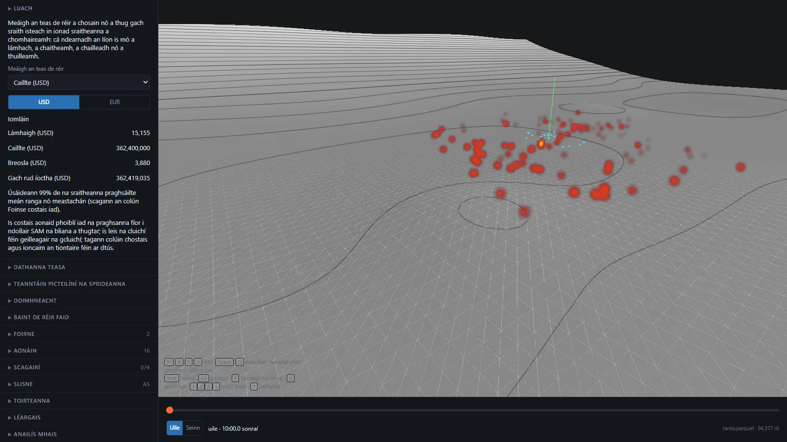

# Meáchan luacha

Tá praghas ag gach lámhaigh, gach muisiún, gach feithicil chaillte agus gach lítear breosla. Ríomhann an léirsitheoir cad a chosain nó a thuill gach sraith, agus is féidir leis an teas a mheáigh de réir sin, ionas go dtaispeánann an léarscáil **cá ndeachaigh an t-airgead** in ionad cá bhfuil na sraitheanna.

## Conas a úsáid é {#how-to-use-it}

1. Lódáil sonraí le himeachtaí (lámhaigh, marbhtha, básanna) agus ainmneacha feithicle nó armaí.
2. Oscail **Luach** sa bhar taobh an Teas.
3. Roghnaigh **Meáigh an teas de réir**, mar shampla *Caillte (USD)*. Cuireann an teas praghas gach sraithe leis anois in ionad 1.
4. Léigh **Iomláin**: suim gach colúin luacha don rud a thaispeántar (baineann scagairí agus an fhuinneog ama leis).
5. Nuair is airgead fíor-domhanda iad na praghsanna, tagann lasc **USD / EUR** chun cinn.

Roghnaigh an chéad iontráil bhán den roghchlár chun na sraitheanna a chomhaireamh arís.

## Cad is féidir a mheáigh {#what-can-be-weighed}

Cuirtear na colúin luacha leis ag an lódáil, ceann amháin in aghaidh cineáil agus airgeadra:

| Cineál | An sraitheanna a bhuaileann sé | Conas a phraghasáiltear é |
|---|---|---|
| **Lámhaigh** | lámhaigh agus seoladh | an t-arm, nó meán do chineál an mhuisiúin |
| **Caite** | ceannach, athghiniúint | colúin airgid an chluiche (mar shampla roghchlár ceannaigh lámhaigh) |
| **Caillte** | básanna, scriosadh | an fheithicil féin, nó meán a ranga |
| **Scriosta** | marbhtha | an fheithicil sprice |
| **Damáiste a rinneadh** | buailtí | cuid de luach na sprice |
| **Breosla** | suímh | breosla caite, ó cholún breosla nó meastachta ón rang agus ón am |
| **Gach rud íoctha** | | lámhaigh + caite + caillte + breosla |
| **Tuillte** | luaíochtaí | colúin luaíochta féin an chluiche (`earn_…`) |
| **Glan** | | tuillte lúide íoctha; tarraingthe mar theas comharthaithe (ramp dearfach nuair a tuilleadh níos mó, diúltach nuair a íocadh níos mó) |

Is iad ainmneacha na gcolún `cost_<kind>_<currency>`, `earn_<currency>` agus `net_<currency>`. Má tá tiontaire ann a aithníonn airgeadra féin an chluiche (mar shampla tiontaire athsheinm a scríobhann creidiúint sa chluiche), bíonn sé níos tábhachtaí ná táblaí praghsanna an léirsitheora.

## Na táblaí praghsanna {#the-price-tables}

| Tábla | Airgeadra |
|---|---|
| Míleata fíor-domhanda: diúracáin, buamaí, rounds, frith-bhearta, aerárthaí, héileacaptair, feithiclí talún, longa, breosla | USD (EUR = USD × 0.92, an `EUR_PER_USD` seasta i [`cost.ts`](https://github.com/Holdi601/3DHeat/blob/main/src/data/cost.ts); ní ráta beo é) |
| Roghchláir ceannaigh lámhaigh agus luaíochtaí marbhtha | creidiúint an chluiche |
| Cluichí tanc agus long | creidiúint an chluiche |
| Cluichí straitéise (acmhainní iolracha) | colún amháin in aghaidh acmhainne agus colún comhcheangailte amháin |
| Cogaí cluiche | pointí |

Aithnítear an cluiche ó ainmneacha sa sonraí. Tagann praghsanna fíor-domhanda ó fhoinsí poiblí (doiciméid buiséid, ciclipéidí) nó tá siad marcáilte mar mheastacháin; ní choigeartaítear iad don bhoilscigh. Tá liosta ginte de na táblaí ar [Táblaí luacha](ref-value-tables.md).

## Meastacháin {#estimates}

Deir an colún catagóire breise **Foinse costais** conas a praghasáladh gach sraith: `table`, `class average`, `estimate` nó `none`. Taispeánann an chuid Luach cén chuid de na sraitheanna praghasáilte atá ina meáin nó ina meastacháin. Chun na sraitheanna a praghasáladh go beacht amháin a choinneáil, díthic *estimate* agus *class average* faoi **Foinse costais** sna [Scagairí](filters.md).

## Cá bhfuil luach le feiceáil eile {#where-else-value-shows}

- [Léargais](insights.md): torthaí *Talamh costasach* agus *Talamh tuillteach*.
- [Briseadh síos](breakdown.md): airgead Tuillte, Caillte agus Glan de réir foirne, imreoira nó airm.
- [Imleabhair](volumes.md): colúin luacha sna staitisticí agus sa chomparáid.
