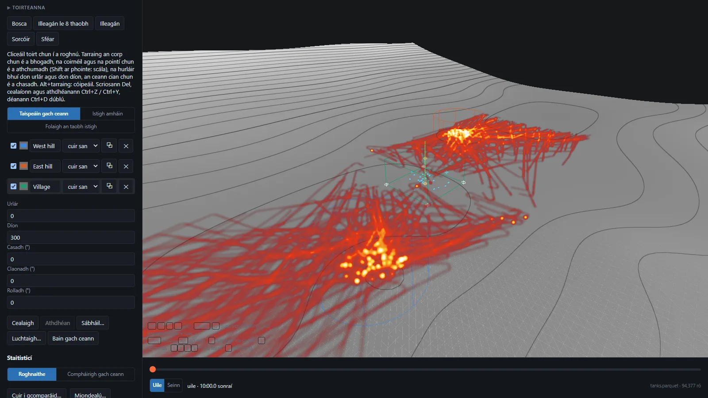
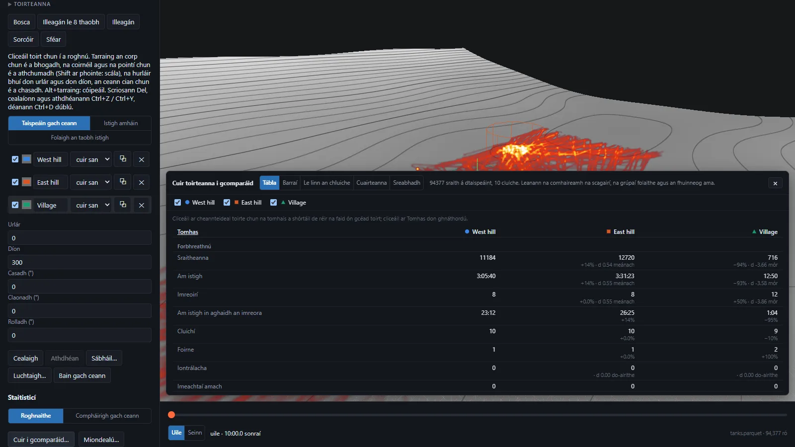
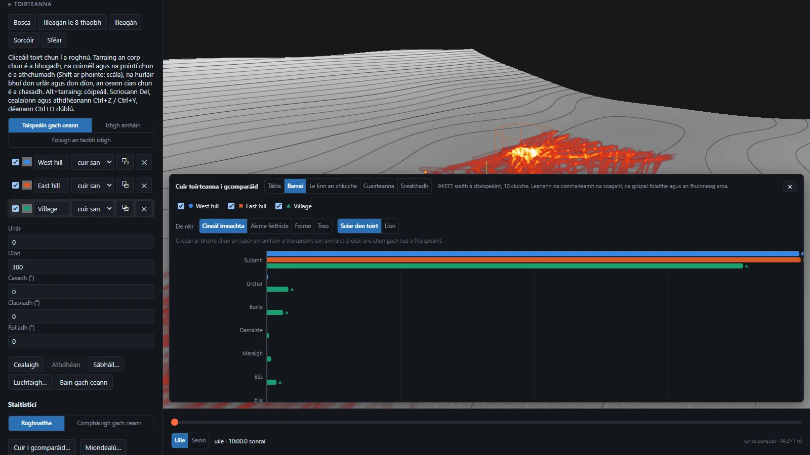

# Toirteanna agus comparáid

Is **toirt** bosca dofheicthe (nó sorcóir, nó sféar) a tharraingíonn tú timpeall ar áit, chun fiafraí: cad a tharla istigh? Úsáid é chun marúanna ag droichead a chomhaireamh, chun dhá chnoc a chur i gcomparáid, nó chun gníomhaíocht i limistéar amháin a thaispeáint amháin.

```
 radharc ón mbarr        Tarraingíonn tú cruth ->  comhaireann an t-amharcóir
 +------------+           cad atá istigh:
 |   ( A )    |            sraitheanna, imreoirí, marúanna, am ...
 |        [B] |           Cuir A i gcomparáid le B, taobh le taobh.
 +------------+
```



Tomhaiseann toirteanna cad a tharlaíonn istigh iontu, scagann siad an radharc chucu, easpórtálann siad a sraitheanna, agus is féidir iad a chur i gcomparáid taobh le taobh. Féach freisin an [gluais](glossary.md) le haghaidh sraith, imreora agus cluiche.

## Tarraing toirt {#draw-a-volume}

1. Oscail **Toirteanna** sa bharra taoibh.
2. Roghnaigh uirlis agus tarraing sa radharc 3D nó ar an mapa 2D. Tosaíonn an t-urlár agus an síleáil ó na sonraí faoi. Cealaíonn Esc.
3. Cliceáil ar an toirt chun í a roghnú; tagann **Staitisticí** chun cinn.

| Uirlis | Conas a tharraingítear |
|---|---|
| **Bosca** | Tarraing dronuilleog (Shift: cearnóg). Cuireann cliceáil bosca réamhshocraithe. |
| **n-illeagán** | Tarraing ón lár (coinníonn Shift é rialta). Socraíonn *Cúinní* n, ó 3 go 64 (8 de réir réamhshocraithe, mar sin léann an cnaipe **8-illeagán**). |
| **Illeagán** | Cliceáil na cúinní; dún le dúbailtcliceáil, Enter nó cliceáil ar an gcéad chúinne. Baineann Backspace an cúinne deiridh. |
| **Sorcóir** | Tarraing an ga. |
| **Sféar** | Tarraing an ga; luíonn sé ar an talamh. |

## Cuir in eagar {#edit}

- Cliceáil toirt chun í a roghnú. Tarraing a corp chun í a bhogadh, a cúinní chun cruth nua a thabhairt di (Shift ar chúinne scálaíonn sé).
- Léiríonn na láimhseálacha **buí** an t-urlár agus an síleáil, léiríonn an láimhseáil **cyan** an casadh.
- Déanann Alt+tarraingt cóip, scriosann Del, Ctrl+Z / Ctrl+Y cealaíonn agus athdhéanann, Ctrl+D dúbailtíonn. Scriosann **Bain gach ceann** gach toirt.
- Luachanna cruinne: Urlár, Síleáil, Casadh / Fiar / Rolla (boscaí), Ga (sféir, sorcóirí).

Tá cnaipe taispeána, dath, ainm, **cuir san áireamh** nó **eisigh**, dúbailt agus scriosadh ag gach sraith toirte. Sábháiltear toirteanna sa bhrabhsálaí do gach tacar sonraí, agus scríobhann agus léann **Sábháil…** / **Lódáil…** comhad `volumes.json`.

## Scag an radharc {#filter-the-view}

| Scagaire | Éifeacht |
|---|---|
| **Taispeáin iad uile** (réamhshocrú) | Ní thomhaiseann toirteanna ach. |
| **Istigh amháin** | Ní tharraingíonn an teas, an athsheinm agus [anailís buailte](hit-analysis.md) ach an méid atá istigh sna toirteanna cuir san áireamh agus amuigh sna toirteanna eisigh. |
| **Folaigh an taobh istigh** | An rud contrártha. |

Glacann an scagaire GPU suas le 8 dtoirt le 64 pointe imlín ar fad; marcálann "!" toirt atá thar sin. Comhaireann staitisticí agus easpórtáil í fós.

## Staitisticí {#statistics}

Leanann an limistéar **Staitisticí** na scagairí, an fhuinneog ama agus na grúpaí folaithe. Taispeánann *Roghnaithe* an toirt roghnaithe, cuireann *Cuir gach ceann i gcomparáid* gach toirt taobh le taobh. Taispeánann sé:

- **Sraitheanna istigh (taispeánta)** agus **Sraitheanna istigh (gach sonra)**, **Imreoirí**, **Foirne**, **Cluichí**, **Am istigh**, **Isteach / amach**, **Buaic teasa**, **Meántheas**, **Toirt / lorg coise** agus histeagram **Cathain**;
- do gach colún: catagóirí le **Lift** (an sciar istigh roinnte ar an sciar i ngach sonra taispeánta), agus uimhreacha le raon, meán agus 5ú-95ú ceatharthach.

Sábhálann **Staitisticí mar CSV / JSON** iad. Scríobhann **Easpórtáil na sonraí istigh** na sraitheanna istigh mar CSV nó Parquet (*Na sraitheanna taispeánta amháin* ar siúl de réir réamhshocraithe), toirt amháin nó gach ceann le colún a insíonn cén toirt a bhfuil gach sraith inti.

## Cuir toirteanna i gcomparáid {#compare-volumes}

Le dhá thoirt infheicthe nó níos mó, brúigh **Cuir i gcomparáid…**.

1. Tarraing trí thoirt, mar shampla Cnoc an Iarthair, Cnoc an Oirthir agus an Sráidbhaile.
2. Brúigh **Cuir i gcomparáid…** faoi Staitisticí.
3. I **Tábla**, léigh difríocht gach luacha ón gcéad toirt.
4. Athraigh go **Barraí** chun na sciareanna mar bharraí a fheiceáil.



| Radharc | Taispeánann sé |
|---|---|
| **Tábla** | Sraitheanna, am istigh, imreoirí, cluichí, foirne, isteach, amach, cuairteanna, fad cuairte, marúanna, básanna, marúanna in aghaidh báis, marúanna in aghaidh nóiméid, am in aghaidh an imreora, colúin luacha; grúpáilte de réir imeachtaí, aicme feithicle, imreoir nó AI, foireann agus aghaidh. Taispeánann gach luach a difríocht ón gcéad toirt agus méid éifeachta (neamhshuntasach, beag, meánach, mór). Cliceáil ceanntásc toirte chun sórtáil de réir achair ón gcéad cheann. |
| **Barraí** | Comhaireamh nó sciareanna de réir imeachta, aicme, gníomhaí, foirne nó treo. Cliceáil barra chun an radharc a scagadh chuige. |
| **Le linn an chluiche** | Cairt amháin do gach toirt thar nóiméid an chluiche: láithreacht, sraitheanna nó marúanna. Cliceáil chun léim ann. |
| **Cuairteanna** | Plótaí bosca agus fidil de cé chomh fada is a mhaireann cuairteanna (scála logartamach). |
| **Sreabhadh** | Cá dtéann rianta tar éis fágáil gach toirt: maitrís trasdula nó ribíní sreafa. |



## Leideanna {#tips}

- Tosaigh ó thorthaí: in [Léargais](insights.md), cuireann **Toirt anseo** sorcóir timpeall ar áit an torthaí.
- Osclaíonn **Miondealú…** an [Miondealú](breakdown.md) don toirt roghnaithe: cé agus cad a dhéanann go maith istigh ann.
- Is féidir le [teas treoch](directional-heat.md) treonna istigh sa toirt roghnaithe a chairteáil.
- Úsáideann [cluaisín Feithiclí](hit-analysis.md#restrict-to-an-area) na toirteanna céanna mar a scagaire limistéir.
