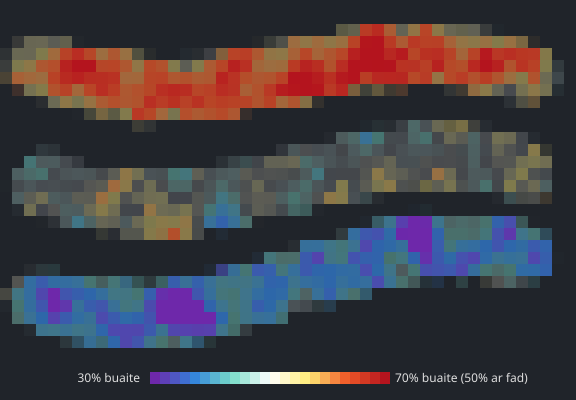

# Ráta buaite: cé chomh minic a bhuann áit, bealach nó beart

Cá seasann imreoir, cén treo a théann sé, cá gcaitheann sé a fhearas - agus cé chomh minic a bhuann a thaobh an babhta ansin. Dathaíonn an **léarscáil ráta buaite** gach áit de réir an sciar de na sraitheanna ann a bhaineann le babhtaí a bhuaigh taobh na sraithe, i gcoinne an sciar thar gach rud a thaispeántar: te nuair atá sé níos airde, fuar nuair atá sé níos ísle, gan dath nuair atá sé mar an gcéanna.

*Sonraí cumtha atá sa phictiúr: trí bhealach ar leibhéal folamh, 68%, 50% agus 33% dá sraitheanna i mbabhtaí buaite.*

Teastaíonn sonraí uaidh a deir cé a bhuaigh: na [colúin toraidh](data-formats.md#outcome-columns) (`won`, `matchWon`, `roundEndReason`). Scríobhann tiontairí CS2 agus War Thunder iad; is féidir le comhad ar bith iad a bheith aige.

## Bain triail as {#try-it}

1. Lódáil cluichí le colún toraidh agus brúigh `2` (**Difríocht**).
2. In **Scoilt difríochta**, brúigh **Ráta buaite in aghaidh an bhabhta** (nó **Ráta buaite in aghaidh an chluiche**). Cuireann sé na babhtaí buaite ar **+** agus na cinn caillte ar **−**, agus athraíonn sé an painéal go **Sciar +**.
3. Léigh na dathanna. Insíonn an painéal an sciar iomlán: *San iomlán, tá 52.0% de 1,200,000 sraith ar +.*
4. Cúngaigh é leis na [scagairí](filters.md): taobh amháin (T nó CT), cineál imeachta amháin (*Suíomh* don áit ar sheas daoine, *Urchar* nó *Seoladh (diúracán, roicéad, buama)* don áit ar lámhach nó ar chaith siad as), ceannach amháin, léarscáil amháin.

Áit atá te le sraitheanna *Suíomh*, is áit í ar ghnách lena sealbhóirí an babhta a bhuachan. Le sraitheanna *Maraigh*, is áit í ar threoraigh na marúcháin a rinneadh ann chuig babhtaí buaite.

## Na socruithe {#the-settings}

| Socrú | Cad a dhéanann sé | Réamhshocrú |
|---|---|---|
| **Difríocht** / **Sciar +** | an difríocht féin, nó sciar an taobh + de na sraitheanna ar an dá thaobh | Difríocht |
| **Dath iomlán ag** | cé chomh fada os cionn nó faoi bhun an sciar iomláin a thaispeántar áit i ndath iomlán, i bpointí | ± 20 pointe |
| **Líon is lú sraitheanna chun áit a dhathú** | ní dhathaítear áit le níos lú sraitheanna; tagann sí isteach go réidh ó leath an líon sin | 12 |
| **Tarraingt i dtreo an sciar iomláin (sraitheanna)** | tosaíonn gach áit ón líon seo sraitheanna ag an sciar iomlán, ionas nach dtaispeántar áit le 3 shraith, iad uile buaite, mar 100% | 12 |

Oibríonn an trí cinn ar an bpictiúr críochnaithe: ní atosaíonn an carnadh riamh nuair a tharraingíonn tú iad.

Is é an sciar sciar scoilte ar bith, ní bua amháin: taispeánann *Sciar +* le scoilt de réir taobh cá raibh na T ina gcuid níos mó den láithreacht, agus le scoilt de réir comhaid dhá léarscáil cá bhfuil sraitheanna comhaid amháin níos troime ná sraitheanna an chinn eile.

## Sraitheanna, ní babhtaí {#rows-not-rounds}

Comhaireann an léarscáil sraitheanna. Imreoir a sheasann in aon spota amháin ar feadh fiche soicind, cuireann sé sraith leis gach sampla, iad uile ó bhabhta amháin, mar sin is iad na sraitheanna in aice le háit an fhianaise ann, ní na babhtaí. Sin é an fáth a bhfuil an t-íosmhéid agus an tarraingt i sraitheanna, agus an fáth a bhfuil siad níos mó ná luach babhta amháin.

Do na babhtaí féin:

- **[Miondealú](breakdown.md)** ar spota, ar an radharc nó ar thoirt: comhaireann *Buaite %* babhta gach imreora uair amháin, tarraingthe i dtreo ráta iomlán na háite ar an mbealach céanna (4 bhabhta).
- Staitisticí **[Toirteanna](volumes.md)**: *Ráta buaite* - na babhtaí le himreoir laistigh den toirt, gach ceann uair amháin, tarraingthe i dtreo an ráta thar gach rud a thaispeántar, leis na líonta.

## Scagairí toraidh {#outcome-filters}

Liostaíonn an painéal [Scagairí](filters.md) na colúin toraidh díreach i ndiaidh cholúin an amharcóra féin: **Toradh an bhabhta** agus **Toradh an chluiche** (*Ar bith*, *Buaite*, *Caillte*) agus **Conas a chríochnaigh an babhta** (Díbirt, Phléasc an buama, Díchumasaíodh an buama, Rith an t-am amach, Géilleadh, Comhscór, Cuspóir, Criosanna coinnithe, Ticéid caillte, Gach feithicil caillte), i dteanga an amharcóra.

## Do fhorbróirí {#for-developers}

Scríobhann an pas teasa trí shuim isteach sa sprioc ceithre chainéal a úsáideann teas foirne: an teas `R = Σ|v|`, teas an taobh + `P`, agus `S = Σ v²/w`, áit arb é `w` meáchan an phas (meáchan samplála faoi ghnóthachan an fhráma). Léann an cumasc an sciar `P/R` (meán ualaithe ag an eithne) agus na sraitheanna a bhfuil sé bunaithe orthu `n = R²/S` (méid éifeachtach samplach Kish), tarraingíonn sé an sciar i dtreo an chinn iomláin, `p = (n·P/R + m·r0)/(n + m)`, agus dathaíonn sé `p - r0` thar an réimse ar rampaí na difríochta.

Roinneann `n` amach gach fachtóir atá coitianta do na sraitheanna ag picteilín - gnóthachan an fhráma, an meáchan samplála, meáchan achair sprite clampáilte - mar sin is ionann an pictiúr ag zúmáil ar bith agus dlús samplála ar bith, agus cumascann frámaí de gach k-ú sraith go dtí an t-iomlán gan léim sna dathanna. Tagann an sciar iomlán ó chomhaireamh taobhanna an CPU, coinnithe go deichiú cuid de faoin gcéad; ní léitear aon rud ar ais ón GPU. An uimhríocht agus a seiceálacha: [`render/rateMap.ts`](https://github.com/Holdi601/3DHeat/blob/main/src/render/rateMap.ts) agus a thástáil.

Cosnaíonn sé an méid céanna le teas foirne: méadaíonn an sprioc ceithre chainéal bandaleithead cumasctha an phas teasa faoi cheathair, ach amháin fad atá *Sciar +* air.
