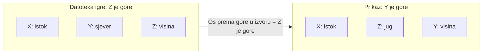

# Osi, jedinice i vrijeme

Igre i karte se ne slažu u tome koji je smjer gore, koliko je dugačka jedinica i kako se piše vrijeme. Ova stranica prikazuje tri postavke koje čine da vaši podaci stoje, budu u pravoj mjeri i teku na pravi način.

Ako vaša karta stoji kao zid umjesto da leži kao pod, promijenite **Os prema gore u izvoru**.

S pogrešnom **Osi prema gore u izvoru** karta stoji kao zid; s ispravnom leži kao pod.

## Svijet u kojem prikaz crta {#the-world-the-viewer-draws-in}

Svijet prikaza je **Y-gore**: X i Z su ravnina tla, Y je visina. Većina igraćih motora je **Z-gore**: za njih su X i Y tlo, a Z je visina. Neki motori su također zrcalni (lijevoruki). Preslikavanje kaže kako osi datoteke pretvoriti u osi prikaza. (Tehnički, prikaz je desnoruk, konvencija three.js.)

### Os prema gore {#up-axis}

**Os prema gore u izvoru** u [Preslikavanju stupaca](column-mapping.md):

| Postavka | Datoteka (x, y, z) postaje svijet (X, Y, Z) |
|---|---|
| *Z je gore (većina igraćih motora)* - zadano | (x, **z**, **y**): Z iz datoteke postaje visina, a Y iz datoteke postaje Z svijeta |
| *Y je gore (grafička konvencija)* | (x, y, z) nepromijenjeno |

Za podatke sa Z-gore sva tri niza se preimenuju umjesto kopiranja ([`remapAxesInPlace`](https://github.com/Holdi601/3DHeat/blob/main/src/data/ingest.ts)), što štedi stotine megabajta pri velikim učitavanjima. Pretpostavka se radi iz uzorka: koji god od stupaca Y i Z ima manji raspon, to je gore.

### Okreti {#flips}

**Okreni X**, **Okreni Y**, **Okreni Z** mijenjaju predznak *osi datoteke* s tim imenom, prije preimenovanja. Dakle uz Z-gore, *Okreni Y* mijenja predznak onoga što na kraju postaje Z svijeta. Okret mijenja učitane podatke: koordinate koje prikazuju [ravnalo](measure.md), isječak i položaj kamere su okrenute.

Za crtanje zrcalnog svijeta na ispravan način **bez** promjene podataka koristite **Kamera i scena → Obrni os svijeta** ([Kamera](camera.md#invert-world-axis)). To je bolji izbor za igre čiji je svijet lijevoruk, jer svaka koordinata koju alati prikazuju ostaje igrina vlastita.

### Mjerilo jedinica {#unit-scale}

**Mjerilo jedinica** množi svaku poziciju. *1 (m)* postavlja 1, *0,01 (cm→m)* postavlja 0,01 (jedinice Unreal Enginea su centimetri, pa koristite 0,01; jedinice Source enginea su inči, pa koristite 0,0254; ni jedno nije metar), a okvir prihvaća bilo koju vrijednost. Upisana 0 ili vrijednost koja nije broj zamjenjuje se s 1.

Prikaz označava udaljenosti u metrima (polumjer spritea, granice odsijecanja, ravnalo, brzina letenja), što je istinito samo kad je mjerna jedinica svijeta nakon skaliranja metar. Ništa se ne pokvari kad nije; oznake samo glase "m" za ono što jedinica jest.

## Vrijeme {#time}

### Jedinice vremena {#time-units}

Pravilo: vrijednosti poput 17000000000 (deset ili više znamenki) su Unix vremenska oznaka; vrijednosti poput 0, 0,25, 0,5 su sekunde od početka.

| Jedinica vremena (oznaka izbornika) | Čita se kao | Prikazuje se stvarno vrijeme |
|---|---|---|
| *Sekunde (relativno)* | vrijednost × 1 s | ne |
| *Milisekunde (relativno)* | vrijednost × 0,001 s | ne |
| *Mikrosekunde (relativno)* | vrijednost × 10^-6 s | ne |
| *Nanosekunde (relativno)* | vrijednost × 10^-9 s | ne |
| *Unix vremenska oznaka (s)* | sekunde od 1970-01-01 UTC | da |
| *Unix vremenska oznaka (ms)* | milisekunde od 1970-01-01 UTC | da |
| *ISO-8601 datum kao tekst* | tekst kao `2026-03-14T18:02:11.250Z`, parsiran browserovim `Date.parse` | da |

S apsolutnom jedinicom (zadnje tri) skup podataka zadržava stvarni trenutak najranijeg retka, a vremenska crta pokazuje trenutno UTC vrijeme dana (`HH:MM:SSZ`) pored glave za reprodukciju.

**Stupci Parquet `TIMESTAMP` i `DATE`** dekodiraju se u prave trenutke, pa se njihova postavka jedinice zanemaruje i panel to kaže. Stupac `DATE` je cijeli dan: svaki redak jednog dana dijeli isti trenutak, a reprodukcija skače dan po dan, na što panel upozorava.

**ISO-8601 nizovi rade i u CSV-u i u Parquetu.** Tekstualni stupac vremena s ISO jedinicom parsira se jednom za svaki različiti niz; ako se nijedan ne parsira, učitavanje pada uz poruku *Nema parsabilnih ISO-8601 vremenskih oznaka u mapiranom stupcu vremena.* Preslikavanje već odbija pokretanje kad se nijedna uzorkovana vrijednost ne parsira. Stupac Parquet `TIMESTAMP` čita se kao vremenska oznaka, bez obzira na postavljenu jedinicu, a brojčani stupac Parquet s ISO jedinicom čita se kao Unix milisekunde. Tekstualni stupac vremena s brojčanom jedinicom odbija se prije učitavanja: svaka vrijednost bi se čitala kao NaN.

### Kako se vrijeme sprema {#how-time-is-stored}

Dok se datoteke spajaju, vremena su 64-bitne sekunde, pa apsolutna epoha zadržava svoje detalje ispod sekunde. Kad su sve datoteke unutra, najraniji trenutak cijelog odabira postaje 0, a svaki redak sprema 32-bitne sekunde od tog trenutka. 32-bitni decimalni broj ima 24 bita mantise: rasponi do otprilike dan i pol razlučuju se bolje od 1/100 s, a rasponi od pola godine do otprilike jedne sekunde. Redak čije je vrijeme nedostaje ili nije broj stavlja se na 0, na početak.

Retci se zatim slažu po vremenu, što vremensku crtu čini jeftinom: vremenski prozor nalazi se s dva binarna pretraživanja (pogledajte [Uzorkovanje i proračuni](sampling-and-budgets.md)).

### Proteklo vrijeme naspram stvarnog vremena {#elapsed-time-versus-wall-clock}

Stupac vremena poput `match_time` ili `round_time` broji od početka svakog meča. Njegov odabir stavlja svaki meč na jednu zajedničku os, što je dobro za usporedbu onoga što se događa u trećoj minuti svakog meča, a panel to naglašava. Stupac stvarnog vremena prikazuje mečeve redom kojim su se stvarno odigrali, preklapajući se tamo gdje su se preklapali.

## Smjer pogleda {#look-direction}

Smjer pogleda koristi samo [reprodukcija kutije](box-replay.md) (zrake iz svake kutije). Sprema se kao dva kuta, zakret i nagib, u radijanima.

- **Stupci zakreta / nagiba** čitaju se kakvi jesu, pretvaraju se iz stupnjeva kad je odabrano *Stupnjevi*. Ne prilagođavaju se za os prema gore ili okrete.
- **Stupci vektora smjera** prolaze kroz isto preimenovanje i okrete kao pozicije, a zatim postaju zakret = atan2(x, -z) i nagib = atan2(y, √(x² + z²)) u osima svijeta, pa zraka pokazuje kamo kutija gleda i u svijetu zrcaljenog izvora.

Ako stupci zakreta/nagiba nakon okreta, vektora smjera ili prilagođenih kuteva pokazuju u krivom smjeru, rješenje je to što treba popraviti.
