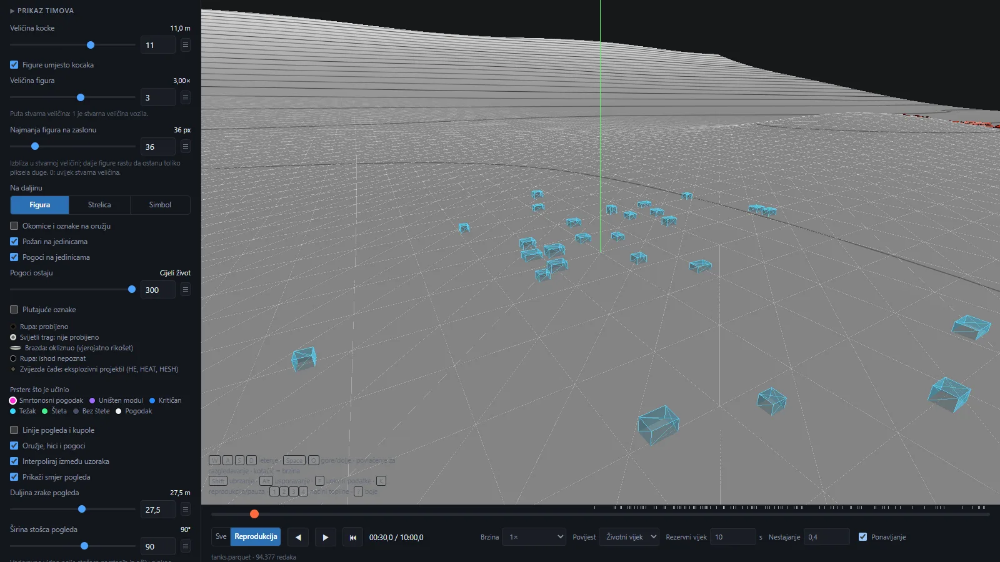

# Preklapanje figura (reprodukcija kutija)

Mali film: jedna figura za svaku osobu, koja se miče dok vrijeme teče, s tragom iza sebe.

Način se u traci načina zove **Preklapanje figura**. Ova stranica se prije zvala "reprodukcija kutija", jer je prije figura svaka osoba bila kutija; "reprodukcija figura" i "reprodukcija kutija" znače isto. **Preklapanje figura** nema tipku s brojem: odaberite ga u traci načina. Crta jednu figuru (ili kutiju) po [osobi](glossary.md), koja se miče duž [vremenske crte](timeline.md), uz neobavezne zrake pogleda i tragove. To je reprodukcija, a ne gustoća: *tko je bio gdje, kad*. Treba stupac osobe; bez stupca vremena svaki uzorak se crta odjednom.

## Kako se koristi {#how-to-use-it}

1. Učitajte podatke sa stupcem osobe i stupcem vremena.
2. Odaberite **Preklapanje figura** u traci načina.
3. Prebacite vremensku crtu na **Reprodukcija** i pritisnite reprodukciju (`K`).
4. Otvorite **Prikaz timova** da promijenite **Duljinu traga**, veličinu figura ili zrake pogleda.

U ovom načinu se ne crta toplina, a prilagodljivi proračun spriteova miruje.

Prema zadanom se svaka osoba crta kao figura onoga čime je, a ne kao kutija. Pogledajte [Figure](figures.md) za to koju figuru dobiva jedinica, i [Reprodukciju meča](match-replay.md) za oznake, kameru praćenja, mjerenje između dvije jedinice i popis događaja.

## Panel Prikaz timova {#the-team-viewer-panel}

Prikazuje se umjesto panela topline u ovom načinu.

| Kontrola | Zadano | Raspon (klizanje) | Značenje |
|---|---|---|---|
| **Figure umjesto kocaka** | uključeno | | Svaka osoba kao figura onoga čime je: vojnik pješice, tenk ili zrakoplov koji podaci navode. Što podaci ne opisuju, ostaje kutija. |
| **Veličina figura** | 1× | | 1× je prava veličina. |
| **Najmanja figura na zaslonu** | 36 px | 0 = uvijek prava veličina | Prava veličina izbliza; dalje figure rastu da ostanu ovoliko piksela dugačke. |
| **Oružje, hici i pogoci** | uključeno | | Oružje u letu s dimom, trasirke, udari, pogoci i ubojstva. Trasirke izvedene iz pogotka su crtkane. |
| **Veličina kocke** | veličina entiteta, ili raspon / 500, pri učitavanju | 0,05–200 m, logaritamski (5000) | Duljina brida svake kutije. Pogledajte [veličinu entiteta](sessions-persons-groups.md#entity-size). |
| **Interpoliraj između uzoraka** | uključeno | | Između dva uzorka iste osobe u istoj sesiji smješta kutiju proporcionalno između njih. Nikad preko granice sesije. |
| **Prikaži smjer pogleda** | uključeno | | Zraka iz svake kutije u smjeru pogleda osobe (treba [stupce pogleda](axes-units-and-time.md#look-direction)). |
| **Duljina zrake pogleda** | veličina entiteta × 4, ili raspon / 200, pri učitavanju | 0,5–500 m, logaritamski (20.000) | Prikazuje se dok je smjer pogleda uključen. |
| **Duljina traga** | 8 s | 0–300 s (86.400); 0 = isključeno | Sekunde povijesti iza svake osobe. |
| **Crtaj svaki sirovi uzorak** | isključeno | | Kutija po spremljenom uzorku u prozoru, umjesto jedne interpolirane kutije po osobi. Uzorkuje se kako bi ostalo interaktivno. |

Savjeti u panelu objašnjavaju da interpolacija i tragovi spajaju uzorke samo unutar jedne sesije te, kad učitavanje ima [zajednička imena](sessions-persons-groups.md#names-worn-by-several-things-at-once), koliko se imena crta kao pojedinačni uzorci.

## Sesija koja se reproducira {#the-session-being-played}

Uz stupac sesije, birač **Sesija** na vrhu bočne trake ([Sesije](sessions-persons-groups.md#the-session-picker)) odlučuje koji se meč reproducira. Pri učitavanju se bira najzaposleniji. Samo redci te sesije postaju kutije i tragovi, a vremenska crta ide preko raspona te sesije, a ne cijelog skupa podataka. **Sve sesije** reproducira sve sesije odjednom, i dalje nikad ne spajajući uzorke među sesijama.

## Što se kada crta {#what-is-drawn-when}

Iz [`TrackCursor`](https://github.com/Holdi601/3DHeat/blob/main/src/data/tracks.ts):

**Žive kutije** (način Reprodukcija, sirovi uzorci isključeni). Za svaku vidljivu osobu, njezin posljednji uzorak na glavi za reprodukciju ili prije nje:

- Ako osoba ima sljedeći uzorak, on je u istoj sesiji i ime nije zajedničko, kutija se smješta između dva uzorka proporcionalno vremenu, a skretanje se interpolira najkraćim putem, a nagib linearno (kad je *Interpoliraj* uključeno).
- Inače kutija ostaje na posljednjem uzorku za **Rezervni vijek** vremenske crte (zadano 10 s), a zatim se odbacuje, da eliminirani igrači ne ostaju.

**Način Sve** zanemaruje glavu za reprodukciju i crta svaki uzorak u rasponu kao kutiju.

**Sirovi uzorci** crtaju kutiju po spremljenom uzorku u prozoru: *raspon* uz povijest *Prozor*, inače sve do glave za reprodukciju. Najviše 65.536 kutija; s više uzoraka crta se svaki *k*-ti.

**Tragovi** (kad je duljina traga iznad 0 i sirovi uzorci nisu nacrtani): linija između svakog para uzastopnih uzoraka osobe unutar zadnjih *duljina traga* sekundi do glave za reprodukciju, s blijeđenjem od 80% neprozirnosti do prozirnog s dobi. Trag staje na promjeni sesije i ne crta se za zajednička imena. Najviše 131.072 vrhova; s više se redci preskaču ravnomjerno.

**Tko je vidljiv:** osoba je skrivena kad je njezina grupa isključena u [popisu timova](teams-list.md) (njezina grupa je ona njezinog prvog retka), kad je filtar grupe isključuje, ili kad panel [Entiteti](entities.md) ima odabir koji je ne uključuje. [Filtri](filters.md) stupaca ne primjenjuju se na kutije.

## Boje {#colours}

Jedna obitelj nijansi po grupi i jedna sjena po članu, pa se jednim pogledom vidi na kojoj je strani ([`teamMemberColor`](https://github.com/Holdi601/3DHeat/blob/main/src/render/colors.ts)). Nijanse grupa kruže kroz fiksni popis od deset - plava, crvena, zelena, jantarna, ljubičasta, cijan, magenta, limeta, narančasta, indigo - a članovi grupe raspoređeni su po svjetlini 42–76% i zasićenju 90–65%.

## Napomene {#notes}

- Preklapanje figura ponovno gradi svoje figure samo kad se nešto promijeni; prazan kadar ponovno crta posljednje.
- Redak *Kocke* u [prekrivnom prikazu statistike](performance-and-stats.md) broji kutije na zaslonu.
- Preklapanje figura crta u istoj sceni kao razina, pa [dubina polja](camera.md#depth-of-field) muti kutije, ali nikad toplinu.
