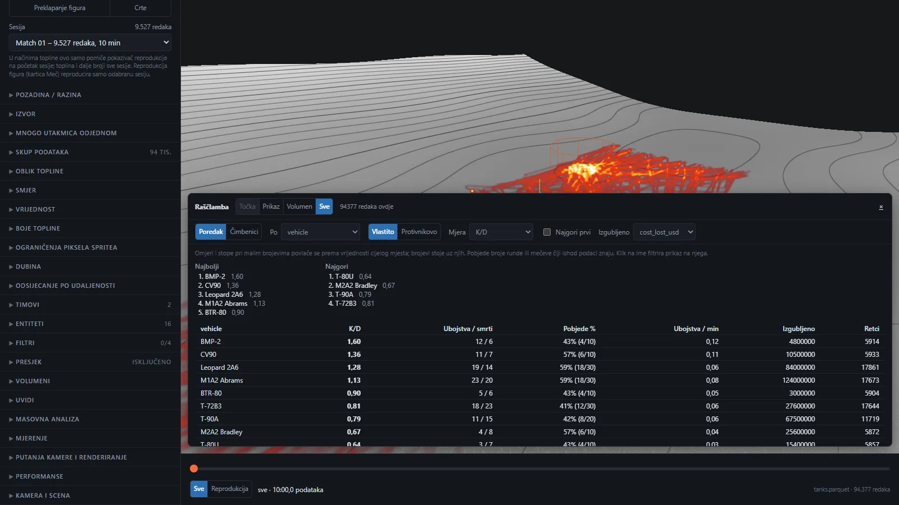
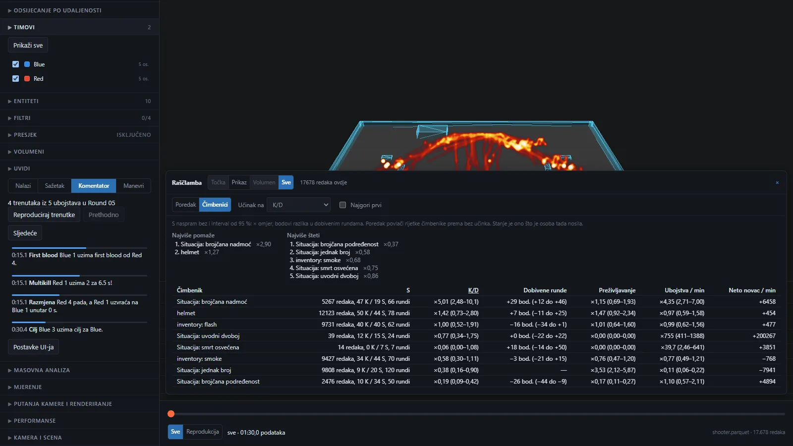

# Raščlamba: tko i što je najbolji gdje

**Raščlamba** odgovara na jedno pitanje: na ovom mjestu, koje vozilo, igrač ili oružje je najbolje? Koristite je da nađete tenk koji pobjeđuje na mostu ili da vidite pomaže li zaista nositi kacigu.

Ona rangira što se događa na jednom mjestu (odabrana točka, prikaz, volumen ili sve prikazano) po bilo kojoj kategoriji i mjeri učinak svakog čimbenika stanja: s njim naspram bez njega.

## Isprobajte {#try-it}

1. Učitajte meč s ubojstvima i smrtima te otvorite **Volumeni**.
2. Nacrtajte volumen oko mjesta koje vas zanima i odaberite ga.
3. Pritisnite **Raščlamba...** pod Statistikom.
4. Pod **Po** odaberite *Vozilo*, a mjeru *K/D* (ubojstva po smrti).
5. Pročitajte popis, najbolji prvi. Pritisnite **Najgori prvi** da ga okrenete. Kliknite ime da filtrirate prikaz na njega; kliknite ponovno da ga pustite.

## Otvorite je {#open-it}

| Iz | Područje s kojim počinje |
| --- | --- |
| **Raščlamba...** u [Volumenima](volumes.md) (Statistika) | odabrani volumen |
| **Raščlamba ovdje** na kartici odabira, nakon klika na točku | kugla oko te točke (**Radijus**, zadano 3% veličine podataka) |
| panel podijeljen za **Razliku** | prikaz |

Zaglavlje mijenja područje: **Točka**, **Prikaz** (što je kamera vidjela pri zadnjem brojanju; **Prebroji ponovno** nakon pomicanja), **Volumen** (odaberite jedan) ili **Sve**. Broji u pozadini; redak stanja kaže koliko je redaka u području.

## Rangiranje {#ranking}

Odaberite po čemu se rangira i mjeru:

| Mjera | Što je |
| --- | --- |
| A, B | retci s obiju strana karte razlike, podijeljeni kako ih toplina dijeli |
| A / B, A - B, A / (A + B) | dva sloja jedan naspram drugog |
| K/D | ubojstva naspram smrti |
| Pobjeda % | pobijeđene runde (ili mečevi), gdje podaci kažu tko je pobijedio |
| Ubojstva / min | ubojstva po minuti prisutnosti (praznine između uzoraka kretanja) |
| Zarađeno, Izgubljeno, Neto novac | zbrojevi stupaca `earn_*` i `cost_*`; birač bira valutu |

Ubojstva, smrti, prisutnost, pobjede i novac broje svaki redak koji prikaz pokazuje na tom mjestu, na bilo kojoj strani podjele ili nijednoj.

Omjeri i stope povlače se prema vrijednosti cijelog mjesta gdje su brojke male, pa 2 ubojstva u 1 životu ne idu na vrh popisa. Brojke se prikazuju uz njih.

Možete rangirati po grupama, igračima i mečevima, po bilo kojem stupcu kategorije (vozilo, oružje, strana, vrsta kupnje, agent ili oprema), po bilo kojem brojčanom stupcu u rasponima (oklop, vrijednost opreme), po **klasi** stupca oružja (puška, snajper, SMG, pištolj...) i po tome koliko komada **pomagala** sadrži stupac popisa poput `inventory`.

**Vlastito** rangira prema vlastitoj vrijednosti retka. **Protivnikovo** rangira prema vrijednosti druge strane: oružje žrtve kod ubojstva, oružje ubojice kod smrti (treba stupac `other` / `victim` koji ih imenuje).

## Stanje u trenutku {#state-at-the-time}

Vrijednost retka je njegova vlastita, osim ako redak ne bilježi nijednu (redak događaja bez opreme) ili je riječ o smrti (čiji stupac oružja može imenovati oružje ubojice); tada je to ono što je ista osoba zadnje nosila ranije u meču.

## Faktori: s naspram bez {#factors-with-against-without}

Prebacite s **Poredak** na **Čimbenici**, odaberite **Učinak na** i pročitajte *Najviše pomaže* i *Najviše šteti*:

Učinak svakog faktora na K/D, osvojene runde, preživljavanje (minute po smrti), ubojstva u minuti i neto novac u minuti, s intervalom od 95%: omjeri kao x, osvojene runde kao razlika u bodovima. Rangiranje povlači svaku procjenu prema nultom učinku, prema njezinoj vlastitoj nesigurnosti, pa rijedak faktor treba jasan učinak da bi visoko rangirao; prikazani interval je nepovučen.

Podaci s rundama dodaju **situacije** iz borbe izbliza ([Borba izbliza i runde](close-quarters.md)), izračunate jednom za skup podataka: *zaslijepljen* (`state_flashed` retka, ili protivnički bljesak unutar 15 m u zadnje 3 s), *smrt uzvraćena*, *uvodni dvoboj* te *čovjek više*, *jednaki brojevi* ili *čovjek manje* (igrači živi na strani retka naspram protivnika). Smrt se broji u situaciji u kojoj je njezina žrtva bila neposredno prije.

U jednom prolazu mjeri se najviše 256 faktora.

## Za razvojne programere {#for-developers}

### Povlačenje malih uzoraka {#pulling-small-samples}

Vrijednost rangiranja je `(n + m*r0) / (d + m)`: `n` i `d` su brojevi, `r0` omjer cijelog mjesta, a `m` težina tog prethodnog podatka.

### Za autore pretvarača: imenovanje stupaca faktora {#for-converter-authors-naming-factor-columns}

Pretvarač dodaje faktor imenovanjem svog stupca:

| Stupac | Faktor |
| --- | --- |
| `state_<name>` brojčani | uključen dok nije nula (`state_scoped`, `state_suppressor`) |
| `state_<name>` kategorija | jedan faktor po vrijednosti (`state_ammo` = AP, HE...) |
| `active_<name>` | isto, za nešto uključeno ili nedavno upotrijebljeno: sposobnost, ultimate, pomagalo, pojačanje (`active_ult`, `active_stim`) |
| stupac popisa (`inventory`, `loadout`, `perks`, `abilities`, `attachments`, `modules`, `buffs`, `debuffs`, `upgrades`, ili ime `state_`/`active_` koje završava na `s`) | jedan faktor po stavci vrijednosti `a\|b\|c` |
| zastavice opreme koje su već uobičajene (`helmet`, `defuser`, `armor`, `scoped`, `airborne`, `duck`, `flashed`...) | uključeno dok nije nula |
| `ammoType`, `shellType`, `ammoName` | zadnji ispaljeni metak |

Rezultati: stupac `won` s 0/1 (strana retka osvojila je rundu ili meč) i stupac `round` - [stupci ishoda](data-formats.md#outcome-columns); gdje datoteka ima i `won` i `matchWon`, *Pobjede %* broji runde. Novac: `earn_<valuta>` i `cost_<vrsta>_<valuta>`; prihod samo po vrsti (`earn_round_cs2`, točne nagrade za rundu pretvarača) zamjenjuje samo model troškova za prihod te vrste (`round` obuhvaća i postavljanja i deaktivacije), a model i dalje određuje cijenu ostatka.

Preslikavanje učitava te stupce samo od sebe, uz popis iz same datoteke: svaki `state_*`, `active_*`, `won`, `round` i stupac popisa, osim onih koje statistika Parquet datoteke pokazuje da drže jednu vrijednost kroz sve (svaki učitani stupac je 4 bajta po retku).
