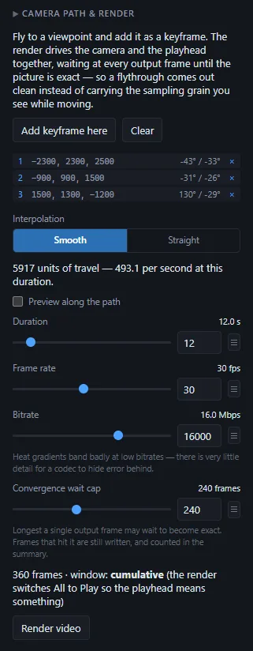

# Putanja kamere i video

Snimite film o svojim podacima: postavite kameru na nekoliko mjesta, prikaz leti između njih i sprema video. Svaki kadar je vrlo čist, bez zrnatosti. Kamera i glava za reprodukciju se pomiču zajedno, pa isti panel pravi i timelapse ([`PathPanel.tsx`](https://github.com/Holdi601/3DHeat/blob/main/src/ui/panels/PathPanel.tsx), [`campath.ts`](https://github.com/Holdi601/3DHeat/blob/main/src/render/campath.ts), [`record.ts`](https://github.com/Holdi601/3DHeat/blob/main/src/render/record.ts)).

## Napravite prelet {#make-a-flythrough}

1. Doletite do mjesta gdje film počinje i pritisnite **Dodaj ključni kadar ovdje** u **Putanja kamere i renderiranje**.
2. Doletite do sljedećeg mjesta i ponovno pritisnite. Ponovite za svaku stanicu.
3. Označite **Pregled duž putanje** i povucite **Položaj na putanji** da provjerite pokret.
4. Postavite **Trajanje** (koliko će video trajati). Pokret koji je dobar, ali prebrz, treba samo dulje trajanje.
5. Pritisnite **Renderiraj video**. Pričekajte liniju napretka; datoteka se preuzme kad završi.

## Ključni kadrovi {#keyframes}

| Kontrola | Učinak |
|---|---|
| **Dodaj ključni kadar ovdje** | Dodaje trenutni položaj kamere, skretanje, nagib i vidno polje kao ključni kadar. |
| **Očisti** | Uklanja sve ključne kadrove. |
| Popis ključnih kadrova | Jedan redak po ključu: njegov broj (klik vas odvede tamo kamerom, postavljajući i vidno polje), položaj, `yaw° / pitch°` i **×** za uklanjanje. |

Ključevi se **ravnomjerno** razmještaju duž normalizirane osi putanje od 0 do 1 kad god se jedan doda ili ukloni; trajanje izlaza tada rasteže cijeli pokret, pa kadar koji je dobar, ali prebrz, treba samo dulje trajanje. Skretanje se odmata između ključeva, pa se kamera okrene kratkim putem.

Bez ključnih kadrova renderiranje drži trenutnu kameru nepomičnom kroz cijeli isječak: savršen timelapse.

## Postavke putanje {#path-settings}

| Kontrola | Zadano | Raspon (klizanje) | Značenje |
|---|---|---|---|
| **Interpolacija** (2+ ključa) | *Glatko* | *Glatko* / *Ravno* | *Glatko*: kubična Hermiteova krivulja kroz ključeve s tangentama iz susjednih ključeva, pa se brzina podudara na svakom ključu i nema trzaja gdje se segmenti spajaju. *Ravno*: ravne linije između ključeva, predvidljivo, s vidljivim kutom na svakom ključu. Vidno polje se uvijek interpolira linearno. |
| Linija putovanja (2+ ključa) | | | `N jedinica putovanja - M po sekundi pri ovom trajanju`, ili napomena da su svi ključevi na jednom mjestu. |
| **Pregled duž putanje** (1+ ključ) | isključeno | | Vodi kameru prikaza po putanji i pomiče glavu za reprodukciju s njom, kao što to radi renderiranje, pa se pokret može procijeniti prije renderiranja. |
| **Položaj na putanji** (dok je pregled uključen) | 0% | 0–100% | Gdje na putanji se pregledava. |
| **Trajanje** | 12 s | 1–120 s (3600) | Duljina videa. |
| **Broj kadrova u sekundi** | 30 fps | 6–60 (240) | |
| **Brzina prijenosa** | 16 Mbps | 1–60 Mbps, logaritamski (400) | Gradijenti topline loše se pruge pri niskim brzinama prijenosa: premalo je detalja iza kojeg kodek može sakriti grešku. |
| **Ograničenje čekanja na konvergenciju** | 240 kadrova | 2–600 (10.000) | Najdulje što jedan izlazni kadar smije čekati da postane točan. Kadrovi koji dosegnu ovo i dalje se zapisuju i broje. |
| Sažetak | | | `N kadrova · prozor: kumulativno/fiksno/trajanje`, a kad je vremenska crta u načinu Sve: *(renderiranje prebacuje Sve na Reprodukciju da glava za reprodukciju nešto znači)*. |
| **Renderiraj video** / **Odustani** | | | Pokreće renderiranje; dok traje, prikazuje `kadar i / n · čekano w · X MB` i koliko kadrova nije bilo točno. Treba skup podataka. |

## Savjeti {#tips}

- Veličina izlaza je veličina platna u pikselima uređaja (omjer piksela zaslona, najviše 2). Promijenite veličinu prozora preglednika da je promijenite.
- Kumulativna povijest gradi toplinu tijekom isječka; povijest prozora ili trajanja prikazuje pomični isječak vremena.
- Položaji ključeva su koordinate prikaza: uz [obrnutu os svijeta](camera.md#invert-world-axis), ključevi napravljeni prije prebacivanja pokazuju nešto drugo nakon toga.

## Za razvojne programere {#for-developers}

### Što radi renderiranje {#what-a-render-does}

1. Snima probu kadra da sazna točnu izlaznu veličinu u pikselima uređaja.
2. Bira kodek kroz WebCodecs: **VP9** (`vp09.00.10.08`), inače **VP8**, pri odabranoj brzini prijenosa i broju kadrova. Bez `VideoEncoder` zaustavlja se uz *Ovaj preglednik nema VideoEncoder - za pisanje videa potreban je WebCodecs*; bez oba kodeka uz *Nema podržanog video kodeka (pokušano VP9, VP8)*.
3. Preuzima postavke koje renderiranje treba: pauzira reprodukciju, isključuje **prilagodljivi proračun**, uključuje **progresivno pročišćavanje** i postavlja proračun spriteova na 64M po kadru (prilagodljivi proračun štiti brzinu kadrova, što je ovdje pogrešan cilj: svaki spor konvergirajući kadar čitao bi kao razlog za manje redaka, a to bi trebalo više kadrova za konvergenciju), i prebacuje vremensku crtu s **Sve** na **Reprodukcija**. Postavka povijesti (kumulativna, prozor, trajanje) ostaje kako jest: renderiranje treba biti upravo ono što ste gledali, odigrano i zapisano.
4. Za svaki izlazni kadar *f* od *n*, pri *u* = f / (n - 1):
   - postavlja kameru na položaj putanje pri *u* (ako ima ključeva);
   - premješta glavu za reprodukciju na isti udio *u* raspona vremenske crte (trajanje odabrane sesije u reprodukciji kutije);
   - forsira svježu procjenu, čak i kad se kamera nije pomaknula, jer bi naslijeđena akumulacija prethodnog kadra ostavila sjenu prethodnog prozora;
   - čeka, kadar po kadar, dok slika ne postane točna (svi kandidatni retci nacrtani u jednom kadru, ili akumulacija dovršena), do ograničenja čekanja;
   - hvata složeni kadar i kodira ga, s ključnim kadrom svake 2 sekunde izlaza, da se datoteka može pretraživati.
5. Slaže kadrove u WebM datoteku ([`webm.ts`](https://github.com/Holdi601/3DHeat/blob/main/src/render/webm.ts)) s vremenskim oznakama odabranim iz broja kadrova; vrijeme koje je svaki kadar stvarno trajao nije važno.
6. Vraća proračun, vidno polje, način vremenske crte, glavu za reprodukciju i je li se reproduciralo.
7. Preuzima video kao `3dheat-<širina>x<visina>-<kadrovi>f.webm` i prijavljuje `N kadrova pri W×H, X MB - svaki kadar točan`, ili koliko ih je dosegnulo ograničenje čekanja.

**Odustani** zaustavlja se nakon trenutnog kadra (*Renderiranje otkazano.*) i vraća postavke.
