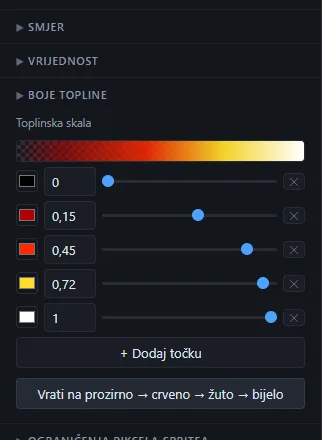

# Boja i ekspozicija

Ove kontrole određuju koliko topline dobiva koju boju. **Točka zasićenja** pokazuje koliko topline se računa kao bijelo usijano.

## Brzi popravci {#quick-fixes}

- Sve je bijelo: povećajte **Točku zasićenja** ili pritisnite **Automatska ekspozicija iz polja**.
- Ništa se ne vidi: smanjite **Točku zasićenja** ili pritisnite **Automatska ekspozicija iz polja**.
- Vide se samo pojedinačne točke: povećajte **Minimalnu toplinu**.

Svaka kontrola na ovoj stranici djeluje kad se toplina pretvara u boju. Zato se slika odmah ponovno iscrta kad god povučete bilo koju od njih, i **nikad ne pokreće ponovno akumulaciju**.

## Točka zasićenja {#saturation-point}

**Točka zasićenja** (odjeljak Oblik topline): akumulirana toplina koja odgovara vrhu skale boja (uz odziv *Linearno*; za ostale pogledajte niže). Logaritamski klizač od 0,1 do 4000, a ručica se može povući do 10.000.000, jer akumulirana toplina raste s brojem redaka. Zadano je 24. Pri svakom učitavanju prvo se uzima **analitička procjena**, a zatim se **mjeri** iz slike.

Pogrešna vrijednost razlikuje toplinsku kartu od praznog (ili bijelog) ekrana. Ne može se pouzdano izvesti, jer se telemetrija toliko grupira (pokretanje, vrata, usko grlo) da se omjer vršne i prosječne gustoće između skupova podataka i između kutova kamere razlikuje za red veličine.

## Automatska ekspozicija {#auto-exposure}

**Automatska ekspozicija iz polja** mjeri polje koje je shader stvarno proizveo. Zanemaruje prazne piksele, uzima 98. percentil osvijetljenih piksela i postavlja ga na 85% puta do točke zasićenja. Tako se vrh skale čuva za stvarne vrhove.

Ploča zatim piše *izmjereno X% kadra; 98. percentil R postavljen blizu vrha skale*. Uz odziv *Zasićujući*, vrijednost na 85% točke zasićenja pada na oko 69% skale, a ne na 85%.

Ona se također pokreće **automatski**:

- 8 iscrtanih kadrova nakon učitavanja skupa podataka;
- 8 kadrova nakon promjene [filtara](filters.md) (filtriranje svake pozicije na samo stotinu događaja mijenja gustoću za redove veličine);
- 8 kadrova nakon prebacivanja između točkaste topline i [linijske topline](line-heat.md) ili nakon promjene ruta koje linijska toplina crta, jer linija ostavlja mnogo manje topline po uzorku nego sprite.

Kad ništa nije osvijetljeno, automatsko mjerenje ostavlja zasićenje na miru. Gumb tada prelazi na analitičku procjenu i piše *nema ničeg osvijetljenog za mjerenje – korištena je analitička procjena*.

### Prati prikaz {#follow-the-view}

**Prati prikaz** (odjeljak Oblik topline, zadano uključeno) ponovno mjeri svaki put kad kamera stane. Zato područje u koje uletite koristi cijelu skalu boja, a ne mjerilo izmjereno za cijelu kartu. Male promjene se zanemaruju, a mjerilo klizi umjesto da skoči. Radi u četiri načina topline, ali ne i u prikazu figura preko slike.

Isključite ga da zaključate mjerilo i usporedite mjesta na jednoj skali. Ručno povlačenje **Točke zasićenja** također ga zaključava.

## Odziv gustoće {#density-response}

**Odziv gustoće** pokazuje kako se *k* (toplina / zasićenje) preslikava na skalu:

| Odziv | Formula | Upotreba |
|---|---|---|
| **Zasićujući** (zadano) | t = 1 - e^(-k) | Asimptotski se približava vrhu skale, kao što to rade naslagani prozirni spriteovi. Ništa nikad ne prelazi u ravnu bijelu, pa je to siguran zadani izbor za nepoznate podatke. |
| **Linearno** | t = k | Jedino preslikavanje u kojem jednaka boja znači jednak broj. Koristite ga za usporedbu dvaju skupova podataka ili dvaju vremenskih razdoblja. |
| **Logaritamski** | t = log₂(1 + 7k) / 3 | Sažima dugi rep, pa jedna ekstremna vruća točka više ne spljoštava sve ostalo na dno skale. Podiže rijetka područja. |

## Minimalna toplina {#minimum-heat}

**Minimalna toplina** (zadano isključeno, od 0 do 100%): svaki piksel koji nosi ikakvu toplinu podiže se barem na ovu točku skale. Povećajte je i smanjite radijus spritea da biste vidjeli **gdje se nešto ikad dogodilo**. Pojedinačne podatkovne točke tada postaju jasno vidljive, umjesto da stoje tek malo iznad prozirnog. Ostavite isključeno kad procjenjujete gustoću, jer ona namjerno spljoštava dno skale. Prag (k > 0,0001) održava stvarno prazne piksele praznima.

## Urednik skale {#the-ramp-editor}

U odjeljku **Boje topline**. Oznaka kaže čemu skala služi: *Toplinska skala* u Toplini i Linijama, *Pozitivna (timovi koji dodaju)* u Razlici, *Skala neprozirnosti (boja dolazi od skupine)* u [Toplini timova](team-heat.md), gdje se koristi samo njezin alfa kanal.



Traka na vrhu prikazuje pregled skale. Ispod nje je po jedan redak za svaku točku:

| Dio | Značenje |
|---|---|
| Kvadratić boje | Boja točke (birač boja preglednika). |
| Broj | Položaj točke na skali, od 0 do 1 (0 = nema topline). |
| Klizač | Neprozirnost točke, od 0 do 100%. |
| ✕ | Uklanja točku. Onemogućeno je kad ostanu samo dvije. |

**+ Dodaj točku** dodaje točku na sredini između zadnje dvije točke, s bojom i neprozirnošću zadnje točke. **Vrati na prozirno → crveno → žuto → bijelo** vraća zadano.

Točke se mogu zadati bilo kojim redom. Pri izgradnji skale slažu se po položaju. **Alfa** je ono što miješa toplinu sa scenom, zato je nulti kraj zadane skale potpuno proziran.

### Zadane skale {#the-default-ramps}

| Položaj | Pozitivna (Toplina, Linije, Razlika +) | Negativna (Razlika −) |
|---|---|---|
| 0,00 | crna, alfa 0 | crna, alfa 0 |
| 0,15 | rgb(180, 0, 0), alfa 0,55 | rgb(0, 170, 60), alfa 0,55 |
| 0,45 | rgb(255, 40, 0), alfa 0,85 | rgb(0, 190, 200), alfa 0,85 |
| 0,72 | rgb(255, 220, 40), alfa 0,95 | rgb(40, 80, 255), alfa 0,95 |
| 1,00 | bijela, alfa 1 | rgb(170, 60, 255), alfa 1 |

## Dok se kamera kreće {#while-the-camera-moves}

Kad se kamera kreće, akumulacija se ponovno pokreće svaki kadar. Kad je uključeno **Crtaj svaki redak u svakom kadru** (zadano), svaki pokretni kadar je i dalje točan. Kad je isključeno, pokretni kadar prikazuje jednu uzorkovanu procjenu: svjetlije, grupirane mrlje s težinskim skaliranjem. Pri zaustavljanju ona se približava glađoj, stvarnoj slici. To je očekivano. Pogledajte [Akumulaciju](accumulation.md).

## Za razvojne programere {#for-developers}

### Prolaz kompozicije {#the-composite-pass}

Nakon što je toplina akumulirana, vrijednost svakog piksela pretvara se u boju u jednom prolazu kompozicije ([`COMPOSITE_FS`](https://github.com/Holdi601/3DHeat/blob/main/src/render/webgl2/shaders.ts)). Koraci su:

```
k = |heat| / saturation point
t = response(k)                         clamped to 0..1
if minimum heat > 0 and k > 0.0001:  t = minimum + (1 - minimum) × t
colour, alpha = ramp(t)                  (the negative ramp when heat < 0, Difference only)
pixel = mix(scene, colour, alpha)
```

### Analitička procjena {#the-analytic-estimate}

**Analitička procjena** ([`estimateSaturation`](https://github.com/Holdi601/3DHeat/blob/main/src/data/calibrate.ts)) pretpostavlja da su retci raspoređeni po tlocrtu podataka u smjeru X-Z. Prosječna toplina = broj redaka × (π r² / površina tlocrta) × 1/3 × intenzitet u središtu (1/3 je prosjek diska za linearnu skalu). To se množi pretpostavljenim omjerom vršne i prosječne vrijednosti, 25, i ograničava na raspon od 0,1 do 1.000.000. Mora biti unutar reda veličine, ništa više.

### Mjerenje {#metering}

[`exposure.ts`](https://github.com/Holdi601/3DHeat/blob/main/src/render/exposure.ts):

1. vrijednosti topline čitaju se natrag iz GPU-a i uzorkuju se na najviše 40.000 vrijednosti;
2. prazni pikseli (toplina ≤ 0,0001) odbacuju se. Većina polja topline je prazna, a kad bi se ti pikseli uprosječili, sve bi bilo podeksponirano, kao što bi svjetlomjer usmjeren na crnu pozadinu pogrešno mjerio;
3. referenca je 98. percentil osvijetljenih piksela;
4. točka zasićenja postaje referenca / 0,85. Referenca tako sjedi na 85% puta do točke zasićenja, a vrh skale ostaje sačuvan za stvarne vrhove.

### Tablica boja {#the-colour-table}

Skala se unaprijed izračunava u tablicu 256 × 2 RGBA (pozitivna skala u prvom retku, negativna u drugom) ([`buildColorLut`](https://github.com/Holdi601/3DHeat/blob/main/src/render/colors.ts)). Boje se interpoliraju u linearnom svjetlu i spremaju kao sRGB. Neprozirnost se interpolira linearno.
