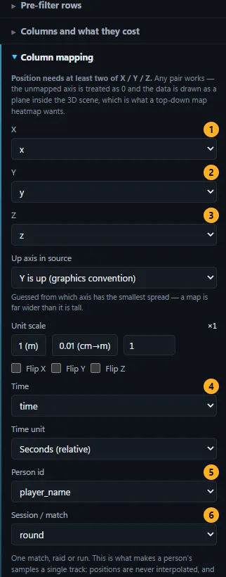

# Mapiranje stupaca

Datoteka je tablica, a 3DHeat mora znati koji stupac sadrži položaj istok-zapad, koji vrijeme, koji ime igrača i tako dalje. Ovaj panel pokazuje što je pretpostavio i gdje ispravljate krivu pretpostavku.

*Datoteka je sama imenovala svoje stupce, pa je svako polje već popunjeno.*

Na primjer, CSV sa zaglavljem `x,y,z,t,player,team` mapira se sam: x, y i z postaju položaj, `t` vrijeme, `player` [osoba](glossary.md), a `team` [grupa](glossary.md).

Nakon odabira datoteka, panel **Mapiranje stupaca** otvara se ispod panela Izvor. Kaže koji stupac igra koju ulogu. Popunjava se automatski, a svako polje se može promijeniti prije pritiska na **Učitaj**. Mapiranje se čita pri učitavanju, pa ga promjena nakon toga zahtijeva ponovno učitavanje.

## Polja {#the-fields}

Svi izbornici stupaca navode svaki stupac prve datoteke, plus *- nijedan -*.

| Polje | Uloga | Napomene |
|---|---|---|
| **Razdjelnik** | Samo CSV: znak koji razdvaja polja. | Izbornik: *Zarez ,*, *Točka-zarez ;*, *Tab*, *Okomita crta \|*, *Razmak*. Ili upišite bilo koji jedan znak u *ili upišite jedan znak*. Otkriva se automatski (vidi dolje). Promjena ponovno pokreće automatsko mapiranje, pa se izmjene napravljene prije gube. |
| **X**, **Y**, **Z** | Položaj. | Potrebne su barem dvije. Nemapirana treća os je 0 (podaci leže u ravnini). Isti stupac na dvije osi je greška. |
| **Os prema gore u izvoru** | Koja izvorna os pokazuje prema gore. | *Z je prema gore (većina game enginea)* ili *Y je prema gore (grafička konvencija)*. Vidi [Osi, jedinice i vrijeme](axes-units-and-time.md). |
| **Mjerilo jedinica** | Množi svaki položaj. | Gumbi *1 (m)* i *0,01 (cm→m)*, ili upišite vrijednost. |
| **Okreni X / Okreni Y / Okreni Z** | Negira izvornu os. | Primjenjuje se na položaje i na vektore smjera pogleda. |
| **Vrijeme** | Vremenska os. | Neobavezno. Bez nje nema vremenske osi. |
| **Jedinica vremena** | Kako čitati stupac vremena. | Sedam jedinica; vidi [Osi, jedinice i vrijeme](axes-units-and-time.md#time). Ignorira se za Parquet stupce `TIMESTAMP`/`DATE`, što panel kaže. |
| **ID osobe** | Kome ili čemu redak pripada. | Neobavezno. Omogućuje putanje, trajanja, box reprodukciju i linijsku toplinu. |
| **Sesija / meč** | Koji meč, racija, runda, vožnja ili krug redak pripada. | Neobavezno. Položaji se nikad ne interpoliraju, ne vuku za sobom i ne spajaju u rutu preko promjene sesije. Vidi [Sesije, osobe i grupe](sessions-persons-groups.md). |
| **Tim / skupina** | Bilo koji stupac s malo vrijednosti. | Neobavezno. Pokreće boje grupa, toplinu timova i podjelu razlike po grupi. |
| **Smjer pogleda** | *Nijedan*, *Stupci zakreta / nagiba* ili *Stupci vektora smjera*. | Sa zakretom/nagibom: **Zakret**, **Nagib** i **Jedinica kuta** (*Stupnjevi* / *Radijani*). S vektorom: **Smjer X**, **Smjer Y**, **Smjer Z**. Koristi se za zrake pogleda [box reprodukcije](box-replay.md). |
| **Zadrži za filtriranje** | Dodatni stupci zadržani u memoriji. | Kućica za svaki stupac, a za svaki označeni *raspon* (brojčani) ili *kategorija*. Svaki košta 4 bajta po retku i jedan prolaz dekodiranja pri učitavanju. Samo zadržani stupci mogu se [filtrirati](filters.md), koristiti za [podjelu razlike](difference.md) ili kao stupac događaja [linijske topline](line-heat.md). |
| **Prikaži primjere redaka** | Tablica prvih 12 uzorkovanih redaka, svi stupci. | Za provjeru pretpostavki. |

Označen stupac filtra koji nije izričito postavljen čita se kao *raspon*. Stupac id-a koji izgleda kao broj često je korisniji kao *kategorija*. Istovremeno može biti aktivna samo 4 filtra ([Filtri](filters.md)).

## Kako automatsko mapiranje pogađa {#how-the-auto-mapping-guesses}

Pogađanje je u [`src/data/automap.ts`](https://github.com/Holdi601/3DHeat/blob/main/src/data/automap.ts). Gleda nazive stupaca, koji stupci su brojčani u uzorkovanim redovima (više od 90 % nepraznih vrijednosti pretvara se u brojeve), koliko različitih vrijednosti svaki stupac ima u uzorku i Parquet logičke vrste. Obrasci imena isprobavaju se redom, bez razlike između velikih i malih slova, a prvi obrazac koji se podudara s bilo kojim još slobodnim stupcem pobjeđuje.

### Položaj {#position}

| Os | Obrasci imena, redom (samo brojčani stupci) |
|---|---|
| X | `x`, `…_x` / `… x`, `pos…x`, `x…pos`, `loc…x`, `lon…`, `longitude` |
| Y | `y`, `…_y`, `pos…y`, `y…pos`, `loc…y`, `lat…`, `latitude` |
| Z | `z`, `…_z`, `pos…z`, `z…pos`, `loc…z`, `…alt…`, `…height…`, `…elev…` |

Ako je os i dalje prazna, prvi slobodni brojčani stupci (zanemarujući `filename`, `level`, `year`, `month`, `day`, `hour`, `location`) je popunjavaju redom. Kriva pretpostavka je na zaslonu očita. Prazna bi ostavila prazan prikaz.

### Vrijeme {#time}

- **Prvo Parquet stupci vremenske oznake.** Među stupcima čija je logička vrsta `TIMESTAMP` ili `DATE`, najbolji se bira po bodovima: +10 000 ako ime odgovara obrascu vremena, -5 000 za običan `DATE`, plus broj različitih vrijednosti u uzorku. Datum cijelog dana i stalni početak sesije uzimaju gotovo nimalo različitih vrijednosti, pa trenutak događaja pobjeđuje. Jedinica je tada *Unix vremenska oznaka (ms)*.
- **Inače po nazivu:** `time`, `timestamp`, `ts`, `…event…time…`, `…time…stamp…`, `t`, `…date…time…`, `when`, `tick`, `…frame…`, zatim nazivi proteklog vremena (`gdur`, `g_duration`, `…duration…`, `…elapsed…`, `…match time…`, `…round time…`, `…game time…`, `…minute from start…`, `…since start…`, `age`). Jedinica se tada pogađa iz vrijednosti: ISO-8601 kad vrijednost izgleda kao `GGGG-MM-DDT…` ili `GGGG-MM-DD …`. Inače po najvećoj veličini: iznad 10^17 nanosekundi, iznad 10^14 mikrosekundi, iznad 10^11 Unix milisekundi, iznad 10^8 Unix sekundi, iznad 10^6 milisekundi, inače sekunde.

Kad se odabere stupac proteklog vremena, panel bilježi da je svaka sesija tada poravnata na vlastiti početak. To je dobro za preklapanje utakmica, ali ne za gledanje u stvarnom slijedu.

### Sesija, osoba, grupa {#session-person-group}

Sesija se preuzima **nakon** vremenske osi i **prije** osobe i grupe, jer je stupac sesije često vremenska oznaka (trenutak početka utakmice na svakom retku utakmice).

| Uloga | Obrasci imena, redom |
|---|---|
| Sesija | `session` / `session_id`, `match…`, `round…`, `raid…`, `game…`, `run…`, `replay…`, `instance…`, `lap…`, `stint…` (svaki točno, opcionalno uz `_id`) |
| Osoba | `name`, `…player…id/name…`, `…user…`, `…account…`, `persona…`, `…character…`, `victim`, `actor`, `…puuid…`, `…steam id…`, `subject…`, zatim `driver` / `driver_id` / `driver_name`, `car` / `car_id` / `car_name` (podaci utrka: automobil je ono što se kreće) |
| Grupa | `spawn_team`, `real_team`, `team` / `team_id` / `team_name`, `squad…`, `side`, `…faction…`, `clan…`, `party…`, `alliance…`, `car_class` |
| Grupa, rezerva | `…victim_ai…`, `…killer_ai…`, `…is_ai/bot/npc…`, `target_type`, `survived`, `outcome`, `result`, `event_env`, `playtest_id` |

Kandidat za grupu koji poprima različitu vrijednost u većini uzorkovanih redaka (više od max(48, 60 % uzorka)) je id, a ne grupa. Postaje stupac osobe ako nijedan nije nađen, a ne koristi se kao grupa. Ako uopće nije nađen stupac grupe, koristi se nebrojčani stupac s najmanje različitih vrijednosti između 2 i 12.

### Smjer pogleda {#look-direction}

Brojčani stupac imena `yaw`, `…rot…yaw…`, `…heading…`, `azimuth…`, `…view…yaw…` ili `rot_z` / `rotation_z` prebacuje smjer pogleda na zakret/nagib. Nagib se traži kao `pitch`, `…rot…pitch…`, `…elevation…angle…`, `…view…pitch…`. Pretpostavljaju se stupnjevi kad neki uzorkovani zakret premašuje 7 po apsolutnoj vrijednosti, inače radijani. Vektor smjera se nikad ne pogađa. Dolazi iz dolje navedenih savjeta ili od vas.

### Stupci filtra {#filter-columns}

Najviše **6** stupaca zadržava se automatski, po rangu:

1. `region`, `sessionMode`, `actor`: stupci koji postoje da bi se po njima filtriralo (rezultat 1200);
2. stupci kategorije koji variraju u uzorku, s manje različitih vrijednosti prvo (1000 minus broj);
3. stupac konstantan u uzorku, ali samo kad se učita više datoteka. Može se razlikovati među datotekama, kao regija ili id testnog pokretanja (600);
4. brojčani stupci (500).

Stupci koji već imaju ulogu, gore navedena imena šuma, stupci konstantni pri učitavanju jedne datoteke i stupci slobodnog teksta (više od max(16, pola uzorka) različitih vrijednosti) ne nude se automatski. Svaki stupac se i dalje može označiti ručno.

### Os prema gore {#up-axis}

Kad su sve tri osi mapirane, os s manjim rasponom Y i Z u uzorku uzima se kao gornja (karta je znatno šira nego visoka). Inače se pretpostavlja Z prema gore.

## Savjeti `heat3d` u Parquet podnožju {#the-heat3d-hints-in-a-parquet-footer}

Parquet datoteka može reći kako treba biti pročitana. Ako metapodaci ključ/vrijednost u njezinu podnožju imaju unos s ključem **`heat3d`**, njegova vrijednost se raščlanjuje kao JSON i stavlja preko pretpostavki ([`applyHints`](https://github.com/Holdi601/3DHeat/blob/main/src/data/automap.ts)). Pretvarač CS2 demo zapisuje takav unos, pa se njegove tablice otvaraju s igračem kao osobom, stranom kao grupom, svakom rundom kao sesijom, uključenim smjerom pogleda i svijetom okrenutim kako treba.

Samo se **prva** datoteka odabira čita zbog savjeta. Svaki unos je neobavezan, a svaka vrijednost iz savjeta i dalje se pojavljuje u panelu i može se promijeniti. Potpuni opis sheme, s primjerom i načinom pisanja, nalazi se u [Referenci formata podataka](data-formats.md#the-heat3d-hints).

Ukratko, pravila:

- Stupac kojeg savjet navodi primjenjuje se samo kad datoteka ima taj stupac.
- `lookMode: "vector"` vrijedi samo kad su `dirX`, `dirY` i `dirZ` svi postavljeni. `"yawPitch"` samo kad je postavljen `yaw`.
- `extra`, kad postoji, zamjenjuje automatski popis filtara (nepoznata imena i stupci koji već imaju ulogu odbacuju se). Tip raspon/kategorija svakog slijedi je li izgledao brojčano. Kad ga nema, automatski popis ostaje bez stupaca kojima je savjet dao ulogu.
- `axes.up` mora biti `"y"` ili `"z"`, zastavice moraju biti logičke vrijednosti, `scale` mora biti pozitivan.
- `entity.size`, kad je pozitivan, je veličina jedne praćene stvari u jedinicama datoteke ([veličina entiteta](sessions-persons-groups.md#entity-size)). To je jedini način da se ona postavi.

## Poznat problem: nadjačavanje razdjelnika CSV-a {#known-issue-overriding-the-csv-separator}

Kad promijenite razdjelnik u drugi od otkrivenog, popis stupaca i uzorkovani redovi se ne mijenjaju (pregled i dalje dijeli prema otkrivenom razdjelniku). Odabrani razdjelnik i dalje se koristi za samo učitavanje. Ako je otkriveni razdjelnik kriv:

1. Otvorite datoteku u uređivaču teksta.
2. Zamijenite razdjelnik zarezom posvuda (a decimalne zareze točkama).
3. Spremite, pa ponovno učitajte datoteku.

Uzrok je u [`previewSource`](https://github.com/Holdi601/3DHeat/blob/main/src/data/sourcePreview.ts).
