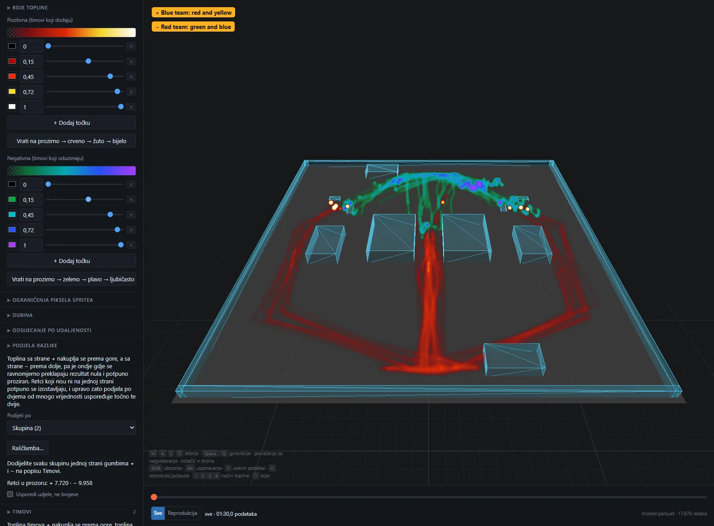

# Razlika

Crveno tamo gdje je tim A bio više, zeleno-plavo tamo gdje je bio tim B, ništa tamo gdje su bili jednaki.

**Razlika** (tipka 2) je toplina s predznakom. Redci jedne populacije zbrajaju toplinu; redci druge je oduzimaju. Tamo gdje se dvije populacije ravnomjerno preklapaju rezultat je nula i potpuno prozirno; tamo gdje jedna prevladava, prikazuje se u bojama te strane - zadano toplo (prozirno → crveno → žuto → bijelo) za stranu **+** i hladno (prozirno → zeleno → plavo → ljubičasto) za stranu **−**.

## Kako se koristi {#how-to-use-it}

1. Pritisnite `2` (ili odaberite **Razlika** na traci načina).
2. Otvorite **Podjela razlike** u bočnoj traci.
3. Odaberite što **Podijeli po**: obično *Grupe*.
4. Stavite jednu grupu (ili vrijednost) na **+**, a drugu na **−**.
5. Pročitajte boje: toplo znači stranu +, hladno znači stranu −. Panel upozorava ako jedna strana nema redaka (vidi [Poruke koje možete vidjeti](#messages-you-may-see)).

*Koje* dvije populacije su cijelo pitanje, pa podjela može biti bilo koji zadržani stupac, ne samo grupe. Redci koji padnu na **nijednu** stranu **izostavljaju se**, ne broje se kao nula: upravo zato podjela preko dviju od mnogih vrijednosti uspoređuje točno te dvije, i slaže se s [filtrima](filters.md) - filtrirajte na jednu kartu, pa to podijelite po verziji.

Način treba dvije strane: stupac grupe s najmanje dvije grupe ili podjelu po stupcu zadržanom za filtriranje. Na podacima s manje od dviju grupa učitavanje započinje podjelom po stupcu - prvo stupac *Izvorna datoteka* kod učitavanja više datoteka, inače prvi kategorijski stupac s dvije vrijednosti, inače prvi brojčani stupac s rasponom - pa *usporedba dva učitavanja* radi i na podacima bez grupa. Način je nedostupan samo kod podataka bez ijedne od ovih mogućnosti; nedostupan je i kad podjela po stupcu ostavi praznu jednu stranu.

## Panel Podjela razlike {#the-difference-split-panel}

Prikazuje se u načinu Razlika, ispod panela topline.

**Podijeli po** nudi:

| Opcija | Prikazuje se kao | Pravilo podjele |
|---|---|---|
| Grupe | *Grupa (N)* (kad postoji stupac grupe) | Svaka grupa na +, − ili nijednoj, postavlja se u [Popisu timova](teams-list.md) |
| Kategorijski stupac | *stupac (N vrijednosti)* | Vrijednosti na +, − ili nijednoj |
| Brojčani stupac | *stupac (brojčano)* | Raspon vrijednosti za svaku stranu |
| Datoteka podrijetla | *Izvorna datoteka - usporedi dva učitavanja* (kad je učitano više datoteka) | Datoteke na +, − ili nijednoj |

Nude se samo stupci zadržani pod *Zadrži za filtriranje* pri učitavanju.

### Usporedi udjele, ne brojeve {#compare-shares-not-counts}

**Usporedi udjele, ne brojeve** (zadano isključeno) pondera svaku stranu s 1/(brojem njezinih redaka), pa strana s pet puta više redaka ne pobjeđuje samo po brojkama. Boja tada pokazuje gdje je svaka strana proporcionalno češća od druge. Koristite to kad dvije strane imaju vrlo različite količine podataka, na primjer dvije sesije različitog trajanja.

### Poruke koje možete vidjeti {#messages-you-may-see}

Panel upozorava kad slika nije prava razlika:

| Poruka | Značenje |
|---|---|
| *N + / M −* (ili *N + / M − / K nekorišteno*) | Koliko je vrijednosti na svakoj strani (i na nijednoj). |
| Nijedan redak u prozoru nije na strani **+** | Crta se samo strana **−**. Pomaknite prozor vremenske trake ili promijenite podjelu. |
| Nijedan redak u prozoru nije na strani **−** | Crta se samo strana **+**. |
| Nijedna vrijednost nije ni na jednoj strani | Razlika ne crta ništa. Stavite barem jednu vrijednost na **+** ili **−**. |
| *stupac* se ne može podijeliti na ovaj način | Odabrani stupac ne odgovara podjeli. Odaberite stupac ponovno. |
| Stupac podjele nije stao u memoriju GPU-a za N od M dijelova | Ti redci se ne crtaju. Povećajte proračun GPU-a pod Performanse → Proračun resursa ili učitajte manje redaka. |

### Po grupi {#by-group}

Panel samo upućuje na [Popis timova](teams-list.md), gdje svaka grupa ima gumb **+** i **−**. Pri svakom učitavanju prva polovica grupa (zaokružena prema gore) stavlja se na +, ostatak na −; **Podijeli ravnomjerno** u Popisu timova to ponovno radi. Grupa na nijednoj strani, ili skrivena svojim potvrdnim okvirom, ne doprinosi ništa.

### Po vrijednostima kategorije {#by-category-values}

| Dio | Značenje |
|---|---|
| `a + / b − / c nekorišteno` | Koliko je vrijednosti na svakoj strani i na nijednoj. |
| **Očisti** | Stavlja svaku vrijednost na nijednu stranu. |
| Popis vrijednosti | Svaka vrijednost s gumbom **+** i **−** (aktivni gumb ponovno kliknite da je uklonite s te strane). Prazna vrijednost navodi se kao *(nedostaje)*. |
| Napomena o ograničenju | Navodi se samo prvih 200 vrijednosti: *Prikazano prvih 200 od N vrijednosti. Stupac ovako širok bolje je prvo suziti filtrom, ili podijeliti po rasponu ako su vrijednosti poredane.* |

Odabir stupca stavlja njegovu prvu vrijednost na + a drugu na −. Kad nijedna strana nema vrijednosti, podjela se vraća na grupe umjesto da prikaže prazan okvir. *Izvorna datoteka* radi isto, jedna vrijednost po datoteci - tako se uspoređuju dva izvoza, dva testna prolaska ili dvije verzije.

### Po rasponu {#by-range}

| Dio | Značenje |
|---|---|
| Savjet | Najmanja i najveća vrijednost stupca. |
| **Pozitivni raspon (+)**, **od** / **do** | Redci s vrijednošću u ovom rasponu zbrajaju se; granice su uključene s obje strane. |
| **Negativni raspon (−)**, **od** / **do** | Redci u ovom rasponu oduzimaju. |
| **Podijeli na sredini** | Postavlja + na [najmanje, sredina] i − na [sredina, najveće] - to se događa i kad odaberete stupac. |

Vrijednost u oba raspona broji se kao +. Rasponi ne moraju pokrivati stupac; vrijednosti u nijednom se izostavljaju. *Prve dvije minute naspram zadnjih dviju* je podjela po rasponu na stupcu sličnom vremenu.

## Boje {#colours}

Odjeljak **Boje topline** u ovom načinu prikazuje dva uređivača skale: **Pozitivna (timovi koji dodaju)** i **Negativna (timovi koji oduzimaju)**, svaki sa svojim gumbom za vraćanje (*Vrati na prozirno → crveno → žuto → bijelo*, *Vrati na prozirno → zeleno → plavo → ljubičasto*). Kompozicija uzima apsolutnu vrijednost neto topline kroz [točku zasićenja i odziv](colour-and-exposure.md), a negativnu skalu bira tamo gdje je neto ispod nule. Vidi [Boja i ekspozicija](colour-and-exposure.md#the-ramp-editor).

Koristite *linearni* odziv gustoće kad je važna veličina razlike: to je jedini odziv u kojem jednaka boja znači jednak broj.

## Kako radi {#how-it-works}

Svaki redak dobiva predznak +1, -1 ili 0 u vertex shaderu ([`POINT_HEAT_VS`](https://github.com/Holdi601/3DHeat/blob/main/src/render/webgl2/shaders.ts)); 0 odbacuje redak prije nego se iscrta ijedan fragment.

- Po grupi, predznak dolazi iz tablice grupa od 4096 unosa indeksirane id-em grupe retka (id grupe nosi se u četvrtom kanalu teksela pozicije retka).
- Po kategoriji, predznak dolazi iz druge tablice od 4096 unosa, popunjene po vrijednosti kategorije, a vrijednost retka čita se iz teksture filtra stupca; vrijednost iza kraja tablice se odbacuje na objema pozadinama.
- Po rasponu, vrijednost retka uspoređuje se s dva raspona.

Promjena podjele ponovno pokreće akumulaciju.

**Skrivene grupe ostaju skrivene uz svaku podjelu.** Pod podjelom po stupcu tablica grupa više ne nosi predznake; drži 1 za prikazanu grupu i 0 za skrivenu ([`frameSignTables`](https://github.com/Holdi601/3DHeat/blob/main/src/render/filterTables.ts)), a obje tablice stižu do shadera zajedno - dva retka jedne teksture predznaka na WebGL2, dvije polovice jednog storage buffera na WebGPU. Redak se crta samo kad je njegova grupa prikazana *i* njegova vrijednost stupca je na nekoj strani. Tako grupa koja je odznačena u [Popisu timova](teams-list.md), ili izostavljena fokusom strane u kartici Meč, ne doprinosi ništa, bez obzira na to kako je razlika podijeljena.
