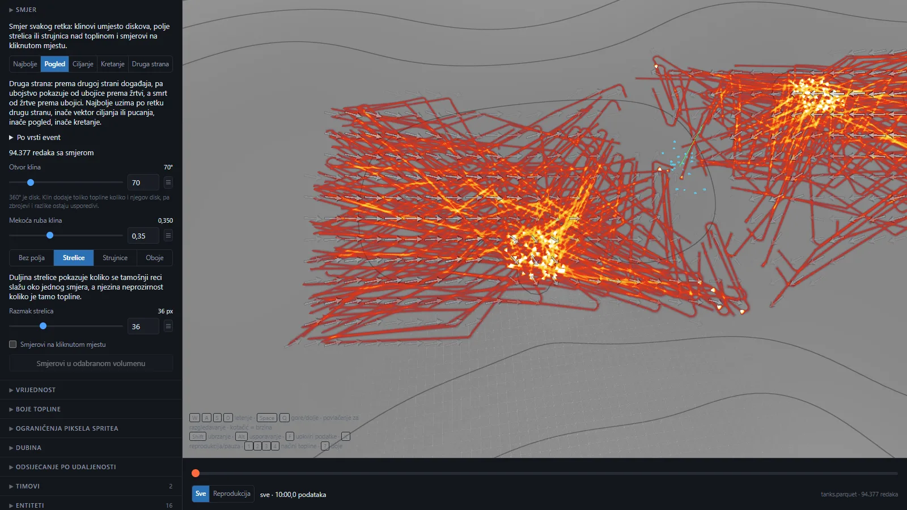

# Usmjerena toplina

Obična toplina kaže **gdje** se stvari događaju. Usmjerena toplina kaže i **u kojem smjeru**: u koji su smjer ljudi gledali, ciljali, kretali se, ili gdje je bila druga strana borbe.

Obični sprite je puni disk (360 stupnjeva). S **Otvorom klina** od 70 stupnjeva isti sprite postaje uski klin koji pokazuje smjer u kojem je redak bio okrenut, i dodaje istu ukupnu toplinu.

## Kako se koristi {#how-to-use-it}

1. Učitajte podatke koji imaju smjer u sebi (pogledajte [Što redku daje smjer](#what-gives-a-row-a-direction)).
2. Odaberite **Toplina**, **Razlika** ili **Toplina timova** u traci načina.
3. Otvorite odjeljak **Smjer** na bočnoj traci.
4. Odaberite **izvor** (koji smjer koristiti), zatim uključite crtanje:
   - smanjite **Otvor klina** ispod 360° da svaki redak nacrtate kao klin koji pokazuje svoj smjer, umjesto diska;
   - odaberite **Polje** da preko topline nacrtate strelice ili strujnice;
   - označite **Smjerovi na kliknutom mjestu** i kliknite na toplinu da dobijete polarni grafikon tog mjesta.

Redak stanja kaže koliko redaka ima smjer iz odabranog izvora.

## Postavke {#settings}

| Postavka | Zadano | Što radi |
|---|---|---|
| Izvor: **Najbolji**, **Prikaz**, **Ciljanje**, **Kretanje**, **Druga strana** | Najbolji | Koji smjer dobiva svaki redak. *Najbolji* uzima, po retku, drugu stranu, inače ciljanje, inače prikaz, inače kretanje. |
| **Po vrsti događaja** | kao gore | Drugi izvor za svaku vrstu događaja, na primjer *Druga strana* za ubojstva i *Prikaz* za pozicije. Prikazuje se kad podaci imaju stupac događaja s najviše 40 vrijednosti. |
| **Otvor klina** | 360° | 360° je normalan disk (isključeno). Manje je uži klin. Klin dodaje onoliko topline koliko i njegov disk, pa ukupni zbrojevi i razlike ostaju usporedivi. |
| **Mekoća ruba klina** | 0,35 | 0 je klin oštrih rubova, 1 je meki lepeza. |
| **Polje**: Bez polja, Strelice, Strujnice, Oboje | Bez polja | Strelice: duljina strelice pokazuje koliko se retci tamo slažu oko jednog smjera, a njezina neprozirnost koliko je topline tamo. Strelice se pokazuju samo tamo gdje ima topline. |
| **Razmak strelica** | 28 px | Udaljenost između strelica na zaslonu. |
| **Animiraj strujnice** | uključeno | Strujnice teku dok je uključeno. |
| **Smjerovi na kliknutom mjestu** | isključeno | Kliknite na toplinu da vidite smjerove tamo (dolje). |
| **Smjerovi u odabranom volumenu** | | Isti grafikon za sve unutar odabranog [volumena](volumes.md). |

## Polarni grafikon na mjestu {#the-polar-chart-at-a-spot}

Uz uključeno **Smjerovi na kliknutom mjestu**, kliknite na toplinu. Redci blizu te točke (unutar 1,5 polumjera spritea) skupljaju se u ružu od 24 isječka po 15°:

- **narančaste** latice: odlazni smjerovi (kamo redci pokazuju);
- **plave** latice: dolazni smjerovi (odakle su došli);
- **površina** latice raste s njezinim brojem; strelica pokazuje glavni smjer;
- linije ispod grafikona daju glavni smjer, koliko se redci snažno slažu (R, od 0 do 1), raspršenost u stupnjevima i broj redaka.

0° je gore na grafikonu, što je svjetski −Z (sjever za Tacview snimke). Mjesto je također označeno u 3D prikazu strelicom i prstenom.

## Što redku daje smjer {#what-gives-a-row-a-direction}

| Izvor | Treba u podacima |
|---|---|
| Prikaz | stupac skretanja (preslikan kao smjer pogleda): `yaw`, `heading`, `azimuth`, `view_yaw`, `rot_z` |
| Ciljanje | parovi brojeva poput `aim_x`/`aim_y`, `shot_x`/`shot_y`, `fire_x`/`fire_y`, `hit_dir_x`/`hit_dir_y` (izborni `…_z`) |
| Kretanje | ništa dodatno: korak od prethodnog uzorka iste osobe (najviše 10 s ranije, ista sesija) |
| Druga strana | stupac koji imenuje drugu stranu događaja (`other`, `victim`, `target`, `killer`, `attacker`, `shooter`, `other_player` ...) čije su vrijednosti imena osoba; ubojstvo pokazuje od ubojice prema žrtvi, smrt od žrtve prema ubojici |

## Savjeti {#tips}

- Klinovi trebaju neku veličinu na zaslonu; ispod nekoliko piksela ponovno se crtaju kao diskovi.
- Koristite *Druga strana* na recima ubojstava da vidite **odakle** su borbe dobivene, a *Prikaz* na recima pozicija da vidite **gdje ljudi gledaju**.
- Uz **Razliku**, klinovi dviju strana pokazuju u svoje smjerove, pa se sporne linije vatre ističu.
