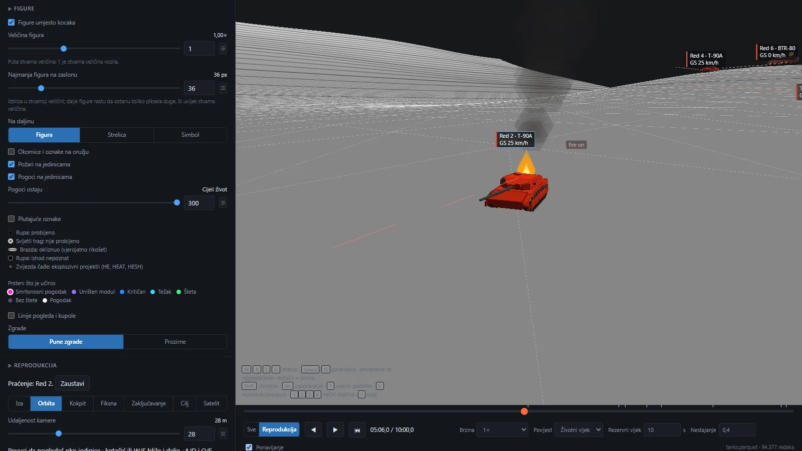

# Figure

**Figura** je mali 3D model onoga što jedinica zapravo jest: tenka, mlaznjaka, broda, vojnika. [Reprodukcija](match-replay.md) crta svaku jedinicu kao njezinu figuru u stvarnoj veličini, umjesto kao običnu kutiju.

Ima oko 2.000 imenovanih vozila, zrakoplova, brodova, oružja i vojnika, a sve ih je izgradio sam preglednik.

## Što je u katalogu {#what-is-in-the-catalogue}

| Domena | Primjeri |
|---|---|
| Ljudi | vojnik koji stoji, čuči, leži ničice; snajperist, protuoklopni, medicinar, posada |
| Kopno | tenkovi, oklopna borbena vozila, protuzračna obrana, topništvo, kamioni i automobili, vlakovi i tramvaji |
| Zrak | lovci, jurišni zrakoplovi, bombarderi, transporti, helikopteri, od dvokrilaca do modernih mlaznjaka |
| More | ratni brodovi po klasi, nosači zrakoplova, podmornice, čamci, trgovački brodovi |
| Oružje | rakete, projektili, bombe, torpeda, mamci (flare) i kutići za ometanje (chaff) |
| Oznake | dimne, bljeskalice i zapaljive granate, postavljene bombe, zastave, mjesta pojave, točke puta |

## Kako se figure prave {#how-the-figures-are-made}

- **Građene iz objavljenih dimenzija.** Većinu figura pravi vlastiti graditelj figura preglednika iz javnih brojeva: duljina, širina, visina, kotači na cesti, kupola i top, krila i rep. Njihov oblik se zatim podešava prema javnim fotografijama, crtežima i objavljenim dimenzijama. Nisu korišteni modeli nijedne igre.
- **Besplatni modeli.** Nekoliko figura koristi besplatne 3D modele (CC0 ili CC BY) tamo gdje su vjerniji, ponekad spojene s izgrađenim trupom. Autori djela CC BY navedeni su na [Zasluge za figure](figure-credits.md); djela CC0 ne traže navođenje i nisu tamo popisana.
- Svaka figura ima punu, grubu i daleku verziju (razine detalja, LOD), pa se tisuće mogu nacrtati odjednom.

## Koju figuru jedinica dobija {#which-figure-a-unit-gets}

Preglednik gleda vlastite stupce podataka:

1. **Nazivi** - stupci nazvani *Name*, *Vehicle*, *Unit*, *Unit type*, *Model*, *Aircraft*, *Plane*, *Tank*, *Ship*, *Craft*, *Loadout*, *Kit* ili *Figure* - uspoređuju se s katalogom: točno, kroz oko 4.000 aliasa (id-ovi jedinica iz više igara), po najdužem poznatom početku (`F-16C_50` je F-16C), ili po najkraćem nazivu figure koji počinje tim nizom.
2. Naziv čija figura ne odgovara **tipu** jedinice se ne koristi (kamion zvan *Typhoon* nije lovac).
3. **Tipovi** - stupci nazvani *Type*, *Class*, *Kind*, *Category*, *Icon*, *Role* ili *Domain* - daju figuru klase: Tacview oznake (`Air+FixedWing`, `Ground+Heavy+Armor+Vehicle+Tank`, `Sea+Watercraft+Warship`, `Weapon+Missile`), oznake na karti ili obične riječi (tank, helicopter, infantry).
4. Podaci bez nijednog od toga su podaci o ljudima: svi su vojnici.

Zato je najlakši način da dobiješ prave figure stupac `vehicle` sa stvarnim nazivima ili stupac `type` s Tacview oznakama.

**Moja jedinica se prikazuje kao kutija ili vojnik.** Dodaj stupac `vehicle` sa stvarnim nazivom ili stupac `type` s Tacview oznakom. Pređi mišem preko jedinice da vidiš koji je naziv pronađen. Podaci koji imaju takve stupce, ali ne govore ništa o jedinici, ostavljaju je kao kutiju; podaci bez ijednog se crtaju kao vojnici.

## Postavke {#settings}

Odjeljak **Figure** u bočnoj traci reprodukcije postavlja veličinu, najmanju veličinu na ekranu, u što se pretvaraju daleke jedinice (figura, strelica, simbol) i učinke koji se crtaju na njima. Vidi [Reprodukcija utakmice](match-replay.md#figures). Dim, vatra i drugi vremenski učinci: [Figure u preklapanju figura](figure-replay.md).

## Izborni lokalni paket figura {#an-optional-local-figure-pack}

Na svojem računalu možeš čuvati izborni paket vlastitih figura. Njegove figure zauzimaju mjesto figura iz kataloga s istim nazivima. Nikad nije dio repozitorija ni objavljene verzije; bez njega se ništa ne mijenja.
