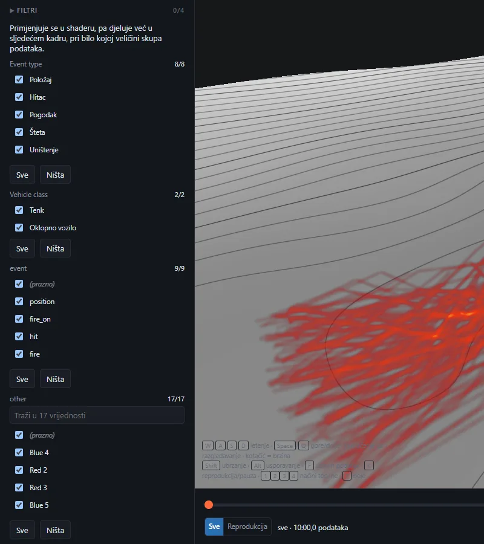
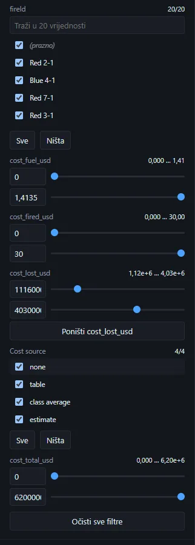

# Filtri

**Filtri** skrivaju redke koji vas ne zanimaju, poput jedne klase vozila ili jedne vrste događaja, a slika se odmah ažurira. Panel navodi stupce zadržane pri učitavanju pod *Zadrži za filtriranje* ([Mapiranje stupaca](column-mapping.md)), plus *Izvorna datoteka* kad je učitano više datoteka.

## Isprobajte {#try-it}

1. Učitajte skup podataka i otvorite **Filtri** u bočnoj traci.
2. Pod **Klasa vozila** odznačite *Tank*. Slika se odmah mijenja.
3. Pritisnite **Očisti sve filtre** za poništavanje.

Prvi redci su vlastiti stupci preglednika (u nastavku). Redci nakon njih dolaze iz vaše datoteke.

## Stupci koje preglednik dodaje {#columns-the-viewer-adds}

Pri učitavanju preglednik sam izrađuje četiri stupca i navodi ih **prvo**, s imenima i vrijednostima na vašem jeziku, pa isti filtar radi za svaku igru i izvor podataka:

| Stupac | Vrijednosti | Izvodi se iz |
|---|---|---|
| **Vrsta događaja** | 23 vrste: Pozicija, Ispaljen hitac, Lansiranje (projektil, raketa, bomba), Pogodak, Promašaj (oružje završilo blizu nijedne mete), Eksplozija, Oštećenje, Ubojstvo, Smrt, Uništeno, Pad, Katapultiranje / iskakanje, Pojava, Nestanak, Polijetanje, Slijetanje, Dodir s tlom, Zaustavljanje na tlu, Ponovno naoružavanje / punjenje, Zauzimanje / cilj, Mamac, Poruka, Ostalo | stupac pod nazivom `event`, `events`, `event_type` ili `event_name`; riječi svake igre (`shot`, `burst`, `fired`, `struck`, `flare`, `plant` ...) preslikavaju se u ove vrste. Potpuna tablica: [Vrste i klase događaja](ref-event-types.md). |
| **Igrač ili UI** | Igrač, UI | stupac `ai`, `is_ai`, `bot` ili `actor`; inače `is_player` / `human`; inače id računa (`user_id`, `steam_id`; prazno ili 0 je UI); za Tacview snimke, ima li objekt pilota |
| **Klasa vozila** | 17 klasa: Lovac, Jurišni zrakoplov, Bombarder, Ostali zrakoplovi, Helikopter, Tenk, Oklopno vozilo, Protuzračna obrana, Topništvo, Kamion / auto, Brod, Podmornica, Pješaštvo, Oružje, Mamac, Građevina, Ostalo | ime vozila ili jedinice (uspoređeno s [katalogom figura](figures.md)) i stupci tipa |
| **Klasa cilja** | iste klase | vozilo druge strane (`other_vehicle`, `target_vehicle`, `victim_type` ...) |

Navode se samo vrste koje se pojavljuju. Stupci vrijednosti (`cost_*`, `earn_*`, `net_*` i *Izvor cijene*, vidi [Ponderiranje vrijednosti](value-weighting.md)) filtriraju se kao i svaki brojčani stupac: na primjer, odznačite *estimate* pod *Izvor cijene* da zadržite samo redke s cijenom.

Popis kategorija s više od 12 vrijednosti dobiva polje za pretragu (*Pretraži n vrijednosti*) i gumb **Samo ovi** koji dopušta točno one vrijednosti koje odgovaraju.

Koji se stupci mogu filtrirati odlučuje se pri učitavanju, jer se tada moraju čitati. Bez i jednog zadržanog stupca panel to kaže i upućuje na *Zadrži za filtriranje*.

## Brojčani stupci (raspon) {#numeric-columns-range}

| Dio | Značenje |
|---|---|
| Ime, i `min ... max` | Stupac i trenutni raspon (puni raspon stupca dok nije postavljen filtar). |
| Prvi redak: polje za broj i klizač | Donja granica. Povlačenje klizača iznad gornje granice gura i gornju granicu s njim. |
| Drugi redak: polje za broj i klizač | Gornja granica. Povlačenje ispod donje granice gura i nju. |
| **Vrati *stupac*** | Uklanja ovaj filtar. |

Klizači pokrivaju najmanju do najveću vrijednost stupca u 1000 koraka; polja za broj prihvaćaju bilo koju vrijednost. Redak prolazi kad mu je vrijednost unutar raspona, uključujući oba kraja. Velike vrijednosti prikazuju se u eksponencijalnom obliku (`1.23e6`).

## Stupci kategorija {#category-columns}

| Dio | Značenje |
|---|---|
| Ime, i `dopušteno/ukupno` | Stupac i koliko je njegovih vrijednosti dopušteno. |
| Popis vrijednosti | Potvrdni okvir po vrijednosti; prazna vrijednost prikazuje se kao *(prazno)*. |
| **Sve** / **Ništa** | Dopusti svaku vrijednost / nijednu vrijednost. |

Dopuštanje svake vrijednosti uklanja filtar.

## Pravila {#rules}

- **Četiri filtra istovremeno.** Zaglavlje prikazuje `aktivni/4`. Peti filtar se ne primjenjuje, a panel to kaže. Odabir u [Entitetima](entities.md) (ili fokus igrača na kartici Meč) koristi jedan od četiri. Filtar koji pokriva cijeli stupac ne koristi nijedan.
- **Stupac kategorije ima najviše 4096 vrijednosti**; širi se ne zadržava pri učitavanju.
- **Filtri se kombiniraju s I**, i s vidljivošću timova, podjelom razlike, vremenskim prozorom, odbacivanjem po udaljenosti i [presjekom](slice.md).
- **Promjena filtra ponovno pokreće akumulaciju i ponovno mjeri ekspoziciju** nekoliko okvira kasnije, jer filtriranje može jako promijeniti gustoću ([Boja i ekspozicija](colour-and-exposure.md#auto-exposure)).
- **Očisti sve filtre** uklanja svaki filtar stupca. Vidljivost timova i odabiri igrača postavljeni drugdje ostaju.
- Filtri stupaca mijenjaju načine topline. Ne mijenjaju figure [reprodukcije figura](box-replay.md), koje prate vidljivost timova i odabir u Entitetima. Odabir u Entitetima mijenja oboje.
- U [linijskoj toplini](line-heat.md) filtar se provjerava na retku u kojem svaki segment *završava*.
- Pri svakom novom skupu podataka svi filtri se brišu.

## Za programere {#for-developers}

**Utori (slots).** Svaki aktivni filtar zauzima jedan od četiri GPU utora ([`MAX_FILTER_SLOTS`](https://github.com/Holdi601/3DHeat/blob/main/src/render/types.ts)), teksturu od 4 bajta po retku. Utori idu filtrima redom kojim su zadnji put mijenjani ([`filterSlots`](https://github.com/Holdi601/3DHeat/blob/main/src/render/filterTables.ts), dijele ga shader i oba panela). Iza četiri pojavljuje se poruka *Primijenjena su samo prva 4 filtra. Uklonite jedan – ostali se ignoriraju, a ne tiho kombiniraju*, a dodatni filtri nose naziv *stupac (nije primijenjeno)*. Filtri se izvode po retku u vertex shaderu, pa promjena praga ne traži ponovno parsiranje ni ponovno slanje.

**Filtri koje panel ne prikazuje.** U stanju aplikacije postoje još dvije vrste ([`FilterSpec`](https://github.com/Holdi601/3DHeat/blob/main/src/state/types.ts)):

- filter **grupa**, koji postavlja kartica Meč kad fokusira jednu stranu. Skriva ostale grupe u svakom načinu, uključujući podjelu [razlike](difference.md) po stupcu.
- filter **osoba**, koji postavljaju panel [Entiteti](entities.md) i kartica Meč kad fokusira jednog igrača. Ograničava reprodukciju figura i načine topline. U toplini je to filter kategorije nad id-evima osoba i zauzima jedan od četiri utora. Maska sadrži 65.536 id-eva ([`FILTER_MASK_CAPACITY`](https://github.com/Holdi601/3DHeat/blob/main/src/render/types.ts)); osoba iza te granice dok je filter aktivan ne crta se u toplini, čak ni kad je odabrana. Reprodukcija figura je i dalje prikazuje.
