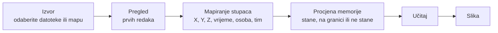

# Unos podataka

Prije nego što 3DHeat išta može nacrtati, treba mu tablica: svaki redak kaže gdje je nešto bilo i, ako to imate, kada i tko. Ovaj odjeljak pokazuje kako datoteka postaje slika. Još nemate podatke? Isprobajte [demo podatke](demo-data.md).

**Učinite ovo odmah:**

1. U bočnoj traci Toplinske karte otvorite **Izvor** i pritisnite **Datoteke…** (ili spustite datoteku ili mapu na zonu za ispuštanje).
2. Pogledajte **Mapiranje stupaca**: okviri su obično već popunjeni.
3. Provjerite da **Procjena memorije** kaže *stane*.
4. Pritisnite **Učitaj**.

Sve što kartica Toplinska karta prikazuje dolazi iz jednog **skupa podataka**: tablice redaka, od kojih svaki ima položaj i, po želji, vrijeme, osobu, grupu, sesiju, smjer pogleda i bilo koji broj dodatnih stupaca zadržanih za filtriranje. Ovaj odjeljak objašnjava kako nastaje skup podataka.

## Put od datoteka do slike {#the-path-from-files-to-picture}

1. **Odaberite datoteke** u panelu **Izvor** - jednu, nekoliko, stablo mape ili ispuštanjem. Prihvaćaju se Parquet, CSV, Tacview, GPS tragovi i više; jedini potpuni popis je u [Formati podataka](data-formats.md#files). Vidi [Učitavanje datoteka](loading-files.md).
2. **Pregled.** Otvara se prva datoteka odabira: njezina imena stupaca, njezinih prvih 50 redaka, koji stupci izgledaju brojčano i (Parquet) logički tip svakog stupca te vlastite upute datoteke za čitanje, unos `heat3d` u podnožju.
3. **Automatsko mapiranje.** Stupci se dodjeljuju ulogama - X, Y, Z, vrijeme, osoba, sesija, grupa, smjer pogleda - i nekoliko ih se zadržava za filtriranje. Svako pogađanje prikazano je u panelu **Mapiranje stupaca** i može se promijeniti. Vidi [Mapiranje stupaca](column-mapping.md) i [Osi, jedinice i vrijeme](axes-units-and-time.md).
4. **Brojanje.** Broj redaka svake datoteke se očitava (točno iz Parquet podnožja, procjenom za CSV), pa panel prije svakog učitavanja može reći koliko memorije učitavanje treba i stane li. Ako ne stane, predlaže učitavanje svakog *N*-tog retka. Vidi [Memorija i proračuni](memory-and-budgets.md).
5. **Učitaj.** Pozadinski radnik parsira samo mapirane stupce svake datoteke - nekoliko datoteka istovremeno, do proračuna [niti parsera](memory-and-budgets.md#parser-threads) - i spaja ih, redoslijedom odabira, u jedan skup podataka: jedan zajednički rječnik osoba, grupa i sesija kroz sve datoteke, jedno zajedničko vremensko ishodište, svi redci sortirani po vremenu. Vidi [Sesije, osobe i grupe](sessions-persons-groups.md).
6. **Prijenos.** Glavna nit najavljuje „Prijenos N redaka na GPU” za jedan okvir, zatim pakira redke u memoriju GPU-a unutar GPU proračuna. Vidi [Boravak u memoriji GPU-a](gpu-memory.md).
7. **Prva slika.** Kamera uokviruje podatke, polumjer spritea i zasićenje postavljaju se prema opsegu podataka i broju redaka, a nakon 8 iscrtanih okvira zasićenje se mjeri iz same slike ([Boja i ekspozicija](colour-and-exposure.md)).

## Zahtjevi koji se provjeravaju prije učitavanja {#requirements-checked-before-a-load}

| Potreba | Što se događa bez nje |
|---|---|
| **Najmanje dvije od X / Y / Z** | Učitavanje se odbija. Uz točno dvije, treća os je 0 i podaci se crtaju kao ravna ploha u 3D sceni - što želi toplinska karta odozgo. |
| Stupac vremena | Neobavezan. Bez njega je vremenska traka onemogućena, prikaz ostaje u načinu **Sve**, a bočna traka to kaže. |
| Stupac osobe | Neobavezan. Potreban za [prekrivanje figura](box-replay.md) (figura za svaku osobu), [linijsku toplinu](line-heat.md) (put koji je svaka osoba prošla), interpolaciju, tragove i povijest **Životni vijek**. |
| Stupac grupe | Neobavezan. Potreban za [toplinu timova](team-heat.md) i za način [razlike](difference.md) (najmanje dvije grupe). |

Način koji učitani podaci ne mogu podržati zasivljen je na traci načina; zadržavanje pokazivača na njemu kaže zašto.

## Bez vlastitih podataka {#without-your-own-data}

Panel **Skup podataka** (ispod **Izvor**) ima [sintetički generator](synthetic-generator.md) koji stvara skup podataka oblika battle-royalea bilo koje veličine, koristan za isprobavanje preglednika i za testiranje što stroj može podnijeti.

## Stranice u ovom odjeljku {#pages-in-this-section}

- [Učitavanje datoteka](loading-files.md) - birači, mape, povuci i ispusti, spajanje više datoteka, pravilo datoteka pokreta, napredak i otkazivanje
- [Mapiranje stupaca](column-mapping.md) - svako polje panela mapiranja, kako automatsko mapiranje pogađa, `heat3d` savjeti
- [Osi, jedinice i vrijeme](axes-units-and-time.md) - gornja os, okretanja, mjerilo jedinica, vremenske jedinice, smjer pogleda
- [Sesije, osobe i grupe](sessions-persons-groups.md) - što svaka radi, ograničenja, zajednička imena, veličina entiteta, panel Skup podataka
- [Sintetički generator](synthetic-generator.md)
- [Memorija i proračuni](memory-and-budgets.md) - model otiska, provjera stanja, prorjeđivanje, granica sortiranja, proračuni resursa
