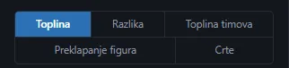

# Načini topline

Svaka točka dodaje malo sjaja, sjajevi se gomilaju, a nakupina se boji. Načina je pet, to su pet načina bojanja, i svaki odgovara na jedno pitanje.

Traka načina na vrhu bočne trake kartice Toplinska karta određuje kako se [skup podataka](glossary.md) crta. Tipke 1-4 biraju Toplina, Razlika, Toplina timova i Crte. Preklapanje figura nema tipku.

| Način | Pitanje na koje odgovara |
|---|---|
| **Toplina** | Gdje se dogodilo i koliko? |
| **Razlika** | Koja je strana to činila više? |
| **Toplina timova** | Čija je bila? |
| **Crte** | Kojim putem su ljudi išli? |
| **Preklapanje figura** | Tko je bio gdje i kada? |

| Način (oznaka na traci) | Tipka | Što crta | Treba |
|---|---|---|---|
| **Toplina** | 1 | Aditivna gustoća: svaki vidljivi redak dodaje radijalni sprite okrenut prema kameri. [Toplina](heat.md) | skup podataka |
| **Razlika** | 2 | Gustoća s predznakom: jedna populacija zbraja, druga oduzima. [Razlika](difference.md) | dvije strane: najmanje dvije grupe ili podjela po zadržanom stupcu |
| **Toplina timova** | 3 | Gustoća obojena po grupi: nijansa po grupi, miješa se tamo gdje se grupe preklapaju. [Toplina timova](team-heat.md) | stupac grupe |
| **Preklapanje figura** | - | Figura (ili kutija) po osobi, koja se kreće duž vremenske trake: reprodukcija. [Preklapanje figura](box-replay.md), [Reprodukcija utakmice](match-replay.md) | stupac osobe |
| **Crte** | 4 | Linijska toplina: linija od svakog uzorka osobe do njezinog sljedećeg, toplina slabi u stranu. [Linijska toplina](line-heat.md) | stupac osobe i stupac vremena |

Način koji podaci ne mogu podržati zasivljen je, a njegov opis alata kaže razlog, na primjer *Nedostupno - način Razlika treba dvije grupe ili zadržani stupac za podjelu; ovi podaci imaju jednu grupu.* Kad novi skup podataka ne može podržati trenutni način, prikaz se vraća na **Toplinu**.

Tipke 1-4 se provjeravaju prema podacima na isti način: tipka za zasivljen način ne čini ništa.

## Koje panele svaki način prikazuje {#which-panels-each-mode-shows}

| Panel | Toplina | Razlika | Toplina timova | Preklapanje figura | Crte |
|---|---|---|---|---|---|
| Rute ([linijska toplina](line-heat.md)) | | | | | da |
| Oblik topline (s **Prati prikaz** i **Ista gustoća pri svakom zumiranju**), Boje topline, Ograničenja piksela sprite-a, Dubina, Odbacivanje po udaljenosti | da | da | da | | da |
| Smjer ([usmjerena toplina](directional-heat.md)), Vrijednost ([ponderiranje vrijednosti](value-weighting.md)) | da | da | da | | da |
| Prikaz timova ([prekrivanje figura](box-replay.md)) | | | | da | |
| Podjela razlike ([razlika](difference.md)) | | da | | | |
| [Timovi](teams-list.md), [Entiteti](entities.md), [Filtri](filters.md), Pozadina / razina, [Presjek](slice.md), [Mjerenje](measure.md), Putanja kamere i prikaz, Performanse, Kamera i scena | da | da | da | da | da |

## Što dijele svi načini topline {#what-every-heat-mode-shares}

Svi četiri načina topline (sve osim preklapanja figura) isti su stroj s različitim ulazima ([`engine.ts`](https://github.com/Holdi601/3DHeat/blob/main/src/render/engine.ts)):

1. **Koji redci.** Prozor [vremenske trake](timeline.md) bira neprekinuti raspon redaka sortiranih po vremenu; [filtri](filters.md), vidljivost grupa, podjela razlike, [odbacivanje po udaljenosti](depth-and-culling.md#distance-culling) i [presjek](slice.md) odlučuju po retku, u vertex shaderu, hoće li i koliko jako svaki doprinijeti.
2. **Splatting.** Svaki redak koji doprinosi crta se kao sprite (ili, u načinu Crte, kao segment) u **toplinski cilj** s pomičnim zarezom, dodajući svoju vrijednost skale. Stratificirani uzorak redaka crta se kad ih je više nego što jedan okvir može priuštiti, s ponderom koji to nadoknađuje. Vidi [Uzorkovanje i proračuni](sampling-and-budgets.md).
3. **Akumulacija.** Dok se ništa ne mijenja, okviri se spajaju dok svaki redak ne doprinese točno jednom. Vidi [Akumulacija](accumulation.md).
4. **Kompozicija.** Akumulirana vrijednost u svakom pikselu dijeli se s **točkom zasićenja**, oblikuje **odzivom gustoće**, podiže za **minimalnu toplinu** i traži se u **skali boja**, čija alfa vrijednost miješa to preko scene. Vidi [Boja i ekspozicija](colour-and-exposure.md).

Sve u koraku 4 primjenjuje se u trenutku kompozicije, pa povlačenje tih kontrola nikad ne pokreće akumulaciju ponovno; sve u koracima 1-2 to radi.

## Stranice u ovom odjeljku {#pages-in-this-section}

- [Toplina](heat.md) - obični način topline i pregled njegovih panela
  - [Oblik sprite-a](sprite-shape.md) - polumjer, intenzitet, opadanje, uređivač krivulje, ograničenja piksela, spljoštavanje
  - [Boja i ekspozicija](colour-and-exposure.md) - uređivač skale, točka zasićenja, automatska ekspozicija, minimalna toplina, odziv gustoće
  - [Dubina i odbacivanje](depth-and-culling.md) - zaklanjanje razinom, skrivanje iza terena, odbacivanje po udaljenosti
- [Razlika](difference.md) - podjela razlike
- [Toplina timova](team-heat.md)
- [Linijska toplina](line-heat.md) - rute
- [Preklapanje figura](box-replay.md) - način reprodukcije (datoteka se još zove box replay)
- [Usmjerena toplina](directional-heat.md)
- [Ponderiranje vrijednosti](value-weighting.md)
