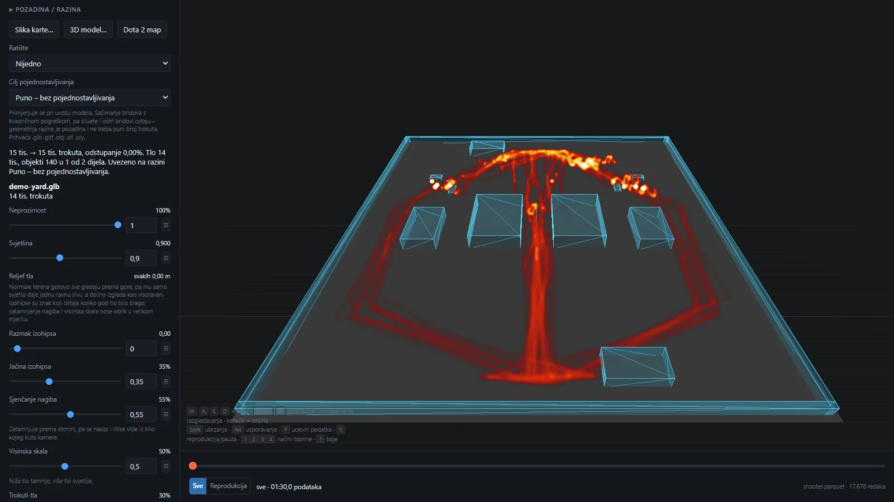
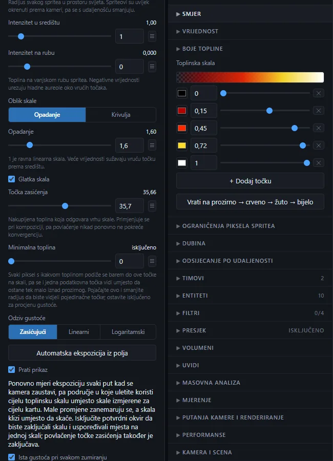

# Toplina

Toplina boji mjesta na kojima se dogodilo mnogo stvari: crveno tamo gdje se dogodilo malo, bijelo usijano tamo gdje se dogodilo puno. Odgovara na pitanje "gdje se ovo događa i koliko često".

**Toplina** (tipka 1) je zadani način. Svaki vidljivi [redak](glossary.md) pridonosi okruglim [spriteom](glossary.md) okrenutim prema kameri; preklapajući spriteovi zbrajaju se u spremniku s pomičnim zarezom; zbroj se preslikava kroz skalu boja - zadano prozirno → crveno → žuto → bijelo - i crta preko scene.

Slika prikazuje toplinu runde pucača na razini sa zgradama: vruće točke su u sobama i na stepenicama, a ne samo na tlu.

## Kako se koristi {#how-to-use-it}

1. Učitajte podatke i pritisnite `1` (ili odaberite **Toplina** u traci načina).
2. Ako je sve bijelo ili prazno, pritisnite **Automatska ekspozicija iz polja** u odjeljku **Oblik topline**.
3. Mijenjajte **Radijus spritea** dok se susjedne točke ne spoje u pojaseve: manji prikazuje pojedinačne mjesta, veći prikazuje područja.
4. Otvorite **Boje topline** da promijenite boje, ili **Dubinu** da brda i zidovi skrivaju toplinu iza sebe.

Iste ploče oblikuju [Razliku](difference.md), [Toplinu timova](team-heat.md) i [Linijsku toplinu](line-heat.md); razlikuju se po tome što se zbraja (predznačeno, obojeno ili duž linija), a ne po tome kako.

## Ploče i njihove zadane vrijednosti {#the-panels-and-their-defaults}

Svaka kontrola objašnjena je na vlastitoj stranici; stupac Pojedinosti vodi do nje. Klizači imaju upisani okvir pored sebe i ručicu za povlačenje (mali hvatač s desne strane: povucite gore ili dolje, dalje je brže, Shift za fino podešavanje); gdje staza klizača završava prije stvarne granice, ručica može gurnuti preko nje do *gornje granice klizanja* navedene ovdje. Vrijednosti označene *pri učitavanju* ponovno se izračunavaju za svaki novi skup podataka.

### Oblik topline (otvoreno) {#heat-shape-open}

| Kontrola | Zadano | Raspon (gornja granica klizanja) | Pojedinosti |
|---|---|---|---|
| **Radijus spritea** | 6 m; pri učitavanju raspon / 120 | 0,05–2000 m, logaritamski (50.000) | [Oblik spritea](sprite-shape.md#sprite-radius) |
| **Intenzitet u središtu** | 1 | 0–10 (1000) | [Oblik spritea](sprite-shape.md#centre-and-edge-intensity) |
| **Intenzitet na rubu** | 0 | -2–10 (1000) | [Oblik spritea](sprite-shape.md#centre-and-edge-intensity) |
| **Oblik skale** | *Opadanje* | *Opadanje* / *Krivulja* | [Oblik spritea](sprite-shape.md#ramp-shape-falloff-or-curve) |
| **Opadanje** (samo Opadanje) | 1,6 | 0,1–8 (64) | [Oblik spritea](sprite-shape.md#falloff) |
| **Glatka skala** (samo Opadanje) | uključeno | | [Oblik spritea](sprite-shape.md#falloff) |
| Urednik krivulje (samo Krivulja) | pretpostavka *Glatko* | | [Oblik spritea](sprite-shape.md#the-curve-editor) |
| **Točka zasićenja** | 24; pri učitavanju procjena, zatim izmjereno | 0,1–4000, logaritamski (10.000.000) | [Boja i ekspozicija](colour-and-exposure.md#saturation-point) |
| **Minimalna toplina** | isključeno (0) | 0–100% | [Boja i ekspozicija](colour-and-exposure.md#minimum-heat) |
| **Odziv gustoće** | *Zasićujući* | *Zasićujući* / *Linearni* / *Logaritamski* | [Boja i ekspozicija](colour-and-exposure.md#density-response) |
| **Automatska ekspozicija iz polja** | | gumb | [Boja i ekspozicija](colour-and-exposure.md#auto-exposure) |
| **Prati prikaz** | uključeno | | Ponovno mjeri ekspoziciju svaki put kad kamera stane, pa područje u koje uletite koristi cijelu skalu boja. Male promjene se zanemaruju, a mjerilo klizi. Isključite ga, ili povucite **Točku zasićenja**, da zaključate mjerilo i usporedite mjesta na jednoj skali. [Boja i ekspozicija](colour-and-exposure.md#follow-the-view) |
| **Ista gustoća pri svakom zumiranju** | uključeno | | Boja znači isti broj redaka po površini tla, koliko god ste blizu. Sprite koji ograničenja piksela povećavaju (daleko) ili smanjuju (izbliza) zadržava toplinu koju bi dodao njegov pravi oblik, pa se slika izložena izdaleka ne blijedi dok u nju letite. Isključeno, ograničeni sprite dodaje punu težinu pri svojoj ograničenoj veličini. [Oblik spritea](sprite-shape.md#pixel-clamps) |
| **Spljošti na ravninu tla** | isključeno | | [Oblik spritea](sprite-shape.md#flatten-onto-ground-plane) |

### Boje topline (zatvoreno) {#heat-colours-closed}

| Kontrola | Zadano | Pojedinosti |
|---|---|---|
| Uzorci grupa i **Razdvajanje boja** (samo Toplina timova) | 1,4 | [Toplina timova](team-heat.md) |
| Urednik **Toplinske skale** (*Pozitivna (timovi koji dodaju)* u Razlici, *Skala neprozirnosti* u Toplini timova) | prozirno → crveno → žuto → bijelo | [Boja i ekspozicija](colour-and-exposure.md#the-ramp-editor) |
| **Vrati na prozirno → crveno → žuto → bijelo** | | |
| Skala **Negativna (timovi koji oduzimaju)** (samo Razlika) | prozirno → zeleno → plavo → ljubičasto | [Razlika](difference.md#colours) |

### Ograničenja piksela spritea (zatvoreno) {#sprite-pixel-clamps-closed}

| Kontrola | Zadano | Raspon (gornja granica klizanja) | Pojedinosti |
|---|---|---|---|
| **Najmanji radijus u pikselima** | 1 px | 0–16 (512) | [Oblik spritea](sprite-shape.md#pixel-clamps) |
| **Najveći radijus u pikselima** | 96 px | 2–1024, logaritamski (8192) | [Oblik spritea](sprite-shape.md#pixel-clamps) |

### Dubina (otvoreno) {#depth-open}

| Kontrola | Zadano | Pojedinosti |
|---|---|---|
| **Sakrij iza terena** | uključeno | [Dubina i odsijecanje](depth-and-culling.md#hide-behind-terrain) |
| **Skriveno iza geometrije** | 0,8 (*80% tamnije*) | [Dubina i odsijecanje](depth-and-culling.md#hidden-behind-geometry) |

### Odsijecanje po udaljenosti (zatvoreno) {#distance-culling-closed}

| Kontrola | Zadano | Raspon (gornja granica klizanja) | Pojedinosti |
|---|---|---|---|
| **Blizu** | isključeno (0) | 0,5–5000 m, logaritamski; donji kraj staze = isključeno (200.000) | [Dubina i odsijecanje](depth-and-culling.md#distance-culling) |
| **Daleko** | isključeno (0) | 1–200.000 m, logaritamski; dno = isključeno (10.000.000) | [Dubina i odsijecanje](depth-and-culling.md#distance-culling) |
| **Reži ravninom** | uključeno | | [Dubina i odsijecanje](depth-and-culling.md#distance-culling) |
| **Reži i razinu** | uključeno | | [Dubina i odsijecanje](depth-and-culling.md#distance-culling) |

Tipke: `[` i `]` guraju daleku granicu unutra i van, `\` je uključuje i isključuje ([Dubina i odsijecanje](depth-and-culling.md#keyboard)).

### Smjer i Vrijednost {#direction-and-value}

Dva odjeljka dodatno su ispod Oblika topline. **Smjer** crta svaki redak kao klin i dodaje strelice: pogledajte [Usmjerena toplina](directional-heat.md). **Vrijednost** važe toplinu po tome koliko je svaki redak koštao ili zaradio: pogledajte [Ponderiranje vrijednosti](value-weighting.md).

## Što se sprema {#what-is-saved}

Gornje postavke topline ne pamte se između sesija: ponovno učitavanje stranice vraća zadane vrijednosti. Dvije stvari se čuvaju u pregledniku: zadnja brzina reprodukcije (`heat3d.speed`, pogledajte [Vremenska crta](timeline.md)) i postavke udaljenih figura [prekrivnog prikaza figura](box-replay.md) (stil simbola, veličina, oznake pogodaka i tako dalje). Tako su i jezik, [obrnute osi svijeta](camera.md#invert-world-axis), zapamćena imena automobila na kartici utrke i [biblioteka razina](level-library.md). Cijeli popis je na [Spremljene postavke](ref-settings-storage.md).
