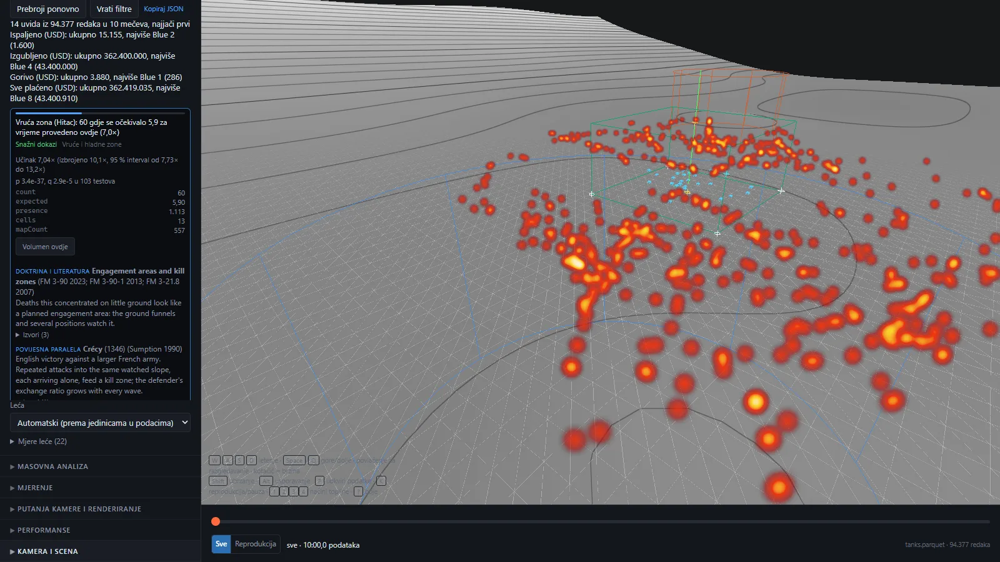
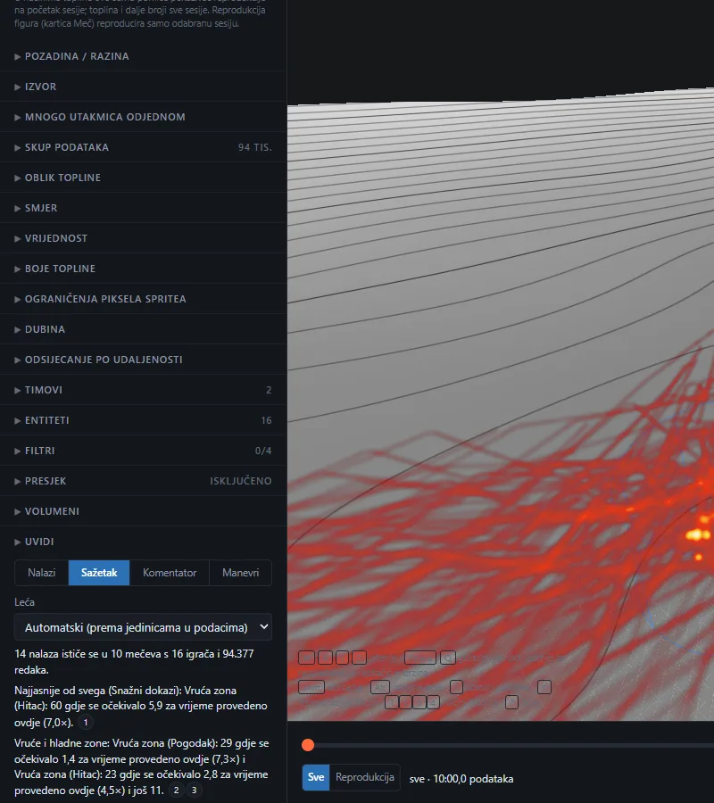

# Uvidi

**Uvidi** pregledavaju učitane podatke tražeći ono što se ističe - jake pozicije, smrtonosno tlo, zamke za spawnanje, uska grla, igrače daleko iznad njihovih vršnjaka - i govore vam, od najjačeg prema najslabijem, uz dokaze. Koristite ih da za minutu saznate gdje je utakmica dobivena ili izgubljena. Zatim mogu napisati sažetak, a u jednoj reprodukciji mogu raditi kao komentator koji skače na velike trenutke.

Sve se broji u vašem pregledniku. Ništa ne napušta vaše računalo osim ako ne uključite vanjski UI (vidi [Vanjski UI](#external-ai)).

Odjeljak **Uvidi** nalazi se u bočnoj traci kartica Toplinska karta i Meč. Ima tri kartice: **Nalazi**, **Sažetak** i **Komentator**.

## Nalazi {#findings}

1. Učitajte podatke i otvorite **Uvide**. Pritisnite **Pronađi uvide** (*Brojanje… n%* pokazuje napredak).
2. Pročitajte popis. Svaki nalaz ima traku snage, rečenicu, koliko su dokazi dobri (*Jaki dokazi*, *Dobri dokazi* ili *Neki dokazi*), koji detektor ga je našao i klasu vozila tamo gdje je to važno.
3. **Kliknite nalaz**: preglednik primjenjuje njegove filtre, leti kamerom do mjesta i skače na vrijeme, i otvara detalje: učinak s njegovim intervalom od 95%, vrijednosti p i q, prebrojane dokaze i **Volumen ovdje**, koji crta [volumen](volumes.md) oko mjesta.
4. **Vrati filtre** vraća vaše filtre. **Kopiraj JSON** kopira cijeli izvještaj.

Brojanje koristi trenutne filtre, skrivene grupe i odabranu utakmicu kroz cijeli vremenski raspon. Kad poslije promijenite filtre, bilješka to kaže; pritisnite **Prebroji ponovno**.

Retci na vrhu popisa (na primjer ukupni iznosi novca) sažimaju cijele podatke prije nalaza.

### Detektori {#the-detectors}

| Detektor | Što nalazi | Treba u podacima |
|---|---|---|
| **Jake pozicije** | Mjesta s mnogo boljim omjerom ubojstava i smrti od ostatka karte, i *sigurno tlo* gdje malo tko pogine za provedeno vrijeme | događaji ubojstva i smrti |
| **Vruće i hladne zone** | Mjesta gdje se vrsta događaja (hici, pogoci, zauzimanja ...) događa znatno češće ili rjeđe nego što vrijeme provedeno tamo predviđa | stupac događaja |
| **Otvoreni teren i zaklon** | Smrti na otvorenom uz blisku geometriju razine, i sporo naspram brzog kretanja | smrti; 3D razina za dio geometrije |
| **Spawnovi** | Jaki spawnovi, zamke za spawnanje, sigurni spawnovi, vrijeme do prvog kontakta | vrijeme i osobe |
| **Klasa po mjestu** | Klasa vozila, ili igrači naspram UI-ja, koji rade znatno bolje ili lošije u nekom području | ubojstva plus stupac klase vozila ili igrač/UI |
| **Igrači** | Igrači koji ubijaju ili ginu znatno više ili manje od drugih u istoj klasi | osobe i ubojstva |
| **Uska grla i bokovi** | Uska grla (znatno više prijelaza od okolnog tla) i bočne rute (rijetko korištene, ali vode do ubojstava) | osobe |
| **Vrijednost** | *Skupo tlo* i *Tlo koje donosi* | [stupci vrijednosti](value-weighting.md) |
| **Što je odlučilo runde** | Što je razdvajalo dobivene od izgubljenih rundi i igrači koji su dodali ili stajali najviše vjerojatnosti pobjede (vidi [Tko je pobijedio](#who-won-what-decided-the-rounds)) | runde, ubojstva i smrti te [stupci ishoda](data-formats.md#outcome-columns) (`won`) |

Detektori koje podaci ne mogu pokrenuti navedeni su na dnu s razlogom.

### Kako se nalazi rangiraju {#how-findings-are-ranked}

Svako mjesto ili grupa testira se naspram ostatka karte (točni binomni testovi ili testovi stope). Stopa lažnih otkrića drži se na 5% (Benjamini-Hochberg). Slučajnost može izgledati kao uzorak; ovo drži lažne uzbune niskima: među prikazanim nalazima očekuje se najviše otprilike jedan od dvadeset koji je slučajan. Učinci iz malo događaja vuku se prema „nema učinka” prije rangiranja. Najviše 60 nalaza navodi se, i svaki detektor dobiva nekoliko mjesta blizu vrha.

### Tko je pobijedio: što je odlučilo runde {#who-won-what-decided-the-rounds}

Gdje podaci kažu tko je dobio svaku rundu ([stupac ishoda](data-formats.md#outcome-columns) `won`: CS2, Rainbow Six Siege, War Thunder ...), Uvidi se vrte oko rezultata. Za svaku stranu dijele runde prema onome što se u njima dogodilo i uspoređuju postotke pobjeda:

| Čimbenik | Runde strane s njim | ... i bez njega |
|---|---|---|
| Otvarajući dvoboj | strana je ostvarila prvo ubojstvo | strana je prva poginula |
| Kupnja | njezina kupnja bila je bolja od kupnje druge strane | lošija |
| Razmijenjena prva smrt | njezina prva smrt razmijenjena je unutar 5 s | nije razmijenjena |
| Postavljanje | strana je postavila bombu | bez postavljanja |
| Pomagala | više granata nego u njezinoj uobičajenoj rundi | manje |
| Rani kontakt | prvi dvoboj došao je prije medijana vremena utakmice | kasnije |
| Držano mjesto | igrač je stajao na mjestu 5 s ili dulje | nitko |
| Rano dosegnuto mjesto | igrač je onamo stigao u prvih 25 s (ruta) | nitko |

Svaka usporedba je razlika dvaju postotaka pobjeda s njezinim intervalom od 95% (Newcombe), Fisherovim egzaktnim p i q nad svim isprobanim čimbenicima (Benjamini-Hochberg). Grana s manje od 8 rundi označena je s *malo rundi*. One ispod stope lažnih otkrića od 5% postaju nalazi; najjači se rangiraju iznad nalaza ostalih detektora (nalaz o ishodu teži 1,35 puta više od nalaza s istim učinkom i dokazima).

Izmišljeni primjer iz 40 rundi:

> **T** je dobila 79% od 19 rundi u kojima je držala **Mid**, naspram 24% od 21 bez toga (55 bodova, 95% od 26 do 74) - q 0,004.

Prati i **vjerojatnost pobjede** runde - šansu koju je svaka strana imala u svakom trenutku, prema živim igračima, postavljanju i satu: prilagođenu rundama kad ih je 30 ili više, inače iz fiksnog apriornog modela (i tekst kaže iz kojeg). Iz nje dolaze **prekretnice** (ubojstva i postavljanja koja su najviše pomaknula šansu) i **dodana vjerojatnost pobjede** svakog igrača: ubojstva i postavljanja koja je napravio broje mu se u korist, njegove smrti protiv njega, u vrijednosti rundi kroz utakmicu, u prosjeku po rundi s intervalom, testirano naspram nule. Mjesta dobivaju istu bilancu: koja je strana najviše dobila u dvobojima vođenima ondje.

Podaci trebaju runde, ubojstva i smrti s obje strane te stupac `won`; imenovana mjesta (`place`) za držana mjesta, stupac `buy` za kupnju.

## Sažetak {#debrief}

Kartica **Sažetak** piše nalaze kao kratak tekst: uvod, najjasniji nalaz, jedan za taktiku, jedan za balansiranje, zatim - gdje podaci kažu tko je pobijedio - što je odlučilo runde, ostali grupirani po detektoru i koliko ih se oslanja na slabije dokaze.

Što je odlučilo runde dolazi u četiri odlomka: rezultat i odakle dolaze vjerojatnosti pobjede; najjači čimbenici s brojevima, intervalom i q (kad nijedan ne prođe stopu lažnih otkrića, tekst kaže *za sada ništa nije sigurno* i ipak navodi najjače); tri najveće prekretnice; te igrači koji su dodali i stajali najviše vjerojatnosti pobjede, s mjestima koja su najviše dobila. Izmišljeni primjer:

> T je dobila 23, a CT 17 od 40 rundi s poznatim ishodom (T: 58%, 95% od 42% do 72%). Vjerojatnosti pobjede dolaze iz modela prilagođenog ovim rundama.
>
> Što je razdvajalo dobivene od izgubljenih rundi: T je dobila 79% od 19 rundi u kojima je držala Mid, naspram 24% od 21 bez toga (55 bodova, 95% od 26 do 74) (q 0,004), ...
>
> Prekretnice: runda 17 u 48 s, ubojstvo strane CT na mjestu B promijenilo je njezine izglede s 31% na 58%, i dobila je rundu, ... Svaki odlomak ima numerirane gumbe koji prikazuju njegove nalaze. **Kopiraj tekst** ga kopira.

Ugrađeni pripovjedač radi izvan mreže, na vašem jeziku. Birač **Leća** iznad njega (vidi [Leća znanja](knowledge.md)) određuje koju literaturu odlomci citiraju.

### Vanjski UI {#external-ai}

**Postavke UI-ja** umjesto toga omogućuju da model UI-ja po vašem izboru napiše sažetak:

| Postavka | Značenje |
|---|---|
| **Pružatelj** | Anthropic (Claude), OpenAI (ChatGPT), OpenRouter, Ollama (lokalno), LM Studio (lokalno), llama.cpp poslužitelj (lokalno) ili bilo koja krajnja točka kompatibilna s OpenAI |
| **Osnovni URL**, **Model** | Popunjava pružatelj; **Prikaži modele** pita poslužitelj |
| **API ključ** | Šalje se samo na osnovni URL. Nikad se ne bilježi, nikad se ne sprema u prikaze, izvoze ili `.3dheat` datoteke. Većini lokalnih poslužitelja ne treba. |
| **Zapamti ključ u ovom pregledniku** | Prema zadanom isključeno: ključ se zaboravlja kad se stranica zatvori |
| **Koristi vanjski UI** | Prema zadanom isključeno |
| **Šalji imena igrača** | Prema zadanom isključeno: igrači se šalju kao P1, P2 ... |

Zatim upišite neobavezno pitanje i pritisnite **Napiši uz UI**. Šalju se samo nalazi i njihovi brojevi - nikad retci vaših podataka. Odgovor se pojavljuje u tijeku, a navedeni nalazi postaju gumbi. Gdje podaci kažu tko je pobijedio, model dobiva uputu da počne s onim što je odlučilo runde, s intervalom i q svakog broja, i da kaže kad se čimbenik oslanja na malo rundi ili kad vjerojatnosti pobjede dolaze iz apriornog modela.

## Komentator {#caster}

Za **jednu utakmicu** (odaberite jednu ako je učitano više), **Komentator** pronalazi trenutke vrijedne gledanja: prvu krv, višestruka ubojstva, razmjene, završnice, promjene ciljeva, preokrete, istaknute igrače, dalekometne pucnjeve i **prekretnice** - ubojstva koja su najviše pomaknula šansu strane da dobije rundu (prema igračima koji su ostali živi na svakoj strani, u rundama bez ponovnog oživljavanja).

Gdje podaci kažu tko je dobio svaku rundu, to kaže svaki trenutak: *„Anna obara Bena: šansa strane T da dobije rundu mijenja se s 38% na 62% - i dobivaju rundu.”* Trenutak strane koja je potom pobijedila vrijedi više kad komentator bira koje trenutke zadržava, a preokret se broji u dobivenim rundama.

- Kliknite trenutak: prikaz prelazi na reprodukciju, skače na malo prije njega, leti do tamo i prati igrača.
- **Reproduciraj trenutke** pušta svaki do kraja i prelazi dalje; **Prethodno** / **Sljedeće** se kreću kroz njih.
- Uz uključen vanjski UI, **Komentar UI-ja** piše komentar iz popisa trenutaka (vrste, vremena, imena ili pseudonimi, timovi, klase, udaljenosti).

Treba osobe i događaje ubojstva/smrti (ili zauzimanja); stupac `other`/`victim` omogućuje razmjene i dalekometne pucnjeve.

## Leća znanja {#knowledge-lens}

Nalaz se može čitati kroz **leću** utvrđenog znanja: vojnu doktrinu, zračnu i pomorsku borbu, urbane operacije, dizajn igara i e-sport (ili *Auto*, koji odabiru jedinice u podacima). Otvoren nalaz tada prikazuje najbliži unos **doktrine i literature** i **povijesnu paralelu**, s referencama, a **Mjere leće** računa mjere iz te literature na podacima (Lanchesterova prilagođavanja, omjeri razmjene, omjeri snaga, polja vatre, ključni teren, razmjene, inicijativa). Sažetak i upit za UI ih uključuju. Sve o tome: [Leća znanja](knowledge.md).

Mjere leće također mjere kako se igrači ponašaju kao gomila i kao grupa - poravnanje i kruženje, usmjeravanje ruta, trake i tragovi, gužva, vođe i pratitelji, zaostali, točka sloma pod gubicima, rizik nakon izgubljenog života, nizovi, slaganje kupnje i odgovor na dolaznu vatru - svaka naspram vlastitog nultog modela: [Kolektivno ponašanje](collective-behaviour.md).

## Podaci koji čine uvide korisnima {#data-that-makes-insights-work}

- pozicije s **vremenom**, **osobom** i stupcem **tima**;
- stupac **događaja** s ubojstvima i smrtima (`kill`, `death`), i drugima (`hit`, `fire`, `capture` ...);
- stupac **druge strane** (`other`, `victim`) za razmjene i smjerove;
- stupac **vozila** ili **tipa** za klase; stupac `ai` za igrače naspram UI-ja;
- stupac **sesije** / **utakmice** / **runde** kad ima više utakmica.

[Demo podaci](demo-data.md) imaju sve to.
